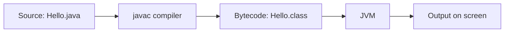

## Hook

Picture the Spoke workshop. The head mechanic writes a repair guide in English for fixing a bike lock. Spoke has stations in many towns, and some mechanics don't read English.

So the guide goes to a translator first. The translator checks it for mistakes, then turns it into a picture manual. Every mechanic at every station can follow pictures. Write the guide once, and any station can use it.

Java works the same way. The ticket's question about the "build" is really a question about that translator.

## Concept

A **program** is a list of instructions for a computer. The computer follows them in order, exactly as written.

```callout jargon
Source code is the text of a program that a person writes. Java source code lives in files that end in `.java`.
```

A computer can't run source code straight away. Its CPU only understands tiny number codes. So Java uses two helpers.

The first helper is the **compiler**. A compiler is a program that checks your source code and translates it. Java's compiler is called `javac`. It reads `Hello.java` and writes a new file called `Hello.class`.

The `.class` file holds **bytecode**. Bytecode is a set of simple instructions that people don't read. It is the picture manual from the hook.

The second helper is the **JVM**, the Java Virtual Machine. The JVM is a program that reads bytecode and runs it on your computer. Windows, Mac and Linux each have their own JVM. They all read the same bytecode. That is why people say Java is "write once, run anywhere".

This whole step from `.java` to `.class` is the **build** that the ticket asks about.

```callout tip
Shortcut: `java Hello.java` compiles in memory and runs in one step. It makes no `.class` file. This course uses `javac`, then `java`, so you can see both helpers at work.
```



### Syntax: compile

```bash
javac Hello.java
```

- `javac` is the compiler.
- You give it the file name, with `.java` at the end.
- If the code is fine, `Hello.class` appears in the same folder.

### Syntax: run

```bash
java Hello
```

- `java` starts the JVM.
- You give it the class name only. Leave off `.class`.
- The JVM loads `Hello.class` and runs it.

Errors can show up at two different times. A **compile error** happens when `javac` finds a mistake, such as a missing semicolon. No `.class` file is made, so nothing runs. A **run-time error** happens later, while the JVM is running your program. The code was valid, but something went wrong during the run.

```callout tip
A compile error is good news. The compiler caught the mistake before any rider saw it on a kiosk.
```

## Worked example

Here is a complete program. Press **Run** to see it work.

```java run
public class Main {
    public static void main(String[] args) {
        System.out.println("Welcome to Spoke!");
        System.out.println("Your bike is unlocked.");
    }
}
```

When you press Run, the app does this for you:

1. It saves your text as `Main.java`. This is the source code.
2. It runs `javac Main.java`. The compiler checks the code and makes `Main.class`.
3. It runs `java Main`. The JVM loads the bytecode.
4. The JVM starts at `main` and runs the two print lines in order.
5. You see two lines of output.

## Try it

Press **Run** on the program in the worked example. Check that both lines appear.

Now change the text inside the quotes. Try `"Ride safe, Riverton!"`, then press **Run** again. The app compiles your new source code, so the output changes.

Next, delete one semicolon and press **Run**. You get a compile error, and nothing prints. Put the semicolon back to fix it.

```callout warning
Changing a `.java` file does nothing until you compile it again. The JVM runs the `.class` file it finds, even if it is older than your `.java` file.
```

## Recap

- A program is a list of instructions. Source code is the text you write in a `.java` file.
- `javac` is the compiler. It checks your code and turns it into bytecode in a `.class` file.
- The JVM runs bytecode, so the same `.class` file works on any computer with a JVM.
- Compile with `javac Hello.java`. Run with `java Hello`.
- Compile errors stop the build. Run-time errors happen while the program runs.

## Common mistakes

**The file name doesn't match the class name.**

You save `public class Hello` in a file called `hello.java`. `javac` says: `class Hello is public, should be declared in a file named Hello.java`. Rename the file to `Hello.java`, with the same capital letters.

**Adding .class to the run command.**

You type `java Hello.class`. Java says: `Could not find or load main class Hello.class`. Give the class name only: `java Hello`.

**Forgetting to compile after an edit.**

You edit `Hello.java` and run `java Hello` again. The old output still appears. The JVM ran the old `Hello.class`. Run `javac Hello.java` first, then `java Hello`.
