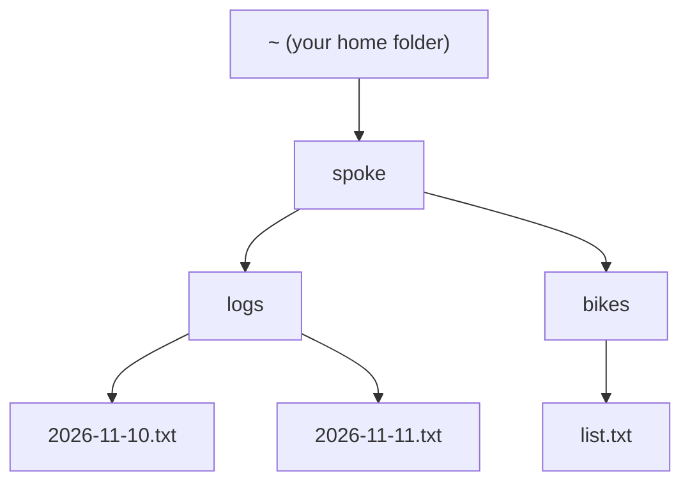

## Hook

Picture your first day riding a Spoke bike around Riverton. You stop at a station. A signpost tells you where you are. Arrows point to the next streets. You read the sign, pick a direction, and pedal.

Theo has a job for you. Yesterday's ride log sits on the test server. That server has no screen full of icons and no mouse. It has only a terminal. So today you learn to read the signposts and ride through folders by typing.

## Concept

A **terminal** is a window where you type instructions as text. On your Mac, the app is called Terminal. You can find it with Spotlight: press Cmd and Space, then type "Terminal".

```callout jargon
A **shell** is the program inside the terminal that reads what you type and runs it. Your Mac uses a shell called **zsh**. A **command** is one instruction you type, such as `ls`.
```

You type a command and press Enter. The shell runs it, and the answer appears below. Then it waits for the next command. Watch one command make the trip:

```animate
title: What happens when you type ls
kind: scene
nodes:
  - { id: you, label: Terminal window, emoji: "⌨️", value: "%" }
  - { id: shell, label: Shell (zsh), emoji: "🐚", value: waiting }
  - { id: prog, label: The ls program, emoji: "🔧" }
  - { id: folder, label: Current folder, emoji: "📁", value: "~/spoke" }
steps:
  - say: You type ls and press Enter. The terminal hands your text to the shell.
    focus: [you]
    set: { you: "% ls" }
    send: { from: you, to: shell, label: ls }
  - say: The shell reads the word ls. It finds the program called ls on your Mac and starts it.
    set: { shell: running ls }
    send: { from: shell, to: prog, label: start }
  - say: You gave ls no folder name, so it looks inside the current folder, the one you stand in.
    send: { from: prog, to: folder, label: "what's inside?" }
  - say: The folder answers with the names it holds.
    send: { from: folder, to: prog, label: "bikes  logs", back: true }
  - say: ls writes the names straight into the terminal window, below your command. Then ls ends.
    send: { from: prog, to: you, label: "bikes  logs", back: true }
    set: { you: "bikes  logs" }
  - say: ls is done, so the shell shows the % prompt again. It is waiting for your next command.
    focus: [you]
    set: { you: "%", shell: waiting }
```

### Folders form a tree

Your files live in **folders**. A folder can hold files and other folders. Together they form a **tree**, with one folder at the top and branches below it.



```callout analogy
The folder tree is a map of Riverton. Each folder is a station. The **current folder** is the station where you stand right now. Every command works from that spot.
```

### Paths: directions to a file

A **path** is the written route to a file or folder. Folder names are joined with a slash `/`.

- An **absolute path** starts at the very top of the tree, with `/`. Example: `/Users/you/spoke/logs`. It works from anywhere.
- A **relative path** starts from your current folder. If you stand in `spoke`, then `logs/2026-11-11.txt` reaches the log.

Three short names save you typing:

- `~` means your home folder, the folder that belongs to your user.
- `.` means the current folder.
- `..` means the folder one level up, the parent.

### Syntax: pwd

```bash
pwd
```

`pwd` stands for "print working directory". It shows the absolute path of your current folder. Directory is another word for folder.

### Syntax: ls

```bash
ls
ls logs
```

`ls` lists what is inside a folder. With no name, it lists the current folder.

### Syntax: cd

```bash
cd logs
cd ..
cd ~
```

`cd` means "change directory". It moves you into another folder. `cd ..` moves you up one level. `cd ~` takes you home.

### Syntax: mkdir

```bash
mkdir logs
mkdir -p spoke/logs
```

`mkdir` makes a new folder. The `-p` option makes every missing folder along the path in one go.

### Syntax: touch

```bash
touch notes.txt
```

`touch` creates an empty file. If the file exists already, it leaves the contents alone.

### Syntax: cat

```bash
cat notes.txt
```

`cat` prints the contents of a file to the screen.

### Syntax: clear

```bash
clear
```

`clear` wipes the terminal window clean. Your files stay exactly as they were.

```callout tip
Type the first few letters of a name, then press Tab. The shell finishes the name for you. This is called **tab completion**, and it stops typos.
```

Spoke's servers run Linux, where names are **case sensitive**. That means capital letters matter: `Logs` and `logs` are two different folders there. Your Mac usually ignores capitals in file names. So a slip can work on your laptop and fail on the server. Type names exactly every time.

## Worked example

Theo copied the server's `spoke` folder to your laptop, so you can practise on your Mac first. Here is his ticket, solved in a terminal. Lines that start with `%` are what you type. The `%` is the **prompt**, the shell's sign that it is ready. You do not type it.

```text
% pwd
/Users/you
% ls
Desktop  Documents  spoke
% cd spoke
% ls
bikes  logs
% cd logs
% ls
2026-11-10.txt  2026-11-11.txt
% cat 2026-11-11.txt
08:02 bike 17 out from Mill Street
08:31 bike 17 in at River Park
% cd ..
% pwd
/Users/you/spoke
```

Watch where you stand as each command runs. The pin moves with every `cd`:

```animate
title: Riding through the folder tree
kind: scene
nodes:
  - { id: home, label: "~ (/Users/you)", emoji: "🏠", value: "📍 you are here", row: 0, col: 1 }
  - { id: spoke, label: spoke, emoji: "📁", row: 1, col: 1 }
  - { id: logs, label: logs, emoji: "📁", row: 2, col: 0 }
  - { id: bikes, label: bikes, emoji: "📁", row: 2, col: 2 }
  - { id: file, label: 2026-11-11.txt, emoji: "📄", row: 3, col: 0 }
  - { id: term, label: Terminal, emoji: "⌨️", value: "% pwd", row: 0, col: 3 }
links:
  - { from: home, to: spoke }
  - { from: spoke, to: logs }
  - { from: spoke, to: bikes }
  - { from: logs, to: file }
steps:
  - say: You start in your home folder. pwd prints its full path, /Users/you.
    focus: [home]
    set: { term: /Users/you }
  - say: ls lists what is inside home. One of the folders is spoke.
    show: [spoke]
    set: { term: "Desktop Documents spoke" }
  - say: cd spoke moves you down into it. From now on, every command works from spoke.
    set: { home: "", spoke: "📍 you are here", term: "% cd spoke" }
  - say: ls shows bikes and logs. cd logs moves you one level deeper.
    show: [logs, bikes]
    set: { spoke: "", logs: "📍 you are here", term: "% cd logs" }
  - say: cat prints yesterday's log. It works because the file sits right here, in the current folder.
    show: [file]
    send: { from: file, to: term, label: "08:02 bike 17 out" }
    set: { term: "08:02 bike 17 out..." }
  - say: cd .. climbs one level up, to the parent folder. pwd confirms you are in /Users/you/spoke.
    set: { logs: "", spoke: "📍 you are here", term: /Users/you/spoke }
```

Your own `ls` list in the home folder will be longer. A Mac also has folders like Downloads, Music and Pictures.

## Try it

Open the Terminal app and type each command, then press Enter.

1. `cd ~` to go to your home folder.
2. `mkdir -p spoke-practice/logs` to make a practice folder with a `logs` folder inside.
3. `cd spoke-practice/logs` to move into it. Try tab completion here.
4. `pwd` to check where you are. The path should end in `spoke-practice/logs`.
5. `touch today.txt` to create an empty file.
6. `echo "bike 5 out" > today.txt` to put one line of text in the file. `echo` prints text. The `>` sends that text into the file and replaces anything already there.
7. `ls` to list the folder. You should see `today.txt`.
8. `cat today.txt` to print it. You should see `bike 5 out`.
9. `clear` to tidy the window.

```callout warning
Practise only inside `~/spoke-practice`. Stay away from folders you did not make, so you never change a file by accident.
```

## Recap

- A terminal is a text window, and the shell (zsh on your Mac) runs the commands you type.
- Folders form a tree, and every command works from your current folder.
- Absolute paths start with `/`. Relative paths start from where you stand.
- `~` is home, `.` is here, and `..` is one level up.
- `pwd`, `ls`, `cd`, `mkdir`, `touch`, `cat` and `clear` cover most daily work.
- Type names with the exact capital letters. Spoke's Linux servers treat `Logs` and `logs` as different folders.

## Common mistakes

**Spaces in a folder name.**

```bash
cd ride logs
```

The shell says: `cd: string not in pwd: ride`. It reads `ride` and `logs` as two separate words. Put quotes around the name: `cd "ride logs"`. Better still, name folders without spaces, like `ride-logs`.

**Wrong capital letters on the server.**

```bash
cd Logs
```

On your Mac this may work, because macOS usually ignores capitals in file names. On Spoke's Linux test server it fails with an error like `No such file or directory`. The folder is called `logs` with a small l. Type the name exactly, or press Tab to fill it in.

**Being in the wrong folder.**

```bash
cat 2026-11-11.txt
```

The shell says: `cat: 2026-11-11.txt: No such file or directory`. The file exists, but not in your current folder. Run `pwd` to see where you are, then `cd` into the `logs` folder first.
