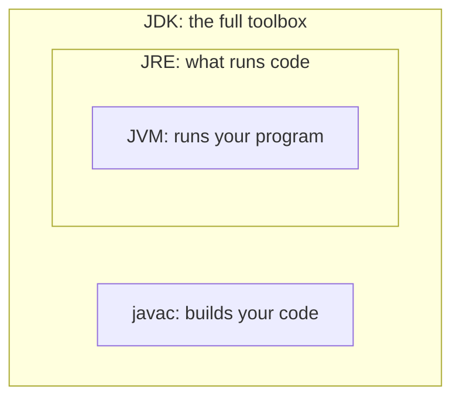

## Hook

Picture the Spoke repair shop. A mechanic can't fix a bike with bare hands. They need a toolbox with wrenches, a pump and a bike stand.

Your laptop is your repair shop. Right now it has no Java tools at all. In this ticket you install two things: the Java toolbox and a comfy workbench to use it on. After that, every later ticket just works.

## Concept

Java comes in a few pieces. Their names sound alike, so take them one at a time.

- **JVM** (Java Virtual Machine): the program that runs Java code on your computer.
- **JRE** (Java Runtime Environment): the JVM plus the extra files it needs to run programs. It can run Java, but it can't build it.
- **JDK** (Java Development Kit): everything in the JRE, plus tools for building programs. The most important tool is `javac`, the Java compiler.

```callout jargon
A compiler is a program that turns the code you write into code the computer can run. For Java, that tool is called javac.
```

```callout analogy
The JDK is the full mechanic's toolbox. javac is the wrench you use to build the bike. The JVM is the bike stand that holds the bike and spins the wheels. You need the whole toolbox, so you install the JDK.
```



### Which version?

Java gets a new version twice a year. Some versions are marked **LTS**, which means long-term support. An LTS version gets fixes and security updates for many years. Java 21 is an LTS version, and it's the one Spoke uses. So you install Java 21.

### Installing the JDK on a Mac

The recommended way is the **Eclipse Temurin 21** installer. Temurin is a free build of the JDK. You get it from **adoptium.net**. It comes as a `.pkg` file, which is a normal Mac installer you double-click.

If you already use Homebrew, you can install it with one command instead. Homebrew is a tool that installs apps from Terminal.

```bash
brew install --cask temurin@21
```

### Syntax: check the JVM version

```bash
java -version
```

This asks the JVM which version it is.

### Syntax: check the compiler version

```bash
javac -version
```

This asks the compiler which version it is. If this works, you have a full JDK.

### What is an IDE?

An **IDE** (Integrated Development Environment) is an editor built for code. It colours your code, spots mistakes as you type, and runs programs with one click.

The recommended IDE is **IntelliJ IDEA**. Download it from jetbrains.com. The free version has everything this course needs, and it's made for Java. Another good choice is **VS Code** with the **Extension Pack for Java** added.

The IDE does not replace the JDK. When you press Run, it calls the JDK tools for you:

```animate
title: You press Run in the IDE
kind: scene
nodes:
  - { id: ide, label: IntelliJ IDEA, emoji: "🪟", value: Hello.java }
  - { id: javac, label: javac (JDK), emoji: "🔧" }
  - { id: cls, label: Hello.class, emoji: "📦", value: bytecode }
  - { id: jvm, label: java (JVM), emoji: "⚙️" }
steps:
  - say: You write Hello.java in the IDE and press the green Run button.
    focus: [ide]
  - say: The IDE hands your file to javac, the compiler from the JDK. javac checks it and builds it.
    send: { from: ide, to: javac, label: Hello.java }
    set: { javac: compiling }
  - say: javac writes Hello.class, full of bytecode.
    show: [cls]
    send: { from: javac, to: cls, label: bytecode }
    set: { javac: done }
  - say: Next the IDE starts java, the JVM, and tells it to run Hello.
    send: { from: ide, to: jvm, label: run Hello }
  - say: The JVM loads Hello.class and runs it.
    send: { from: cls, to: jvm, label: Hello.class }
    set: { jvm: running }
  - say: The output comes back to the IDE's Run panel. Without the JDK installed, the Run button has nothing to call.
    send: { from: jvm, to: ide, label: "Hello, World!", back: true }
    set: { ide: "Hello, World!", jvm: finished }
```

### Opening the practice project

JavaQuest keeps your exercises in the `practice/` folder of this repository. Each exercise lives in `practice/<module>/<topic>/src`. When you save a file there, JavaQuest notices and runs the checks for you.

The file `practice/pom.xml` describes all the exercises as one project. Maven is a build tool, and `pom.xml` is its settings file. When your IDE opens `pom.xml` as a project, it finds JUnit, the testing library the checks use.

```callout warning
Open practice/pom.xml as a project. If you open one .java file on its own, the IDE can't see JUnit and shows red errors everywhere.
```

## Worked example

Here is a Terminal session after a good install. Your exact numbers may differ a little.

```bash
java -version
```

```text
openjdk version "21.0.5" 2024-10-15 LTS
OpenJDK Runtime Environment Temurin-21.0.5+11 (build 21.0.5+11-LTS)
OpenJDK 64-Bit Server VM Temurin-21.0.5+11 (build 21.0.5+11-LTS, mixed mode)
```

1. The first line shows version `21` and the word `LTS`. That's the version you want.
2. The second line names the runtime. `Temurin` tells you which installer you used.
3. The third line describes the JVM itself.

Your numbers after `21` and the date will differ, because every update changes them. The second line may name a different builder, such as Homebrew. Only the `21` at the start matters.

```bash
javac -version
```

```text
javac 21.0.5
```

The compiler also reports 21. Both tools agree, so your toolbox is complete.

## Try it

1. Go to adoptium.net and download the **Temurin 21** installer for macOS. Double-click the `.pkg` and follow the steps.
2. Open a new Terminal window. Type `java -version` and press Enter. Check that you see `21`.
3. Type `javac -version` and press Enter. Check that you see `javac 21`.
4. Download and install **IntelliJ IDEA** from jetbrains.com. The free version is enough.
5. In IntelliJ, choose **Open**, go to this repository, and pick `practice/pom.xml`. Choose **Open as Project** when asked.
6. Wait for the progress bar at the bottom to finish. IntelliJ is downloading JUnit.
7. In the project panel, open `module-00-foundations`, then `topic-05-hello-world`, then `src`. The IDE may show the next folders as one package, `jq.m00.helloworld`. Open it and find `Hello.java`.

```callout tip
Byte says: open a fresh Terminal window after installing. An old window may not know Java is there yet.
```

## Recap

- The **JVM** runs Java code. The **JDK** adds tools like `javac` to build it.
- You install the JDK, version **21**, because it's an LTS version.
- `java -version` and `javac -version` both should show 21.
- An **IDE** such as IntelliJ IDEA helps you write and run code.
- Open `practice/pom.xml` as a project. Saving a file in `src` makes JavaQuest run the checks.

## Common mistakes

**Java isn't installed or Terminal can't find it.**

macOS shows a message like `The operation couldn't be completed. Unable to locate a Java Runtime.` Install Temurin 21, then close Terminal and open a new window. Try `java -version` again.

**An older Java shows up.**

You see: `java version "1.8.0_..."` or `openjdk version "17..."`. Your Mac has an older JDK too. Install Temurin 21, open a new Terminal, and check again. In IntelliJ, set the project SDK to 21 under **File > Project Structure**.

**Imports are red in the IDE.**

You see red lines under `import org.junit...` and the word `Cannot resolve symbol`. You opened a single file instead of the project. Close it, then open `practice/pom.xml` and choose **Open as Project**.
