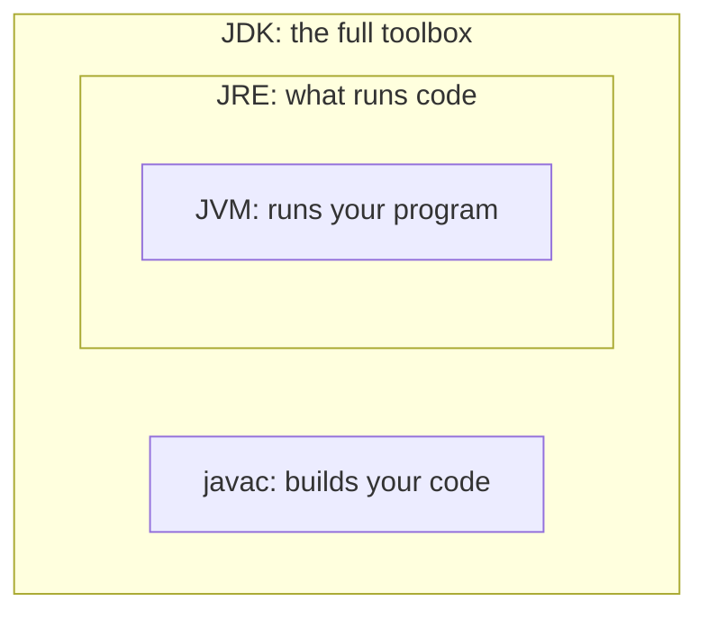

## Hook

Picture the Spoke repair shop. A mechanic can't fix a bike with bare hands. They need a toolbox with wrenches, a pump and a bike stand.

Your laptop is your repair shop. Right now it has no Java tools at all. In this ticket you install two things: the Java toolbox and a comfy workbench to use it on. After that, every later ticket just works.

## Concept

Java comes in a few pieces. Their names sound alike, so take them one at a time.

- **JVM** (Java Virtual Machine): the program that runs Java code on your computer.
- **JRE** (Java Runtime Environment): the JVM plus the extra files it needs to run programs. It can run Java, but it can't build it.
- **JDK** (Java Development Kit): everything in the JRE, plus tools for building programs. The most important tool is `javac`, the Java compiler.

The JRE is mostly an old word now. Since Java 11, Oracle no longer offers a separate JRE, and developers always install the full JDK. You will still hear the name in older guides.

```callout jargon
A compiler is a program that turns the code you write into code the computer can run. For Java, that tool is called javac.
```

```callout analogy
The JDK is the full mechanic's toolbox. javac is the wrench you use to build the bike. The JVM is the bike stand that holds the bike and spins the wheels. You need the whole toolbox, so you install the JDK.
```



### Which version?

Java gets a new version twice a year. Some versions are marked **LTS**, which means long-term support. An LTS version gets fixes and security updates for many years. Recent LTS versions are 17, 21 and 25. Most companies run an LTS version in production. Java 21 is the one Spoke uses, so you install Java 21.

### Installing the JDK on a Mac

The recommended way is the **Eclipse Temurin 21** installer. Temurin is a free build of the JDK. You get it from **adoptium.net**. Several companies build the JDK from the same open source code, called OpenJDK. Temurin, Amazon Corretto and Oracle's JDK are common ones, and they all run your code the same way. It comes as a `.pkg` file, which is a normal Mac installer you double-click.

If you already use Homebrew, you can install it with one command instead. Homebrew is a tool that installs apps from Terminal.

```bash
brew install --cask temurin@21
```

### Syntax: check the JVM version

```bash
java -version
```

This asks the JVM which version it is.

### Syntax: check the compiler version

```bash
javac -version
```

This asks the compiler which version it is. If this works, you have a full JDK.

### How the terminal finds java: PATH and JAVA_HOME

When you type `java`, how does the shell know which program to start? Your Mac may even hold several JDKs. The answer is two environment variables.

```callout jargon
An **environment variable** is a named setting that the shell keeps. It hands these settings to every program it starts. You can print one with `echo`, such as `echo $PATH`.
```

**PATH** is a list of folders, joined by colons. When you type a command, the shell looks in each folder in order and runs the first match. `which java` shows the one it found:

```text
% echo $PATH
/usr/local/bin:/System/Cryptexes/App/usr/bin:/usr/bin:/bin:/usr/sbin:/sbin
% which java
/usr/bin/java
```

Your PATH will probably be longer. On a Mac, `/usr/bin/java` is a small launcher from Apple. It looks at **JAVA_HOME**, the folder of the JDK you want. If JAVA_HOME is empty, it picks the newest JDK installed. Build tools such as Maven read JAVA_HOME too.

To see every JDK on your Mac, run this:

```text
% /usr/libexec/java_home -V
Matching Java Virtual Machines (2):
    21.0.13 (arm64) "Eclipse Adoptium" - "OpenJDK 21.0.13" /Library/Java/JavaVirtualMachines/temurin-21.jdk/Contents/Home
    1.8.511.33 (arm64) "Oracle Corporation" - "Java" /Library/Internet Plug-Ins/JavaAppletPlugin.plugin/Contents/Home
/Library/Java/JavaVirtualMachines/temurin-21.jdk/Contents/Home
```

Each line is one installed Java, with its version and folder. Here an old Java 8 (written `1.8`) hides next to Temurin 21. The last line is the one your Mac picks by default.

### Syntax: point JAVA_HOME at Java 21

```bash
export JAVA_HOME=$(/usr/libexec/java_home -v 21)
export PATH="$JAVA_HOME/bin:$PATH"
```

These two lines pin Java 21. The first asks `java_home` for the JDK 21 folder and stores it in JAVA_HOME. The second puts that JDK's `bin` folder at the front of PATH, so its `java` and `javac` win.

Most Macs work without this. You need it only when an older Java keeps showing up. To keep the lines, add them to `~/.zshrc`. That is a settings file zsh reads every time a new Terminal window opens. Run `touch ~/.zshrc`, then `open -e ~/.zshrc` to edit it in TextEdit. Paste the two lines at the end, save, and open a new Terminal window.

```callout warning
A line in `~/.zshrc` that points JAVA_HOME at an old JDK beats everything you install. If Java 21 is installed but an old version shows up, look in `~/.zshrc` first.
```

### What is an IDE?

An **IDE** (Integrated Development Environment) is an editor built for code. It colours your code, spots mistakes as you type, and runs programs with one click.

This course uses **VS Code**, a free editor from Microsoft. Download it from code.visualstudio.com. On its own it doesn't know Java, so you add the **Extension Pack for Java**. An extension is an add-on that teaches VS Code a new skill.

Many Java teams use **IntelliJ IDEA** instead. It works the same way, so you can switch later if you like.

The IDE does not replace the JDK. When you press Run, it calls the JDK tools for you:

```animate
title: You press Run in the IDE
kind: scene
nodes:
  - { id: ide, label: VS Code, emoji: "🪟", value: Hello.java }
  - { id: javac, label: javac (JDK), emoji: "🔧" }
  - { id: cls, label: Hello.class, emoji: "📦", value: bytecode }
  - { id: jvm, label: java (JVM), emoji: "⚙️" }
steps:
  - say: You write Hello.java in the IDE and click Run, just above main.
    focus: [ide]
  - say: The IDE hands your file to javac, the compiler from the JDK. javac checks it and builds it.
    send: { from: ide, to: javac, label: Hello.java }
    set: { javac: compiling }
  - say: javac writes Hello.class, full of bytecode.
    show: [cls]
    send: { from: javac, to: cls, label: bytecode }
    set: { javac: done }
  - say: Next the IDE starts java, the JVM, and tells it to run Hello.
    send: { from: ide, to: jvm, label: run Hello }
  - say: The JVM loads Hello.class and runs it.
    send: { from: cls, to: jvm, label: Hello.class }
    set: { jvm: running }
  - say: The output comes back to the IDE's Run panel. Without the JDK installed, the Run button has nothing to call.
    send: { from: jvm, to: ide, label: "Hello, World!", back: true }
    set: { ide: "Hello, World!", jvm: finished }
```

### Opening the practice project

```callout jargon
A **repository** is a project folder whose history of changes is saved by Git. You meet Git two tickets from now. A **library** is code someone else wrote that you reuse, such as JUnit for checks. A **build tool** compiles a whole project, fetches its libraries and runs its checks in one go. **Maven** is a popular build tool for Java.
```

Cadence keeps your exercises in the `practice/` folder of this repository. Each exercise lives in `practice/<module>/<topic>/src`. When you save a file there, Cadence notices and runs the checks for you.

The file `practice/pom.xml` describes all the exercises as one project. Maven is a build tool, and `pom.xml` is its settings file. When VS Code opens the `practice` folder, the Java extension reads `pom.xml` and finds JUnit, the testing library the checks use.

```callout warning
Open the whole practice folder in VS Code. If you open one .java file on its own, VS Code can't see JUnit and shows red errors everywhere.
```

On every code ticket, Kakashi's guide repeats these steps and points at that ticket's exact files.

## Worked example

Here is a Terminal session after a good install. Your exact numbers may differ a little.

```bash
java -version
```

```text
openjdk version "21.0.5" 2024-10-15 LTS
OpenJDK Runtime Environment Temurin-21.0.5+11 (build 21.0.5+11-LTS)
OpenJDK 64-Bit Server VM Temurin-21.0.5+11 (build 21.0.5+11-LTS, mixed mode)
```

1. The first line shows version `21` and the word `LTS`. That's the version you want.
2. The second line names the runtime. `Temurin` tells you which installer you used.
3. The third line describes the JVM itself.

Your numbers after `21` and the date will differ, because every update changes them. The second line may name a different builder, such as Homebrew. Only the `21` at the start matters.

```bash
javac -version
```

```text
javac 21.0.5
```

The compiler also reports 21. Both tools agree, so your toolbox is complete.

## Try it

1. Go to adoptium.net and download the **Temurin 21** installer for macOS. Double-click the `.pkg` and follow the steps.
2. Open a new Terminal window. Type `java -version` and press Enter. Check that you see `21`.
3. Type `javac -version` and press Enter. Check that you see `javac 21`.
4. Download **VS Code** from code.visualstudio.com. Open the download, drag **Visual Studio Code** into your **Applications** folder, and start it.
5. Press **Cmd+Shift+X** to open Extensions. Search for **Extension Pack for Java**, pick the one made by Microsoft, and click **Install**.
6. Choose **File > Open Folder…**, go to this repository, and pick the `practice` folder. Click **Open**.
7. If VS Code asks whether you trust the authors of these files, click **Yes, I trust the authors**. It's your own folder.
8. Wait for the spinner in the bottom bar to stop. The Java extension is reading `pom.xml` and downloading JUnit.
9. Press **Cmd+Shift+E** to show the Explorer. Open `module-00-foundations`, then `topic-05-hello-world`, then `src`. VS Code may show the next folders as one row, `jq/m00/helloworld`. Open it and find `Hello.java`.

```callout tip
Gojo says: open a fresh Terminal window after installing. An old window may not know Java is there yet.
```

## Recap

- The **JVM** runs Java code. The **JDK** adds tools like `javac` to build it.
- You install the JDK, version **21**, because it's an LTS version.
- `java -version` and `javac -version` both should show 21. If not, check PATH and JAVA_HOME.
- An **IDE** such as VS Code, with the Extension Pack for Java, helps you write and run code.
- Open the `practice` folder in VS Code. Saving a file in `src` makes Cadence run the checks.

## Common mistakes

**Java isn't installed or Terminal can't find it.**

macOS shows a message like `The operation couldn't be completed. Unable to locate a Java Runtime.` Install Temurin 21, then close Terminal and open a new window. Try `java -version` again.

**An older Java shows up.**

You see: `java version "1.8.0_..."` or `openjdk version "17..."`. Your Mac has an older JDK too. Install Temurin 21, open a new Terminal, and check again.

Still old? Then JAVA_HOME or PATH points at the old JDK. Run `echo $JAVA_HOME` and `which java` to see which one. Look in `~/.zshrc` for a line that sets JAVA_HOME or PATH to an old folder. Replace it with the two lines from "Syntax: point JAVA_HOME at Java 21", then open a new Terminal.

In VS Code, press **Cmd+Shift+P**, run **Java: Configure Java Runtime**, and pick 21.

**Imports are red in the IDE.**

You see red lines under `import org.junit...` and a message that the import cannot be resolved. You opened a single file, or the wrong folder, instead of the project. Choose **File > Open Folder…** and open the `practice` folder itself.
