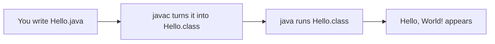

## Hook

Imagine you hire a robot chef. The robot is fast, but it only follows written recipes, word for word. If the recipe says "add salt", it adds salt. If you forget to write "turn off the oven", the oven stays on.

A program is a recipe for a computer. Your first code ticket asks for the smallest recipe there is: make the test kiosk show the words **Hello, World!** on its screen. If that works, your laptop can build and run Java, and you're ready for real tickets. Programmers have started this way since the 1970s.

## Concept

Here is the whole program:

```java
public class Hello {
    public static void main(String[] args) {
        System.out.println("Hello, World!");
    }
}
```

That looks like a lot for one sentence. Let's take it apart, one line at a time.

```callout analogy
A class is like a folder with a name on it. Everything in Java lives inside a class.
```

### Syntax: a class

```java
public class Hello {
    // your code goes here
}
```

- `class Hello` creates a class called `Hello`.
- The file must have the same name: `Hello.java`.
- The curly braces `{ }` show where the class starts and ends.

### Syntax: the main method

```java
public static void main(String[] args) {
    // the program starts here
}
```

When you run a program, Java looks for a method called `main` and starts there. For now, copy this line exactly. Later lessons explain every word in it.

```callout jargon
A method is a named list of steps. `main` is the method Java runs first.
```

### Syntax: printing

```java
System.out.println("Hello, World!");
```

- `System.out.println` prints text and then moves to a new line.
- The text goes inside double quotes. Text in quotes is called a **String**.
- Every instruction ends with a semicolon `;`. It works like a full stop at the end of a sentence.

### Syntax: a method that gives back text

Your exercise asks for one more thing: a method that gives back text instead of printing it.

```java
public class Hello {
    public static String greeting() {
        return "Hello, World!";
    }

    public static void main(String[] args) {
        System.out.println(greeting());
    }
}
```

- `String` before the name means the method gives back text.
- `return` hands that text back to whoever called the method.
- `System.out.println(greeting());` calls the method and prints what it gives back.

```callout jargon
A **package** groups classes, like folders group files. The exercise file starts with `package jq.m00.helloworld;`. Leave that line exactly as it is.
```



## Worked example

This program prints two lines:

```java run
public class Main {
    public static void main(String[] args) {
        System.out.println("Hello, World!");
        System.out.println("I am learning Java.");
    }
}
```

1. Java finds `main` and starts at its first line.
2. The first `println` prints `Hello, World!` and moves to a new line.
3. The second `println` prints `I am learning Java.`
4. Java reaches the closing brace of `main`, so the program ends.

Java runs the lines from top to bottom, one at a time.

## Try it

Change the text inside the quotes to your own name, then press **Run**.

```java run
public class Main {
    public static void main(String[] args) {
        System.out.println("Hello, my name is Byte!");
    }
}
```

Now add a second `println` line with your favourite food. Press **Run** again.

```callout tip
Java cares about capital letters. `System` works, `system` does not.
```

## Recap

- A Java program lives inside a **class**, and the file name matches the class name.
- Java starts running at the `main` method.
- `System.out.println("...")` prints text and moves to a new line.
- Text in double quotes is a **String**.
- Every instruction ends with a semicolon.

## Common mistakes

**Forgetting the semicolon.**

```java nocompile
System.out.println("Hello, World!")
```

Java says: `';' expected`. Add `;` at the end of the line.

**Wrong capital letters.**

```java nocompile
system.out.println("Hello, World!");
```

Java says: `package system does not exist`. Write `System` with a capital S.

**Missing quotes around text.**

```java nocompile
System.out.println(Hello);
```

Java says: `cannot find symbol`. Without quotes, Java thinks `Hello` is the name of something. Put the text inside `"double quotes"`: `System.out.println("Hello");`
