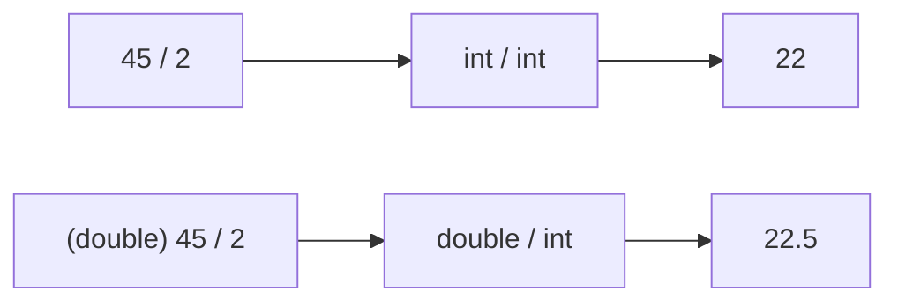

## Hook

Think of a parcel locker. A small slot fits a letter. A big slot fits a box. If you push a box into the letter slot, something gets squashed.

That is what happened to Sam's rider. Her ride was 2.5 km long. The kiosk stored it in a box made for whole numbers, so the .5 got squashed off. The receipt said 2 km. This page shows you the right box for each kind of number.

## Concept

In the last topic you met `int` and `String`. Java has a small set of built in types for simple values. They are called **primitive types**.

```callout jargon
A **primitive type** is one of Java's basic building blocks. Its name is all lowercase, like `int` or `double`. `String` starts with a capital letter because it is a class, so it is not a primitive.
```

Here are the five you need now:

| Type | Holds | Example |
|---|---|---|
| `int` | a whole number | `int docks = 12;` |
| `long` | a very big whole number | `long totalRides = 3000000000L;` |
| `double` | a number with a decimal point | `double km = 2.5;` |
| `boolean` | `true` or `false` | `boolean isMember = true;` |
| `char` | a single character | `char size = 'M';` |

### Syntax: double

```java
double distanceKm = 2.5;
```

A `double` holds numbers with a decimal point. Use it for distances, prices and averages.

```java
double fare = 4.0;
double perMinute = 0.15;
double eBikeRate = 0.30;
```

Java prints a whole-number double with `.0`, so `double fare = 4;` prints as `4.0`.

### Syntax: boolean

```java
boolean isMember = true;
```

A `boolean` holds only `true` or `false`. There are no quotes around them. Use it for yes or no questions.

```java
boolean isMember = false;
boolean dockIsFree = true;
```

### Syntax: char

```java
char bikeType = 'E';
```

A `char` holds exactly one character. It uses single quotes. A String uses double quotes and can hold many characters.

```java
char first = 'B';
String bikeId = "B-1042";
```

### Syntax: long

```java
long totalRides = 3000000000L;
```

An `int` stops at about 2.1 billion. A `long` holds much bigger whole numbers. Put an `L` at the end of a big number so Java reads it as a long.

### Why 2.5 does not fit in an int

An int box only fits whole numbers. Java refuses to squash 2.5 in by itself:

```java nocompile
int distance = 2.5;
```

Java says: `incompatible types: possible lossy conversion from double to int`. The word **lossy** means some of the value would be lost.

### Syntax: widening

```java
double km = 7;
```

Going the other way is safe. Every whole number fits in a double box. Java converts it for you, and `km` holds `7.0`. This automatic move to a bigger type is called **widening**.

```java
int minutes = 20;
double exact = minutes;   // exact holds 20.0
long big = minutes;       // an int fits in a long too
```

### Syntax: casting

```java
int whole = (int) 2.5;
```

Sometimes you really do want the whole number part. A **cast** tells Java "convert this value to this type, I know I may lose something". You write the type in brackets before the value.

```java
int a = (int) 2.5;   // 2
int b = (int) 2.9;   // 2, the .9 is cut off
double c = (double) 5;  // 5.0
```

```callout warning
A cast to int cuts off the decimal part. It never rounds up, so `(int) 2.9` gives `2`.
```

### The integer division surprise

The four maths signs `+ - * /` work on numbers. Topic 03 covers them in detail. One rule matters right now. When you divide an int by an int, Java gives back an int and throws away the remainder.

```java
int a = 5 / 2;        // 2
double b = 5 / 2;     // 2.0, the .5 was already lost
double c = 5.0 / 2;   // 2.5
```

Look at `b`. Java does the division first, with two ints, so it gets `2`. Only then does it widen `2` to `2.0`. The fix is to make one side a double before dividing.

```java
int total = 45;
int rides = 2;
double average = (double) total / rides;   // 22.5
```

The cast turns `total` into `45.0` first. A double divided by an int gives a double, so the .5 survives.



### Syntax: a method with inputs

```java nocompile
public static double averageMinutes(int totalMinutes, int rides) {
    return (double) totalMinutes / rides;
}
```

Your exercise methods take inputs, like `averageMinutes(int totalMinutes, int rides)`. The values inside the round brackets are called **parameters**. Treat each one as a variable that already holds a value. The word `return` hands the answer back to whoever called the method.

You can call a method and pass it a value: `averageMinutes(45, 2)` runs averageMinutes with 45 and 2 as its inputs. One method can also call another, so `main` can call `averageMinutes(45, 2)` and print what comes back.

## Worked example

This program stores the rider's real ride and prints it:

```java run
public class Main {
    public static void main(String[] args) {
        double distanceKm = 2.5;
        boolean isMember = true;
        char bikeType = 'E';
        int roundedKm = (int) distanceKm;
        System.out.println(distanceKm);
        System.out.println(isMember);
        System.out.println(bikeType);
        System.out.println(roundedKm);
    }
}
```

1. Line 3 stores 2.5 in a double, so nothing is lost.
2. Line 4 stores `true` in a boolean.
3. Line 5 stores the single character E in a char.
4. Line 6 casts the distance to an int, which cuts it down to 2.
5. The program prints `2.5`, `true`, `E` and `2`, each on its own line.

Now see integer division side by side with the fix:

```java run
public class Main {
    public static void main(String[] args) {
        int totalMinutes = 45;
        int rides = 2;
        double wrong = totalMinutes / rides;
        double right = (double) totalMinutes / rides;
        System.out.println(wrong);
        System.out.println(right);
    }
}
```

The first line prints `22.0`. The second prints `22.5`.

## Try it

Change `totalMinutes` to `61` and `rides` to `4`. Predict both answers before you press **Run**.

```java run
public class Main {
    public static void main(String[] args) {
        int totalMinutes = 7;
        int rides = 2;
        System.out.println(totalMinutes / rides);
        System.out.println((double) totalMinutes / rides);
    }
}
```

## Recap

- Use `int` for whole numbers, `double` for decimals, `boolean` for true or false, `char` for one character, and `long` for very big whole numbers.
- Java widens a smaller type into a bigger one for you, like an int into a double.
- A cast such as `(int) 2.9` forces a conversion and cuts off the decimal part.
- An int divided by an int gives an int: `5 / 2` is `2`.
- Cast before you divide to keep the decimals: `(double) 5 / 2` is `2.5`.

## Common mistakes

**Storing a decimal in an int.**

```java nocompile
int distanceKm = 2.5;
```

Java says: `incompatible types: possible lossy conversion from double to int`. Use a double box: `double distanceKm = 2.5;`

**Casting after the division.**

```java
int total = 45;
int rides = 2;
double average = (double) (total / rides);
System.out.println(average);
```

This compiles, but it prints `22.0`. The brackets make the int division happen first. Cast the first number on its own: `(double) total / rides` prints `22.5`.

**Double quotes around a char.**

```java nocompile
char bikeType = "E";
```

Java says: `incompatible types: String cannot be converted to char`. A char uses single quotes: `char bikeType = 'E';`
