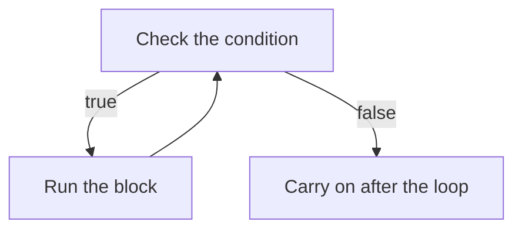

## Hook

Theo has a problem at Old Mill. The card reader misses the first tap a lot. The kiosk shows an error at once, and riders give up.

A person would just say "tap again". So far your programs run each line once, from top to bottom. To try again, the kiosk needs to **repeat** some lines. Java repeats lines with a **loop**.

## Concept

```callout jargon
A **loop** is a block of code that runs again and again. Each run of the block is called an **iteration**, or a turn.
```

### Syntax: while

```java nocompile
while (condition) {
    // code to repeat
}
```

- The **condition** is a `boolean` test, just like in an `if`.
- Java checks the condition first. If it is `true`, the block runs once.
- Then Java jumps back up and checks the condition again.
- When the condition is `false`, Java skips the block and carries on below it.



A `while` is an `if` that keeps asking. Here is a loop that prints three lines:

```java
int i = 1;
while (i <= 3) {
    System.out.println("Tap " + i);
    i++;
}
```

It prints `Tap 1`, `Tap 2` and `Tap 3`. After the third turn, `i` is 4, so `4 <= 3` is `false` and the loop stops.

### Syntax: a counter

```java
int count = 0;   // 1. start
count++;         // 2. change, same as count = count + 1
```

A **counter** is an `int` variable that counts turns. Most loops have three parts:

1. **Start** the counter before the loop: `int i = 1;`
2. **Test** it in the condition: `while (i <= 3)`
3. **Change** it inside the block: `i++;`

You can count down too:

```java
int seconds = 3;
while (seconds > 0) {
    System.out.println(seconds);
    seconds--;
}
```

You can also count by more than 1. This one goes 0, 5, 10:

```java
int bikes = 0;
while (bikes <= 10) {
    System.out.println(bikes);
    bikes = bikes + 5;
}
```

A loop can even run zero times. If the condition is `false` at the start, the block never runs:

```java
int docks = 0;
while (docks > 0) {
    System.out.println("This never prints");
}
```

### Syntax: infinite loops

```java nocompile
int i = 1;
while (i <= 3) {
    System.out.println(i);
    // i never changes!
}
```

An **infinite loop** never stops, because its condition never turns `false`. This one prints `1` forever. The program freezes, and you have to stop it by hand.

```callout warning
Before you run a loop, ask: "What changes each turn, and will it make the condition false?" If nothing changes, the loop runs forever.
```

Watch out for a change in the wrong direction too. If `docks++` runs where `docks--` belongs, `docks > 0` stays true for billions of turns, so the program looks frozen. It should be docks--.

### Syntax: do-while

```java nocompile
do {
    // code to repeat
} while (condition);
```

A `do-while` runs the block **first**, then checks the condition. So the block always runs at least once. Note the semicolon after the closing bracket.

```java
int tap = 1;
do {
    System.out.println("Reading tap " + tap);
    tap++;
} while (tap <= 0);
```

The condition is `false` from the start, yet this still prints `Reading tap 1` once. A plain `while` with the same condition prints nothing.

```callout analogy
A `while` loop is like checking the fridge before you open the door. A `do-while` opens the door first, then decides whether to look again.
```

Use `do-while` when the action must happen at least once, like a first card tap.

### Syntax: break

```java nocompile
while (condition) {
    if (otherTest) {
        break;   // leave the loop now
    }
}
```

`break` jumps out of the loop at once. Java carries on with the line after the loop. You already met `break` in `switch`; here it does the same job for loops.

```java
int tap = 1;
while (tap <= 3) {
    if (tap == 2) {
        System.out.println("Card read!");
        break;
    }
    tap++;
}
```

This stops at tap 2. Tap 3 never happens.

### Syntax: return inside a loop

```java nocompile
while (tap <= maxTaps) {
    if (tap == goodTap) {
        return tap;
    }
    tap++;
}
return -1;
```

Inside a method that gives back a value, `return` also ends the loop. It leaves the whole method at once. The `return -1;` after the loop only runs if the loop finished without finding anything.

The practice gives you each method header. You only write the body. Topic 09 explains headers fully.

## Worked example

Here is the kiosk retrying a card. In this pretend run, the card works on tap 2.

```java run
public class Main {
    public static void main(String[] args) {
        int goodTap = 2;
        int maxTaps = 3;
        int tap = 1;
        boolean paid = false;
        while (tap <= maxTaps) {
            System.out.println("Tap " + tap + "...");
            if (tap == goodTap) {
                paid = true;
                break;
            }
            tap++;
        }
        System.out.println("Paid: " + paid);
    }
}
```

1. `tap` starts at 1. The condition `1 <= 3` is `true`, so the block runs and prints `Tap 1...`.
2. `tap == goodTap` is `false`, so `tap++` makes it 2.
3. `2 <= 3` is `true`. The block prints `Tap 2...`.
4. Now `tap == goodTap` is `true`. `paid` becomes `true`, and `break` leaves the loop.
5. Java prints `Paid: true`.

Change `goodTap` to 5. The loop runs three turns, then stops on its own. It prints `Paid: false`.

## Try it

This loop builds a countdown into one String with `+`. Press **Run**.

```java run
public class Main {
    public static void main(String[] args) {
        String text = "";
        int n = 3;
        while (n >= 1) {
            text = text + n + " ";
            n--;
        }
        text = text + "go";
        System.out.println(text);
    }
}
```

Change `n` to 5 and run it again. Then change `n--` into `n = n - 2` and predict the output first.

```callout tip
If a loop seems stuck, add a `System.out.println` inside it that prints the counter. You will see at once whether it changes.
```

## Recap

- A `while` loop checks its condition, runs its block, and repeats until the condition is `false`.
- A `do-while` runs its block once first, then checks the condition.
- A counter needs a start, a test and a change.
- If nothing in the loop moves the condition toward `false`, you get an infinite loop.
- `break` leaves a loop at once. `return` leaves the loop and the whole method.

## Common mistakes

**Forgetting to change the counter.**

```java
int i = 1;
while (i <= 3) {
    System.out.println(i);
}
```

It compiles, but it prints `1` forever and the program freezes. Add `i++;` inside the block.

**A semicolon right after the while.**

```java
int i = 1;
while (i <= 3); {
    System.out.println(i);
    i++;
}
```

It compiles, but nothing prints and the program freezes. The `;` is an empty loop body, so Java repeats "do nothing" forever. Delete the `;` after `)`.

**Missing semicolon after do-while.**

```java nocompile
do {
    tap++;
} while (tap < 3)
```

Java says: `';' expected`. A `do-while` ends with `);`. Write `} while (tap < 3);`.
