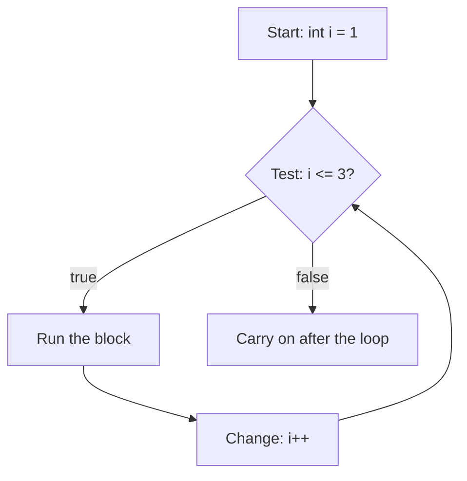

## Hook

The kiosk at Riverside has 12 docks. Maya wants the screen to show `1 2 3 4 5 6 7 8 9 10 11 12`. You could write twelve `print` lines. But what about a station with 40 docks?

In the last topic, you wrote `while` loops with a counter. You always needed three parts: start, test and change. Those parts were spread over three lines, so they were easy to forget. A **for loop** puts all three on one line.

## Concept

### Syntax: for

```java nocompile
for (start; test; change) {
    // code to repeat
}
```

```java
for (int i = 1; i <= 3; i++) {
    System.out.println("Dock " + i);
}
```

This prints `Dock 1`, `Dock 2` and `Dock 3`. The three parts inside the brackets are separated by semicolons:

1. **Start** `int i = 1` runs once, before anything else.
2. **Test** `i <= 3` is checked before every turn. When it is `false`, the loop ends.
3. **Change** `i++` runs at the end of every turn.



This `for` loop does exactly the same as this `while` loop:

```java
int i = 1;
while (i <= 3) {
    System.out.println("Dock " + i);
    i++;
}
```

```callout tip
Use `for` when you know how many turns you need, like "once per dock". Use `while` when you wait for something to happen, like a card that finally reads.
```

```callout jargon
The **scope** of a variable is the part of the code where it exists. A counter declared inside `for (...)` only exists inside that loop.
```

### Syntax: counting down

```java
for (int i = 3; i >= 1; i--) {
    System.out.println(i);
}
```

Start high, test with `>=`, and change with `i--`. This prints `3`, `2`, `1`.

### Syntax: step size

```java
for (int i = 2; i <= 12; i += 2) {
    System.out.print(i + " ");
}
```

`i += 2` is short for `i = i + 2`. The **step size** is how much the counter changes each turn. This prints `2 4 6 8 10 12 `. Count by 5s with `i += 5`. Count down by 3s with `i -= 3`.

### Syntax: adding up in a loop

```java
double total = 0.0;
for (int ride = 1; ride <= 3; ride++) {
    total = total + 2.50;
}
```

Start a total at 0 before the loop. Each turn adds one more amount. After three turns, `total` is `7.5`.

### Syntax: building text in a loop

```java
String line = "";
for (int i = 1; i <= 4; i++) {
    line = line + i + " ";
}
```

After the loop, `line` is `"1 2 3 4 "`. Note the space at the end. To skip it, add the space **before** every number except the first:

```java
String line = "";
for (int i = 1; i <= 4; i++) {
    if (i > 1) {
        line = line + " ";
    }
    line = line + i;
}
```

Now `line` is `"1 2 3 4"`.

### Syntax: break and continue

```java nocompile
for (...) {
    if (test) { break; }      // leave the whole loop now
    if (test) { continue; }   // skip the rest of this turn only
}
```

You met `break` in `while` loops. It works the same in `for`. **`continue`** is new. It skips the rest of the current turn and jumps to the change part. The loop keeps going.

```java
for (int dock = 1; dock <= 5; dock++) {
    if (dock == 3) {
        continue;
    }
    System.out.print(dock + " ");
}
```

Dock 3 is broken, so it is skipped. This prints `1 2 4 5 `.

```java
for (int dock = 1; dock <= 5; dock++) {
    if (dock == 3) {
        break;
    }
    System.out.print(dock + " ");
}
```

With `break` instead, the loop stops at dock 3. This prints `1 2 `.

### Syntax: nested loops

```java
for (int row = 1; row <= 2; row++) {
    for (int dock = 1; dock <= 3; dock++) {
        System.out.print(row + "-" + dock + " ");
    }
    System.out.println();
}
```

A **nested loop** is a loop inside another loop. The inner loop runs all the way through on every turn of the outer loop. This prints two rows: `1-1 1-2 1-3` and `2-1 2-2 2-3`.

```callout warning
Give the inner counter a different name. If both loops use `i`, Java says `variable i is already defined`.
```

## Worked example

This program lists the docks and adds up a batch of classic bike fares.

```java run
public class Main {
    public static void main(String[] args) {
        String line = "";
        for (int i = 1; i <= 12; i++) {
            if (i > 1) {
                line = line + " ";
            }
            line = line + i;
        }
        System.out.println(line);

        double total = 0.0;
        for (int ride = 1; ride <= 4; ride++) {
            total = total + 1.00 + 10 * 0.15;
        }
        System.out.println("Total: $" + total);
    }
}
```

1. `line` starts empty. The first loop runs 12 turns, with `i` from 1 to 12.
2. On turn 1, `i > 1` is `false`, so no space is added. `line` becomes `"1"`.
3. On every later turn, a space goes in first, then the number.
4. The second loop runs 4 turns. Each turn adds a 10 minute classic fare: $1.00 plus 10 times $0.15, which is $2.50.
5. The total prints as `Total: $10.0`.

## Try it

Here the kiosk skips broken dock 4 and stops at the first free dock after dock 6. Press **Run**.

```java run
public class Main {
    public static void main(String[] args) {
        for (int dock = 1; dock <= 12; dock++) {
            if (dock == 4) {
                continue;
            }
            if (dock > 6) {
                System.out.println("Free: dock " + dock);
                break;
            }
            System.out.println("Taken: dock " + dock);
        }
    }
}
```

Change `dock > 6` to `dock > 9` and run it again. Then delete the `continue` part and see dock 4 come back.

## Recap

- A `for` loop holds the start, the test and the change on one line.
- Count down with `i--` and a test like `i >= 1`.
- Change the step size with `i += 2` or `i -= 3`.
- `break` leaves the loop. `continue` skips the rest of one turn.
- A nested loop runs completely on each turn of the outer loop.

## Common mistakes

**Using commas instead of semicolons.**

```java nocompile
for (int i = 1, i <= 3, i++) {
    System.out.println(i);
}
```

Java says: `';' expected`. The three parts are separated by semicolons: `for (int i = 1; i <= 3; i++)`.

**Off by one: using < when you meant <=.**

```java
for (int i = 1; i < 12; i++) {
    System.out.print(i + " ");
}
```

It compiles, but it prints `1 2 3 4 5 6 7 8 9 10 11 ` and dock 12 is missing. Use `i <= 12` to include the last dock.

**Using the counter after the loop.**

```java nocompile
for (int i = 1; i <= 3; i++) {
    System.out.println(i);
}
System.out.println(i);
```

Java says: `cannot find symbol`. The counter `i` only exists inside the loop. Declare it before the loop if you need it afterwards.
