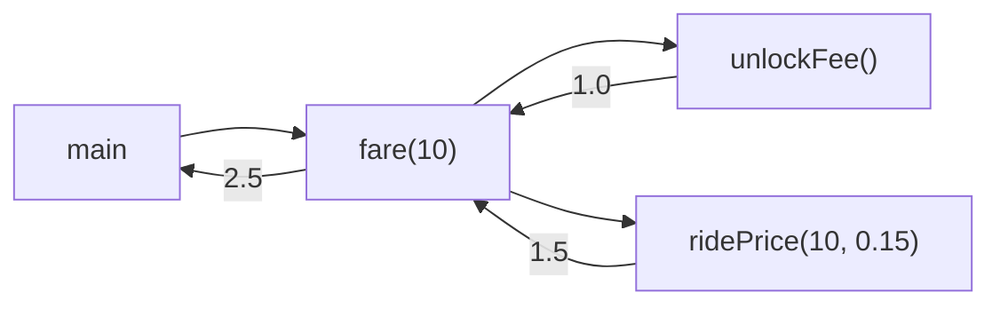

## Hook

Think about a recipe book. One page explains how to make pizza dough. The pizza recipe just says "make the dough (see page 12)". It does not repeat every step.

The fare code at Spoke has no pages like that. Everything sits in one giant `main`. Your ticket is to cut it into small, named pieces. Each piece does one job, and you can test each one on its own.

## Concept

You already wrote one small method in module 0: `greeting()`, which gave back some text. This page shows the full picture.

```callout jargon
A **method** is a named block of code that does one job. You **call** a method when you use its name to run it.
```

### Syntax: defining a method

```java
public static double unlockFee() {
    return 1.00;
}
```

- `public static` stays the same for now. Later modules explain both words.
- `double` is the **return type**: the kind of value the method gives back.
- `unlockFee` is the method name, written in camelCase.
- The round brackets `()` hold the inputs. This method has none.
- `return 1.00;` hands the value back and ends the method.

### Syntax: calling a method

```java nocompile
double fee = unlockFee();
System.out.println(fee);
```

The call `unlockFee()` runs the method. The value it returns lands where the call was written. Here it goes into `fee`.

### Syntax: parameters

```java
public static double ridePrice(int minutes) {
    return minutes * 0.15;
}
```

```callout jargon
A **parameter** is a variable in the method's brackets. It receives a value each time someone calls the method. The value you pass in is called an **argument**.
```

```java nocompile
double a = ridePrice(10);   // minutes is 10, a is 1.5
double b = ridePrice(20);   // minutes is 20, b is 3.0
```

A method can take several parameters. Separate them with commas, and give each one its own type.

```java
public static double ridePrice(int minutes, double rate) {
    return minutes * rate;
}
```

```java nocompile
double c = ridePrice(10, 0.30);   // 3.0
```

The arguments match the parameters by position. The first argument goes into the first parameter.

### Syntax: return types, including void

The return type can be any type you know: `int`, `double`, `boolean`, `String`.

```java
public static boolean isLongRide(int minutes) {
    return minutes > 60;
}

public static String bikeName() {
    return "B-1042";
}
```

Some methods do a job and give nothing back. Their return type is `void`, which means "nothing".

```java
public static void printReceipt(double amount) {
    System.out.println("Total: $" + amount);
}
```

A `void` method needs no `return` line. You call it as a statement on its own line.

```java nocompile
printReceipt(2.5);
```

### Syntax: calling methods from methods

A method can call other methods. This is how you build big jobs out of small ones.

```java nocompile
public static double fare(int minutes) {
    return unlockFee() + ridePrice(minutes, 0.15);
}
```

`fare` asks `unlockFee` and `ridePrice` for their answers, then combines them.



### Syntax: local variable scope

```java
public static double fare(int minutes) {
    double rate = 0.15;      // rate lives only inside fare
    return 1.00 + minutes * rate;
}
```

```callout jargon
A **local variable** is a variable created inside a method. Its **scope** is the part of the code where it exists: from its line to the closing brace of its block.
```

When the method ends, its local variables disappear. Another method cannot see them. Parameters are local variables too. A variable made inside a loop or an `if` block lives only inside that block.

```java
for (int i = 0; i < 3; i++) {
    int doubled = i * 2;      // lives only inside the loop
}
// i and doubled do not exist here
```

```callout analogy
Each method is a room with its own whiteboard. What you write on one whiteboard stays in that room. To share a value, pass it in as an argument or give it back with return.
```

### Syntax: method overloading

Two methods may share a name if their parameter lists differ. This is called **overloading**.

```java
public static double fare(int minutes) {
    return 1.00 + minutes * 0.15;
}

public static double fare(int minutes, double rate) {
    return 1.00 + minutes * rate;
}
```

Java picks the version whose parameters match the arguments. `fare(10)` runs the first one. `fare(10, 0.30)` runs the second.

## Worked example

This program splits a classic bike fare into small methods.

```java run
public class Main {
    public static double unlockFee() {
        return 1.00;
    }

    public static double fare(int minutes) {
        double rate = 0.15;
        return unlockFee() + minutes * rate;
    }

    public static void printReceipt(int minutes) {
        System.out.println(minutes + " min: $" + fare(minutes));
    }

    public static void main(String[] args) {
        printReceipt(10);
        printReceipt(20);
    }
}
```

1. Java starts in `main` and calls `printReceipt(10)`. Inside it, `minutes` is 10.
2. `printReceipt` calls `fare(10)`.
3. `fare` creates the local variable `rate` and calls `unlockFee()`, which returns `1.0`.
4. `fare` returns `1.0 + 10 * 0.15`, which is `2.5`.
5. `printReceipt` prints `10 min: $2.5`. The second call does the same with 20 and prints `20 min: $4.0`.

## Try it

This program has a member rule in its own method. Change the minutes in `main` to 25, then to 45, and press **Run** each time.

```java run
public class Main {
    public static double memberFare(int minutes) {
        if (minutes > 30) {
            return (minutes - 30) * 0.15;
        }
        return 0;
    }

    public static void main(String[] args) {
        System.out.println(memberFare(40));
    }
}
```

Now add an overloaded `memberFare(int minutes, double rate)` that uses the rate you pass in. Call it with `0.30` for an e-bike.

```callout tip
Give each method one job and a name that says what it gives back, like `unlockFee` or `pricePerMinute`. Small methods are easy to test.
```

## Recap

- A method is a named block of code. You define it once and call it many times.
- Parameters receive the arguments you pass in, matched by position.
- The return type says what comes back. `void` means nothing comes back.
- Local variables exist only inside the block where you create them.
- Overloaded methods share a name but take different parameters.

## Common mistakes

**Forgetting to return a value.**

```java nocompile
public static double unlockFee() {
    double fee = 1.00;
}
```

Java says: `missing return statement`. A method with a `double` return type must end with `return`. Add `return fee;` before the closing brace.

**Using a local variable outside its method.**

```java nocompile
public static double fare(int minutes) {
    double rate = 0.15;
    return minutes * rate;
}

public static void main(String[] args) {
    System.out.println(rate);
}
```

Java says: `cannot find symbol` with `symbol: variable rate`. `rate` lives only inside `fare`. Call the method instead: `System.out.println(fare(10));`

**Passing arguments in the wrong order or of the wrong type.**

```java nocompile
public static double ridePrice(int minutes, double rate) {
    return minutes * rate;
}

public static void main(String[] args) {
    System.out.println(ridePrice(0.15, 10));
}
```

Java says: `incompatible types: possible lossy conversion from double to int`. The first parameter is the `int` minutes. Swap the arguments: `ridePrice(10, 0.15)`.
