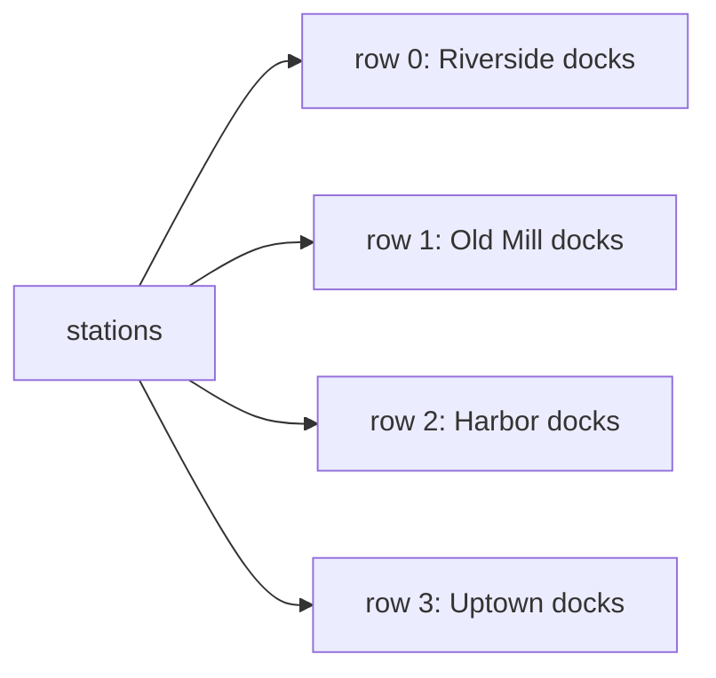

## Hook

Picture the dock row at Riverside station. There are 12 docks side by side, each with a little number painted on it. Some hold a bike. Some are empty.

You could make 12 separate variables: `dock1`, `dock2`, and so on up to `dock12`. That gets messy fast. What if Uptown gets 20 docks? An **array** solves this. It is one variable that holds a whole row of values.

## Concept

```callout jargon
An **array** is a fixed-size row of values that all have the same type. Each value in it is called an **element**.
```

### Syntax: declaring and creating an array

```java
int[] rides = new int[5];
```

- `int[]` means "an array of ints". The square brackets mark it as an array.
- `new int[5]` creates a row of 5 slots.
- New slots start with a default value: `0` for numbers, `false` for `boolean`, `null` for `String`.

```callout jargon
**null** means 'no value yet'. A String slot holds no text until you put some in.
```

```java
boolean[] docks = new boolean[12];   // 12 docks, all false
double[] fares = new double[3];      // 0.0, 0.0, 0.0
String[] stations = new String[4];   // null, null, null, null
```

When you already know the values, list them in curly braces.

```java
int[] rides = {12, 45, 7, 30};
String[] stations = {"Riverside", "Old Mill", "Harbor", "Uptown"};
```

Once created, an array cannot grow or shrink.

### Syntax: indexes start at 0

```java nocompile
String first = stations[0];   // "Riverside"
rides[0] = 15;                // change the first ride to 15 minutes
```

```callout jargon
An **index** is the position number of an element. Java counts from 0, so the first element is at index 0.
```

| Index | 0 | 1 | 2 | 3 |
|---|---|---|---|---|
| Value | Riverside | Old Mill | Harbor | Uptown |

The painted dock numbers at Riverside go from 1 to 12. The array indexes go from 0 to 11. To turn an index into a dock number, add 1.

### Syntax: length

```java nocompile
int count = stations.length;   // 4
```

`length` tells you how many elements an array has. Write it with no brackets after it. The last index is always `length - 1`.

```java nocompile
System.out.println(rides[rides.length - 1]);   // the last ride
```

### Syntax: looping with for

```java nocompile
for (int i = 0; i < rides.length; i++) {
    System.out.println(rides[i]);
}
```

The loop variable `i` walks through every index, from 0 up to `length - 1`. Use this loop when you need the index itself, for example to print a dock number.

```java nocompile
for (int i = 0; i < docks.length; i++) {
    if (docks[i]) {
        System.out.println("Dock " + (i + 1) + " has a bike");
    }
}
```

### Syntax: the enhanced for loop

```java nocompile
for (int minutes : rides) {
    System.out.println(minutes);
}
```

Read it as "for each `minutes` in `rides`". Java hands you each element in turn. You get the values, but you do not get the index.

```java nocompile
int total = 0;
for (int minutes : rides) {
    total = total + minutes;
}
```

```callout tip
Use the enhanced for loop when you only need the values. Use the classic for loop when you need the index too.
```

### What happens with a bad index

```java
int[] rides = {12, 45, 7};
System.out.println(rides[3]);
```

The array has indexes 0, 1 and 2. Index 3 does not exist. The program compiles, but it crashes when it runs:

```
Exception in thread "main" java.lang.ArrayIndexOutOfBoundsException: Index 3 out of bounds for length 3
```

```callout jargon
An **exception** is an error that happens while the program runs. `ArrayIndexOutOfBoundsException` means you used an index below 0 or at least `length`.
```

### Syntax: 2D arrays

A 2D array is an array of arrays. Think of a table with rows and columns. Here each row is a station and each column is a dock.

```java
boolean[][] stations = new boolean[4][12];   // 4 stations, 12 docks each
stations[0][2] = true;                       // Riverside, dock 3 has a bike
```

The first index picks the row. The second index picks the column. `stations.length` is the number of rows, and `stations[0].length` is the number of columns in row 0.

```java
int[][] rides = {
    {10, 20},       // Riverside
    {5, 15, 25}     // Old Mill
};
System.out.println(rides[1][2]);   // 25
```



### Syntax: arrays and methods

A method can take an array as a parameter. Write the array type, like `int[]`, before the parameter name.

```java nocompile
public static int total(int[] rides) {
    int sum = 0;
    for (int r : rides) {
        sum += r;
    }
    return sum;
}
```

A method can also return an array. Create it with `new`, fill it, then return it.

```java nocompile
public static int[] countPerRow(boolean[][] rows) {
    int[] counts = new int[rows.length];
    for (int s = 0; s < rows.length; s++) {
        counts[s] = countBikes(rows[s]);
    }
    return counts;
}
```

In a 2D array, each row is an array of its own. Here `rows[s]` is a `boolean[]`, so you can pass it to a method that takes `boolean[]`.

```java run
public class Main {
    public static int total(int[] rides) {
        int sum = 0;
        for (int r : rides) {
            sum += r;
        }
        return sum;
    }

    public static int countBikes(boolean[] docks) {
        int count = 0;
        for (boolean hasBike : docks) {
            if (hasBike) {
                count++;
            }
        }
        return count;
    }

    public static int[] countPerRow(boolean[][] rows) {
        int[] counts = new int[rows.length];
        for (int s = 0; s < rows.length; s++) {
            counts[s] = countBikes(rows[s]);
        }
        return counts;
    }

    public static void main(String[] args) {
        int[] rides = {12, 45, 7};
        System.out.println("Total minutes: " + total(rides));
        boolean[][] rows = {
            {true, false, true},
            {false, false}
        };
        int[] counts = countPerRow(rows);
        System.out.println("Row 0 bikes: " + counts[0]);
        System.out.println("Row 1 bikes: " + counts[1]);
    }
}
```

## Worked example

This program counts the bikes at a small row of docks.

```java run
public class Main {
    public static void main(String[] args) {
        boolean[] docks = {true, false, true, true, false};
        int bikes = 0;
        for (boolean hasBike : docks) {
            if (hasBike) {
                bikes++;
            }
        }
        System.out.println("Docks: " + docks.length);
        System.out.println("Bikes: " + bikes);
        System.out.println("First dock has a bike: " + docks[0]);
    }
}
```

1. `docks` holds 5 booleans. `true` means the dock holds a bike.
2. `bikes` starts at 0.
3. The enhanced for loop hands each value to `hasBike`, one at a time.
4. Each `true` adds 1 to `bikes`, so `bikes` ends at 3.
5. `docks.length` is 5, and `docks[0]` is the first element, `true`.

## Try it

This program loops over a 2D array of ride minutes and prints a total per station. Change a number, or add a third row, then press **Run**.

```java run
public class Main {
    public static void main(String[] args) {
        int[][] rides = {
            {10, 20, 5},
            {30, 15}
        };
        for (int s = 0; s < rides.length; s++) {
            int total = 0;
            for (int minutes : rides[s]) {
                total = total + minutes;
            }
            System.out.println("Station " + s + ": " + total + " min");
        }
    }
}
```

Now change `s < rides.length` to `s <= rides.length` and run it again. Read the exception, then change it back.

## Recap

- An array holds a fixed number of values of one type.
- Indexes start at 0, and the last index is `length - 1`.
- `array.length` gives the number of elements.
- Use a classic for loop when you need the index, and an enhanced for loop when you only need the values.
- A 2D array is an array of rows: `grid[row][column]`.

## Common mistakes

**Going one past the end.**

```java
int[] rides = {12, 45, 7};
for (int i = 0; i <= rides.length; i++) {
    System.out.println(rides[i]);
}
```

The program prints 12, 45 and 7, then crashes with `java.lang.ArrayIndexOutOfBoundsException: Index 3 out of bounds for length 3`. Use `i < rides.length`.

**Writing length with brackets.**

```java nocompile
int[] rides = {12, 45, 7};
int count = rides.length();
```

Java says: `cannot find symbol` with `symbol: method length()`. For arrays, `length` has no brackets: `rides.length`.

**Forgetting that dock numbers start at 1.**

```java
boolean[] docks = {true, false, true};
for (int i = 0; i < docks.length; i++) {
    if (!docks[i]) {
        System.out.println("Empty dock: " + i);
    }
}
```

This prints `Empty dock: 1`, but the empty dock is painted with the number 2. The index starts at 0. Print `(i + 1)` to show the dock number.
