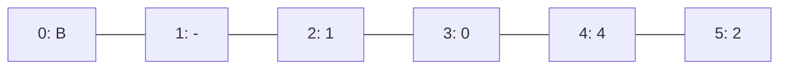

## Hook

Sam from rider support has a problem. Riders type bike codes in strange ways. One rider types `" b-1042 "` with spaces around it. Another types `B1042` and skips the dash. The kiosk compares the text letter by letter, so it says "Unknown bike".

A person reading those codes would see the same bike every time. Your job is to teach the kiosk to clean up the text first. Java gives you a toolbox for that, built right into every String.

## Concept

You already know a **String**: text inside double quotes, like `"B-1042"`. A String is more than text. It also comes with **methods**, small built-in tools you call with a dot.

```callout jargon
Calling a method on a String looks like `code.length()`. The dot means "use this tool on this String". The brackets hold any extra information the tool needs.
```

Each character in a String has a position number called an **index**. Indexes start at 0, just like arrays.



### Syntax: length and charAt

```java nocompile
int size = code.length();
char first = code.charAt(0);
```

- `length()` gives back how many characters the String has.
- `charAt(i)` gives back the single character at index `i`, as a `char`.

```java
String code = "B-1042";
System.out.println(code.length());   // 6
System.out.println(code.charAt(0));  // B
System.out.println(code.charAt(5));  // 2
```

The last index is always `length() - 1`.

### Syntax: changing case

```java nocompile
String upper = text.toUpperCase();
String lower = text.toLowerCase();
```

```java
System.out.println("b-1042".toUpperCase());   // B-1042
System.out.println("Old Mill".toLowerCase()); // old mill
```

### Syntax: trim and strip

```java nocompile
String clean = text.trim();
```

- `trim()` removes spaces, tabs and line breaks at the start and the end.
- `strip()` does the same job and also knows about unusual Unicode spaces. Either works for typed codes.
- Spaces in the middle stay where they are.

```java
System.out.println("[" + "  b-1042 ".trim() + "]");   // [b-1042]
System.out.println("[" + " Old Mill ".strip() + "]"); // [Old Mill]
```

### Syntax: searching inside a String

```java nocompile
boolean has = text.contains("10");
boolean begins = text.startsWith("B-");
int where = text.indexOf("-");
```

- `contains(x)` is `true` when `x` appears anywhere in the text.
- `startsWith(x)` is `true` when the text begins with `x`. There is also `endsWith(x)`.
- `indexOf(x)` gives back the index where `x` first appears, or `-1` when it is missing.

```java
String code = "B-1042";
System.out.println(code.contains("04"));    // true
System.out.println(code.startsWith("B-"));  // true
System.out.println(code.indexOf("-"));      // 1
System.out.println(code.indexOf("X"));      // -1
```

### Syntax: substring

```java nocompile
String part = text.substring(start);
String piece = text.substring(start, end);
```

- `substring(start)` copies from `start` to the end.
- `substring(start, end)` copies from `start` up to `end`, but leaves out the character at `end`.

```java
String code = "B-1042";
System.out.println(code.substring(2));    // 1042
System.out.println(code.substring(0, 1)); // B
System.out.println(code.substring(2, 4)); // 10
```

### Syntax: replace

```java nocompile
String fixed = text.replace("old", "new");
```

`replace` swaps every match of the first text for the second text.

```java
System.out.println("B 1042".replace(" ", "-")); // B-1042
System.out.println("B--1042".replace("--", "-")); // B-1042
```

### Syntax: comparing Strings

```java nocompile
boolean same = a.equals(b);
boolean sameIgnoringCase = a.equalsIgnoreCase(b);
```

- `equals` is `true` when both Strings hold exactly the same characters.
- `equalsIgnoreCase` does the same check but treats `b` and `B` as equal.
- `==` checks something else. An **object** is one value Java has stored. `==` asks whether two names point at the very same stored value. Two Strings can hold equal text and still be different objects.

```callout warning
Always compare String text with `equals`. The `==` check sometimes looks like it works, then fails on text built while the program runs.
```

### Strings never change

Strings are **immutable**. That word means "cannot be changed". A method like `toUpperCase()` never changes the original. It builds a brand new String and gives that back.

```java
String code = "b-1042";
code.toUpperCase();          // the new String is thrown away
System.out.println(code);    // b-1042
code = code.toUpperCase();   // keep the new String
System.out.println(code);    // B-1042
```

```callout analogy
A String is like a printed ticket. You cannot rub out the ink. You print a new ticket and keep that one instead.
```

You can also chain methods. Each call works on the new String from the call before it: `raw.trim().toUpperCase()`.

## Worked example

This program cleans a messy code and checks it.

```java run
public class Main {
    public static void main(String[] args) {
        String raw = "  b1042 ";
        String clean = raw.trim().toUpperCase();
        if (clean.startsWith("B") && !clean.startsWith("B-")) {
            clean = "B-" + clean.substring(1);
        }
        System.out.println(clean);
        System.out.println(clean.length());
        System.out.println(clean.substring(2));
        System.out.println(clean.equals("B-1042"));
    }
}
```

1. `raw.trim()` gives back `"b1042"`. Then `.toUpperCase()` gives back `"B1042"`.
2. `"B1042"` starts with `"B"` but not with `"B-"`, so the `if` runs. A code that already has the dash is left alone.
3. `clean.substring(1)` is `"1042"`. Adding `"B-"` in front gives `"B-1042"`.
4. The program prints the clean code, its length `6`, the digits `1042`, and `true`.

To check that a character is a digit, use `Character.isDigit(c)`. It gives back `true` for `'0'` to `'9'`.

```java run
public class Main {
    public static void main(String[] args) {
        String digits = "10A2";
        for (int i = 0; i < digits.length(); i++) {
            char c = digits.charAt(i);
            System.out.println(c + " " + Character.isDigit(c));
        }
    }
}
```

The loop visits every index from 0 to `length() - 1`. It prints `true` for each digit and `false` for `A`.

## Try it

Change `raw` to other messy codes, like `" B-2077"` or `"b2077   "`. Press **Run** and check that every one prints `B-2077`.

```java run
public class Main {
    public static void main(String[] args) {
        String raw = " b2077 ";
        String clean = raw.strip().toUpperCase();
        if (clean.startsWith("B") && !clean.startsWith("B-")) {
            clean = "B-" + clean.substring(1);
        }
        System.out.println("[" + clean + "]");
        System.out.println("Dash at index " + clean.indexOf("-"));
        System.out.println(clean.equalsIgnoreCase("b-2077"));
    }
}
```

```callout tip
Put square brackets around text when you print it. Then you can see hidden spaces at the start or the end.
```

## Recap

- Every String has methods: `length`, `charAt`, `toUpperCase`, `toLowerCase`, `trim`, `strip`, `contains`, `startsWith`, `indexOf`, `substring` and `replace`.
- Indexes start at 0. The last index is `length() - 1`.
- Compare text with `equals` or `equalsIgnoreCase`. Keep `==` away from Strings.
- Strings are immutable. Store the new String a method gives back, or it is lost.

## Common mistakes

**Calling a method and ignoring the result.**

```java
String code = " b-1042 ";
code.trim();
System.out.println("[" + code + "]");
```

You see `[ b-1042 ]`. The spaces are still there, because `trim()` built a new String that nobody kept. Fix: `code = code.trim();`

**Comparing text with ==.**

```java
String typed = "b-1042";
System.out.println(typed.toUpperCase() == "B-1042");
```

You see `false`, even though the text matches. `toUpperCase()` built a new object, and `==` compares objects. Fix: `typed.toUpperCase().equals("B-1042")`.

**Reading past the end.**

```java
String code = "B-1042";
System.out.println(code.charAt(6));
```

The program crashes with `StringIndexOutOfBoundsException: Index 6 out of bounds for length 6`. The last index is 5. Fix: use `code.charAt(code.length() - 1)`.
