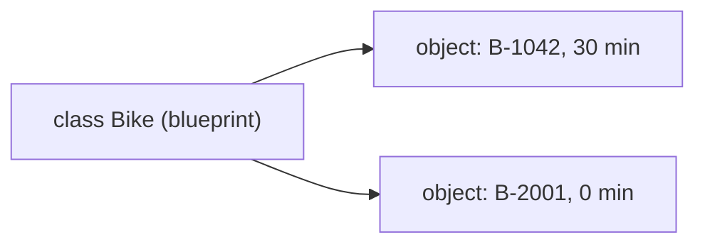

## Hook

Picture a toy factory. The factory has one drawing of a toy bike. From that one drawing, the machines build hundreds of real toy bikes. Each toy is separate. You can paint one red and leave the others blue.

The Spoke kiosk has no drawing like that. It keeps bikes as loose variables: `bikeId1`, `bikeType1`, `bikeId2`, `bikeType2`. Every new bike means copying lines and hoping you changed every number. This page shows you how to draw the blueprint once and build as many bikes as you need.

## Concept

So far, every class you wrote held `public static` methods and a `main`. A class can do much more. It can describe a kind of thing.

```callout jargon
A **class** is a blueprint. It says what data each thing has and what each thing can do. An **object** is one real thing built from that blueprint.
```

```callout analogy
The class `Bike` is the drawing in the factory. Each object is one real bike in a dock. One drawing, many bikes.
```

### Syntax: fields

```java
class Bike {
    String id;
    String type;
    int minutesRidden;
}
```

- A **field** is a variable that lives inside each object.
- Every `Bike` object gets its own `id`, its own `type` and its own `minutesRidden`.
- Fields sit inside the class braces, outside any method.

In the exercise, the fields and methods start with `public`. That word lets code in other classes use them. The next topics explain when to drop it.

### Syntax: creating an object with new

```java nocompile
Bike bike = new Bike();
```

- `new Bike()` builds a fresh object from the `Bike` blueprint.
- `Bike bike` declares a variable whose type is the class `Bike`.
- The variable holds a **reference**: directions to where the object lives in memory.

### Syntax: the dot operator

```java nocompile
bike.id = "B-1042";
bike.type = "classic";
System.out.println(bike.id);
```

The dot means "go inside this object". `bike.id` is the `id` field of that one bike. You can read it or give it a new value.

### Default values

A field you never set still has a value. Java fills it in when it builds the object.

| Field type | Default value |
|---|---|
| `int`, `long` | `0` |
| `double` | `0.0` |
| `boolean` | `false` |
| `String` and other objects | `null` |

```callout jargon
**null** means "no object here". A `String` field that is `null` holds no text at all, not even an empty `""`.
```

If you call a method on `null`, such as `bike.id.length()` when `id` is `null`, the program crashes with a `NullPointerException`. For now, set your String fields before you use them.

### Syntax: instance methods

```java
class Bike {
    int minutesRidden;

    void addRide(int minutes) {
        minutesRidden = minutesRidden + minutes;
    }
}
```

- An **instance method** has no `static`. It belongs to each object.
- Inside it, `minutesRidden` means the field of the object you called it on.
- You call it with the dot: `bike.addRide(20);`

```java nocompile
Bike a = new Bike();
a.addRide(20);
a.addRide(5);
System.out.println(a.minutesRidden);   // 25
```

### Several independent objects

Each `new` builds a separate object. Changing one never changes another.

```java run
public class Main {
    public static void main(String[] args) {
        Bike first = new Bike();
        first.id = "B-1042";
        Bike second = new Bike();
        second.id = "B-2001";

        first.addRide(30);

        System.out.println(first.id + ": " + first.minutesRidden);
        System.out.println(second.id + ": " + second.minutesRidden);
    }
}

class Bike {
    String id;
    int minutesRidden;

    void addRide(int minutes) {
        minutesRidden = minutesRidden + minutes;
    }
}
```

`first` has 30 minutes. `second` still has the default `0`, because nobody rode it.



## Worked example

This bike describes itself and prices a ride using its own type.

```java run
public class Main {
    public static void main(String[] args) {
        Bike bike = new Bike();
        bike.id = "B-1042";
        bike.type = "ebike";
        bike.addRide(45);

        System.out.println(bike.describe());
        System.out.println(bike.fare(10));
    }
}

class Bike {
    String id;
    String type;
    int minutesRidden;

    void addRide(int minutes) {
        minutesRidden = minutesRidden + minutes;
    }

    String describe() {
        return id + " (" + type + "), " + minutesRidden + " min ridden";
    }

    double fare(int minutes) {
        double rate = 0.15;
        if (type.equals("ebike")) {
            rate = 0.30;
        } else if (type.equals("cargo")) {
            rate = 0.25;
        }
        return 1.00 + minutes * rate;
    }
}
```

1. `new Bike()` builds one bike. All its fields start at their defaults.
2. The next two lines set `id` and `type` with the dot operator.
3. `bike.addRide(45)` adds 45 to this bike's `minutesRidden`.
4. `describe()` reads the bike's own fields and builds the text `B-1042 (ebike), 45 min ridden`.
5. `fare(10)` checks this bike's `type`. It is `"ebike"`, so the rate is 0.30. The fare is 1.00 plus 3.00, which prints `4.0`.

Notice that `fare` takes only the minutes. The bike already knows its own type, so you never pass it in.

## Try it

Add a second bike called `cargo` with type `"cargo"`. Give it a ride of 12 minutes and print its description.

```java run
public class Main {
    public static void main(String[] args) {
        Bike bike = new Bike();
        bike.id = "B-3300";
        bike.type = "classic";
        bike.addRide(12);
        System.out.println(bike.describe());
    }
}

class Bike {
    String id;
    String type;
    int minutesRidden;

    void addRide(int minutes) {
        minutesRidden = minutesRidden + minutes;
    }

    String describe() {
        return id + " (" + type + "), " + minutesRidden + " min ridden";
    }
}
```

```callout tip
Class names start with a capital letter, like `Bike`. Variable names start with a small letter, like `bike`. That way you can tell the blueprint from the object.
```

## Recap

- A **class** is a blueprint. An **object** is one thing built from it with `new`.
- **Fields** are variables that every object carries its own copy of.
- The **dot operator** reaches inside one object: `bike.id`, `bike.addRide(5)`.
- **Instance methods** have no `static` and work on the fields of the object you call them on.
- Unset fields get defaults: `0`, `0.0`, `false`, or `null` for objects.

## Common mistakes

**Calling an instance method on the class.**

```java nocompile
Bike.addRide(20);
```

Java says: `non-static method addRide(int) cannot be referenced from a static context`. Java does not know which bike you mean. Build one and call it on that object: `Bike bike = new Bike(); bike.addRide(20);`

**Forgetting new.**

```java nocompile
Bike bike;
bike.id = "B-1042";
```

Java says: `variable bike might not have been initialized`. The variable exists, but no bike was built. Write `Bike bike = new Bike();` first.

**Using a String field you never set.**

```java nocompile
Bike bike = new Bike();
System.out.println(bike.id.length());
```

The program compiles, then crashes with `NullPointerException`. The field `id` is still `null`. Set it first: `bike.id = "B-1042";`
