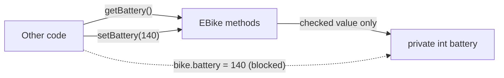

## Hook

Think about a bank card. You can check your balance, and you can pay with it. You cannot open the bank's computer and type a new balance yourself. The bank checks every change first.

Spoke's `EBike` class has no such protection. Any line of code can write `bike.battery = 140;`, and nothing stops it. That is exactly how a rider at Harbor saw 140% battery on her screen. Your ticket is to lock the battery away and let it change only through careful methods.

## Concept

```callout jargon
**Encapsulation** means keeping an object's data inside it, hidden, and letting other code change it only through the object's own methods.
```

So far your fields had no keyword in front, or were `public`, so other classes could read and change them. Here is the risky version:

```java
class EBike {
    String id;
    int battery;
}
```

Somewhere else, a single typo breaks the rule "battery is 0 to 100":

```java nocompile
EBike bike = new EBike();
bike.battery = 140;   // nothing stops this
```

The class cannot defend itself. It never even finds out that the value changed.

### Syntax: a private field

```java
class EBike {
    private int battery;
}
```

- `private` is an **access modifier**. It decides who may use a field or method.
- A `private` field can only be used by code inside the same class.
- Code in any other class gets a compile error if it tries `bike.battery`.

```callout jargon
An **access modifier** is a keyword such as `public` or `private` that says which code is allowed to see a field, method or class.
```

Now the field is safe. But nobody outside can read it either. You fix that with methods.

### The four access levels

`private` is the strictest of four access levels. Each one opens the door a little wider.

| Keyword | Who can use the field or method |
|---|---|
| `private` | only code inside the same class |
| *(no keyword)* | any class in the same package |
| `protected` | the same package, plus child classes anywhere (topic 5) |
| `public` | any class, anywhere |

```callout jargon
**Package-private** is the level you get when you write no keyword at all. Classes in the same **package** (the same `package` line at the top) can use it. Classes outside cannot.
```

A package is a wall around a group of classes. If `docks` has no keyword, a class in another package that reads `tool.docks` gets: `docks is not public in Tool; cannot be accessed from outside package`.

One more rule: a file can hold only one `public` top-level class, and the file must be named after it. Put `public class Extra` inside `Card.java`, and Java says: `class Extra is public, should be declared in a file named Extra.java`.

```callout tip
Start every field at `private`. Open a method up to `public` only when other code really needs it. In topic 1 the exercise used `public` everywhere to keep things simple. From now on, you choose.
```

### Syntax: a getter

```java
class EBike {
    private int battery;

    public int getBattery() {
        return battery;
    }
}
```

- A **getter** is a method that returns the value of a field.
- Its name is `get` plus the field name with a capital letter: `getBattery`.
- It has no `static`, because it reads the battery of one particular bike.
- Other code can now read the value, but it still cannot change it.

```java nocompile
System.out.println(bike.getBattery());   // works
bike.battery = 50;                       // error: battery has private access
```

### Syntax: a setter

```java
class EBike {
    private int battery;

    public void setBattery(int battery) {
        this.battery = battery;
    }
}
```

- A **setter** is a method that changes the value of a field.
- Its name is `set` plus the field name: `setBattery`.
- It returns nothing, so its return type is `void`.
- `this.battery` is the field. Plain `battery` is the parameter.

A setter like this one adds nothing yet. Any value still gets in. The power comes from the next step.

### Syntax: validation inside a setter

**Validation** means checking a value before you accept it. The setter is the one door into the field, so it is the perfect place to check.

```java
class EBike {
    private int battery;

    public void setBattery(int battery) {
        if (battery < 0) {
            battery = 0;
        }
        if (battery > 100) {
            battery = 100;
        }
        this.battery = battery;
    }
}
```

This style is called **clamping**. A value below the range becomes the lowest allowed value. A value above it becomes the highest.

| You call | battery becomes |
|---|---|
| `setBattery(55)` | 55 |
| `setBattery(140)` | 100 |
| `setBattery(-5)` | 0 |

Watch the setter stop a bad value at the door:

```animate
title: The setter checks before it stores
kind: code
code: |
  public class Main {
      public static void main(String[] args) {
          EBike bike = new EBike();
          bike.setBattery(140);
          System.out.println(bike.getBattery() + "%");
      }
  }
  class EBike {
      private int battery;
      public int getBattery() { return battery; }
      public void setBattery(int battery) {
          if (battery > 100) {
              battery = 100;
          }
          this.battery = battery;
      }
  }
steps:
  - line: 3
    objects: { e1: { type: EBike, fields: { battery: 0 } } }
    vars: { bike: "@e1" }
    say: A new e-bike. Its battery field is private, so main can only reach it through methods.
  - line: 4
    say: main asks the setter to store 140. It cannot write bike.battery itself.
  - line: 11
    vars: { this: "@e1", battery: 140 }
    say: Inside setBattery, the parameter battery holds 140. The field in the object is still 0.
  - line: 12
    say: The check asks if 140 is above 100. It is, so the if body runs.
  - line: 13
    vars: { battery: 100 }
    say: The parameter is clamped down to 100. The field has still not changed.
  - line: 15
    objects: { e1: { type: EBike, fields: { battery: 100 } } }
    say: Only now does this.battery get a value, and it is the safe one, 100.
  - line: 16
    vars: { this: ~, battery: ~ }
    say: setBattery ends. Its parameter disappears, but the field keeps 100.
  - line: 5
    out: 100%
    say: Back in main, the getter reads 100. The bad value never reached the field.
```

### Another style: ignore a bad value

Another style is to **ignore** a bad value and keep the old one:

```java
class Station {
    private int freeDocks;

    public void setFreeDocks(int freeDocks) {
        if (freeDocks >= 0 && freeDocks <= 12) {
            this.freeDocks = freeDocks;
        }
    }
}
```

Here `setFreeDocks(30)` changes nothing, because a Spoke kiosk has only 12 docks. Pick the style that fits the rule. For a battery, clamping makes sense: you cannot charge past full.

```callout warning
In production code, quietly ignoring a bad value hides bugs. The caller thinks 30 was stored, and the mistake shows up hours later, far away. Most teams **fail fast**: they throw `new IllegalArgumentException(...)` at once, like the constructors in the last topic. Clamp only when the rule itself says so, like a battery that stops at full.
```

```callout jargon
**Fail fast** means stopping with a clear error the moment something is wrong, instead of carrying on with a bad value.
```

```callout tip
Write the check once, in the setter. Then let the constructor and other methods call the setter. One check means one place to fix.
```

### Syntax: a read-only field

Some values should never change after the object is built. A bike's id is one of them.

```java
class EBike {
    private final String id;

    public EBike(String id) {
        this.id = id;
    }

    public String getId() {
        return id;
    }
}
```

- The field has a getter and **no setter**, so outside code can read it but never change it.
- `final` means the field gets its value once, in the constructor, and then stays fixed.
- If you try to assign `id` again later, even inside the class, the compiler stops you.

```callout analogy
A private field with a getter is like a museum painting behind glass. Everyone can look. Only the staff, using the proper tools, can touch it.
```



### Getters that leak

`private` guards the field, but not always the thing it points to. An array is an object. A getter that returns the array hands out the arrow to your own private data.

```java run
import java.util.Arrays;

public class Main {
    public static void main(String[] args) {
        Station harbor = new Station();
        int[] mine = harbor.getRideMinutes();
        mine[0] = 0;
        System.out.println("Leaky:  " + harbor.getRideMinutes()[0]);

        SafeStation depot = new SafeStation();
        int[] copy = depot.getRideMinutes();
        copy[0] = 0;
        System.out.println("Copied: " + depot.getRideMinutes()[0]);
    }
}

class Station {
    private final int[] rideMinutes = {12, 30, 7};

    public int[] getRideMinutes() {
        return rideMinutes;
    }
}

class SafeStation {
    private final int[] rideMinutes = {12, 30, 7};

    public int[] getRideMinutes() {
        return Arrays.copyOf(rideMinutes, rideMinutes.length);
    }
}
```

It prints `Leaky:  0`, then `Copied: 12`. `main` changed Harbor's private data through the getter. Depot handed out a copy, so its own array stayed safe. Even `final` did not help: it freezes the arrow, not the array.

```callout jargon
A **defensive copy** is a fresh copy of your internal data that you hand out (or take in) instead of the original. Changing the copy cannot hurt your object.
```

`Arrays.copyOf(array, length)` makes a new array with the same values. In module 3 you meet lists, which have the same trap. There you return `List.copyOf(list)`, a copy nobody can change.

### Behaviour, not setters

A setter for every field is barely better than a `public` field. Callers still do the thinking, then push the answer in. Spread over many classes, the rules get lost.

```java nocompile
// Ask, then decide outside: the rule lives in the caller
wallet.setBalanceCents(wallet.getBalanceCents() - 300);

// Tell the object what happened: the rule lives inside
wallet.pay(300);
```

Give the class methods that do a real job, such as `pay`, `charge` or `ride`. Each one checks its own rules.

```java
class Wallet {
    private long balanceCents;

    public Wallet(long balanceCents) {
        this.balanceCents = balanceCents;
    }

    public long getBalanceCents() {
        return balanceCents;
    }

    public void pay(long cents) {
        if (cents > balanceCents) {
            throw new IllegalArgumentException("not enough money: need " + cents + ", have " + balanceCents);
        }
        balanceCents -= cents;
    }
}
```

There is no `setBalanceCents`, so nobody can make up money. Money is kept as whole cents in a `long`, as module 1 showed.

```callout jargon
**Tell, don't ask** is a design rule: tell an object what to do, rather than asking for its data and deciding for it.
```

## Worked example

Here is a small `EBike` with every piece working together.

```java run
public class Main {
    public static void main(String[] args) {
        EBike bike = new EBike("B-1042", 140);
        System.out.println(bike.getId() + " starts at " + bike.getBattery() + "%");

        bike.setBattery(-20);
        System.out.println("After a bad set: " + bike.getBattery() + "%");

        bike.setBattery(65);
        System.out.println("After a good set: " + bike.getBattery() + "%");
    }
}

class EBike {
    private final String id;
    private int battery;

    public EBike(String id, int battery) {
        this.id = id;
        setBattery(battery);
    }

    public String getId() {
        return id;
    }

    public int getBattery() {
        return battery;
    }

    public void setBattery(int battery) {
        if (battery < 0) {
            battery = 0;
        }
        if (battery > 100) {
            battery = 100;
        }
        this.battery = battery;
    }
}
```

It prints:

```
B-1042 starts at 100%
After a bad set: 0%
After a good set: 65%
```

1. `new EBike("B-1042", 140)` runs the constructor. It stores the id.
2. The constructor calls `setBattery(140)`. The setter clamps 140 down to 100.
3. `getId()` and `getBattery()` read the private fields for `main`.
4. `setBattery(-20)` clamps up to 0. `setBattery(65)` is in range, so it is stored as it is.

Notice that `main` never touches a field directly. It cannot. Every change passes through the check.

## Try it

This bike has a `charge` method that uses the setter. Change the numbers, then press **Run**. Try to push the battery above 100.

```java run
public class Main {
    public static void main(String[] args) {
        EBike bike = new EBike(70);
        bike.charge(20);
        System.out.println(bike.getBattery());
        bike.charge(50);
        System.out.println(bike.getBattery());
    }
}

class EBike {
    private int battery;

    public EBike(int battery) {
        setBattery(battery);
    }

    public int getBattery() {
        return battery;
    }

    public void setBattery(int battery) {
        if (battery < 0) {
            battery = 0;
        }
        if (battery > 100) {
            battery = 100;
        }
        this.battery = battery;
    }

    public void charge(int percent) {
        setBattery(battery + percent);
    }
}
```

Now add a method `boolean isLow()` that returns `true` when the battery is below 20. Call it from `main`.

```callout warning
Inside the class, you can still write `battery = 500;` directly. `private` only keeps other classes out. Use your own setter inside the class too, so the check always runs.
```

## Recap

- Mark fields `private`, so only the class itself can touch them.
- Four access levels, narrowest first: `private`, package-private (no keyword), `protected`, `public`.
- A **getter** lets other code read a field. A **setter** lets it change one, through a check.
- Validate every change. Clamp only when the rule says so; otherwise fail fast with `IllegalArgumentException`.
- A field with a getter, no setter and `final` is **read-only**. Return copies, never your own arrays, and prefer methods that do a job (`charge`, `pay`) over setters.

## Common mistakes

**Reading a private field from another class.**

```java nocompile
EBike bike = new EBike("B-1042", 80);
System.out.println(bike.battery);
```

Java says: `battery has private access in EBike`. Call the getter instead: `bike.getBattery()`.

**Forgetting `this` in the setter.**

```java nocompile
public void setBattery(int battery) {
    battery = battery;
}
```

This compiles, but the field never changes. Both names mean the parameter, so the line copies the parameter onto itself. `getBattery()` keeps returning the old value, such as `0`. Write `this.battery = battery;`.

**Checking the value but storing the original.**

```java nocompile
public void setBattery(int value) {
    int safe = value;
    if (safe > 100) {
        safe = 100;
    }
    battery = value;
}
```

This compiles, but `setBattery(140)` still stores 140, and `getBattery()` prints `140`. The last line must store the checked value: `battery = safe;`.
