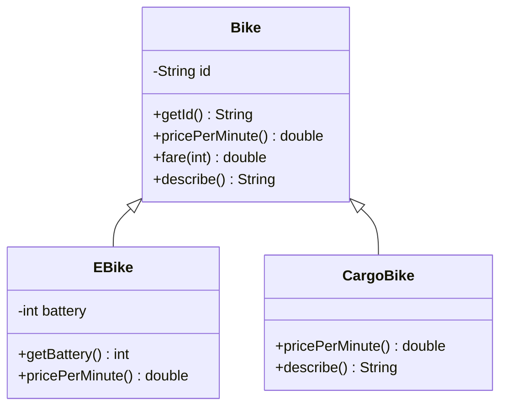

## Hook

Picture a family recipe for pancakes. Your cousin wants blueberry pancakes. She does not rewrite the whole recipe. She writes "make the pancakes from Grandma's recipe, then add blueberries".

Spoke's code has no such shortcut. Someone copied `Bike` into `EBike` and again into `CargoBike`, then changed a few lines. Last week Maya fixed a bug in `Bike`. The two copies still have the bug. Your ticket is to make the e-bike and the cargo bike reuse `Bike` so a fix in one place reaches all three.

## Concept

Java lets one class build on another class. This is called **inheritance**.

```callout jargon
**Inheritance** means a new class gets the fields and methods of an existing class. The existing class is the **superclass** (or parent). The new class is the **subclass** (or child).
```

Here is the `Bike` class every example on this page uses.

```java
class Bike {
    private String id;

    public Bike(String id) {
        this.id = id;
    }

    public String getId() {
        return id;
    }

    public double pricePerMinute() {
        return 0.15;
    }

    public double fare(int minutes) {
        return 1.00 + minutes * pricePerMinute();
    }

    public String describe() {
        return "Bike " + id;
    }
}
```

### Syntax: extends

```java nocompile
class EBike extends Bike {
    // only what is new or different goes here
}
```

The word `extends` says "EBike is a Bike, plus more". An `EBike` object now has `getId()`, `pricePerMinute()`, `fare()` and `describe()` without you writing them again.

```java nocompile
EBike e = new EBike("B-2001", 80);
System.out.println(e.getId());     // B-2001, inherited from Bike
System.out.println(e.fare(10));    // fare() is inherited too
```

A class can extend only one other class. `class EBike extends Bike, Scooter` does not compile.



The arrow points from the child to the parent. Each child lists only what it adds or changes.

### What is inherited

- **Public methods** are inherited. You can call them on the child object.
- **Private fields** exist inside the child object, but the child's code cannot touch them by name. `id` is private in `Bike`, so `EBike` uses `getId()` to read it.
- **Constructors** are never inherited. Each class writes its own.

### Syntax: super(...) in a constructor

The child's constructor must first let the parent set up its own fields. You do that with `super(...)`.

```java nocompile
class EBike extends Bike {
    private int battery;

    public EBike(String id, int battery) {
        super(id);               // runs Bike's constructor with this id
        this.battery = battery;  // then set up the new field
    }

    public int getBattery() {
        return battery;
    }
}
```

```callout warning
`super(...)` must be the very first line of the constructor. Java builds the parent part of the object first, then the child part.
```

If `Bike` had a constructor with no parameters, Java would call it for you. `Bike` only has `Bike(String id)`, so you must write `super(id)` yourself.

### Syntax: overriding a method

An e-bike costs 0.30 per minute. You change that one method by writing it again in the child with the same name, parameters and return type. This is called **overriding**.

```java nocompile
class EBike extends Bike {
    // constructor as before

    @Override
    public double pricePerMinute() {
        return 0.30;
    }
}
```

Now `fare()` in `Bike` calls `pricePerMinute()`. On an `EBike` object, Java runs the e-bike's version. You did not touch `fare()` at all, yet the e-bike fare is right.

```java nocompile
new Bike("B-1042").fare(10);       // 1.00 + 10 * 0.15 = 2.5
new EBike("B-2001", 80).fare(10);  // 1.00 + 10 * 0.30 = 4.0
```

### Syntax: @Override

`@Override` is an **annotation**: a label for the compiler that starts with `@`. It says "I mean to replace a parent method". If you misspell the name, the compiler stops you.

```java nocompile
@Override
public double pricePerMinut() {   // typo: no such method in Bike
    return 0.30;
}
```

The compiler reports `method does not override or implement a method from a supertype`. Without `@Override`, the typo would silently create a new method, and the price would stay 0.15.

### Syntax: calling super.method()

Sometimes the child wants the parent's answer plus a little extra. `super.describe()` calls the parent's version of `describe()`.

```java nocompile
class CargoBike extends Bike {
    public CargoBike(String id) {
        super(id);
    }

    @Override
    public String describe() {
        return super.describe() + " [cargo]";
    }
}
```

For bike `B-1042`, `super.describe()` gives `Bike B-1042`. The cargo version returns `Bike B-1042 [cargo]`.

### Syntax: protected

```java nocompile
class Bike {
    protected String id;   // subclasses can read and change this
}
```

`protected` sits between `private` and `public`. Subclasses (and classes in the same package) can use the field directly. Classes in the same package are the files that share the same `package` line at the top. Most of the time, keep fields `private` and give the child a getter. That way the parent stays in charge of its own data.

## Worked example

This program puts the three classes side by side.

```java run
public class Main {
    public static void main(String[] args) {
        Bike classic = new Bike("B-1042");
        EBike ebike = new EBike("B-2001", 80);
        CargoBike cargo = new CargoBike("B-3005");

        System.out.println(classic.describe() + " costs " + classic.fare(20));
        System.out.println(ebike.describe() + " costs " + ebike.fare(20));
        System.out.println(cargo.describe() + " costs " + cargo.fare(20));
        System.out.println("Battery: " + ebike.getBattery());
    }
}

class Bike {
    private String id;

    public Bike(String id) {
        this.id = id;
    }

    public String getId() {
        return id;
    }

    public double pricePerMinute() {
        return 0.15;
    }

    public double fare(int minutes) {
        return 1.00 + minutes * pricePerMinute();
    }

    public String describe() {
        return "Bike " + id;
    }
}

class EBike extends Bike {
    private int battery;

    public EBike(String id, int battery) {
        super(id);
        this.battery = battery;
    }

    public int getBattery() {
        return battery;
    }

    @Override
    public double pricePerMinute() {
        return 0.30;
    }
}

class CargoBike extends Bike {
    public CargoBike(String id) {
        super(id);
    }

    @Override
    public double pricePerMinute() {
        return 0.25;
    }

    @Override
    public String describe() {
        return super.describe() + " [cargo]";
    }
}
```

Line by line:

- `new EBike("B-2001", 80)` runs the `EBike` constructor. Its first line, `super(id)`, runs the `Bike` constructor, which stores the id.
- `ebike.describe()` is not written in `EBike`, so Java uses the inherited one from `Bike`.
- `ebike.fare(20)` runs `Bike.fare`. Inside it, `pricePerMinute()` picks the `EBike` version, 0.30. The result is 1.00 + 20 × 0.30 = 7.0.
- `cargo.describe()` runs the cargo override, which calls `super.describe()` and adds ` [cargo]`.
- `ebike.getBattery()` works because `getBattery` lives in `EBike`. A plain `Bike` has no battery.

## Try it

Run this short program. Then add a `@Override` of `describe()` in `EBike` that returns `super.describe() + " [electric]"`. Run it again and compare.

```java run
public class Main {
    public static void main(String[] args) {
        EBike e = new EBike("B-2001", 45);
        System.out.println(e.describe());
        System.out.println(e.fare(10));
        System.out.println(e.getBattery() + "%");
    }
}

class Bike {
    private String id;

    public Bike(String id) {
        this.id = id;
    }

    public double pricePerMinute() {
        return 0.15;
    }

    public double fare(int minutes) {
        return 1.00 + minutes * pricePerMinute();
    }

    public String describe() {
        return "Bike " + id;
    }
}

class EBike extends Bike {
    private int battery;

    public EBike(String id, int battery) {
        super(id);
        this.battery = battery;
    }

    public int getBattery() {
        return battery;
    }

    @Override
    public double pricePerMinute() {
        return 0.30;
    }
}
```

```callout tip
Byte says: when two classes share most of their code, ask "is this one a kind of that one?" If the answer is yes, `extends` is a good fit.
```

## Recap

- `class EBike extends Bike` makes `EBike` a subclass that inherits the public methods of `Bike`.
- Constructors are not inherited. Call `super(...)` on the first line to run the parent's constructor.
- Override a method by writing it again with the same signature. Put `@Override` above it so the compiler checks the name.
- `super.method()` calls the parent's version, so you can add to it instead of copying it.
- `protected` lets subclasses reach a field, but `private` plus a getter is usually safer.

## Common mistakes

**Forgetting super(...) when the parent has no empty constructor.**

```java nocompile
class EBike extends Bike {
    private int battery;

    public EBike(String id, int battery) {
        this.battery = battery;
    }
}
```

Java says: `constructor Bike in class Bike cannot be applied to given types;` with `required: String` and `found: no arguments`. Java tried to call `Bike()` for you, and that constructor does not exist. Add `super(id);` as the first line.

**Using a private parent field in the child.**

```java nocompile
class CargoBike extends Bike {
    public CargoBike(String id) {
        super(id);
    }

    @Override
    public String describe() {
        return "Bike " + id + " [cargo]";
    }
}
```

Java says: `id has private access in Bike`. The child cannot read a private field by name. Use `getId()`, or better, `super.describe() + " [cargo]"`.

**Misspelling the method you meant to override.**

```java nocompile
class EBike extends Bike {
    public EBike(String id) {
        super(id);
    }

    @Override
    public double pricePerMin() {
        return 0.30;
    }
}
```

Java says: `method does not override or implement a method from a supertype`. Be glad it did. Without `@Override`, the e-bike would quietly keep the 0.15 price. Rename the method to `pricePerMinute` to match `Bike` exactly.
