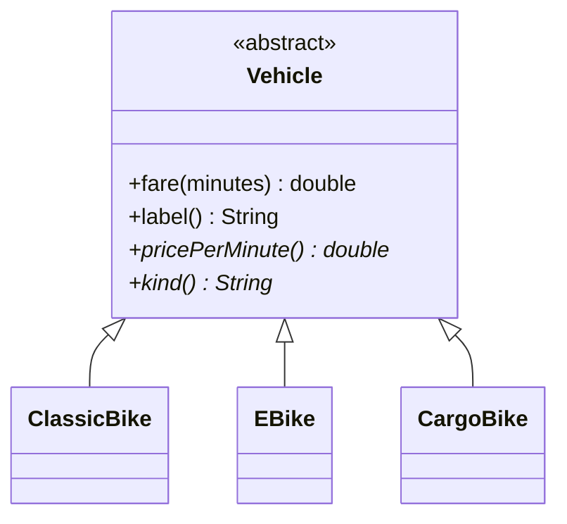

## Hook

Imagine a shop that sells "fruit". You ask for one fruit, please. The shopkeeper stares at you. Which fruit? An apple? A banana? "Fruit" is only a group name. You can never hold a plain fruit in your hand.

Spoke has the same problem. Someone typed `new Vehicle(...)` into the Old Mill kiosk. That vehicle had no type and no price per minute. A rider paid only the $1.00 unlock fee for a 40-minute ride. Your ticket is to make that impossible.

## Concept

In the last two topics you built a family of classes. `Vehicle` was the parent. `ClassicBike`, `EBike` and `CargoBike` extended it. The trouble is that `Vehicle` itself was a normal class, so anyone could create one.

```callout jargon
An **abstract class** is a class you can never create objects from. It exists only to be extended. The opposite, a normal class you can create objects from, is called a **concrete class**.
```

### Syntax: an abstract class

```java
abstract class Vehicle {
    private String id;

    Vehicle(String id) {
        this.id = id;
    }
}
```

Put the word `abstract` before `class`. Everything else looks the same. An abstract class can still have fields, constructors and normal methods.

### Syntax: new fails on an abstract class

```java nocompile
Vehicle v = new Vehicle("B-1042");
```

Java refuses to compile this line. The compiler says:

```text
error: Vehicle is abstract; cannot be instantiated
```

**Instantiated** means "turned into an object". So the message reads: you cannot make an object from `Vehicle`. That one word fixes Kakashi's ticket.

You can still create the subclasses. A `Vehicle` variable can still hold them too, just like in the polymorphism topic.

```java nocompile
Vehicle v = new EBike("B-1042");   // fine: EBike is concrete
```

### Syntax: an abstract method

```java nocompile
abstract double pricePerMinute();
```

```callout jargon
An **abstract method** is a method with a name, parameters and a return type, but no body. It ends with a semicolon where the curly braces would go.
```

An abstract method says: "every vehicle has a price per minute, but I don't know it yet." Each subclass fills in the real number. Only an abstract class may hold abstract methods.

### Syntax: a subclass implements the abstract method

```java nocompile
class EBike extends Vehicle {
    EBike(String id) {
        super(id);
    }

    @Override
    double pricePerMinute() {
        return 0.30;
    }
}
```

To **implement** a method means to write its body. `EBike` now gives `pricePerMinute()` a real answer. `@Override` asks the compiler to check that the name and parameters match the parent.

```callout warning
A concrete subclass must implement every abstract method of its parent. If it skips even one, the class does not compile.
```

### Concrete methods that call abstract ones

Here is the clever part. An abstract class can have normal methods that call its own abstract methods.

```java nocompile
double fare(int minutes) {
    return 1.00 + minutes * pricePerMinute();
}
```

`fare` is written once, in `Vehicle`, and does not know which bike it is working for. Watch which `pricePerMinute()` runs when an e-bike asks for its fare:

```animate
title: Vehicle's fare asks the real bike
kind: code
code: |
  public class Main {
      public static void main(String[] args) {
          Vehicle v = new EBike();
          System.out.println(v.fare(10));
      }
  }
  abstract class Vehicle {
      abstract double pricePerMinute();
      double fare(int minutes) { return 1.00 + minutes * pricePerMinute(); }
  }
  class EBike extends Vehicle {
      @Override
      double pricePerMinute() { return 0.30; }
  }
steps:
  - line: 3
    vars: { v: "@e1" }
    objects: { e1: { type: EBike } }
    say: new Vehicle() would not compile, because Vehicle is abstract. EBike is concrete, so Java builds one. v has type Vehicle but points at the EBike.
  - line: 4
    say: v.fare(10) is called. EBike has no fare of its own, so Java runs the one it inherited from Vehicle.
  - line: 9
    say: fare needs pricePerMinute(). Vehicle only promised that method. It has no body to run.
  - line: 13
    say: So Java asks the real object. It is an EBike, so EBike's pricePerMinute() runs and returns 0.30.
  - line: 9
    say: Back in fare, 1.00 + 10 * 0.30 is 4.0. fare hands 4.0 back to main.
  - line: 4
    out: "4.0"
    say: println prints the fare. A ClassicBike would run the very same fare with its own price, 0.15, and get 2.5.
```

### The template method idea

```callout analogy
Think of a recipe card for a sandwich: "take bread, add the filling, close it". The card is fixed. Each customer chooses the filling. In code, the fixed steps live in the abstract class, and the subclasses supply the missing piece.
```

Programmers call this the **template method** idea. The parent writes the template, the steps that never change. The subclasses fill in the blanks.



In the diagram, a `*` marks an abstract method. Each of the three bikes must write both of them.

## Worked example

Here is a small fleet with an abstract `Vehicle` and two concrete bikes.

```java run
public class Main {
    public static void main(String[] args) {
        Vehicle[] fleet = { new ClassicBike("B-1001"), new EBike("B-1042") };
        for (int i = 0; i < fleet.length; i++) {
            System.out.println(fleet[i].label() + " costs " + fleet[i].fare(10));
        }
    }
}

abstract class Vehicle {
    private String id;

    Vehicle(String id) {
        this.id = id;
    }

    abstract double pricePerMinute();

    abstract String kind();

    double fare(int minutes) {
        return 1.00 + minutes * pricePerMinute();
    }

    String label() {
        return kind() + " " + id;
    }
}

class ClassicBike extends Vehicle {
    ClassicBike(String id) {
        super(id);
    }

    @Override
    double pricePerMinute() {
        return 0.15;
    }

    @Override
    String kind() {
        return "classic";
    }
}

class EBike extends Vehicle {
    EBike(String id) {
        super(id);
    }

    @Override
    double pricePerMinute() {
        return 0.30;
    }

    @Override
    String kind() {
        return "ebike";
    }
}
```

It prints:

```text
classic B-1001 costs 2.5
ebike B-1042 costs 4.0
```

Line by line:

- `abstract class Vehicle` means nobody can write `new Vehicle(...)`.
- `abstract double pricePerMinute();` has no body. Each bike must supply one.
- `fare` and `label` are concrete. They call the abstract methods without knowing the real bike.
- `ClassicBike` and `EBike` call `super(id)` to hand the id to `Vehicle`'s constructor.
- The array type is `Vehicle[]`. It can hold any kind of bike.
- In the loop, `fleet[i].fare(10)` uses 0.15 for the classic bike and 0.30 for the e-bike.

## Try it

Add a cargo bike to the fleet. Copy the `EBike` class, rename it `CargoBike`, and return 0.25 and `"cargo"`. Then put `new CargoBike("B-2001")` in the array.

```java run
public class Main {
    public static void main(String[] args) {
        Vehicle[] fleet = { new ClassicBike("B-1001"), new EBike("B-1042") };
        for (int i = 0; i < fleet.length; i++) {
            System.out.println(fleet[i].label() + " costs " + fleet[i].fare(20));
        }
    }
}

abstract class Vehicle {
    private String id;

    Vehicle(String id) {
        this.id = id;
    }

    abstract double pricePerMinute();

    abstract String kind();

    double fare(int minutes) {
        return 1.00 + minutes * pricePerMinute();
    }

    String label() {
        return kind() + " " + id;
    }
}

class ClassicBike extends Vehicle {
    ClassicBike(String id) {
        super(id);
    }

    @Override
    double pricePerMinute() {
        return 0.15;
    }

    @Override
    String kind() {
        return "classic";
    }
}

class EBike extends Vehicle {
    EBike(String id) {
        super(id);
    }

    @Override
    double pricePerMinute() {
        return 0.30;
    }

    @Override
    String kind() {
        return "ebike";
    }
}
```

As written, it prints `classic B-1001 costs 4.0` and `ebike B-1042 costs 7.0`. Add your `CargoBike` and run it again. A third line appears with no change to the loop.

```callout tip
Try deleting the `kind()` method from `EBike` and press Run. Read the compiler message. It names the exact method you forgot.
```

## Recap

- Write `abstract class` for a parent you never want to create directly.
- `new` on an abstract class fails with `is abstract; cannot be instantiated`.
- An abstract method has no body and ends with a semicolon.
- A concrete subclass must implement every abstract method.
- Normal methods in the abstract class can call abstract ones. Each subclass fills in the blanks.

## Common mistakes

**Creating an object from the abstract class.**

```java nocompile
Vehicle v = new Vehicle("B-1042");
```

Java says: `Vehicle is abstract; cannot be instantiated`. Create a concrete subclass instead: `Vehicle v = new EBike("B-1042");`

**Forgetting to implement an abstract method.**

```java nocompile
abstract class Vehicle {
    abstract double pricePerMinute();
    abstract String kind();
}

class CargoBike extends Vehicle {
    double pricePerMinute() {
        return 0.25;
    }
}
```

Java says: `CargoBike is not abstract and does not override abstract method kind() in Vehicle`. Add the missing method to `CargoBike`: `String kind() { return "cargo"; }`.

**Giving an abstract method a body.**

```java nocompile
abstract class Vehicle {
    abstract double pricePerMinute() {
        return 0.15;
    }
}
```

Java says: `abstract methods cannot have a body`. Remove the braces and end the line with a semicolon: `abstract double pricePerMinute();`. Put the real price in each subclass.
