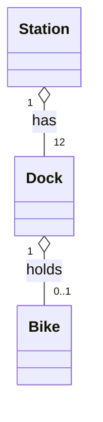

## Hook

Walk up to Riverside station. You see a sign, a kiosk and a row of 12 docks. Each dock may hold one bike.

Now read the code someone wrote last sprint: `class Station extends Dock`. That line says a station **is a** dock. So the code thinks Riverside is one single dock, with room for one bike. That is why it reports 1 free dock instead of 12.

A station is not a kind of dock. A station **has** docks. In this lesson you learn how to say "has" in Java.

## Concept

There are two ways one class can use another class.

```callout jargon
**Inheritance** (is-a): a class `extends` a parent and becomes a kind of that parent. An `EBike` is a `Vehicle`.
**Composition** (has-a): a class keeps another object in a field. A `Station` has `Dock` objects.
```

A quick test helps you choose. Say the sentence out loud.

- "An e-bike **is a** vehicle." That sounds right, so `EBike extends Vehicle` fits.
- "A station **is a** dock." That sounds wrong.
- "A station **has** docks." That sounds right, so use composition.
- "A rider **has** a membership." Composition again.

### Syntax: a field that holds an object

```java nocompile
class Dock {
    private Bike bike;   // a dock HAS a bike, or null when empty
}
```

A field's type can be any class, not only `int` or `String`. The field `bike` holds a reference to a `Bike` object.

A **reference** is the address of an object. The field does not copy the bike. It points to the bike that already exists.

An object field starts as `null` until you put an object in it. In a dock, `null` means "no bike here". That gives you a simple check:

```java nocompile
public boolean isFree() {
    return bike == null;
}
```

### Syntax: an array of objects

```java nocompile
Dock[] docks = new Dock[12];
```

This line makes 12 slots. It does **not** make 12 docks. Every slot starts as `null`, just like a `String[]`. You fill the slots yourself with `new`:

```java nocompile
for (int i = 0; i < docks.length; i++) {
    docks[i] = new Dock();
}
```

Watch a small rack of 3 fill up, then take a bike:

```animate
title: A rack, its docks and a bike
kind: code
code: |
  public class Main {
      public static void main(String[] args) {
          Dock[] docks = new Dock[3];
          for (int i = 0; i < docks.length; i++) {
              docks[i] = new Dock();
          }
          docks[0].bike = new Bike("B-1042");
          System.out.println("Dock 2 free: " + (docks[1].bike == null));
      }
  }
  class Dock { Bike bike; }
  class Bike { String id; Bike(String id) { this.id = id; } }
steps:
  - line: 3
    vars: { docks: "@rack" }
    objects: { rack: { type: "Dock[]", fields: { "0": null, "1": null, "2": null } } }
    say: new Dock[3] builds the rack. It has 3 slots, and every slot is null. There are no docks yet.
  - line: 4
    vars: { i: 0 }
    say: The loop starts with i at 0, and 0 is less than docks.length, which is 3.
  - line: 5
    objects:
      d0: { type: Dock, fields: { bike: null } }
      rack: { type: "Dock[]", fields: { "0": "@d0", "1": null, "2": null } }
    say: First round. new Dock() builds a real dock, and slot 0 points at it. Its bike field starts as null, so no bike yet.
  - line: 5
    vars: { i: 1 }
    objects:
      d1: { type: Dock, fields: { bike: null } }
      rack: { type: "Dock[]", fields: { "0": "@d0", "1": "@d1", "2": null } }
    say: Second round fills slot 1 the same way.
  - line: 5
    vars: { i: 2 }
    objects:
      d2: { type: Dock, fields: { bike: null } }
      rack: { type: "Dock[]", fields: { "0": "@d0", "1": "@d1", "2": "@d2" } }
    say: Third round fills slot 2. Every slot now points at a real dock, so asking any of them a question is safe.
  - line: 7
    vars: { i: ~ }
    objects:
      b1: { type: Bike, fields: { id: '"B-1042"' } }
      d0: { type: Dock, fields: { bike: "@b1" } }
    say: A bike arrives at dock 1. The dock's bike field now points at the Bike. The dock has the bike; it does not copy it. Here bike is not private, to keep the demo short.
  - line: 8
    out: "Dock 2 free: true"
    say: Dock 2 lives in slot 1. Its bike field is still null, so it is free.
```

```callout warning
`new Dock[12]` builds the rack, and `new Dock()` builds one dock. Forget the loop, and `docks[0].isFree()` crashes with a `NullPointerException`.
```

### Building the docks in the constructor

The best place for that loop is the constructor. Then every `Station` is born with 12 real docks.

```java nocompile
class Station {
    private final String name;
    private final Dock[] docks;

    Station(String name) {
        this.name = name;
        this.docks = new Dock[12];
        for (int i = 0; i < docks.length; i++) {
            docks[i] = new Dock();
        }
    }
}
```

### Syntax: delegation

```java nocompile
public boolean isFree(int number) {
    return docks[number - 1].isFree();
}
```

**Delegation** means a method passes the work to an object it holds. The station does not check bikes itself. It asks the dock.

```animate
title: The station asks its dock
kind: scene
nodes:
  - { id: kiosk, label: Kiosk, emoji: "🖥️" }
  - { id: station, label: Station Riverside, emoji: "🚏" }
  - { id: dock, label: Dock 2, emoji: "🔌", value: "bike: null" }
steps:
  - say: A rider asks the kiosk if dock 2 is free. The kiosk calls isFree(2) on the station.
    send: { from: kiosk, to: station, label: "isFree(2)" }
  - say: The station does not look at bikes itself. It finds docks[1] and passes the question on. That is delegation.
    send: { from: station, to: dock, label: "isFree()" }
  - say: The dock checks its own private bike field. It holds null, so the answer is true.
    focus: [dock]
  - say: The dock answers the station.
    send: { from: dock, to: station, label: "true", back: true }
  - say: The station passes the answer back to the kiosk. Each class did only its own job.
    send: { from: station, to: kiosk, label: "true", back: true }
```

Each class keeps its own job. `Dock` knows about one bike. `Station` knows about 12 docks. Neither one reaches inside the other's private fields.



### When to choose composition

- The sentence "A is a B" sounds wrong, but "A has a B" sounds right.
- You need more than one of the thing. A class can extend only one parent, yet it can hold 12 docks.
- You want to swap a part later. A field can point to a different object; a parent class is fixed forever.

When you are unsure, start with composition. It ties classes together less tightly.

## Worked example

Here is a tiny station with 3 docks so the output stays short.

```java run
public class Main {
    public static void main(String[] args) {
        Station harbor = new Station();
        System.out.println(harbor.dock(new Bike("B-1042")));
        System.out.println(harbor.dock(new Bike("B-2001")));
        System.out.println(harbor.dock(new Bike("B-3300")));
        System.out.println(harbor.dock(new Bike("B-4400")));
    }
}

class Bike {
    private final String id;
    Bike(String id) { this.id = id; }
    String getId() { return id; }
}

class Dock {
    private Bike bike;
    boolean isFree() { return bike == null; }
    void park(Bike bike) { this.bike = bike; }
    Bike getBike() { return bike; }
}

class Station {
    private final Dock[] docks = new Dock[3];

    Station() {
        for (int i = 0; i < docks.length; i++) {
            docks[i] = new Dock();
        }
    }

    int dock(Bike bike) {
        for (int i = 0; i < docks.length; i++) {
            if (docks[i].isFree()) {
                docks[i].park(bike);
                return i + 1;
            }
        }
        return -1;
    }
}
```

Line by line:

- `Dock` holds one `Bike` field. `isFree()` is true while that field is `null`.
- `Station` holds an array of 3 `Dock` objects. Its constructor fills every slot with `new Dock()`.
- `dock(bike)` walks the array. At the first free dock it **delegates**: it calls `park` on that dock.
- It returns `i + 1`, because people count docks from 1 while arrays count from 0.
- The fourth bike finds no free dock, so the loop ends and the method returns `-1`.

The output is `1`, `2`, `3` and `-1`, each on its own line.

## Try it

Add a `freeDocks()` method that counts free docks. It delegates to `isFree()` on every dock.

```java run
public class Main {
    public static void main(String[] args) {
        Station uptown = new Station();
        uptown.park("B-1042");
        uptown.park("B-2001");
        System.out.println("Free docks at Uptown: " + uptown.freeDocks());
    }
}

class Dock {
    private String bikeId;
    boolean isFree() { return bikeId == null; }
    void park(String id) { bikeId = id; }
}

class Station {
    private final Dock[] docks = new Dock[12];

    Station() {
        for (int i = 0; i < docks.length; i++) {
            docks[i] = new Dock();
        }
    }

    void park(String id) {
        for (Dock dock : docks) {
            if (dock.isFree()) {
                dock.park(id);
                return;
            }
        }
    }

    int freeDocks() {
        int count = 0;
        for (Dock dock : docks) {
            if (dock.isFree()) {
                count++;
            }
        }
        return count;
    }
}
```

Park two more bikes and run it again. Then change the array to `new Dock[20]` and watch the count change.

## Recap

- Is-a means inheritance with `extends`. Has-a means composition: one object holds another in a field.
- Say the sentence out loud. If "A has a B" sounds right, hold a B in a field.
- `new Dock[12]` makes 12 empty slots. Fill each one with `new Dock()`, usually in the constructor.
- Delegation means a method passes the work to an object it holds, like `docks[i].park(bike)`.
- Prefer composition when you need many parts, or when "is a" sounds wrong.

## Common mistakes

**1. Using extends for a has-a link.**

```java nocompile
class Dock {
    private Bike bike;
    boolean isFree() { return bike == null; }
    void park(Bike bike) { this.bike = bike; }
}

class Station extends Dock {
}
```

This compiles, so the compiler cannot help you. The bug shows up when the code runs. Every `park` call on a station overwrites the same single bike. A `Station` built this way is one dock. The fix is to remove `extends Dock` and give `Station` a `Dock[]` field.

**2. Making the array but not the docks.**

```java nocompile
Station(String name) {
    this.name = name;
    this.docks = new Dock[12];
}
```

The first call to `docks[0].isFree()` crashes:

```text
Exception in thread "main" java.lang.NullPointerException: Cannot invoke "Dock.isFree()" because "this.docks[0]" is null
```

Add the loop that puts a `new Dock()` in every slot.

**3. Returning the index instead of the dock number.**

```java nocompile
if (docks[i].isFree()) {
    docks[i].park(bike);
    return i;
}
```

The first bike reports dock `0`, and riders look for a dock that is not painted on the rack. Return `i + 1` instead. Going the other way, use `docks[number - 1]`.
