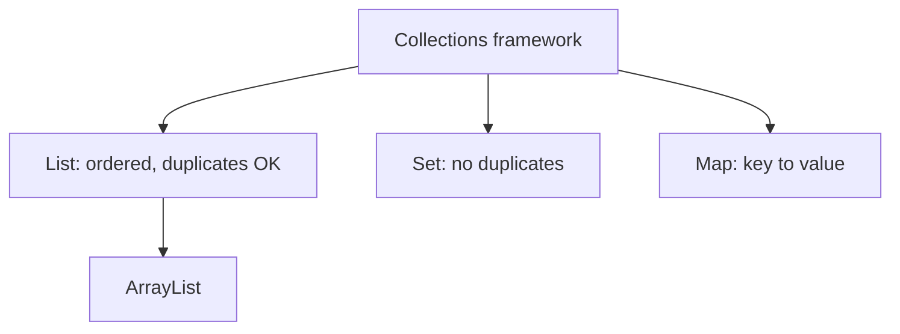

## Hook

Picture an egg box with 12 holes. It holds 12 eggs. When egg number 13 arrives, there is no hole for it. You cannot stretch the box.

The Riverside kiosk keeps its ride log in a box like that. It is an array with room for 100 rides. Yesterday, ride 101 ended, and the kiosk crashed. Tsunade wants a log that grows as long as riders keep riding.

## Concept

### Why an array cannot grow

When you create an array, Java sets aside room for an exact number of items. That number never changes.

```java
String[] rides = new String[3];
rides[0] = "B-1042";
rides[1] = "B-2001";
rides[2] = "B-3300";
```

Now all 3 slots are full. Writing to `rides[3]` crashes the program with an `ArrayIndexOutOfBoundsException`. To store a fourth ride, you would have to make a bigger array and copy everything across by hand.

```java run crash
public class Main {
    public static void main(String[] args) {
        String[] rides = new String[2];
        rides[0] = "B-1042";
        rides[1] = "B-2001";
        System.out.println("Slots: " + rides.length);
        rides[2] = "B-3300";
        System.out.println("You never see this line.");
    }
}
```

### The collections family

Java ships with ready-made containers that grow on their own. Together they are called the **collections framework**.

```callout jargon
A **collection** is an object that holds a group of other objects. A **framework** is a set of classes and interfaces built to work together.
```

Three members of the family cover most jobs:

- **List**: items in order, with positions 0, 1, 2 and so on. Duplicates are allowed. Use it for "the rides in the order they happened".
- **Set**: no duplicates, and no positions. Use it for "which bikes went out today", where each bike id counts once.
- **Map**: pairs of a **key** and a **value**. You look up a value by its key. Use it for "minutes ridden per bike", where the bike id is the key and the minutes are the value.



`List`, `Set` and `Map` are interfaces, like the ones you wrote in module 2. Each interface has classes that do the real work. This topic uses one of them: `ArrayList`. Lists, sets and maps each get their own topic next.

```callout analogy
A List is a numbered queue at the dock. A Set is a guest list where each name appears once. A Map is a coat check: you hand over a ticket (the key) and get your coat (the value).
```

### ArrayList: an array that grows

`ArrayList` keeps an array inside it. When that array fills up, `ArrayList` makes a bigger one and copies the items for you. You never see the copying.

### Syntax: creating a list

```java nocompile
List<String> bikeIds = new ArrayList<>();
```

- `List<String>` is the type of the variable. The `<String>` part says every item is a `String`.
- `new ArrayList<>()` creates an empty, growable list.
- The empty `<>` is called the **diamond**. Java copies `String` from the left side, so you do not type it twice.
- You need two imports at the top of the file: `import java.util.List;` and `import java.util.ArrayList;`.

```callout jargon
The type inside the angle brackets is a **type argument**. It tells the list what it may hold. Writing your own classes with angle brackets comes in topic 05.
```

A list holds objects only. For whole numbers you write `List<Integer>`, because `int` is a primitive. Java turns each `int` into an `Integer` for you when you add it.

```java nocompile
List<Integer> minutes = new ArrayList<>();
minutes.add(25);
```

### Syntax: add, get and size

```java nocompile
bikeIds.add("B-1042");
String first = bikeIds.get(0);
int howMany = bikeIds.size();
```

- `add(item)` puts the item on the end of the list. The list grows by one.
- `get(index)` gives back the item at that position. Positions start at 0, like arrays.
- `size()` gives back how many items the list holds right now. Arrays use `.length`; lists use `.size()`.

Short examples:

```java nocompile
List<String> stations = new ArrayList<>();
stations.add("Riverside");             // size is now 1
stations.add("Harbor");                // size is now 2
System.out.println(stations.get(1));   // Harbor
System.out.println(stations);          // [Riverside, Harbor]
```

A list prints nicely on its own. Its `toString` shows every item inside square brackets.

### Choosing the right collection

Ask yourself one question about the job:

- Does order matter, or can the same item appear twice? Pick a **List**.
- Must each item appear only once? Pick a **Set**.
- Do you look things up by a name or id? Pick a **Map**.

## Worked example

This program logs four rides at Riverside. An array of size 2 would crash. The list just grows.

```java run
import java.util.ArrayList;
import java.util.List;

public class Main {
    public static void main(String[] args) {
        List<String> rideLog = new ArrayList<>();
        rideLog.add("B-1042");
        rideLog.add("B-2001");
        rideLog.add("B-3300");
        rideLog.add("B-1042");
        System.out.println("Rides today: " + rideLog.size());
        System.out.println("First ride: " + rideLog.get(0));
        System.out.println(rideLog);
    }
}
```

1. The two imports bring in `List` and `ArrayList` from the `java.util` package.
2. `new ArrayList<>()` makes an empty list of strings.
3. Four calls to `add` put four bike ids on the end, in order.
4. `B-1042` appears twice. A list allows that, because the same bike can ride twice.
5. `size()` gives 4, and `get(0)` gives the first bike id.
6. Printing the list shows `[B-1042, B-2001, B-3300, B-1042]`.

## Try it

Add more rides with `add` and press **Run**. The list never runs out of room.

```java run
import java.util.ArrayList;
import java.util.List;

public class Main {
    public static void main(String[] args) {
        List<Integer> minutes = new ArrayList<>();
        for (int i = 1; i <= 150; i++) {
            minutes.add(i);
        }
        System.out.println("Stored rides: " + minutes.size());
        System.out.println("Last ride minutes: " + minutes.get(minutes.size() - 1));
    }
}
```

Change `150` to `1000` and run it again.

```callout tip
The last item sits at `size() - 1`. Asking for `get(size())` is one step past the end.
```

## Recap

- An array has a fixed size. It crashes when you write past its last slot.
- The collections framework gives you containers that grow: `List`, `Set` and `Map`.
- A List keeps order and allows duplicates. A Set keeps each item once. A Map pairs keys with values.
- `List<String> ids = new ArrayList<>();` creates a growable list. The diamond `<>` copies the type from the left.
- `add` puts an item on the end, `get(i)` reads position `i`, and `size()` counts the items.

## Common mistakes

**Forgetting the imports.**

```java nocompile
public class Main {
    public static void main(String[] args) {
        List<String> ids = new ArrayList<>();
    }
}
```

Java says: `cannot find symbol` for `List` and for `ArrayList`. Add `import java.util.ArrayList;` and `import java.util.List;` at the top of the file.

**Putting a primitive inside the angle brackets.**

```java nocompile
List<int> minutes = new ArrayList<>();
```

Java says: `unexpected type` with `required: reference` and `found: int`. Use the class version: `List<Integer> minutes = new ArrayList<>();`.

**Using `.length` on a list.**

```java nocompile
List<String> ids = new ArrayList<>();
System.out.println(ids.length);
```

Java says: `cannot find symbol` for `length`. Arrays use `.length`, but lists use the method `size()`: `ids.size()`.
