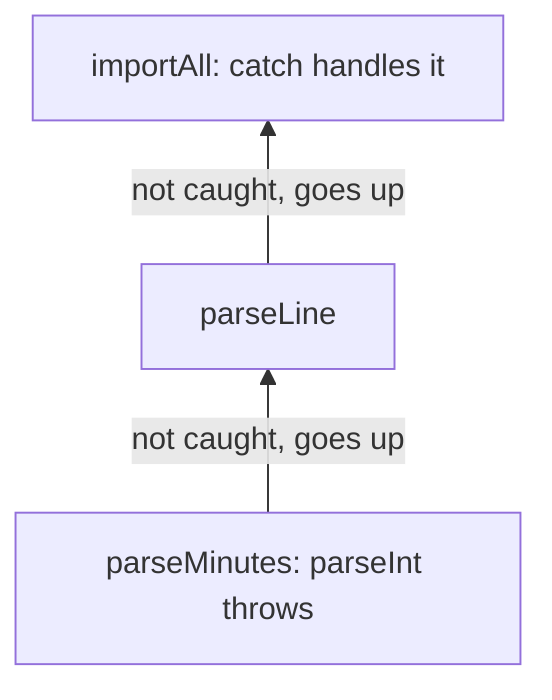

## Hook

Picture a cashier scanning a long line of shopping baskets. One item has a torn barcode. A careless cashier shuts the whole shop and sends everyone home. A good cashier puts that item aside, writes a note, and keeps scanning.

Right now the Spoke ride import is the careless cashier. One line says `twenty` where a number should be. Java gives up, and every ride after that line is lost. In this lesson you learn how to put the bad item aside and keep going.

## Concept

### What an exception is

An **exception** is an object Java creates when something goes wrong while the program runs. Java then **throws** it. Throwing means Java stops the current line and hands the problem upward.

Here is a line that throws:

```java
int minutes = Integer.parseInt("twenty");
```

`Integer.parseInt` turns text like `"25"` into the number `25`. It cannot read `"twenty"`, so it throws a `NumberFormatException`.

```callout jargon
An **exception** is a problem report object. Its class name says what kind of problem happened, such as `NumberFormatException`.
```

If nothing catches the exception, the program crashes. Java prints a **stack trace** and stops.

### Reading a stack trace

A stack trace is the crash report. It looks like this:

```text
Exception in thread "main" java.lang.NumberFormatException: For input string: "twenty"
    at java.base/java.lang.NumberFormatException.forInputString(NumberFormatException.java:67)
    at java.base/java.lang.Integer.parseInt(Integer.java:662)
    at java.base/java.lang.Integer.parseInt(Integer.java:778)
    at Main.parseMinutes(Main.java:3)
    at Main.main(Main.java:7)
```

Read it from the top:

1. The first line names the exception type and its **message**: `For input string: "twenty"`.
2. Each `at` line is one method call that was running. The top one is where the problem started, deep inside Java.
3. Look down the list for the first line that is your own code. Here it is `Main.java:3`, so line 3 of your file.

```callout tip
Skip the `java.base` lines at first. They are inside Java itself. Your bug is almost always in the first line that names your own file.
```

### Syntax: try and catch

```java nocompile
try {
    // code that might throw
} catch (ExceptionType e) {
    // what to do if it does
}
```

- `try` wraps the risky code.
- If a line inside `try` throws, Java jumps straight to the matching `catch`. The rest of the `try` block is skipped.
- `e` is a variable that holds the exception object.
- After the `catch` block finishes, the program carries on as normal.

```java
try {
    int minutes = Integer.parseInt("twenty");
    System.out.println("Minutes: " + minutes);
} catch (NumberFormatException e) {
    System.out.println("Not a number");
}
```

This prints `Not a number`. The first `println` never runs, because the line above it threw.

When nothing throws, the `catch` block is skipped:

```java
try {
    int minutes = Integer.parseInt("25");
    System.out.println("Minutes: " + minutes);
} catch (NumberFormatException e) {
    System.out.println("Not a number");
}
```

This prints `Minutes: 25`.

### Syntax: reading the message

```java nocompile
e.getMessage()
```

Every exception carries a message. `getMessage()` gives it back as a String.

```java
try {
    Integer.parseInt("abc");
} catch (NumberFormatException e) {
    System.out.println(e.getMessage());
}
```

This prints `For input string: "abc"`.

### ArrayIndexOutOfBoundsException

Arrays throw too. If you ask for a slot that does not exist, you get an `ArrayIndexOutOfBoundsException`.

```java
String[] parts = "B-1042,Riverside".split(",");
try {
    System.out.println(parts[3]);
} catch (ArrayIndexOutOfBoundsException e) {
    System.out.println("Line is too short");
}
```

`parts` has only 2 slots, numbered 0 and 1. Slot 3 does not exist, so this prints `Line is too short`.

### Syntax: several catch blocks

```java nocompile
try {
    // risky code
} catch (NumberFormatException e) {
    // handle a bad number
} catch (ArrayIndexOutOfBoundsException e) {
    // handle a missing part
}
```

Java checks each `catch` from top to bottom. It runs the first one whose type matches. Only one `catch` runs.

### Syntax: finally

```java nocompile
try {
    // risky code
} catch (NumberFormatException e) {
    // handle it
} finally {
    // always runs
}
```

The `finally` block runs every time. It runs when the `try` succeeds, and it runs when a `catch` handles a problem. Use it for clean-up, such as printing "import finished".

```java
try {
    Integer.parseInt("oops");
} catch (NumberFormatException e) {
    System.out.println("Bad number");
} finally {
    System.out.println("Done");
}
```

This prints `Bad number` and then `Done`.

```callout warning
Never write `return` inside `finally`. It throws away any exception still on its way up, and the caller never hears about the problem. The compiler only warns with `-Xlint:finally`: `finally clause cannot complete normally`.
```

### Letting an exception go up

You do not have to catch an exception where it happens. If a method does not catch it, the exception leaves that method. It goes up to the caller, the method that called it. The caller can catch it there.



If no method on the way catches it, the exception reaches `main` and the program crashes.

### Syntax: throw

```java nocompile
throw new IllegalArgumentException("message");
```

You can throw an exception yourself. `throw` creates the problem report and sends it up, just like Java does. `IllegalArgumentException` is a type Java already has. It means "the value you gave me is not allowed".

```java
static int checkMinutes(int minutes) {
    if (minutes < 0) {
        throw new IllegalArgumentException("Minutes cannot be negative: " + minutes);
    }
    return minutes;
}
```

```callout analogy
`throw` is like a worker raising a hand and saying "I cannot do this one, here is why". The boss up the line decides what to do.
```

## Worked example

This program reads three ride lines. One of them is broken. It counts the good rides and the bad lines.

```java run
public class Main {
    static int parseMinutes(String line) {
        String[] parts = line.split(",");
        if (parts.length != 4) {
            throw new IllegalArgumentException("Expected 4 parts: " + line);
        }
        return Integer.parseInt(parts[3]);
    }

    public static void main(String[] args) {
        String[] lines = {
            "B-1042,Riverside,ebike,25",
            "B-1042,Riverside,ebike,twenty",
            "B-2001,Harbor,classic,12"
        };
        int total = 0;
        int bad = 0;
        for (String line : lines) {
            try {
                total = total + parseMinutes(line);
            } catch (NumberFormatException e) {
                bad = bad + 1;
                System.out.println("Skipped: " + line);
            } catch (IllegalArgumentException e) {
                bad = bad + 1;
                System.out.println(e.getMessage());
            } finally {
                System.out.println("Checked one line");
            }
        }
        System.out.println("Minutes: " + total + ", bad lines: " + bad);
    }
}
```

1. `parseMinutes` splits the line on commas. If there are not 4 parts, it throws an `IllegalArgumentException`.
2. `Integer.parseInt` throws a `NumberFormatException` for `twenty`. `parseMinutes` does not catch it, so it goes up to `main`.
3. In `main`, the `try` is inside the loop. A bad line only skips that one turn of the loop.
4. The `NumberFormatException` catch comes first. `NumberFormatException` is a special kind of `IllegalArgumentException`, so the more specific catch must be on top.
5. `finally` prints `Checked one line` for every line, good or bad.
6. The last line prints `Minutes: 37, bad lines: 1`.

## Try it

Run the program below. Then change `"12"` to `"12.5"` and run it again. Finally, change the array index `[2]` to `[5]`.

```java run
public class Main {
    public static void main(String[] args) {
        String[] parts = "B-2001,Harbor,12".split(",");
        try {
            int minutes = Integer.parseInt(parts[2]);
            System.out.println("Ride took " + minutes + " minutes");
        } catch (NumberFormatException e) {
            System.out.println("Bad number: " + e.getMessage());
        } catch (ArrayIndexOutOfBoundsException e) {
            System.out.println("Missing part: " + e.getMessage());
        } finally {
            System.out.println("Line checked");
        }
    }
}
```

```callout warning
Never write an empty `catch` block. The problem disappears without a trace, and nobody knows a ride was lost. At least count it or print a message.
```

## Recap

- An **exception** is an object Java throws when something goes wrong. Uncaught, it crashes the program and prints a **stack trace**.
- Read a stack trace from the top. Find the first `at` line that names your own file.
- `try` wraps risky code. A matching `catch` handles the problem, and the program keeps going.
- Use several `catch` blocks for different problems, most specific first. `finally` always runs.
- An exception you do not catch goes up to the caller. Use `throw new IllegalArgumentException("...")` to report a bad value yourself.

## Common mistakes

**Catching the wrong type.**

```java
public class Main {
    public static void main(String[] args) {
        try {
            int minutes = Integer.parseInt("twenty");
        } catch (ArrayIndexOutOfBoundsException e) {
            System.out.println("Bad line");
        }
    }
}
```

The program still crashes with `Exception in thread "main" java.lang.NumberFormatException: For input string: "twenty"`. The catch only handles array problems. Catch `NumberFormatException` instead.

**Putting the general catch first.**

```java nocompile
try {
    int minutes = Integer.parseInt("twenty");
} catch (IllegalArgumentException e) {
    System.out.println("Bad value");
} catch (NumberFormatException e) {
    System.out.println("Bad number");
}
```

Java says: `exception NumberFormatException has already been caught`. The first catch already handles every `NumberFormatException`. Put the specific `NumberFormatException` catch first.

**Using a variable from inside try after the block.**

```java nocompile
try {
    int minutes = Integer.parseInt("25");
} catch (NumberFormatException e) {
    System.out.println("Bad number");
}
System.out.println(minutes);
```

Java says: `cannot find symbol`. A variable declared inside `try { }` only lives inside those braces. Declare it before the `try`, for example `int minutes = -1;`, and assign it inside.
