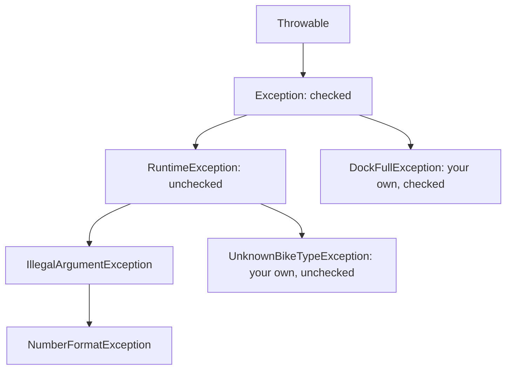

## Hook

Imagine a smoke alarm that only blinks a tiny light when it finds smoke. If you are in the next room, you miss it. A real alarm screams, and you cannot carry on until you deal with it.

The Harbor kiosk works like the blinking light. When the station is full, `dock()` returns `-1`. Some code forgets to check, and a rider gets charged for a ride that never ended. In this lesson you turn the blinking light into a screaming alarm.

## Concept

### Checked and unchecked exceptions

Java has two families of exceptions.

- An **unchecked exception** extends `RuntimeException`. The compiler does not force anyone to handle it. `NumberFormatException` and `IllegalArgumentException` are unchecked. They usually mean a bug or a bad value.
- A **checked exception** extends `Exception` but not `RuntimeException`. The compiler checks that every caller handles it. It means "this can go wrong even when your code is correct", such as a full station or a missing file.



```callout jargon
**Checked** means the compiler checks it. If a method can throw a checked exception, every caller must catch it or pass it on. Otherwise the code does not compile.
```

### Syntax: your own exception class

```java
class DockFullException extends Exception {
    DockFullException(String station) {
        super("Station full: " + station);
    }
}
```

- An exception is a normal class. It extends `Exception` (checked) or `RuntimeException` (unchecked).
- `super("...")` passes the message to the parent class. Later, `getMessage()` gives that text back.
- The class name says what went wrong. That makes a stack trace easy to read.

An unchecked one looks the same, with a different parent:

```java
class UnknownBikeTypeException extends RuntimeException {
    UnknownBikeTypeException(String type) {
        super("Unknown bike type: " + type);
    }
}
```

### Syntax: throws in a method signature

```java nocompile
int dock(String bikeId) throws DockFullException {
    // ...
}
```

`throws DockFullException` is a warning label on the method. It tells every caller: "this method can throw a `DockFullException`". For a checked exception the label is required.

```java nocompile
int dock(String bikeId) throws DockFullException {
    if (docked == docks) {
        throw new DockFullException(name);
    }
    docked = docked + 1;
    return docked;
}
```

Note the two words. `throw` (no s) sends one exception now. `throws` (with s) goes in the signature and lists what the method might throw.

### The caller must decide

When you call `dock`, the compiler gives you two choices.

Choice 1: catch it.

```java nocompile
try {
    int number = harbor.dock("B-1042");
    System.out.println("Docked at " + number);
} catch (DockFullException e) {
    System.out.println(e.getMessage());
}
```

Choice 2: pass it on, by adding `throws` to your own method.

```java nocompile
static void endRide(Station s, String bikeId) throws DockFullException {
    s.dock(bikeId);
}
```

If you do neither, the code does not compile. The full-station case cannot be forgotten.

```callout tip
Use a checked exception when a careful caller can still hit the problem and must plan for it. Use an unchecked one for a bug, such as a bike type that should never exist.
```

### Syntax: rethrowing with a cause

```java nocompile
} catch (NumberFormatException e) {
    throw new BadRideLineException("Bad minutes in: " + line, e);
}
```

Sometimes you catch a low-level exception and throw a clearer one. Pass the original as the **cause**. The cause is the exception that started the problem. It keeps the full story in the stack trace.

```java
class BadRideLineException extends Exception {
    BadRideLineException(String message, Throwable cause) {
        super(message, cause);
    }
}
```

`Throwable` is the top parent of every exception. Read the cause back with `e.getCause()`.

### Syntax: try-with-resources

```java nocompile
try (Session session = new Session()) {
    // use session
}
```

A **resource** is something you must close when you finish, like a kiosk screen session or a file. A class is a resource when it implements `AutoCloseable`. That interface has one method: `close()`.

Put the resource in round brackets after `try`. Java calls `close()` for you when the block ends. It does this when the block finishes normally, and also when it throws.

```java
class Session implements AutoCloseable {
    public void close() {
        System.out.println("Session closed");
    }
}
```

```callout analogy
try-with-resources is like a door that shuts itself. However you leave the room, calmly or running, the door closes behind you.
```

## Worked example

This program docks bikes at a tiny station with 2 docks. A session opens for each bike and closes on its own.

```java run
public class Main {
    public static void main(String[] args) {
        Station harbor = new Station("Harbor", 2);
        String[] bikes = {"B-1042", "B-2001", "B-3300"};
        for (String bike : bikes) {
            try (Session session = new Session()) {
                System.out.println(bike + " docked at " + harbor.dock(bike));
            } catch (DockFullException e) {
                System.out.println(bike + ": " + e.getMessage());
            }
        }
    }
}

class DockFullException extends Exception {
    DockFullException(String station) {
        super("Station full: " + station);
    }
}

class Station {
    private final String name;
    private final int docks;
    private int docked;

    Station(String name, int docks) {
        this.name = name;
        this.docks = docks;
    }

    int dock(String bikeId) throws DockFullException {
        if (docked == docks) {
            throw new DockFullException(name);
        }
        docked = docked + 1;
        return docked;
    }
}

class Session implements AutoCloseable {
    public void close() {
        System.out.println("  session closed");
    }
}
```

1. `DockFullException` extends `Exception`, so it is checked. Its message is `Station full: Harbor`.
2. `dock` says `throws DockFullException`. When all docks are used, it throws one.
3. In `main`, the call sits inside `try`, and a `catch` handles the full case. Remove the `catch` and the program does not compile.
4. `Session` implements `AutoCloseable`. Java calls `close()` at the end of each `try`, before any `catch` runs.
5. The third bike prints `  session closed` first and then `B-3300: Station full: Harbor`.

## Try it

Run this program. Then change `"ebike"` to `"tandem"` and run it again. Read the message.

```java run
public class Main {
    static double pricePerMinute(String type) {
        if (type.equals("classic")) {
            return 0.15;
        }
        if (type.equals("ebike")) {
            return 0.30;
        }
        if (type.equals("cargo")) {
            return 0.25;
        }
        throw new UnknownBikeTypeException(type);
    }

    public static void main(String[] args) {
        try {
            System.out.println(pricePerMinute("ebike"));
        } catch (UnknownBikeTypeException e) {
            System.out.println("Problem: " + e.getMessage());
        }
    }
}

class UnknownBikeTypeException extends RuntimeException {
    UnknownBikeTypeException(String type) {
        super("Unknown bike type: " + type);
    }
}
```

`pricePerMinute` has no `throws` label. `UnknownBikeTypeException` is unchecked, so the compiler does not ask for one.

```callout warning
Do not turn a checked exception into silence with an empty catch. The compiler made you look at the problem. Return a clear message, or pass it on.
```

## Recap

- A **checked** exception extends `Exception`. Every caller must catch it or declare it with `throws`.
- An **unchecked** exception extends `RuntimeException`. The compiler does not force anyone to handle it.
- Write your own exception as a class, and pass the message up with `super(message)`. Read it with `getMessage()`.
- When you catch one exception and throw a clearer one, pass the original as the cause.
- try-with-resources closes any `AutoCloseable` object for you, even when the block throws.

## Common mistakes

**Calling a method that throws a checked exception without handling it.**

```java nocompile
public static void main(String[] args) {
    Station harbor = new Station("Harbor", 12);
    harbor.dock("B-1042");
}
```

Java says: `unreported exception DockFullException; must be caught or declared to be thrown`. Wrap the call in `try` with a `catch (DockFullException e)`, or add `throws DockFullException` to the method.

**Forgetting to pass the message to super.**

```java nocompile
class DockFullException extends Exception {
    DockFullException(String station) {
    }
}
```

This compiles, but `e.getMessage()` gives back `null`. The rider sees `null` on the screen. Add `super("Station full: " + station);` as the first line of the constructor.

**Using a class that is not AutoCloseable in try-with-resources.**

```java nocompile
class Session {
    public void close() {
        System.out.println("closed");
    }
}

try (Session s = new Session()) {
}
```

Java says: `incompatible types: try-with-resources not applicable to variable type`. Having a `close()` method is not enough. Write `class Session implements AutoCloseable`.
