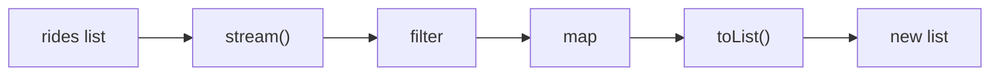

## Hook

Picture a car wash. Cars roll in at one end. One station sprays water, the next scrubs, the next dries. Cars roll out clean at the other end. The car wash never stores cars. It only moves them through steps.

Tsunade's report code works like a messy garage instead. Every report is a loop with its own counter, and every counter has a different bug. A **stream** turns each report into a short car wash: the rides go in, pass a few clear steps, and a result comes out.

## Concept

### What a stream is

```callout jargon
A **stream** is a pipeline that carries the items of a collection through a series of steps. It holds no data of its own. The data stays in the list.
```

A stream pipeline has three parts:

1. A **source**: where the items come from, such as a list.
2. Zero or more **intermediate operations**: steps that change or drop items, such as `filter` and `map`.
3. One **terminal operation**: the final step that produces a result, such as `count` or `toList`.



### Syntax: stream()

```java nocompile
List<Ride> rides = ...;
rides.stream()
```

Every collection has a `stream()` method. It opens a pipeline over the items. The list itself never changes.

### Syntax: filter

```java nocompile
rides.stream().filter(ride -> ride.minutes() >= 30)
```

`filter` takes a `Predicate`, the true or false check from the last topic. Items that pass the check go on. The rest are dropped.

### Syntax: map

```java nocompile
rides.stream().map(ride -> ride.station())
rides.stream().map(Ride::station)
```

`map` takes a `Function`. It swaps each item for something else. Here, a stream of rides becomes a stream of station names. Both lines do the same thing; the second uses a method reference.

### Syntax: count

```java nocompile
long ebikes = rides.stream().filter(ride -> ride.type().equals("ebike")).count();
```

`count` is a terminal operation. It returns how many items reached the end, as a `long`.

### Syntax: collecting into a list

```java nocompile
List<String> names = stations.stream().map(s -> s.toUpperCase()).toList();
List<String> same = stations.stream().map(s -> s.toUpperCase()).collect(Collectors.toList());
```

- `toList()` gathers the items into a new list. That list cannot be changed afterwards.
- `collect(Collectors.toList())` is the older way. It usually gives an `ArrayList`. If you need to add to it, use `collect(Collectors.toCollection(ArrayList::new))`. You need `import java.util.stream.Collectors;`.

```java run
import java.util.List;

public class Main {
    public static void main(String[] args) {
        List<Integer> minutes = List.of(25, 10, 40, 15, 30);

        List<Integer> longOnes = minutes.stream()
                .filter(m -> m >= 25)
                .toList();
        System.out.println(longOnes);

        List<String> labels = minutes.stream()
                .map(m -> m + " min")
                .toList();
        System.out.println(labels);

        System.out.println(minutes.stream().filter(m -> m < 20).count());
    }
}
```

### Syntax: mapToInt, sum and average

```java nocompile
int total = rides.stream().mapToInt(Ride::minutes).sum();
double mean = rides.stream().mapToInt(Ride::minutes).average().orElse(0.0);
```

`mapToInt` turns each item into an `int`. The result is an `IntStream`, a stream made only of whole numbers. An `IntStream` has number methods such as `sum`, `max` and `average`.

`average` has a problem: an empty stream has no average. So it gives back a box that might be empty. `orElse(0.0)` opens the box and uses `0.0` when the box is empty. You will meet this box properly in the Optional topic.

### Syntax: sorted, limit and distinct

```java nocompile
stations.stream().distinct()                 // drop repeats
stations.stream().sorted()                   // natural order, A to Z
minutes.stream().sorted((a, b) -> Integer.compare(b, a))   // biggest first
minutes.stream().limit(3)                    // keep only the first 3
```

- `distinct` keeps the first copy of each item and drops the repeats. It uses `equals`.
- `sorted()` sorts in natural order. `sorted(comparator)` sorts with your own rule.
- `limit(n)` lets the first `n` items through and stops.

```java run
import java.util.List;

public class Main {
    public static void main(String[] args) {
        List<String> stations = List.of("Harbor", "Uptown", "Harbor", "Old Mill", "Riverside");
        System.out.println(stations.stream().distinct().sorted().toList());

        List<Integer> minutes = List.of(25, 10, 40, 15, 30);
        System.out.println(minutes.stream()
                .sorted((a, b) -> Integer.compare(b, a))
                .limit(3)
                .toList());

        System.out.println(minutes.stream().mapToInt(m -> m).sum());
        System.out.println(minutes.stream().mapToInt(m -> m).average().orElse(0.0));
    }
}
```

### Syntax: anyMatch, allMatch, noneMatch, min

```java nocompile
boolean any = rides.stream().anyMatch(r -> r.minutes() < 2);     // at least one?
boolean all = rides.stream().allMatch(r -> r.minutes() > 0);     // every one?
boolean none = rides.stream().noneMatch(r -> r.minutes() > 120); // not a single one?
Ride shortest = rides.stream().min(Comparator.comparingInt(Ride::minutes)).orElse(null);
```

The three match methods answer yes-or-no questions. They stop as soon as they know the answer. `anyMatch` stops at the first match, so it never reads the rest of a long list.

`min` and `max` take a comparator and find the smallest or biggest item. Like `average`, they give back a box that is empty for an empty stream. `orElse(null)` opens it here. The Optional topic shows better ways.

```java run
import java.util.Comparator;
import java.util.List;

public class Main {
    record Ride(String bikeId, int minutes) { }

    public static void main(String[] args) {
        List<Ride> rides = List.of(
                new Ride("B-1042", 25),
                new Ride("B-2001", 1),
                new Ride("B-3300", 40));

        System.out.println(rides.stream().anyMatch(r -> r.minutes() < 2));
        System.out.println(rides.stream().allMatch(r -> r.minutes() > 0));
        System.out.println(rides.stream().noneMatch(r -> r.minutes() > 120));
        System.out.println(rides.stream().max(Comparator.comparingInt(Ride::minutes)).orElse(null));
        System.out.println(rides.stream().min(Comparator.comparingInt(Ride::minutes)).orElse(null));
        List<Ride> none = List.of();
        System.out.println(none.stream().allMatch(r -> r.minutes() > 1000));
    }
}
```

It prints `true` three times, then `Ride[bikeId=B-3300, minutes=40]` and `Ride[bikeId=B-2001, minutes=1]`, and finally `true` once more.

That last `true` is a trap: `allMatch` on an empty stream returns `true`. With no rides, no ride breaks the rule. Check for an empty list first if that matters.

### Syntax: Stream.of, IntStream.range and boxed

```java nocompile
Stream.of("Harbor", "Uptown", "Depot")   // a stream from the values you list
IntStream.range(0, 4)                    // 0, 1, 2, 3: the end is left out
IntStream.rangeClosed(1, 4)              // 1, 2, 3, 4: the end is included
IntStream.range(0, 3).boxed()            // turns int values into Integer objects
```

You do not always start from a list. `Stream.of` makes a stream from a few values. `IntStream.range` counts for you, like a `for` loop.

An `IntStream` holds plain `int` values, so it cannot become a `List<Integer>` directly. `boxed()` wraps each `int` in an `Integer`. `mapToObj` turns each number into any object you like.

```java run
import java.util.List;
import java.util.Set;
import java.util.stream.Collectors;
import java.util.stream.IntStream;
import java.util.stream.Stream;

public class Main {
    public static void main(String[] args) {
        System.out.println(Stream.of("Harbor", "Uptown", "Depot").count());
        System.out.println(IntStream.range(0, 4).sum());
        System.out.println(IntStream.rangeClosed(1, 4).sum());

        List<String> docks = IntStream.rangeClosed(1, 3)
                .mapToObj(n -> "Harbor-" + n)
                .toList();
        System.out.println(docks);

        List<Integer> numbers = IntStream.range(0, 3).boxed().toList();
        System.out.println(numbers);

        Set<String> types = Stream.of("ebike", "classic", "ebike")
                .collect(Collectors.toSet());
        System.out.println(types.size());
    }
}
```

It prints `3`, `6`, `10`, `[Harbor-1, Harbor-2, Harbor-3]`, `[0, 1, 2]` and `2`. `Collectors.toSet()` gathers the items into a `Set`, so the repeated `ebike` counts once.

### Streams are lazy and single use

**Lazy** means intermediate steps do nothing until a terminal operation asks for a result. A pipeline with `filter` and `map` but no terminal step runs no code at all.

**Single use** means a stream works once. After the terminal step, the stream is closed. To ask a second question, call `stream()` on the list again.

```callout warning
Do not keep a stream in a variable and reuse it. The second use crashes with `IllegalStateException: stream has already been operated upon or closed`.
```

## Worked example

This program answers two report questions about Harbor.

```java run
import java.util.List;

public class Main {
    public static void main(String[] args) {
        List<Ride> rides = List.of(
                new Ride("B-1042", "Harbor", "ebike", 25),
                new Ride("B-2001", "Harbor", "classic", 10),
                new Ride("B-3300", "Uptown", "cargo", 40),
                new Ride("B-4100", "Harbor", "ebike", 30));

        List<String> harborBikes = rides.stream()
                .filter(ride -> ride.station().equals("Harbor"))
                .map(Ride::bikeId)
                .sorted()
                .toList();
        System.out.println(harborBikes);

        int ebikeMinutes = rides.stream()
                .filter(ride -> ride.type().equals("ebike"))
                .mapToInt(Ride::minutes)
                .sum();
        System.out.println(ebikeMinutes);
    }
}

record Ride(String bikeId, String station, String type, int minutes) {
}
```

1. `rides.stream()` opens a pipeline over the four rides.
2. `filter` keeps the three Harbor rides.
3. `map(Ride::bikeId)` swaps each ride for its bike id.
4. `sorted()` puts the ids in order, and `toList()` collects them: `[B-1042, B-2001, B-4100]`.
5. The second pipeline is a fresh stream. It keeps the two e-bike rides and adds their minutes: `55`.

No index, no counter and no `i < size` check. That removes the off-by-one bugs from the ticket.

## Try it

In the worked example, change the first pipeline to list the stations of the rides over 20 minutes. Use `map(Ride::station)` and add `distinct()`. Press **Run**. You should see `[Harbor, Uptown]`.

Then add a third pipeline that prints how many rides are classic, with `count()`.

## Recap

- A stream is a pipeline over a collection: a source, some steps, and one terminal operation.
- `filter` drops items, `map` swaps them, and `toList()` or `collect(Collectors.toList())` gathers them.
- `mapToInt` gives number methods like `sum` and `average`. `IntStream.range` counts, and `boxed()` turns the numbers back into objects.
- `sorted`, `limit` and `distinct` order, cut and remove repeats. `anyMatch`, `allMatch`, `noneMatch`, `min` and `max` answer questions about the whole stream.
- Streams are lazy and single use. Start a new stream for each question.

## Common mistakes

**Reusing a stream.**

```java
import java.util.List;
import java.util.stream.Stream;

public class Main {
    public static void main(String[] args) {
        Stream<Integer> minutes = List.of(25, 10, 40).stream();
        System.out.println(minutes.count());
        System.out.println(minutes.count());
    }
}
```

The program prints `3`, then crashes with `IllegalStateException: stream has already been operated upon or closed`. Call `stream()` on the list again for each question.

**Forgetting the terminal operation.**

```java
import java.util.List;

public class Main {
    public static void main(String[] args) {
        List<Integer> minutes = List.of(25, 10, 40);
        minutes.stream().filter(m -> m > 20).map(m -> m * 2);
        System.out.println(minutes);
    }
}
```

This prints `[25, 10, 40]`. Streams are lazy, and nothing collected the result. The list never changes anyway. End the pipeline with `toList()` and store the new list in a variable.

**Using average() as a double.**

```java nocompile
double mean = rides.stream().mapToInt(Ride::minutes).average();
```

Java says: `incompatible types: OptionalDouble cannot be converted to double`. The average might not exist for an empty list. Add `.orElse(0.0)` at the end.
