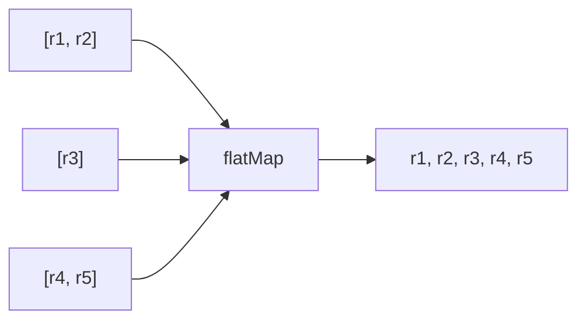

## Hook

Jiraiya needs numbers for the board by next week. How many rides started at each station? How many minutes did each bike type ride? Which bikes showed up anywhere?

Imagine a pile of paper ride slips on a table. You could sort them into piles by station, then count each pile. You could add up the minutes on every slip. You could tip several boxes of slips onto one table.

In the last topic, a stream filtered and changed items one by one. This topic teaches the stream to sort things into piles, add things up and flatten boxes. Those are the jobs a dashboard needs.

## Concept

A **collector** is a recipe that tells `collect(...)` how to gather the stream's items into a result. You already used `toList()`. The class `Collectors` holds many more recipes. Add this import at the top of your file:

```java nocompile
import java.util.stream.Collectors;
```

### Syntax: groupingBy

`Collectors.groupingBy(key)` sorts items into piles. The **key** is a function that says which pile an item belongs in. The result is a `Map` from each key to a `List` of items.

```java nocompile
Map<String, List<Ride>> byStation = rides.stream()
        .collect(Collectors.groupingBy(Ride::station));
```

Each station name becomes a key. Its value is the list of rides from that station.

### Syntax: groupingBy with a downstream collector

Often you want a number per pile, not the whole list. Give `groupingBy` a second collector. This second one is called a **downstream** collector, because it runs on each pile after the sorting.

```java nocompile
Map<String, Long> count = rides.stream()
        .collect(Collectors.groupingBy(Ride::station, Collectors.counting()));
```

```callout jargon
Downstream means "further along the stream". The first collector makes the piles. The downstream collector turns each pile into one value.
```

Here are the downstream collectors you will use most:

```java nocompile
Collectors.counting()                       // how many items: a Long
Collectors.summingInt(Ride::minutes)        // add up an int field: an Integer
Collectors.mapping(Ride::bikeId, Collectors.toList())   // change each item, then collect
```

Notice that `counting()` gives a `Long`, the object version of `long`. So the map type is `Map<String, Long>`. Small examples:

```java nocompile
// rides per type, as a count
Map<String, Long> perType = rides.stream()
        .collect(Collectors.groupingBy(Ride::type, Collectors.counting()));

// total minutes per type
Map<String, Integer> minutes = rides.stream()
        .collect(Collectors.groupingBy(Ride::type, Collectors.summingInt(Ride::minutes)));

// bike ids per station
Map<String, List<String>> bikes = rides.stream()
        .collect(Collectors.groupingBy(Ride::station,
                Collectors.mapping(Ride::bikeId, Collectors.toList())));
```

```callout tip
A map from groupingBy has no fixed order. To print it in alphabetical order, copy it into a TreeMap first: new TreeMap<>(map).
```

### Syntax: partitioningBy

`Collectors.partitioningBy(test)` splits items into exactly two piles. The test is a lambda that returns true or false. The result is a `Map<Boolean, List<...>>`.

```java nocompile
Map<Boolean, List<Ride>> split = rides.stream()
        .collect(Collectors.partitioningBy(r -> r.minutes() > 30));

List<Ride> longRides = split.get(true);
List<Ride> shortRides = split.get(false);
```

Both keys are always there, even when a pile is empty. That makes `partitioningBy` safer than `groupingBy` for a yes or no split.

### Syntax: toMap with a merge function

`Collectors.toMap(keyFn, valueFn)` builds a map with one value per key. If two items share a key, it throws an `IllegalStateException`. A third argument, the **merge function**, decides what to keep when keys clash.

```java nocompile
Map<String, Ride> longest = rides.stream()
        .collect(Collectors.toMap(Ride::station, r -> r, (a, b) -> {
            if (a.minutes() >= b.minutes()) {
                return a;
            }
            return b;
        }));
```

The merge function gets the old value `a` and the new value `b`. It returns the one to keep. Here it keeps the longest ride per station. Another example sums values on a clash:

```java nocompile
Map<String, Integer> minutes = rides.stream()
        .collect(Collectors.toMap(Ride::station, Ride::minutes, Integer::sum));
```

### Syntax: reduce

`reduce` folds every item into one value. You give it a starting value, called the **identity**, and a rule that combines two values.

```java nocompile
int total = rides.stream()
        .map(Ride::minutes)
        .reduce(0, Integer::sum);
```

It starts at 0. Then it adds each ride's minutes in turn. More examples:

```java nocompile
int longestMinutes = rides.stream().map(Ride::minutes).reduce(0, Math::max);
String ids = rides.stream().map(Ride::bikeId).reduce("", (a, b) -> a + b);
```

### Syntax: flatMap

Sometimes each item holds a list of its own. Each station keeps its own log, so you get a `List<List<Ride>>`. `flatMap` turns every inner list into a stream and joins them into one long stream.

```java nocompile
List<Ride> all = stationLogs.stream()
        .flatMap(List::stream)
        .toList();
```



`map(List::stream)` would give you a stream of streams. `flatMap` flattens them into a single stream of rides.

### Syntax: joining

`Collectors.joining(separator)` glues strings into one string. It puts the separator between items, never at the ends.

```java nocompile
String names = List.of("Harbor", "Uptown").stream().collect(Collectors.joining(", "));
// "Harbor, Uptown"
```

The items must be strings already. Use `map` first if they are not.

## Worked example

This program counts rides per station and adds up minutes per type.

```java run
import java.util.List;
import java.util.Map;
import java.util.TreeMap;
import java.util.stream.Collectors;

public class Main {
    public static void main(String[] args) {
        List<Ride> rides = List.of(
                new Ride("B-1042", "Riverside", "ebike", 25),
                new Ride("B-2001", "Harbor", "classic", 10),
                new Ride("B-1042", "Riverside", "ebike", 40),
                new Ride("B-3300", "Uptown", "cargo", 15));

        Map<String, Long> perStation = rides.stream()
                .collect(Collectors.groupingBy(Ride::station, Collectors.counting()));
        System.out.println(new TreeMap<>(perStation));

        Map<String, Integer> perType = rides.stream()
                .collect(Collectors.groupingBy(Ride::type, Collectors.summingInt(Ride::minutes)));
        System.out.println(new TreeMap<>(perType));

        int total = rides.stream().map(Ride::minutes).reduce(0, Integer::sum);
        System.out.println("Total minutes: " + total);
    }
}

record Ride(String bikeId, String station, String type, int minutes) {}
```

Line by line:

- `groupingBy(Ride::station, Collectors.counting())` makes one pile per station and counts each pile.
- `new TreeMap<>(perStation)` copies the map into alphabetical order for printing. It prints `{Harbor=1, Riverside=2, Uptown=1}`.
- `summingInt(Ride::minutes)` adds the minutes in each type's pile. It prints `{cargo=15, classic=10, ebike=65}`.
- `reduce(0, Integer::sum)` adds every ride's minutes, starting from 0. It prints `Total minutes: 90`.

## Try it

Each station has its own log. This program flattens them, lists each bike once, and joins the station names.

```java run
import java.util.List;
import java.util.stream.Collectors;

public class Main {
    public static void main(String[] args) {
        List<List<Ride>> logs = List.of(
                List.of(new Ride("B-1042", "Riverside", "ebike", 25),
                        new Ride("B-2001", "Riverside", "classic", 10)),
                List.of(new Ride("B-1042", "Old Mill", "ebike", 30)),
                List.of(new Ride("B-3300", "Harbor", "cargo", 15)));

        List<String> bikes = logs.stream()
                .flatMap(List::stream)
                .map(Ride::bikeId)
                .distinct()
                .sorted()
                .toList();
        System.out.println(bikes);

        String stations = logs.stream()
                .flatMap(List::stream)
                .map(Ride::station)
                .distinct()
                .sorted()
                .collect(Collectors.joining(", "));
        System.out.println(stations);
    }
}

record Ride(String bikeId, String station, String type, int minutes) {}
```

Change `", "` to `" | "` and run it again. Then remove `.distinct()` and see B-1042 appear twice.

## Recap

- `groupingBy(key)` sorts items into piles in a `Map`. Add a downstream collector such as `counting()` or `summingInt(...)` to get one value per pile.
- `partitioningBy(test)` splits items into a `true` pile and a `false` pile.
- `toMap(key, value, merge)` builds a map, and the merge function decides what to keep when two keys clash.
- `reduce(identity, rule)` folds a whole stream into one value.
- `flatMap` turns a list of lists into one stream, and `joining(", ")` glues strings together.

## Common mistakes

**1. toMap with a repeated key and no merge function.**

```java
import java.util.List;
import java.util.Map;
import java.util.stream.Collectors;

public class Main {
    public static void main(String[] args) {
        List<Ride> rides = List.of(new Ride("B-1", "Harbor", "classic", 10),
                new Ride("B-2", "Harbor", "ebike", 20));
        Map<String, Integer> m = rides.stream()
                .collect(Collectors.toMap(Ride::station, Ride::minutes));
        System.out.println(m);
    }
}

record Ride(String bikeId, String station, String type, int minutes) {}
```

The program crashes: `java.lang.IllegalStateException: Duplicate key Harbor (attempted merging values 10 and 20)`. Add a merge function as the third argument, for example `Integer::sum`.

**2. Storing counting() in a Map of Integer.**

```java nocompile
Map<String, Integer> count = rides.stream()
        .collect(Collectors.groupingBy(Ride::station, Collectors.counting()));
```

The compiler says `incompatible types: inference variable D has incompatible equality constraints Integer,Long`. `counting()` gives a `Long`. Declare the map as `Map<String, Long>`.

**3. Using map where you need flatMap.**

```java nocompile
List<Ride> all = stationLogs.stream()
        .map(List::stream)
        .toList();
```

The compiler says `incompatible types: List<Stream<Ride>> cannot be converted to List<Ride>`. The `map` call made a stream of streams. Use `.flatMap(List::stream)` to get one stream of rides.
