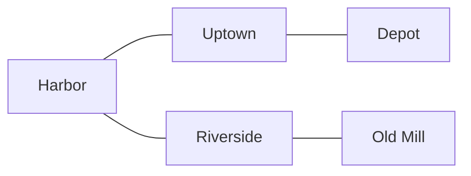

## What happened

The planner gets a lane map and the free docks at each station. It runs a breadth-first search from the rider's station and returns the nearest station with a free dock.



It has three bugs. The first sends riders to full stations. The second crashes on a station the dock sensors don't know yet. The third picks a different station each time two are equally close.

## What you need

This builds on topic 11 and on Optional from module 3.

### Syntax: one distance level at a time

```java nocompile
List<String> level = List.of(start);
Set<String> seen = new HashSet<>(level);
while (!level.isEmpty()) {
    // look at every station in this level first
    List<String> next = new ArrayList<>();
    for (String station : level) {
        for (String n : lanes.getOrDefault(station, List.of())) {
            if (seen.add(n)) {
                next.add(n);
            }
        }
    }
    level = next;
}
```

`seen.add(n)` returns `false` when `n` was already seen, so each station goes into a level once.

## The tiers

1. **Bronze** resolves the incident: `nearestFree(from)` never returns a station with 0 free docks.
2. **Silver**: a station missing from the free-docks map counts as 0 free docks, so the planner does not crash.
3. **Gold**: when several free stations are equally near, return the one with the most free docks. If that ties too, return the name that comes first alphabetically.

`nearestFree` returns `Optional.empty()` when no station can be reached with a free dock. The rider's own station counts when it has a free dock.

## Recap

- Breadth-first search finds the nearest stations first.
- `getOrDefault` turns a missing key into a safe value.
- A rule for ties makes the answer the same on every run.

## Common mistakes

**Checking `>= 0`.** Zero free docks means full. The station needs at least one free dock.

**Returning the first free station found.** Inside one level, the order depends on how the lanes were added. Compare all free stations in that level before you choose.
