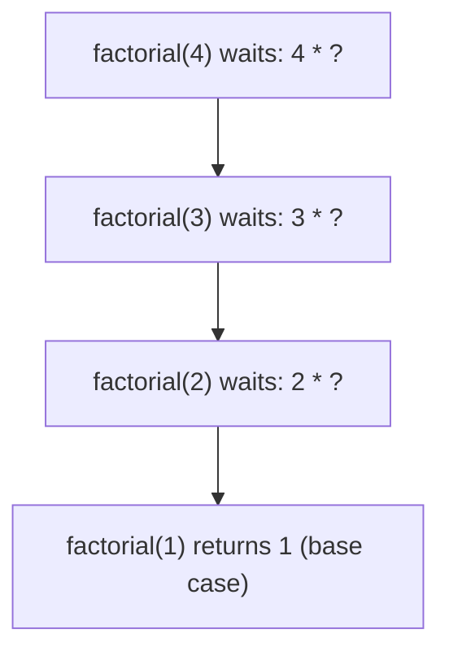

## Hook

Riverside is full, so the app sends you to Old Mill. Old Mill is full too, so it sends you to Harbor. Each station only knows one thing: its own free docks, and which station comes next.

Jiraiya asks: "How many free docks are there along the whole chain?" Each station can answer with a simple rule. "My free docks, plus whatever the rest of the chain has." The last station has no rest, so it just answers with its own docks.

That way of solving a problem is called recursion.

## Concept

```callout jargon
**Recursion** is when a method calls itself to solve a smaller copy of the same problem. A method that does this is a **recursive method**.
```

Every recursive method has two parts.

- The **base case** is the smallest input. The method answers it directly, without calling itself.
- The **recursive case** shrinks the problem a little and calls the method again on the smaller piece.

```callout analogy
Think of Russian nesting dolls. You open a doll and find a smaller doll. You keep going until you reach the tiny solid doll that does not open. That solid doll is the base case.
```

### Syntax: a recursive method

```java nocompile
static int solve(int n) {
    if (n == 0) {           // base case
        return 0;
    }
    return n + solve(n - 1); // recursive case: a smaller n
}
```

The base case comes first. The recursive case must move toward it, here by making `n` smaller each time.

```java
static int addUpTo(int n) {
    if (n == 0) {
        return 0;
    }
    return n + addUpTo(n - 1);
}
```

`addUpTo(3)` is `3 + addUpTo(2)`, which is `3 + 2 + addUpTo(1)`, which is `3 + 2 + 1 + addUpTo(0)`. That is `6`.

### Factorial

The **factorial** of `n`, written `n!`, multiplies every whole number from `n` down to 1. So `4!` is `4 * 3 * 2 * 1`, which is `24`.

```java run
public class Main {
    static long factorial(int n) {
        if (n <= 1) {
            return 1;
        }
        return n * factorial(n - 1);
    }

    public static void main(String[] args) {
        System.out.println(factorial(4));
        System.out.println(factorial(10));
    }
}
```

It returns a `long` because factorials grow huge fast. `factorial(13)` is already too big for an `int`.

### The call stack

How does Java remember the `4 *` while it works out `factorial(3)`? It uses the **call stack**. The call stack is a pile of notes, one for each method call that has started but not finished.

Each call puts a new note on top. When a call returns, its note comes off, and the call below it carries on.



Then the answers travel back up:

| Call | Gets back | Returns |
|---|---|---|
| `factorial(1)` | (base case) | 1 |
| `factorial(2)` | 1 | 2 * 1 = 2 |
| `factorial(3)` | 2 | 3 * 2 = 6 |
| `factorial(4)` | 6 | 4 * 6 = 24 |

### A missing base case: StackOverflowError

The call stack has a size limit. A method with no base case keeps calling itself and adds notes forever. Java stops it with a `StackOverflowError`.

```java run crash
public class Main {
    static int countDown(int n) {
        return countDown(n - 1);
    }

    public static void main(String[] args) {
        countDown(3);
    }
}
```

The program crashes with a stack trace that starts like this:

```text
Exception in thread "main" java.lang.StackOverflowError
	at Main.countDown(Main.java:3)
	at Main.countDown(Main.java:3)
	at Main.countDown(Main.java:3)
```

```callout warning
Gojo says: when you see StackOverflowError, check two things. Is there a base case? Does every recursive call move closer to it?
```

### Syntax: recursion on an array with an index

An array does not shrink. You can still recurse on it by passing an **index**, the position to start from. Each call handles one slot and passes `index + 1` to the next call.

```java nocompile
static int sumFrom(int[] docks, int index) {
    if (index == docks.length) {   // base case: past the last slot
        return 0;
    }
    return docks[index] + sumFrom(docks, index + 1);
}
```

A public method usually hides the index, so callers do not have to pass `0`:

```java nocompile
static int sum(int[] docks) {
    return sumFrom(docks, 0);
}
```

The private method that does the real work is called a **helper**.

### Recursion on text

The same idea works on a `String`. `s.substring(1)` is everything after the first character, so it is one character shorter.

```java
static String reverse(String s) {
    if (s.isEmpty()) {
        return s;
    }
    return reverse(s.substring(1)) + s.charAt(0);
}
```

`reverse("abc")` is `reverse("bc") + 'a'`, which becomes `"cb" + 'a'`, which is `"cba"`.

### Recursion or a loop?

Any recursion can be written as a loop, and the other way round.

- A loop is often faster and never overflows the stack.
- Recursion is often shorter and clearer when the data has a nested or chained shape. Chains, trees and "divide in half" problems later in this module fit it well.

Both `factorial` and `sumFrom` take O(n) time. They also use O(n) space, because the stack holds one note per call.

### Naive Fibonacci repeats work

The **Fibonacci** numbers start 0, 1, and each next one is the sum of the two before: 0, 1, 1, 2, 3, 5, 8. The recursive version reads like the definition.

```java
static int fib(int n) {
    if (n < 2) {
        return n;
    }
    return fib(n - 1) + fib(n - 2);
}
```

It is correct but wasteful. `fib(5)` calls `fib(3)` twice and `fib(2)` three times. The repeats pile up, so the work roughly doubles each time `n` grows by one. That is called O(2^n), and it is far worse than O(n^2).

| Method | Time | Space |
|---|---|---|
| `factorial(n)` | O(n): one call per number | O(n) stack |
| `sum` with an index | O(n): one call per slot | O(n) stack |
| naive `fib(n)` | O(2^n): each call makes two more | O(n) stack |

The fix is to remember answers you already worked out. You will learn that in the dynamic programming topic at the end of this module.

## Worked example

Here is Jiraiya's ticket. The array holds free docks at Riverside, Old Mill, Harbor and Uptown, in chain order.

```java run
public class Main {
    static int sum(int[] docks) {
        return sumFrom(docks, 0);
    }

    static int sumFrom(int[] docks, int index) {
        if (index == docks.length) {
            return 0;
        }
        return docks[index] + sumFrom(docks, index + 1);
    }

    public static void main(String[] args) {
        int[] chain = {3, 0, 5, 2};
        System.out.println("Free docks along the chain: " + sum(chain));
    }
}
```

Line by line:

- `sum` starts the helper at index `0`, which is Riverside.
- `sumFrom` checks the base case first. When `index` equals `docks.length`, there are no stations left, so the rest of the chain has `0` docks.
- Otherwise it returns this station's docks plus the answer for the rest of the chain.
- The calls work out `3 + (0 + (5 + (2 + 0)))`, which is `10`.

The loop version kept missing Uptown. The recursive version cannot miss it, because the base case sits one step past the last station.

## Try it

Change `countDown(3)` to `countDown(5)`. Then remove the `if` block and see what happens.

```java run
public class Main {
    static String countDown(int n) {
        if (n <= 0) {
            return "go";
        }
        return n + " " + countDown(n - 1);
    }

    public static void main(String[] args) {
        System.out.println(countDown(3));
    }
}
```

It prints `3 2 1 go`. Without the `if` block, it crashes with a `StackOverflowError`.

## Recap

- A recursive method calls itself on a smaller version of the problem.
- The base case stops the recursion. The recursive case must move toward it.
- The call stack holds one note per unfinished call. Too many notes cause a `StackOverflowError`.
- Recurse on an array by passing an index to a private helper.
- Naive recursive Fibonacci repeats work and takes O(2^n) time.

## Common mistakes

**1. Forgetting the base case.**

```java run crash
public class Main {
    static long factorial(int n) {
        return n * factorial(n - 1);
    }

    public static void main(String[] args) {
        System.out.println(factorial(4));
    }
}
```

You see:

```text
Exception in thread "main" java.lang.StackOverflowError
```

Fix: add `if (n <= 1) { return 1; }` before the recursive call.

**2. A recursive call that does not shrink the problem.**

```java nocompile
static int sumFrom(int[] docks, int index) {
    if (index == docks.length) {
        return 0;
    }
    return docks[index] + sumFrom(docks, index);   // index never changes
}
```

This compiles, but the index never reaches the end, so you get `java.lang.StackOverflowError` again. Fix: pass `index + 1`.

**3. Stopping one step too early.**

```java
public class Main {
    static int sumFrom(int[] docks, int index) {
        if (index == docks.length - 1) {
            return 0;
        }
        return docks[index] + sumFrom(docks, index + 1);
    }

    public static void main(String[] args) {
        System.out.println(sumFrom(new int[] {3, 0, 5, 2}, 0));
    }
}
```

You expect `10`, but the program prints:

```text
8
```

The base case returns `0` while standing on Uptown, so its 2 docks are lost. Fix: stop at `index == docks.length`, one step past the last slot.
