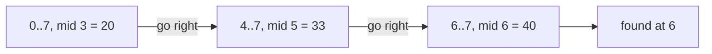

## Hook

Picture a phone book with 50,000 names. You want "Patel". You could read every name from the first page. Nobody does that. You open the book near the middle, see "Moreno", and know Patel is further on. One glance throws away half the book.

Sam's support tool reads the retired-bikes list from the top, one id at a time. The list is already sorted. This page shows you how to use that order to jump straight to the answer.

## Concept

**Searching** means finding where a value sits in a collection. The answer is usually an index. If the value is missing, the search returns `-1`, because no real index is negative.

### Syntax: linear search

A **linear search** checks every item in order, from the first to the last.

```java
static int linear(int[] values, int target) {
    for (int i = 0; i < values.length; i++) {
        if (values[i] == target) {
            return i;
        }
    }
    return -1;
}
```

- It returns as soon as it finds a match.
- It reaches `return -1` only after it has checked every item.
- It works on any array, sorted or not.

```java run
public class Main {
    static int linear(int[] values, int target) {
        for (int i = 0; i < values.length; i++) {
            if (values[i] == target) {
                return i;
            }
        }
        return -1;
    }

    public static void main(String[] args) {
        int[] docks = {7, 3, 12, 5, 9};
        System.out.println(linear(docks, 5));
        System.out.println(linear(docks, 4));
    }
}
```

The first call prints `3`, because 5 sits at index 3. The second prints `-1`, because 4 is not there.

### The idea behind binary search

**Binary search** finds a value in a **sorted** array. Sorted means each item is less than or equal to the next one. Binary search keeps a range of indexes where the target could still be. It marks the range with two ints:

- `low` is the first index still in play.
- `high` is the last index still in play.
- `mid` is the index halfway between them.

Each step looks at `sorted[mid]` and makes one of three choices:

- Equal to the target: you found it, so return `mid`.
- Less than the target: the target must be to the right, so set `low = mid + 1`.
- Greater than the target: the target must be to the left, so set `high = mid - 1`.

When `low` passes `high`, the range is empty. The target is not there, so return `-1`.

```callout warning
Binary search only works on sorted data. On an unsorted array, "the target must be to the right" is a guess. The search can skip right past the value and return -1.
```

### Syntax: iterative binary search

**Iterative** means the method uses a loop.

```java
static int binary(int[] sorted, int target) {
    int low = 0;
    int high = sorted.length - 1;
    while (low <= high) {
        int mid = low + (high - low) / 2;
        if (sorted[mid] == target) {
            return mid;
        } else if (sorted[mid] < target) {
            low = mid + 1;
        } else {
            high = mid - 1;
        }
    }
    return -1;
}
```

### Syntax: the safe midpoint

The obvious midpoint is `(low + high) / 2`. On a huge array, `low + high` can pass `Integer.MAX_VALUE`, about 2.1 billion. The int then **overflows**: it wraps round to a negative number, and `sorted[mid]` crashes.

```java
int low = 2_000_000_000;
int high = 2_100_000_000;
int risky = (low + high) / 2;          // negative!
int safe = low + (high - low) / 2;     // 2050000000
```

`high - low` is the size of the range, which always fits. Half of it, added to `low`, never goes past `high`.

### Syntax: recursive binary search

The range shrinks by half every step. That is a smaller copy of the same problem, so recursion fits well. The helper takes `low` and `high` as parameters.

```java
static int binaryRecursive(int[] sorted, int target) {
    return search(sorted, target, 0, sorted.length - 1);
}

static int search(int[] sorted, int target, int low, int high) {
    if (low > high) {
        return -1;
    }
    int mid = low + (high - low) / 2;
    if (sorted[mid] == target) {
        return mid;
    } else if (sorted[mid] < target) {
        return search(sorted, target, mid + 1, high);
    } else {
        return search(sorted, target, low, mid - 1);
    }
}
```

The base case is the empty range, `low > high`. Each recursive call works on half the range.

### How fast is each search?

| Search | Big-O | In plain words |
|---|---|---|
| Linear | O(n) | Double the data, double the time. |
| Binary | O(log n) | Double the data, one more step. |

**log n** here means "how many times you can halve n until 1 is left". For 1,024 items that is 10 halvings, so binary search needs at most 11 looks. For 50,000 bikes it needs at most 16. A linear search may need all 50,000.

```callout tip
Sorting costs time too. If you search a list only once, a linear search is fine. Binary search pays off when you sort once and search many times.
```

### Syntax: the library versions

Java ships binary search ready-made.

```java nocompile
int i = Arrays.binarySearch(sortedArray, target);
int j = Collections.binarySearch(sortedList, target);
```

- `Arrays` and `Collections` both live in `java.util`.
- A found value gives its index.
- A missing value gives a negative number. It is not always `-1`, so test with `< 0`.

## Worked example

Here is a trace of `binary` on eight ride lengths, searching for 40.

```java run
public class Main {
    public static void main(String[] args) {
        int[] minutes = {5, 8, 12, 20, 25, 33, 40, 61};
        int target = 40;
        int low = 0;
        int high = minutes.length - 1;
        while (low <= high) {
            int mid = low + (high - low) / 2;
            System.out.println("low=" + low + " high=" + high + " mid=" + mid + " value=" + minutes[mid]);
            if (minutes[mid] == target) {
                System.out.println("found at " + mid);
                return;
            } else if (minutes[mid] < target) {
                low = mid + 1;
            } else {
                high = mid - 1;
            }
        }
        System.out.println("not found");
    }
}
```

| Step | low | high | mid | minutes[mid] | Choice |
|---|---|---|---|---|---|
| 1 | 0 | 7 | 3 | 20 | 20 < 40, so low = 4 |
| 2 | 4 | 7 | 5 | 33 | 33 < 40, so low = 6 |
| 3 | 6 | 7 | 6 | 40 | equal, return 6 |

Three looks found the value. A linear search would have needed seven.



## Try it

This program counts the looks binary search needs on bigger and bigger arrays. Change `size` to 50000 and see how small the count stays.

```java run
public class Main {
    public static void main(String[] args) {
        int size = 1024;
        int[] ids = new int[size];
        for (int i = 0; i < size; i++) {
            ids[i] = i * 2;
        }
        int target = -1;
        int low = 0;
        int high = ids.length - 1;
        int steps = 0;
        while (low <= high) {
            steps++;
            int mid = low + (high - low) / 2;
            if (ids[mid] == target) {
                break;
            } else if (ids[mid] < target) {
                low = mid + 1;
            } else {
                high = mid - 1;
            }
        }
        System.out.println(size + " items, " + steps + " steps");
    }
}
```

## Recap

- Linear search checks every item in order. It works on any array and costs O(n).
- Binary search needs sorted data. It halves the range each step and costs O(log n).
- Write the midpoint as `low + (high - low) / 2` so it never overflows.
- Binary search can be a loop or a recursive method with `low` and `high` as parameters.
- `Arrays.binarySearch` and `Collections.binarySearch` are the library versions. They return a negative number when the value is missing.

## Common mistakes

**1. Searching an unsorted array.** Binary search compiles and runs, but gives a wrong answer.

```java
int[] docks = {9, 2, 7, 4, 1};
System.out.println(java.util.Arrays.binarySearch(docks, 9));
```

The output is a negative number, even though 9 is at index 0. Fix: sort the array first, or use a linear search.

**2. Using `low < high` as the loop condition.** The loop stops when one item is left, without checking it.

```java
int[] a = {10, 20, 30};
int low = 0;
int high = a.length - 1;
int found = -1;
while (low < high) {
    int mid = low + (high - low) / 2;
    if (a[mid] == 30) { found = mid; break; }
    else if (a[mid] < 30) { low = mid + 1; }
    else { high = mid - 1; }
}
System.out.println(found);
```

This prints `-1`, although 30 is at index 2. Fix: loop `while (low <= high)`.

**3. Forgetting the `+ 1` or `- 1`.** Writing `low = mid;` can leave the range the same size forever.

```java nocompile
} else if (sorted[mid] < target) {
    low = mid;
}
```

With `low = 2` and `high = 3`, `mid` stays 2 and the loop never ends. The program hangs. Fix: write `low = mid + 1` and `high = mid - 1`, because `mid` has already been checked.
