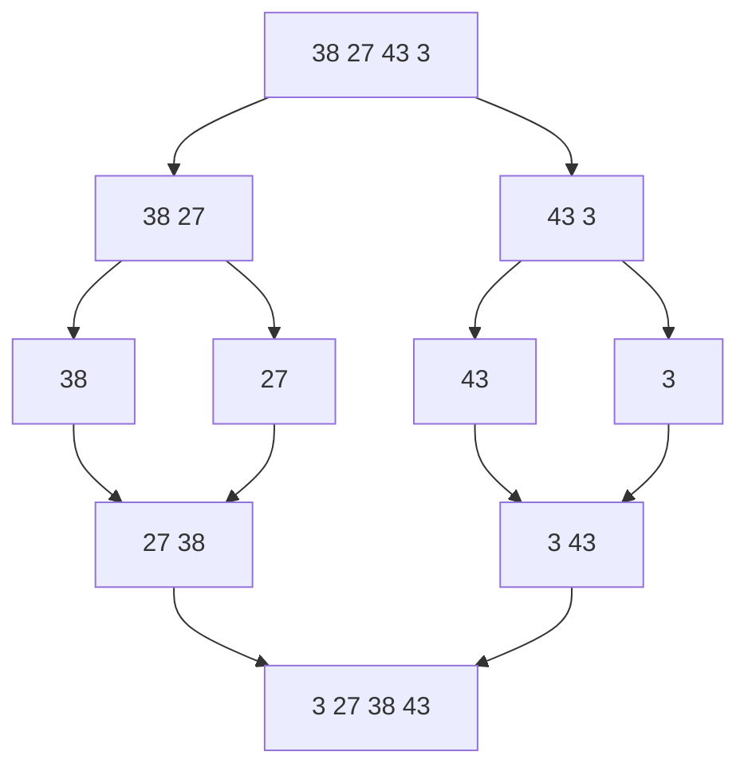

## Hook

Kakashi needs a sorted list of every ride from this year for the board report. That is millions of ride times. The report uses insertion sort from the last ticket, and it now runs all night.

Insertion sort is O(n^2). Double the rides and it gets four times slower. A year of rides is far too many for that.

Think about sorting a huge pile of paper receipts. You could split the pile in two and give each half to a friend. Each friend splits again and passes it on. Tiny piles are easy to sort. Then everyone hands their sorted piles back and joins them. This page teaches two sorts built on that idea.

## Concept

### Divide and conquer

```callout jargon
**Divide and conquer** means: split a big problem into smaller copies of the same problem, solve those, then combine the answers. It fits recursion well, because each small copy is solved by the same method.
```

Both sorts on this page use divide and conquer. They split the work in different places.

- **Merge sort** splits without thinking, then does the hard work when it joins the halves.
- **Quicksort** does the hard work when it splits, so joining needs no work at all.

### Merging two sorted arrays

Merging is the heart of merge sort. You have two arrays that are already sorted. You want one sorted array with every item.

Look at the front item of each array. Copy the smaller one into the result and move past it. Repeat. When one array runs out, copy the rest of the other.

### Syntax: merge

```java
static int[] merge(int[] left, int[] right) {
    int[] result = new int[left.length + right.length];
    int i = 0;
    int j = 0;
    int k = 0;
    while (i < left.length && j < right.length) {
        if (left[i] <= right[j]) {
            result[k] = left[i];
            i++;
        } else {
            result[k] = right[j];
            j++;
        }
        k++;
    }
    while (i < left.length) {
        result[k] = left[i];
        i++;
        k++;
    }
    while (j < right.length) {
        result[k] = right[j];
        j++;
        k++;
    }
    return result;
}
```

- `i` points into `left`, `j` points into `right`, and `k` points into `result`.
- The first loop runs while both arrays still have items.
- The last two loops copy the leftovers. Only one of them does any work.

Each item is copied once, so merging `n` items takes O(n) steps.

### Merge sort

Merge sort uses merging over and over:

1. If the array has 0 or 1 items, it is already sorted. Stop.
2. Split it into a left half and a right half.
3. Merge sort each half. This is the recursive call.
4. Merge the two sorted halves.



The top half of the picture splits. The bottom half merges.

### Syntax: copying part of an array

```java
int[] a = {38, 27, 43, 3};
int[] left = java.util.Arrays.copyOfRange(a, 0, 2);   // {38, 27}
int[] right = java.util.Arrays.copyOfRange(a, 2, 4);  // {43, 3}
```

`Arrays.copyOfRange(array, from, to)` makes a new array. It includes index `from` and stops before index `to`.

### Why merge sort is O(n log n)

Each split halves the array. You can halve `n` items about `log n` times before you reach single items. At each level of halving, the merges copy all `n` items once. So the work is `n` steps per level, times `log n` levels.

```callout warning
Merge sort needs extra memory. Every merge builds a new array, so it uses O(n) extra space. That is the price for its steady speed.
```

Merge sort is also **stable**. Stable means two equal items keep their original order. The `<=` in `merge` does this: on a tie, it takes the item from the left half first.

### Quicksort

Quicksort picks one item and calls it the **pivot**. It then **partitions** the array. Partition means: move every item that is `<=` the pivot to the left, move every bigger item to the right, and put the pivot between them.

After a partition, the pivot sits in its final sorted place. Quicksort then sorts the left part and the right part the same way.

### Syntax: Lomuto partition

The **Lomuto** scheme is the simplest way to partition. It uses the last item as the pivot.

```java
static int partition(int[] a, int low, int high) {
    int pivot = a[high];
    int i = low;
    for (int j = low; j < high; j++) {
        if (a[j] <= pivot) {
            int temp = a[i];
            a[i] = a[j];
            a[j] = temp;
            i++;
        }
    }
    int temp = a[i];
    a[i] = a[high];
    a[high] = temp;
    return i;
}
```

- `i` marks where the next small item goes.
- `j` scans every item except the pivot.
- At the end, the pivot swaps into index `i`. The method returns that index.

```animate
title: Partition around the pivot 12
kind: code
code: |
  int[] a = {30, 8, 50, 12};
  int pivot = a[3];
  int i = 0;
  for (int j = 0; j < 3; j++) {
      if (a[j] <= pivot) {
          int t = a[i]; a[i] = a[j]; a[j] = t;
          i++;
      }
  }
  int t = a[i]; a[i] = a[3]; a[3] = t;
  System.out.println(java.util.Arrays.toString(a) + " pivot at " + i);
steps:
  - line: 1
    objects: { a1: { type: "int[]", fields: { 0: 30, 1: 8, 2: 50, 3: 12 } } }
    vars: { a: "@a1" }
    say: Four ride times. Lomuto picks the last one, 12, as the pivot.
  - line: 3
    vars: { pivot: 12, i: 0 }
    say: i marks the slot where the next small item will go. It starts at the front.
  - line: 5
    vars: { j: 0 }
    say: j looks at 30. It is bigger than 12, so nothing moves.
  - line: 5
    vars: { j: 1 }
    say: j looks at 8. That is small, so it belongs on the left.
  - line: 6
    objects: { a1: { type: "int[]", fields: { 0: 8, 1: 30, 2: 50, 3: 12 } } }
    say: 8 swaps into slot i, which is slot 0. The 30 moves out to where 8 was.
  - line: 7
    vars: { i: 1 }
    say: i steps on. The next small item would go into slot 1.
  - line: 5
    vars: { j: 2 }
    say: j looks at 50. Bigger than 12, so it stays on the right.
  - line: 10
    vars: { j: ~ }
    objects: { a1: { type: "int[]", fields: { 0: 8, 1: 12, 2: 50, 3: 30 } } }
    say: The scan is done. The pivot swaps into slot i. Small items sit left of it, big items right.
  - line: 11
    out: "[8, 12, 50, 30] pivot at 1"
    say: 12 is now in its final sorted place. Quicksort only has to sort the two sides.
```

### Syntax: quicksort with a helper

```java nocompile
static void quickSort(int[] a, int low, int high) {
    if (low >= high) {
        return;
    }
    int p = partition(a, low, high);
    quickSort(a, low, p - 1);
    quickSort(a, p + 1, high);
}
```

The pivot at `p` is already in place, so neither recursive call includes it.

```callout analogy
Partition is like a teacher saying "everyone shorter than Itachi, stand to the left". Itachi ends up in the right spot, and two smaller groups are left to sort.
```

### Quicksort's bad case

On average each pivot lands near the middle. The array halves each time, so quicksort is O(n log n). It needs no extra arrays, and in practice it is very fast. It still uses some memory for its calls, as the next card shows.

Now give it an array that is already sorted. The last item is the biggest, so every item goes left. The split is `n - 1` items and 0 items. That happens at every level, so quicksort does O(n^2) steps. Smarter pivot choices, such as a middle item, make this rare.

### Quicksort's call stack

Every recursive call waits on Java's call stack until it finishes. So quicksort's memory is the depth of its calls, not zero.

When pivots land near the middle, the calls go about `log n` deep. That is O(log n) memory on average. On sorted input each call peels off one item, so the calls go `n` deep. That is O(n) memory in the worst case.

```callout warning
Java's call stack holds only tens of thousands of calls. In a real run, this page's quicksort on 100,000 already sorted ride times crashed with `java.lang.StackOverflowError`.
```

Two textbook fixes keep the calls shallow:

- **A random pivot.** Swap a random item into `a[high]` before you partition. No fixed input is bad every time, so the O(n^2) case becomes very unlikely.
- **Recurse on the smaller side first.** Make the recursive call for the smaller part, and loop for the bigger part. The smaller part is at most half, so the calls go at most `log n` deep.

```java nocompile
static void quickSort(int[] a, int low, int high) {
    while (low < high) {
        int p = partition(a, low, high);
        if (p - low < high - p) {
            quickSort(a, low, p - 1);   // smaller side: a recursive call
            low = p + 1;                // bigger side: go round the loop again
        } else {
            quickSort(a, p + 1, high);
            high = p - 1;
        }
    }
}
```

With both fixes, the same 100,000 sorted ride times sort in well under a second. Java's own `Arrays.sort` takes another route, shown below: it caps how deep its calls go and switches to heapsort past that.

### The costs side by side

| Sort | Usual time | Worst time | Extra memory | Stable |
|---|---|---|---|---|
| Insertion sort | O(n^2) | O(n^2) | O(1) | yes |
| Merge sort | O(n log n) | O(n log n) | O(n) | yes |
| Quicksort | O(n log n) | O(n^2) | O(log n) for the calls on average, O(n) at worst | no |

In plain words, O(n log n) means doubling the data makes the time a bit more than double. For a million rides, that is about 20 million steps. O(n^2) would be a million million.

```callout tip
Java's own sorts use these ideas. `Arrays.sort` on an `int[]` or `double[]` uses **Dual-Pivot Quicksort**: it splits around two pivots into three parts. Sorting objects, with `Arrays.sort` on objects, `List.sort` or `Collections.sort`, uses **TimSort**, a merge sort that spots runs already in order.
```

Why two different sorts? Stability only matters for objects. Two equal `int` values look exactly the same, so nobody can tell if they swapped. Two `Ride` objects with equal minutes are different rides, so their order matters. For primitives Java picks the quicksort, which is fast and needs no extra array.

TimSort is stable and O(n log n) even in its worst case. On input that is already sorted it is only O(n), because it sees one long run and stops. The Dual-Pivot Quicksort in Java 14 and later also falls back to heapsort if its calls get too deep, so it never hits O(n^2) either. You build the sorts by hand here so you know what they cost.

### Quickselect: the k-th smallest

Sometimes you do not need the whole array sorted. Jiraiya might only want the median ride time: the middle value once sorted.

**Quickselect** reuses `partition`. After one partition, the pivot sits at its final index `p`. If `p` is the index you want, you are done. If not, only one side can hold the answer, so you keep going on that side alone.

```java
public class Main {
    static int partition(int[] a, int low, int high) {
        int pivot = a[high];
        int i = low;
        for (int j = low; j < high; j++) {
            if (a[j] <= pivot) {
                int temp = a[i];
                a[i] = a[j];
                a[j] = temp;
                i++;
            }
        }
        int temp = a[i];
        a[i] = a[high];
        a[high] = temp;
        return i;
    }

    // k counts from 0: k = 0 is the smallest item
    static int kthSmallest(int[] a, int k) {
        int low = 0;
        int high = a.length - 1;
        while (true) {
            int p = partition(a, low, high);
            if (p == k) {
                return a[p];
            } else if (p < k) {
                low = p + 1;
            } else {
                high = p - 1;
            }
        }
    }

    public static void main(String[] args) {
        int[] minutes = {25, 12, 40, 5, 18, 33, 9};
        System.out.println("median: " + kthSmallest(minutes, minutes.length / 2));
    }
}
```

This prints `median: 18`. Quicksort works on both sides, but quickselect throws one side away each time. The work goes about `n + n/2 + n/4 + ...`, which adds up to under `2n`. So quickselect is O(n) on average. A bad pivot can still make it O(n^2), and a random pivot fixes that again.

### Can any sort beat n log n?

A sort that only compares two items at a time cannot. With `n` items there are a huge number of possible orders. Each comparison answers only yes or no, so it can rule out at most half of them. Narrowing all those orders down to one takes about `n log n` comparisons. So merge sort is as good as comparison sorts get.

You can only go faster by not comparing. **Counting sort** works when the values are small whole numbers, such as ride minutes from 0 to 4. It counts how often each value appears, then writes the values back in order.

```java
import java.util.Arrays;

public class Main {
    public static void main(String[] args) {
        int[] minutes = {4, 1, 3, 1, 0, 4, 2};
        int[] count = new int[5];           // ride minutes here are 0 to 4
        for (int m : minutes) {
            count[m]++;
        }
        int k = 0;
        for (int value = 0; value < count.length; value++) {
            for (int c = 0; c < count[value]; c++) {
                minutes[k] = value;
                k++;
            }
        }
        System.out.println(Arrays.toString(count));
        System.out.println(Arrays.toString(minutes));
    }
}
```

It prints `[1, 2, 1, 1, 2]` for the counts, then `[0, 1, 1, 2, 3, 4, 4]`. With `k` possible values, counting sort is O(n + k). It only pays off when `k` is small, and it cannot sort by a rule like "busiest station first".

## Worked example

This program merge sorts five ride times and prints each merge as it happens.

```java run
import java.util.Arrays;

public class Main {
    static int[] merge(int[] left, int[] right) {
        int[] result = new int[left.length + right.length];
        int i = 0;
        int j = 0;
        int k = 0;
        while (i < left.length && j < right.length) {
            if (left[i] <= right[j]) {
                result[k] = left[i];
                i++;
            } else {
                result[k] = right[j];
                j++;
            }
            k++;
        }
        while (i < left.length) {
            result[k] = left[i];
            i++;
            k++;
        }
        while (j < right.length) {
            result[k] = right[j];
            j++;
            k++;
        }
        return result;
    }

    static int[] mergeSort(int[] a) {
        if (a.length < 2) {
            return a;
        }
        int mid = a.length / 2;
        int[] left = mergeSort(Arrays.copyOfRange(a, 0, mid));
        int[] right = mergeSort(Arrays.copyOfRange(a, mid, a.length));
        int[] merged = merge(left, right);
        System.out.println(Arrays.toString(left) + " + " + Arrays.toString(right) + " -> " + Arrays.toString(merged));
        return merged;
    }

    public static void main(String[] args) {
        int[] minutes = {42, 7, 19, 30, 3};
        System.out.println(Arrays.toString(mergeSort(minutes)));
    }
}
```

1. `mergeSort` splits `{42, 7, 19, 30, 3}` at `mid = 2` into `{42, 7}` and `{19, 30, 3}`.
2. `{42, 7}` splits into single items, and merging gives `[7, 42]`.
3. `{19, 30, 3}` splits into `{19}` and `{30, 3}`. Then `[3, 30]` merges with `[19]` to give `[3, 19, 30]`.
4. The last merge joins `[7, 42]` and `[3, 19, 30]` into `[3, 7, 19, 30, 42]`.

This version returns a new array. The practice version copies the result back into `a` instead.

## Try it

Run this quicksort. It prints the array after each partition. Then change `minutes` to an already sorted array such as `{1, 2, 3, 4, 5}`, and count the partitions.

```java run
import java.util.Arrays;

public class Main {
    static int partition(int[] a, int low, int high) {
        int pivot = a[high];
        int i = low;
        for (int j = low; j < high; j++) {
            if (a[j] <= pivot) {
                int temp = a[i];
                a[i] = a[j];
                a[j] = temp;
                i++;
            }
        }
        int temp = a[i];
        a[i] = a[high];
        a[high] = temp;
        return i;
    }

    static void quickSort(int[] a, int low, int high) {
        if (low >= high) {
            return;
        }
        int p = partition(a, low, high);
        System.out.println("pivot " + a[p] + " at " + p + ": " + Arrays.toString(a));
        quickSort(a, low, p - 1);
        quickSort(a, p + 1, high);
    }

    public static void main(String[] args) {
        int[] minutes = {25, 12, 40, 5, 18};
        quickSort(minutes, 0, minutes.length - 1);
        System.out.println(Arrays.toString(minutes));
    }
}
```

With the sorted array, every pivot is the biggest item left. Each partition peels off just one item.

The calls nest one inside another, one level per item. With 5 items that is fine. With 100,000 sorted items the same code crashes with `java.lang.StackOverflowError`, because Java runs out of room for calls.

## Recap

- Divide and conquer splits a problem into smaller copies, solves them, then combines the answers.
- Merge sort splits in half, sorts each half, then merges. It is always O(n log n), stable, and needs O(n) extra memory.
- Quicksort partitions around a pivot, then sorts each side. It is O(n log n) on average and needs no extra arrays, but its calls take O(log n) memory on average and O(n) at worst.
- With the last item as pivot, quicksort is O(n^2) on an already sorted array. A random pivot and recursing on the smaller side fix it.
- Java sorts primitives with Dual-Pivot Quicksort and objects with TimSort, a stable merge sort.

## Common mistakes

**Forgetting the leftovers in merge.**

```java
import java.util.Arrays;

public class Main {
    static int[] merge(int[] left, int[] right) {
        int[] result = new int[left.length + right.length];
        int i = 0;
        int j = 0;
        int k = 0;
        while (i < left.length && j < right.length) {
            if (left[i] <= right[j]) {
                result[k] = left[i];
                i++;
            } else {
                result[k] = right[j];
                j++;
            }
            k++;
        }
        return result;
    }

    public static void main(String[] args) {
        System.out.println(Arrays.toString(merge(new int[] {3, 9}, new int[] {1, 4, 12})));
    }
}
```

The output is `[1, 3, 4, 9, 0]`. The loop stops when `left` runs out, so 12 never gets copied. Add the two leftover loops after the main loop.

**No base case in the recursion.**

```java nocompile
static void quickSort(int[] a, int low, int high) {
    int p = partition(a, low, high);
    quickSort(a, low, p - 1);
    quickSort(a, p + 1, high);
}
```

The program crashes with `java.lang.ArrayIndexOutOfBoundsException: Index -1 out of bounds for length 5`. The calls keep going on empty ranges. Start with `if (low >= high) { return; }`.

**Including the pivot in the next call.**

```java nocompile
int p = partition(a, low, high);
quickSort(a, low, p);
quickSort(a, p + 1, high);
```

When the pivot is the biggest item, `p` equals `high`, so the call repeats the same range forever. Java stops with `java.lang.StackOverflowError`. The pivot is already in place, so use `p - 1`.
