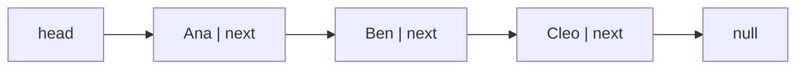

## Hook

Harbor station is full. Every dock holds a bike, and riders want to return theirs. Sam keeps a waiting list. The next free dock goes to the rider at the front.

Riders join and leave the front of this line all day. With an `ArrayList`, removing the front item shifts every other rider one place left. Picture a queue of people where everyone has to shuffle forward each time.

A linked list avoids the shuffle. Each rider only remembers who stands behind them. This page shows you how Java's `LinkedList` works inside, and you build one yourself.

## Concept

### Nodes and references

A linked list is a chain of small objects called **nodes**. Each node holds one item and a link to the next node.

```callout jargon
A **reference** is a variable that points at an object. It is a pointer to the object, the way an address points to a house. A **node** is an object that holds an item plus a reference to the next node.
```

### Syntax: a node class

```java
class Node {
    String item;
    Node next;

    Node(String item) {
        this.item = item;
    }
}
```

- `item` holds the data, such as a rider name.
- `next` refers to the next node. In the last node, `next` is `null`.
- A class can have a field of its own type. That is how the chain forms.

The list itself only keeps a reference to the first node. That first node is called the **head**.



To reach Cleo, you start at head and follow `next` twice. There is no way to jump straight to her.

### Syntax: linking nodes by hand

```java nocompile
Node ana = new Node("Ana");
Node ben = new Node("Ben");
ana.next = ben;
Node head = ana;
```

After these lines, `head.next.item` is `"Ben"`.

### Traversing

**Traversing** means visiting every node, one by one, from head to the end.

### Syntax: walking the list

```java nocompile
Node current = head;
while (current != null) {
    System.out.println(current.item);
    current = current.next;
}
```

- `current` starts at head.
- Each pass prints one item, then moves `current` to the next node.
- When `current` becomes `null`, you have passed the last node.

### Syntax: addFirst

```java nocompile
Node node = new Node(item);
node.next = head;
head = node;
size++;
```

The new node points at the old head, then becomes the head. No other node moves. That is O(1): the same work for 3 riders or 3 million.

### Adding at the end

The list only knows its head. To add at the end, you walk to the last node first, then link the new node after it.

```java nocompile
Node node = new Node(item);
if (head == null) {
    head = node;
} else {
    Node current = head;
    while (current.next != null) {
        current = current.next;
    }
    current.next = node;
}
size++;
```

The loop stops when `current.next` is `null`, so `current` is the last node. An empty list has no last node, so the new node becomes the head. The walk makes this O(n).

```callout tip
Java's real `LinkedList` also keeps a `tail` reference to the last node. That makes adding at the end O(1). Your version keeps only `head`, which is simpler.
```

### Syntax: removeFirst

```java nocompile
if (head == null) {
    return null;
}
String item = head.item;
head = head.next;
size--;
return item;
```

Moving `head` one step forward skips the old first node. Nothing refers to it any more, so Java's garbage collector frees it later.

### A size counter

Counting nodes means walking the whole list, which is O(n). Keep an `int size` field instead. Add 1 in every add and take 1 in every remove. Then `size()` is O(1).

### Linked list or ArrayList?

| Operation | ArrayList | Linked list (head only) |
|---|---|---|
| add or remove at the front | O(n), every item shifts | O(1) |
| add at the end | O(1) usually | O(n) walk, O(1) with a tail |
| get(i) | O(1), jump straight there | O(n), walk i steps |
| contains | O(n) | O(n) |

In plain words: a linked list is fast at its front, and slow to reach the middle. An `ArrayList` is the opposite.

```callout analogy
An `ArrayList` is a row of numbered lockers: you walk straight to locker 7. A linked list is a treasure hunt: each clue tells you where the next one is.
```

### A generic version

Riders' names are `String`, but bike ids or ride minutes could use the same list. Make the list generic with a type parameter `T`, as you did with generics in module 3.

### Syntax: a generic list with a private node class

```java
class RiderList<T> {
    private static class Node<T> {
        T item;
        Node<T> next;

        Node(T item) {
            this.item = item;
        }
    }

    private Node<T> head;
    private int size;
}
```

- `private static class Node<T>` lives inside the list. Code outside the list never sees nodes.
- `static` means a node does not need a list object to exist. It only holds an item and a link.
- `RiderList<String>` holds names. `RiderList<Integer>` holds ride minutes.

## Worked example

This program builds Sam's waiting list, serves the front rider, and walks the rest.

```java run
public class Main {
    public static void main(String[] args) {
        Line<String> waiting = new Line<>();
        waiting.addFirst("Ben");
        waiting.addFirst("Ana");
        System.out.println("size " + waiting.size());
        System.out.println(waiting.removeFirst() + " gets the free dock at Harbor");
        waiting.printAll();
    }
}

class Line<T> {
    private static class Node<T> {
        T item;
        Node<T> next;

        Node(T item) {
            this.item = item;
        }
    }

    private Node<T> head;
    private int size;

    void addFirst(T item) {
        Node<T> node = new Node<>(item);
        node.next = head;
        head = node;
        size++;
    }

    T removeFirst() {
        if (head == null) {
            return null;
        }
        T item = head.item;
        head = head.next;
        size--;
        return item;
    }

    int size() {
        return size;
    }

    void printAll() {
        Node<T> current = head;
        while (current != null) {
            System.out.println("waiting: " + current.item);
            current = current.next;
        }
    }
}
```

1. `addFirst("Ben")` makes Ben the head. Then `addFirst("Ana")` puts Ana in front of Ben.
2. `size` is 2, because each add added 1.
3. `removeFirst()` returns Ana and moves head to Ben.
4. `printAll()` starts at Ben, prints him, and stops when `current` becomes `null`.

## Try it

This program walks to index 2 the way `get` does. Change `index` to 0, then to 3, and run it each time.

```java run
public class Main {
    public static void main(String[] args) {
        Node head = new Node("B-1042");
        head.next = new Node("B-2001");
        head.next.next = new Node("B-3310");

        int index = 2;
        Node current = head;
        for (int i = 0; i < index; i++) {
            current = current.next;
        }
        System.out.println("index " + index + " is " + current.item);
    }
}

class Node {
    String item;
    Node next;

    Node(String item) {
        this.item = item;
    }
}
```

With index 3, `current` walks off the end and becomes `null`. Reading `current.item` then crashes. That is why your `get` checks the index against `size` first and throws `IndexOutOfBoundsException`.

## Recap

- A linked list is a chain of nodes. Each node holds an item and a reference to the next node.
- The list keeps a reference to the first node, the head. The last node's `next` is `null`.
- Adding or removing at the front is O(1). Reaching index i or the end means walking, which is O(n).
- A `size` field, updated in every add and remove, makes `size()` O(1).
- A private static generic `Node<T>` class keeps the nodes hidden inside the list.

## Common mistakes

**Moving head instead of a separate walker.**

```java
public class Main {
    public static void main(String[] args) {
        Node head = new Node("Ana");
        head.next = new Node("Ben");
        while (head != null) {
            System.out.println(head.item);
            head = head.next;
        }
        System.out.println(head);
    }
}

class Node {
    String item;
    Node next;

    Node(String item) {
        this.item = item;
    }
}
```

The output ends with `null`. The loop moved `head` itself, so the list lost every node. Walk with `Node current = head;` and move `current`.

**Forgetting the empty list in addLast.**

```java nocompile
Node<T> current = head;
while (current.next != null) {
    current = current.next;
}
current.next = node;
```

On an empty list `head` is `null`, so `current.next` crashes with `java.lang.NullPointerException`. Check `if (head == null) { head = node; }` first.

**Comparing items with ==.**

```java nocompile
if (current.item == item) {
    return true;
}
```

This compiles, but `contains(new String("Ben"))` returns `false` even when Ben is waiting. `==` checks whether two references point at the same object. Use `current.item.equals(item)` to compare the values.
