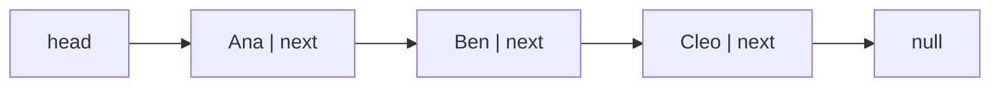

## Hook

Harbor station is full. Every dock holds a bike, and riders want to return theirs. Itachi keeps a waiting list. The next free dock goes to the rider at the front.

Riders join and leave the front of this line all day. With an `ArrayList`, removing the front item shifts every other rider one place left. Picture a queue of people where everyone has to shuffle forward each time.

A linked list avoids the shuffle. Each rider only remembers who stands behind them. This page shows you how Java's `LinkedList` works inside, and you build one yourself.

One honest note first. In real Java code, a line like this would use `ArrayDeque`, which you meet in the next ticket. Building a linked list is still the best way to learn how references work.

## Concept

### Nodes and references

A linked list is a chain of small objects called **nodes**. Each node holds one item and a link to the next node.

```callout jargon
A **reference** is a variable that points at an object. It is a pointer to the object, the way an address points to a house. A **node** is an object that holds an item plus a reference to the next node.
```

### Syntax: a node class

```java
class Node {
    String item;
    Node next;

    Node(String item) {
        this.item = item;
    }
}
```

- `item` holds the data, such as a rider name.
- `next` refers to the next node. In the last node, `next` is `null`.
- A class can have a field of its own type. That is how the chain forms.

The list itself only keeps a reference to the first node. That first node is called the **head**.



To reach Cleo, you start at head and follow `next` twice. There is no way to jump straight to her.

### Syntax: linking nodes by hand

```java nocompile
Node ana = new Node("Ana");
Node ben = new Node("Ben");
ana.next = ben;
Node head = ana;
```

After these lines, `head.next.item` is `"Ben"`.

### Traversing

**Traversing** means visiting every node, one by one, from head to the end.

### Syntax: walking the list

```java nocompile
Node current = head;
while (current != null) {
    System.out.println(current.item);
    current = current.next;
}
```

- `current` starts at head.
- Each pass prints one item, then moves `current` to the next node.
- When `current` becomes `null`, you have passed the last node.

### Syntax: addFirst

```java nocompile
Node node = new Node(item);
node.next = head;
head = node;
size++;
```

The new node points at the old head, then becomes the head. No other node moves. That is O(1): the same work for 3 riders or 3 million.

### Adding at the end

The list only knows its head. To add at the end, you walk to the last node first, then link the new node after it.

```java nocompile
Node node = new Node(item);
if (head == null) {
    head = node;
} else {
    Node current = head;
    while (current.next != null) {
        current = current.next;
    }
    current.next = node;
}
size++;
```

The loop stops when `current.next` is `null`, so `current` is the last node. An empty list has no last node, so the new node becomes the head. The walk makes this O(n).

```callout tip
Java's real `LinkedList` also keeps a `tail` reference to the last node. That makes adding at the end O(1). Your version keeps only `head`, which is simpler.
```

### Syntax: removeFirst

```java nocompile
if (head == null) {
    return null;
}
String item = head.item;
head = head.next;
size--;
return item;
```

Moving `head` one step forward skips the old first node. Nothing refers to it any more, so Java's garbage collector frees it later.

### A size counter

Counting nodes means walking the whole list, which is O(n). Keep an `int size` field instead. Add 1 in every add and take 1 in every remove. Then `size()` is O(1).

### Linked list or ArrayList?

| Operation | ArrayList | Linked list (head only) |
|---|---|---|
| add or remove at the front | O(n), every item shifts | O(1) |
| add at the end | O(1) usually | O(n) walk, O(1) with a tail |
| get(i) | O(1), jump straight there | O(n), walk i steps |
| contains | O(n) | O(n) |

In plain words: a linked list is fast at its front, and slow to reach the middle. An `ArrayList` is the opposite.

```callout analogy
An `ArrayList` is a row of numbered lockers: you walk straight to locker 7. A linked list is a treasure hunt: each clue tells you where the next one is.
```

```callout jargon
The **cache** is a small, very fast memory inside the processor. It loads data in chunks, so items stored side by side, like an array's, come almost for free.
```

```callout warning
Java's `LinkedList` rarely wins in practice. Every node is a separate object with extra memory for its links. The nodes are also scattered in memory, so the processor's cache helps less. For a line served from the front, `ArrayDeque` is faster. For a list, `ArrayList` usually is.
```

### A generic version

Riders' names are `String`, but bike ids or ride minutes could use the same list. Make the list generic with a type parameter `T`, as you did with generics in module 3.

### Syntax: a generic list with a private node class

```java
class RiderList<T> {
    private static class Node<T> {
        T item;
        Node<T> next;

        Node(T item) {
            this.item = item;
        }
    }

    private Node<T> head;
    private int size;
}
```

- `private static class Node<T>` lives inside the list. Code outside the list never sees nodes.
- `static` means a node does not need a list object to exist. It only holds an item and a link.
- `RiderList<String>` holds names. `RiderList<Integer>` holds ride minutes.

### Reversing a list

To reverse a linked list, you do not move any items. You flip every `next` arrow so it points the other way. Then the old last node becomes the head.

You walk the list with three references:

- `previous`: the part already reversed. It starts as `null`.
- `current`: the node you are flipping now. It starts at `head`.
- `next`: a saved copy of `current.next`. Once you flip the arrow, this is the only way to reach the rest of the list.

```animate
title: Flipping the arrows one node at a time
kind: code
code: |
  public class Main {
      public static void main(String[] args) {
          Node head = new Node("Ana", new Node("Ben", new Node("Cleo", null)));
          Node previous = null;
          Node current = head;
          while (current != null) {
              Node next = current.next;
              current.next = previous;
              previous = current;
              current = next;
          }
          head = previous;
          System.out.println(head.item + " " + head.next.item + " " + head.next.next.item);
      }
  }
  class Node {
      String item;
      Node next;
      Node(String item, Node next) {
          this.item = item;
          this.next = next;
      }
  }
steps:
  - line: 3
    objects:
      n3: { type: Node, fields: { item: '"Cleo"', next: "null" } }
      n2: { type: Node, fields: { item: '"Ben"', next: "@n3" } }
      n1: { type: Node, fields: { item: '"Ana"', next: "@n2" } }
    vars: { head: "@n1" }
    say: The waiting list is Ana, Ben, Cleo. head points at Ana.
  - line: 5
    vars: { previous: "null", current: "@n1" }
    say: previous starts as null, because nothing is reversed yet. current starts at the head.
  - line: 7
    vars: { next: "@n2" }
    say: Save current.next first. Once Ana's arrow flips, this saved copy is the only way to reach Ben.
  - line: 8
    objects: { n1: { type: Node, fields: { item: '"Ana"', next: "null" } } }
    say: Flip. Ana now points back at previous, which is null. Ana will be the new last node.
  - line: 9
    vars: { previous: "@n1" }
    say: previous moves up to Ana. The reversed part is now just Ana.
  - line: 10
    vars: { current: "@n2" }
    say: current moves on to Ben, using the saved next.
  - line: 8
    vars: { next: "@n3" }
    objects: { n2: { type: Node, fields: { item: '"Ben"', next: "@n1" } } }
    say: Same again for Ben. Save his next, which is Cleo, then flip his arrow back to Ana.
  - line: 10
    vars: { previous: "@n2", current: "@n3" }
    say: previous moves to Ben, and current moves to Cleo.
  - line: 8
    vars: { next: "null" }
    objects: { n3: { type: Node, fields: { item: '"Cleo"', next: "@n2" } } }
    say: Cleo saves her next, which is null, then flips her arrow back to Ben.
  - line: 10
    vars: { previous: "@n3", current: "null" }
    say: previous moves to Cleo. current becomes null, so the loop stops.
  - line: 12
    vars: { head: "@n3", next: ~ }
    say: head moves to previous, which is Cleo. Every arrow now points the other way.
  - line: 13
    out: "Cleo Ben Ana"
    say: Walking from the new head prints the list backwards. No item moved, only arrows.
```

Each node is visited once, so reversing is O(n). It needs only three extra references, so the extra memory is O(1).

### Syntax: reversing in place

```java nocompile
Node<T> previous = null;
Node<T> current = head;
while (current != null) {
    Node<T> next = current.next;   // 1. save the rest of the list
    current.next = previous;       // 2. flip this node's arrow
    previous = current;            // 3. the reversed part grows by one
    current = next;                // 4. move on
}
head = previous;
```

The order of the four lines matters. Flip before you save, and you lose the rest of the list. At the end `current` is `null`, so the new head is `previous`.

### Fast and slow pointers

Two walkers can start at `head` and move at different speeds. `slow` takes one step each time. `fast` takes two.

```java nocompile
Node slow = head;
Node fast = head;
while (fast != null && fast.next != null) {
    slow = slow.next;
    fast = fast.next.next;
}
// slow is now the middle node
```

When `fast` reaches the end, `slow` has gone half as far. So `slow` sits on the middle node, after one walk. With an even count, such as 4 nodes, it stops on the second of the two middle nodes.

The same trick spots a **cycle**. That is a broken list where some node's `next` points back to an earlier node, so a walk never reaches `null`. Inside the loop, after the two moves, add `if (slow == fast) { return true; }`. Checking before the moves would always say yes, because both start at `head`. On a cycle, `fast` laps `slow` and they meet, like two runners on a track. Without a cycle, `fast` reaches `null` and you return `false`.

```callout tip
`slow == fast` is right here, not `equals`. You are asking whether both walkers stand on the same node object.
```

### A dummy head: merging two sorted lists

Many list methods need a special case for the head, because the head has no node before it. A **dummy head** removes that case. It is a spare node at the front that holds no real item. You build the answer after it, then return `dummy.next`.

Merging two sorted lists of ride minutes shows it well. It is the same idea as merge in merge sort, but you relink nodes instead of copying into an array.

```java nocompile
static Node merge(Node a, Node b) {
    Node dummy = new Node(0);
    Node tail = dummy;
    while (a != null && b != null) {
        if (a.minutes <= b.minutes) {
            tail.next = a;
            a = a.next;
        } else {
            tail.next = b;
            b = b.next;
        }
        tail = tail.next;
    }
    tail.next = (a != null) ? a : b;
    return dummy.next;
}
```

Merging `3, 9, 20` with `5, 9, 12` gives `3, 5, 9, 9, 12, 20`. `tail` always points at the last node of the result, so linking the next one is O(1). The leftovers are already sorted, so one link attaches them all.

## Worked example

This program builds Itachi's waiting list, serves the front rider, and walks the rest.

```java run
public class Main {
    public static void main(String[] args) {
        Line<String> waiting = new Line<>();
        waiting.addFirst("Ben");
        waiting.addFirst("Ana");
        System.out.println("size " + waiting.size());
        System.out.println(waiting.removeFirst() + " gets the free dock at Harbor");
        waiting.printAll();
    }
}

class Line<T> {
    private static class Node<T> {
        T item;
        Node<T> next;

        Node(T item) {
            this.item = item;
        }
    }

    private Node<T> head;
    private int size;

    void addFirst(T item) {
        Node<T> node = new Node<>(item);
        node.next = head;
        head = node;
        size++;
    }

    T removeFirst() {
        if (head == null) {
            return null;
        }
        T item = head.item;
        head = head.next;
        size--;
        return item;
    }

    int size() {
        return size;
    }

    void printAll() {
        Node<T> current = head;
        while (current != null) {
            System.out.println("waiting: " + current.item);
            current = current.next;
        }
    }
}
```

1. `addFirst("Ben")` makes Ben the head. Then `addFirst("Ana")` puts Ana in front of Ben.
2. `size` is 2, because each add added 1.
3. `removeFirst()` returns Ana and moves head to Ben.
4. `printAll()` starts at Ben, prints him, and stops when `current` becomes `null`.

## Try it

This program walks to index 2 the way `get` does. Change `index` to 0, then to 3, and run it each time.

```java run
public class Main {
    public static void main(String[] args) {
        Node head = new Node("B-1042");
        head.next = new Node("B-2001");
        head.next.next = new Node("B-3310");

        int index = 2;
        Node current = head;
        for (int i = 0; i < index; i++) {
            current = current.next;
        }
        System.out.println("index " + index + " is " + current.item);
    }
}

class Node {
    String item;
    Node next;

    Node(String item) {
        this.item = item;
    }
}
```

With index 3, `current` walks off the end and becomes `null`. Reading `current.item` then crashes. That is why your `get` checks the index against `size` first and throws `IndexOutOfBoundsException`.

## Recap

- A linked list is a chain of nodes, each with an item and a `next` reference. The list keeps the first node, the head, and the last `next` is `null`.
- Adding or removing at the front is O(1). Reaching index i or the end means walking, which is O(n).
- A `size` field, updated in every add and remove, makes `size()` O(1).
- A private static generic `Node<T>` class keeps the nodes hidden inside the list.
- Reverse a list by flipping each `next` arrow with `previous`, `current` and a saved `next`. Fast and slow pointers find the middle or a cycle.

## Common mistakes

**Moving head instead of a separate walker.**

```java
public class Main {
    public static void main(String[] args) {
        Node head = new Node("Ana");
        head.next = new Node("Ben");
        while (head != null) {
            System.out.println(head.item);
            head = head.next;
        }
        System.out.println(head);
    }
}

class Node {
    String item;
    Node next;

    Node(String item) {
        this.item = item;
    }
}
```

The output ends with `null`. The loop moved `head` itself, so the list lost every node. Walk with `Node current = head;` and move `current`.

**Forgetting the empty list in addLast.**

```java nocompile
Node<T> current = head;
while (current.next != null) {
    current = current.next;
}
current.next = node;
```

On an empty list `head` is `null`, so `current.next` crashes with `java.lang.NullPointerException`. Check `if (head == null) { head = node; }` first.

**Comparing items with ==.**

```java nocompile
if (current.item == item) {
    return true;
}
```

This compiles, but `contains(new String("Ben"))` returns `false` even when Ben is waiting. `==` checks whether two references point at the same object. Use `current.item.equals(item)` to compare the values.
