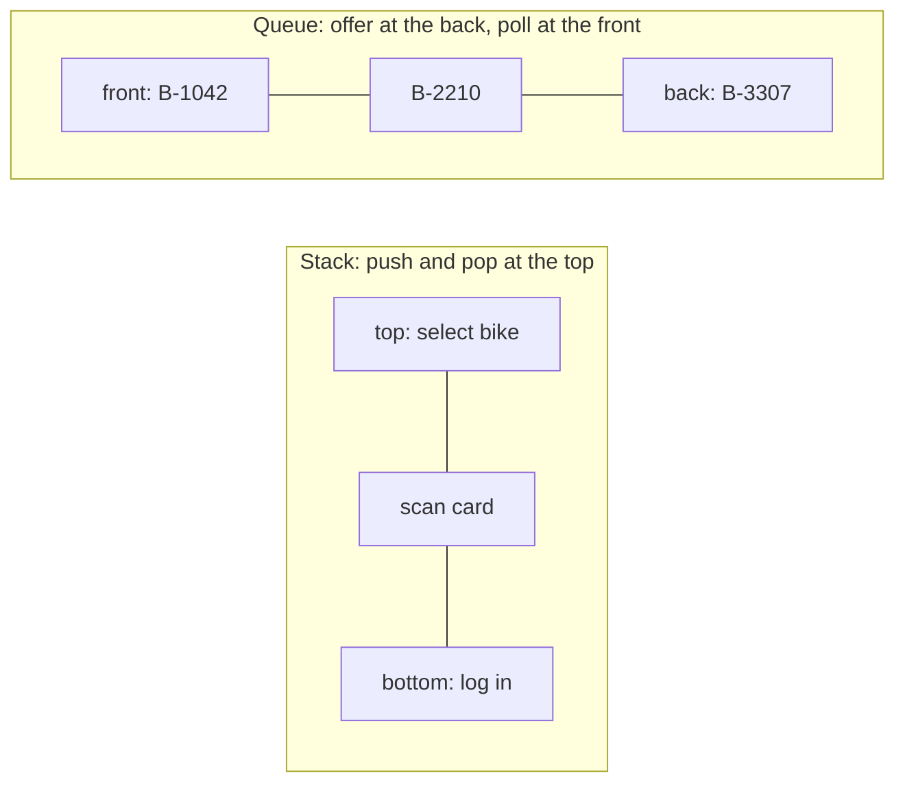

## Hook

Think of a pile of plates in the Spoke kitchen. You put a clean plate on top. When you need one, you take the top plate. The plate at the bottom waits the longest.

Now think of the line at the Harbor kiosk. The first rider to arrive gets served first. A new rider joins at the back.

Both are lists of things waiting. The only difference is which end you take from. The kiosk mixed them up. Undo took from the bottom of the pile, and the repair line served the back of the line.

## Concept

### Two rules for waiting things

```callout jargon
A **stack** is a collection where you add and remove at the same end, called the **top**. The last item in is the first item out. People call this **LIFO**: last in, first out.
```

```callout jargon
A **queue** is a collection where you add at the **back** and remove from the **front**. The first item in is the first item out. People call this **FIFO**: first in, first out.
```



Undo needs a stack. The newest action is on top, so it comes off first. The repair line needs a queue. The bike reported first sits at the front, so it gets fixed first.

### The stack operations

A stack has three main operations:

- **push** puts an item on top.
- **pop** removes the top item and gives it back.
- **peek** shows the top item without removing it.

### The queue operations

A queue has three main operations too:

- **offer** adds an item at the back.
- **poll** removes the front item and gives it back.
- **peek** shows the front item without removing it.

### Build a stack on an array

You can build a stack yourself with an array and a counter. The counter `size` says how many items are stored. The top item sits at index `size - 1`.

### Syntax: push and pop on an array

```java nocompile
items[size] = action;   // push: store at the next free slot
size++;

size--;                 // pop: step back to the top item
String top = items[size];
items[size] = null;     // forget it, so the slot is free
```

An array has a fixed length. When it is full, make a new array twice as long and copy the items across. This is called **growing** the array.

### Syntax: doubling a full array

```java nocompile
if (size == items.length) {
    String[] bigger = new String[items.length * 2];
    for (int i = 0; i < size; i++) {
        bigger[i] = items[i];
    }
    items = bigger;
}
```

```callout tip
Gojo says: copying looks slow, but doubling means it happens rarely. With a starting length of 4, you copy at 4, 8, 16 and 32 items. Most pushes are a single store.
```

### Syntax: ArrayDeque as a stack

```java
import java.util.ArrayDeque;

public class Main {
    public static void main(String[] args) {
        ArrayDeque<String> undo = new ArrayDeque<>();
        undo.push("log in");
        undo.push("scan card");
        undo.push("select bike");
        System.out.println(undo.peek());
        System.out.println(undo.pop());
        System.out.println(undo.pop());
        System.out.println(undo.size());
    }
}
```

`ArrayDeque` is the library class for both jobs. Its name means "array double-ended queue". It can add and remove at either end. `push`, `pop` and `peek` all work at the front, so it behaves as a stack.

### Syntax: ArrayDeque as a queue

```java nocompile
ArrayDeque<String> repairs = new ArrayDeque<>();
repairs.offer("B-1042");       // joins at the back
String first = repairs.poll(); // leaves from the front
```

`offer` adds at the back. `poll` and `peek` work at the front. The first bike in is the first bike out.

```java run
import java.util.ArrayDeque;

public class Main {
    public static void main(String[] args) {
        ArrayDeque<String> repairs = new ArrayDeque<>();
        repairs.offer("B-1042");
        repairs.offer("B-2210");
        repairs.offer("B-3307");
        System.out.println("Next up: " + repairs.peek());
        System.out.println(repairs.poll());
        System.out.println(repairs.poll());
        System.out.println(repairs.poll());
        System.out.println(repairs.poll());
    }
}
```

The last `poll` prints `null`. On an empty queue, `poll` and `peek` return `null`. On an empty stack, `pop` throws a `NoSuchElementException`.

### Why not the old Stack class?

Java also has a class called `Stack`. It is very old. It extends `Vector`, so it has a `get(index)` method that reaches into the middle. That breaks the stack rule. Every method also pays for locking, which is safety for many threads that you do not need here. The Java docs themselves say to use `ArrayDeque` instead.

### How fast is it?

| Operation | Cost | In plain words |
|---|---|---|
| push, pop, peek | O(1) | Same tiny cost with 10 items or 10,000 |
| push when the array is full | O(n) once | Copies everything, but doubling makes this rare |
| offer, poll, peek on ArrayDeque | O(1) | Same tiny cost at any size |
| balanced brackets check | O(n) | Doubles the text, doubles the time |

## Worked example

A classic stack job is checking brackets. In `"{[()]}"` every opening bracket has a matching closing bracket in the right order. In `"([)]"` the order is wrong.

The rule: push every opening bracket. When a closing bracket arrives, the top of the stack must be its partner.

```java run
import java.util.ArrayDeque;

public class Main {
    public static void main(String[] args) {
        System.out.println(balanced("{[()]}"));
        System.out.println(balanced("([)]"));
        System.out.println(balanced("(("));
    }

    static boolean balanced(String text) {
        ArrayDeque<Character> open = new ArrayDeque<>();
        for (char c : text.toCharArray()) {
            if (c == '(' || c == '[' || c == '{') {
                open.push(c);
            } else if (c == ')' || c == ']' || c == '}') {
                if (open.isEmpty()) {
                    return false;
                }
                char top = open.pop();
                if (!matches(top, c)) {
                    return false;
                }
            }
        }
        return open.isEmpty();
    }

    static boolean matches(char open, char close) {
        return (open == '(' && close == ')')
                || (open == '[' && close == ']')
                || (open == '{' && close == '}');
    }
}
```

Line by line:

1. `ArrayDeque<Character>` holds the opening brackets you have seen and not yet closed.
2. An opening bracket goes on top with `push`.
3. A closing bracket with an empty stack has no partner, so the text is unbalanced.
4. `pop` takes the newest opening bracket. It must match the closing one.
5. At the end, the stack must be empty. `"(("` leaves two brackets behind, so it prints `false`.

Other characters, such as letters, are skipped. They never touch the stack.

## Try it

This tiny stack is built on an array that starts with room for 2. Run it, then push a fourth action and watch it grow again.

```java run
public class Main {
    static String[] items = new String[2];
    static int size = 0;

    public static void main(String[] args) {
        push("log in");
        push("scan card");
        push("select bike");
        System.out.println("Room: " + items.length);
        System.out.println("Undo: " + pop());
        System.out.println("Undo: " + pop());
        System.out.println("Left: " + size);
    }

    static void push(String action) {
        if (size == items.length) {
            String[] bigger = new String[items.length * 2];
            for (int i = 0; i < size; i++) {
                bigger[i] = items[i];
            }
            items = bigger;
        }
        items[size] = action;
        size++;
    }

    static String pop() {
        size--;
        String top = items[size];
        items[size] = null;
        return top;
    }
}
```

## Recap

- A stack is last in, first out. Use it for undo and for matching brackets.
- A queue is first in, first out. Use it for lines, such as the repair queue.
- A stack on an array keeps a `size` counter and doubles the array when it is full.
- `ArrayDeque` does both jobs: `push`, `pop`, `peek` for a stack, and `offer`, `poll`, `peek` for a queue.
- Avoid the old `Stack` class. It lets code reach into the middle and pays for locking.

## Common mistakes

### Mixing stack and queue methods

```java
import java.util.ArrayDeque;

public class Main {
    public static void main(String[] args) {
        ArrayDeque<String> undo = new ArrayDeque<>();
        undo.offer("log in");
        undo.offer("select bike");
        System.out.println(undo.pop());
    }
}
```

This prints `log in`, the oldest action. That is the kiosk bug. `offer` adds at the back, but `pop` takes from the front. Pick one pair and keep to it: `push` with `pop` for a stack, `offer` with `poll` for a queue.

### Popping an empty stack

```java run crash
import java.util.ArrayDeque;

public class Main {
    public static void main(String[] args) {
        ArrayDeque<String> undo = new ArrayDeque<>();
        System.out.println(undo.pop());
    }
}
```

The program stops with:

```text
Exception in thread "main" java.util.NoSuchElementException
	at java.base/java.util.ArrayDeque.removeFirst(ArrayDeque.java:361)
	at java.base/java.util.ArrayDeque.pop(ArrayDeque.java:592)
	at Main.main(Main.java:6)
```

Check `isEmpty()` before you call `pop`. Or use `poll`, which returns `null` on an empty deque.

### Forgetting the final empty check

```java nocompile
static boolean balanced(String text) {
    // ... push and pop as in the worked example ...
    return true;
}
```

With this ending, `balanced("((")` prints `true`. Two opening brackets were never closed, yet nothing complained. End with `return open.isEmpty();` so leftover brackets count as a failure.
