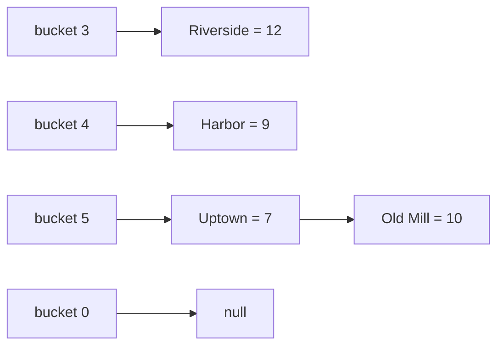

## Hook

Picture the Spoke coat room. It has 8 hooks, numbered 0 to 7. When Kakashi hangs his jacket, a simple rule turns his name into a hook number. When he comes back, the same rule gives the same number. He walks straight to that hook. He never checks the other seven.

That rule is the whole secret of `HashMap`. It is also why a bad rule made the BikeId lookups slow. If the rule sends every jacket to hook 1, hook 1 holds a giant pile, and you dig through it every time.

## Concept

### A hash table in one sentence

```callout jargon
A **hash table** stores key and value pairs in an array of slots. It turns each key into a slot number, so it can jump straight to the right slot. `HashMap` is Java's hash table.
```

Each slot is called a **bucket**. The table you build in this topic starts with 8 buckets.

### Step 1: hashCode gives a number

Every Java object has a `hashCode()` method. It returns an `int` worked out from the object. Equal strings always give the same number.

```java
public class Main {
    public static void main(String[] args) {
        System.out.println("Riverside".hashCode());
        System.out.println("Harbor".hashCode());
        System.out.println("Riverside".hashCode());
    }
}
```

The number can be huge, and it can be negative. `"Harbor"` gives `-2140592980`.

### Step 2: squeeze the number into a bucket index

```callout jargon
**Hashing** means turning a key into a bucket index. The index must be between 0 and the bucket count minus 1.
```

### Syntax: Math.floorMod

```java nocompile
int index = Math.floorMod(key.hashCode(), buckets);
```

`Math.floorMod(a, b)` gives the remainder of `a / b`, and it is never negative when `b` is positive. The `%` operator can give a negative remainder, which is not a valid array index.

```java run
public class Main {
    public static void main(String[] args) {
        String[] stations = {"Riverside", "Old Mill", "Harbor", "Uptown"};
        for (String station : stations) {
            int hash = station.hashCode();
            System.out.println(station + " -> % gives " + (hash % 8)
                    + ", floorMod gives " + Math.floorMod(hash, 8));
        }
    }
}
```

Look at Harbor and Uptown. `%` gives `-4` and `-3`. `floorMod` gives `4` and `5`, which are safe indexes.

### Step 3: collisions and chaining

Old Mill and Uptown both land in bucket 5. Two keys in the same bucket is called a **collision**. Collisions are normal, because many keys share a few buckets.

```callout jargon
**Chaining** handles collisions by keeping a small linked list in each bucket. Each node in the list, called an **entry**, holds a key, a value and a link to the next entry.
```



To find Old Mill, go to bucket 5. Walk the chain and compare each key with `equals`. Stop when one matches.

### Syntax: an entry and a chain walk

```java nocompile
private static class Entry {
    String key;
    Integer value;
    Entry next;
}

Entry entry = buckets[index];
while (entry != null) {
    if (entry.key.equals(key)) {
        return entry.value;
    }
    entry = entry.next;
}
return null;
```

Two different strings can even share the exact same `hashCode`. `"Aa"` and `"BB"` both give `2112`. Chaining still works, because `equals` tells them apart.

### Syntax: unlinking from a chain

To remove a key, walk the chain and keep the entry before the current one in `prev`. When you find the key, link `prev` past it. If the match is the first entry, there is no `prev`, so set `buckets[i] = e.next`.

```java nocompile
Entry prev = null;
Entry e = buckets[i];
while (e != null) {
    if (e.key.equals(key)) {
        if (prev == null) {
            buckets[i] = e.next;
        } else {
            prev.next = e.next;
        }
        size--;
        return e.value;
    }
    prev = e;
    e = e.next;
}
return null;
```

### Step 4: load factor and resizing

```callout jargon
The **load factor** is the number of entries divided by the number of buckets. With 6 entries in 8 buckets, the load factor is 0.75.
```

As the table fills, chains get longer and lookups slow down. So the table grows. In this topic, it doubles its buckets when `size > 0.75 * buckets`. Java's `HashMap` also grows at a load factor of 0.75. Its insides differ in a few clever ways, which you meet in a later card.

```callout warning
When the bucket count changes, every key's index changes too. Harbor sits in bucket 4 out of 8, but in bucket 12 out of 16. So resizing must put every entry into the new array again, at its new index. This step is called **rehashing**.
```

### Step 5: equals and hashCode must agree

You met this rule in [equals, hashCode and toString](/t/module-02-oop/topic-10-equals-hashcode-tostring). Now you can see why it matters.

- `hashCode` picks the bucket.
- `equals` finds the key inside that bucket.

If two equal keys give different hash codes, they go to different buckets. `get` looks in the wrong bucket and returns `null`. If every key gives the same hash code, as the old BikeId did, every entry lands in one bucket. That one chain holds everything, and each lookup walks all of it.

### How Java's HashMap really works

Your `DockTable` is the textbook design. The real `java.util.HashMap` keeps the same idea, with three upgrades.

**1. The bucket count is always a power of two.** It starts at 16, made on the first `put`, and doubles to 32, 64 and so on.

**2. It mixes the hash, then masks it.** It computes `h ^ (h >>> 16)`, which folds the top half of the hash into the bottom half. Then it takes the index as `hash & (n - 1)`, where `n` is the bucket count.

```callout jargon
`^`, `>>>` and `&` are **bitwise operators**: they work on the 0s and 1s inside an `int`. SPK-0420 teaches them. Here you only need one fact: when `n` is a power of two, `hash & (n - 1)` gives the same index as `Math.floorMod(hash, n)`, and it is faster.
```

```java run
public class Main {
    public static void main(String[] args) {
        String[] stations = {"Riverside", "Old Mill", "Harbor", "Uptown"};
        for (String station : stations) {
            int h = station.hashCode();
            int spread = h ^ (h >>> 16);
            System.out.println(station + " -> floorMod " + Math.floorMod(spread, 16)
                    + ", & gives " + (spread & (16 - 1)));
        }
    }
}
```

The mixing step matters because `& (n - 1)` only looks at the lowest bits. Without it, keys that differ only in their high bits would all crowd into a few buckets.

### When a chain turns into a tree

The third upgrade guards against long chains. Since Java 8, when one bucket's chain grows past 8 entries, `HashMap` turns that chain into a **red-black tree**. If the table has fewer than 64 buckets, it doubles the table instead.

```callout jargon
A **red-black tree** is a binary search tree that rebalances itself after every change, so its height stays about log n. `TreeMap`, which you meet in SPK-0409, is one too.
```

So even a terrible `hashCode` gives O(log n) lookups for keys that are `Comparable`, such as `String` and `Integer`. For other keys with equal hashes, the tree cannot sort them, and the worst case is still close to O(n). Never rely on this rescue. Write a good `hashCode`.

### How fast is it?

| Operation | Average | Worst case | In plain words |
|---|---|---|---|
| put, get, remove | O(1) | O(n) | Usually one jump and a short chain. With a broken hashCode, one long chain |
| resize | O(n) | O(n) | Touches every entry, but doubling makes it rare |
| indexFor | O(1) | O(1) | One hashCode and one remainder |

O(1) means the cost stays the same as the table grows. O(n) means doubling the entries doubles the time. These are the costs of your `DockTable`. Java's `HashMap` cuts the worst case to O(log n) for `Comparable` keys, thanks to its tree buckets.

### Hash patterns

Many interview problems become easy with one idea: remember what you have seen in a `HashMap`, then look it up in O(1).

**Two-sum.** Find two rides whose fares add up to 1450 cents. Checking every pair is O(n²). Instead, walk the fares once. For each fare, ask the map: "Have I already seen the fare that completes it?"

```java run
import java.util.HashMap;
import java.util.Map;

public class Main {
    public static void main(String[] args) {
        long[] fares = {550, 1300, 250, 900, 1150};
        long target = 1450;
        Map<Long, Integer> seen = new HashMap<>();
        for (int i = 0; i < fares.length; i++) {
            long need = target - fares[i];
            if (seen.containsKey(need)) {
                System.out.println("Rides " + seen.get(need) + " and " + i);
                return;
            }
            seen.put(fares[i], i);
        }
        System.out.println("No pair");
    }
}
```

It prints `Rides 0 and 3`: 550 + 900 is 1450. One pass, so O(n).

**Grouping.** Anagrams are words with the same letters in a different order. To group them, give each word a key that all its anagrams share: its letters, sorted. Then `map.computeIfAbsent(key, k -> new ArrayList<>()).add(word)` puts each word in its group.

```java nocompile
char[] letters = word.toCharArray();
Arrays.sort(letters);
String key = new String(letters);
groups.computeIfAbsent(key, k -> new ArrayList<>()).add(word);
```

"listen" and "silent" both get the key `eilnst`, so they land in the same list.

### Never change a key

A key's bucket is chosen once, from its `hashCode`, when you put it in. If you change the key afterwards, its hash code changes, but the entry stays in the old bucket. Now nothing can find it.

```java run
import java.util.ArrayList;
import java.util.HashSet;
import java.util.List;
import java.util.Set;

public class Main {
    public static void main(String[] args) {
        List<String> route = new ArrayList<>(List.of("Harbor"));
        Set<List<String>> planned = new HashSet<>();
        planned.add(route);
        route.add("Uptown");
        System.out.println(planned.contains(route));
        System.out.println(planned.size());
    }
}
```

This prints `false` and then `1`. The set still holds the route, but `contains` looks in the wrong bucket. Use keys that cannot change, such as `String`, `Integer`, records with final fields, or `List.of(...)`.

### LRU cache

A cache has room for only a few entries. When it is full, it must throw one out. Which one?

```callout jargon
A **cache** keeps recent answers close by, so you can skip slow work. **LRU** means "least recently used". An LRU cache throws out the entry nobody has touched for the longest time.
```

The classic build is a `HashMap` plus a doubly linked list. The map finds an entry in O(1). The list keeps entries in order of use: each `get` moves its entry to the back, and eviction removes the front. Both steps are O(1).

Java has this built in. A `LinkedHashMap` made with `accessOrder` set to `true` keeps entries in order of use. Override `removeEldestEntry` to say when to evict.

```java run
import java.util.LinkedHashMap;
import java.util.Map;

public class Main {
    public static void main(String[] args) {
        Map<String, Integer> cache = new LinkedHashMap<>(16, 0.75f, true) {
            @Override
            protected boolean removeEldestEntry(Map.Entry<String, Integer> eldest) {
                return size() > 2;
            }
        };
        cache.put("Harbor", 9);
        cache.put("Uptown", 7);
        cache.get("Harbor");
        cache.put("Depot", 12);
        System.out.println(cache);
    }
}
```

It prints `{Harbor=9, Depot=12}`. Reading Harbor made it recent, so Uptown was the least recently used and got evicted.

```animate
title: The cache evicts the stalest station
kind: scene
nodes:
  - { id: oldest, label: Least recent, emoji: "🧊", value: empty }
  - { id: newest, label: Most recent, emoji: "🔥", value: empty }
  - { id: out, label: Evicted, emoji: "🗑️", value: none }
steps:
  - say: put Harbor. The cache holds one station.
    set: { newest: Harbor }
  - say: put Uptown. It is now the most recent, and Harbor slides back.
    set: { oldest: Harbor, newest: Uptown }
  - say: get Harbor. Reading it makes Harbor the most recent again.
    set: { oldest: Uptown, newest: Harbor }
  - say: put Depot. Now there are three, one too many, so the least recent must go.
    focus: [oldest]
  - say: Uptown is evicted. Harbor and Depot stay.
    send: { from: oldest, to: out, label: Uptown }
    set: { out: Uptown, oldest: Harbor, newest: Depot }
```

## Worked example

This program builds a tiny table by hand, with only 4 buckets and no resizing. Read it, then run it.

```java run
public class Main {
    static class Entry {
        String key;
        Integer value;
        Entry next;

        Entry(String key, Integer value, Entry next) {
            this.key = key;
            this.value = value;
            this.next = next;
        }
    }

    static Entry[] buckets = new Entry[4];

    public static void main(String[] args) {
        put("Aa", 1);
        put("BB", 2);
        put("Harbor", 9);
        System.out.println(get("Aa") + " " + get("BB") + " " + get("Harbor"));
        System.out.println("Aa and BB share bucket " + Math.floorMod("Aa".hashCode(), 4));
        System.out.println(get("Uptown"));
    }

    static void put(String key, Integer value) {
        int i = Math.floorMod(key.hashCode(), buckets.length);
        for (Entry e = buckets[i]; e != null; e = e.next) {
            if (e.key.equals(key)) {
                e.value = value;
                return;
            }
        }
        buckets[i] = new Entry(key, value, buckets[i]);
    }

    static Integer get(String key) {
        int i = Math.floorMod(key.hashCode(), buckets.length);
        for (Entry e = buckets[i]; e != null; e = e.next) {
            if (e.key.equals(key)) {
                return e.value;
            }
        }
        return null;
    }
}
```

Line by line:

1. `Entry` is a node in a chain: a key, a value and a link to the next entry.
2. `put` finds the bucket with `floorMod`. If the key is already in the chain, it replaces the value.
3. Otherwise it makes a new entry at the front of the chain. The old first entry becomes its `next`.
4. `get` finds the same bucket and walks the chain, comparing keys with `equals`.
5. `"Aa"` and `"BB"` share bucket 0, yet both values come back. Uptown was never stored, so `get` returns `null`.

## Try it

See where bike ids land. Run it, then change `buckets` to 16 and watch the indexes move.

```java run
public class Main {
    public static void main(String[] args) {
        int buckets = 8;
        String[] bikes = {"B-1042", "B-2210", "B-3307", "Aa", "BB"};
        for (String bike : bikes) {
            System.out.println(bike + " -> bucket " + Math.floorMod(bike.hashCode(), buckets));
        }
    }
}
```

With 8 buckets, B-2210 and B-3307 collide in bucket 2. With 16, B-2210 moves to bucket 10.

## Recap

- A hash table turns a key into a bucket index with `Math.floorMod(key.hashCode(), buckets)`.
- Keys that land in the same bucket form a chain. `equals` finds the right one.
- When `size > 0.75 * buckets`, double the buckets and rehash every entry.
- `equals` and `hashCode` must agree, or lookups miss. A constant `hashCode` puts everything in one chain.
- Lookups are O(1) on average. The worst case is O(n) for your table, and O(log n) in Java's `HashMap` for `Comparable` keys.

## Common mistakes

### Using % for the index

```java run crash
public class Main {
    public static void main(String[] args) {
        String[] buckets = new String[8];
        int index = "Harbor".hashCode() % buckets.length;
        buckets[index] = "Harbor";
    }
}
```

The program stops with:

```text
Exception in thread "main" java.lang.ArrayIndexOutOfBoundsException: Index -4 out of bounds for length 8
	at Main.main(Main.java:5)
```

`"Harbor".hashCode()` is negative, so `%` gives `-4`. Use `Math.floorMod("Harbor".hashCode(), buckets.length)`, which gives `4`.

### Comparing keys with ==

```java
public class Main {
    public static void main(String[] args) {
        String stored = "Old Mill";
        String typed = new String("Old Mill");
        System.out.println(stored == typed);
        System.out.println(stored.equals(typed));
    }
}
```

This prints `false` and then `true`. `==` checks whether both names point to the same object. A key typed by a rider is often a different object with the same letters. Walk the chain with `equals`.

### Overriding equals without hashCode

```java
import java.util.HashMap;

public class Main {
    public static void main(String[] args) {
        HashMap<BikeId, String> docks = new HashMap<>();
        docks.put(new BikeId("B-1042"), "Uptown");
        System.out.println(docks.get(new BikeId("B-1042")));
    }
}

class BikeId {
    final String id;

    BikeId(String id) {
        this.id = id;
    }

    @Override
    public boolean equals(Object other) {
        return other instanceof BikeId b && b.id.equals(id);
    }
}
```

This usually prints `null`. The two BikeId objects are equal, but each gets a different default `hashCode`, so `get` searches the wrong bucket. Add `public int hashCode() { return id.hashCode(); }`. Never return a constant such as `1`. That works, but it puts every bike in one long chain.
