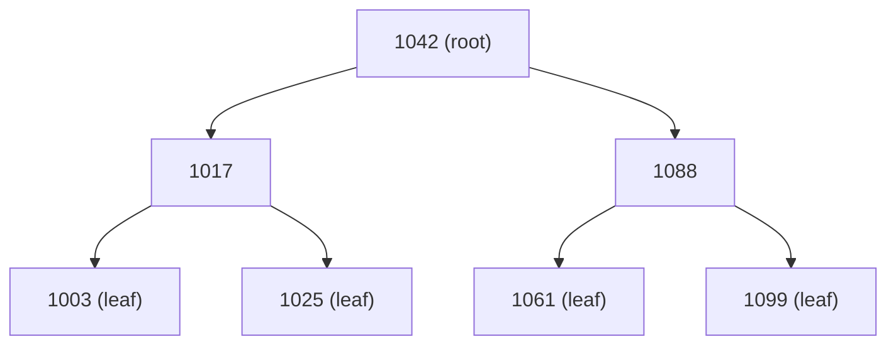
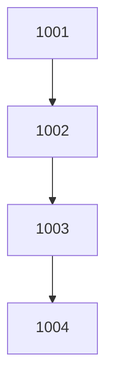

## Hook

Picture the Harbor depot at closing time. Kakashi has a stack of 50,000 bike cards and wants B-1042. He could flip through every card. Or he could use a guessing game. He picks up a card in the middle: B-1500. Too big, so he only looks to the left. Next card: B-1000. Too small, so he only looks to the right. Each guess throws away half the pile.

Binary search on a sorted array already plays this game. The trouble is new bikes. Every new card must squeeze into the right spot, and shifting 50,000 cards is slow. In this lesson you build a structure that plays the guessing game *and* takes new bikes cheaply. It is called a binary search tree.

## Concept

### Trees

A **tree** is a set of boxes joined by arrows that point downward. Each box is a **node**. A node holds a value, such as a bike number.

- The **root** is the single node at the top.
- A node's **children** are the nodes its arrows point to.
- A node's **parent** is the node that points to it. Only the root has no parent.
- A **leaf** is a node with no children.
- A **subtree** is a node together with everything below it.



In a **binary tree**, each node has at most two children: a **left child** and a **right child**.

```callout analogy
Gojo says: a tree is a family tree drawn upside down. The root is the great-grandparent at the top, and the leaves are the youngest kids at the bottom.
```

### Syntax: a node class

A node is a small object with a value and two links. A link that points nowhere is `null`.

```java
class Node {
    int bike;
    Node left;
    Node right;

    Node(int bike) {
        this.bike = bike;
    }
}
```

The tree itself only keeps the root. Every other node is reached by following links from there.

```java nocompile
Node root = new Node(1042);
root.left = new Node(1017);
root.right = new Node(1088);
```

### The BST rule

A **binary search tree** (BST) is a binary tree with one extra rule. For every node:

- every value in its left subtree is **smaller**,
- every value in its right subtree is **larger**.

Look at the picture again. Everything left of 1042 is smaller than 1042. Everything right of it is larger. The same holds at 1017 and at 1088. This rule is what makes search fast. At each node you know which half to ignore.

### Syntax: recursive search

The search looks at one node and then calls itself on one child. A `null` node means you fell off the tree, so the bike is not there.

```java nocompile
static boolean contains(Node node, int bike) {
    if (node == null) {
        return false;
    }
    if (bike == node.bike) {
        return true;
    }
    if (bike < node.bike) {
        return contains(node.left, bike);
    }
    return contains(node.right, bike);
}
```

Searching for 1025 in the picture: 1025 is smaller than 1042, so go left. 1025 is larger than 1017, so go right. Found it in three steps.

The smallest bike uses the same idea without any comparisons. Keep going left until there is no left child.

```java nocompile
static int min(Node node) {
    while (node.left != null) {
        node = node.left;
    }
    return node.bike;
}
```

### Syntax: recursive insert

Insert walks the same path as search. Where the search would hit `null`, insert hangs a new node. The helper returns the node, so the parent can store the link.

```java nocompile
static Node insert(Node node, int bike) {
    if (node == null) {
        return new Node(bike);
    }
    if (bike < node.bike) {
        node.left = insert(node.left, bike);
    } else if (bike > node.bike) {
        node.right = insert(node.right, bike);
    }
    return node;
}
```

When `bike` equals `node.bike`, neither branch runs. The duplicate is ignored. You call it as `root = insert(root, 1042);` so that the first insert sets the root.

### Traversals

A **traversal** visits every node once. There are three common orders. Each one is three lines; only their order changes.

| Name | Order | Use |
|---|---|---|
| in-order | left, node, right | lists a BST in sorted order |
| pre-order | node, left, right | copies a tree top down |
| post-order | left, right, node | deletes or sums a tree bottom up |

### Syntax: in-order traversal

```java nocompile
static void inOrder(Node node, List<Integer> out) {
    if (node == null) {
        return;
    }
    inOrder(node.left, out);
    out.add(node.bike);
    inOrder(node.right, out);
}
```

Why is it sorted? Everything on the left is smaller, so it is added first. Then the node. Then everything larger. For the picture above, in-order gives `[1003, 1017, 1025, 1042, 1061, 1088, 1099]`. Pre-order gives `[1042, 1017, 1003, 1025, 1088, 1061, 1099]`. Post-order gives `[1003, 1025, 1017, 1061, 1099, 1088, 1042]`.

### Height

The **height** of a tree is the number of nodes on the longest path from the root down to a leaf. In this course an empty tree has height 0 and a tree with one node has height 1. The picture above has height 3.

```java nocompile
static int height(Node node) {
    if (node == null) {
        return 0;
    }
    return 1 + Math.max(height(node.left), height(node.right));
}
```

```callout jargon
Gojo says: some books count edges instead of nodes, so a single node has height 0 there. Both are fine. Just pick one and write it down.
```

### Balanced and degenerate trees

Search and insert walk one path from the root. So their cost is the height of the tree.

A **balanced** tree keeps both sides about equally tall. Each level doubles the number of nodes, so 1,000,000 bikes fit in about 20 levels. That is O(log n).

Now feed bikes in sorted order: 1001, 1002, 1003, 1004. Each new bike is larger than all others, so it always goes right. The tree becomes one long chain. This is a **degenerate** tree. Its height equals the number of bikes, so search is O(n), no better than a list.



| Operation | Balanced tree | Degenerate tree |
|---|---|---|
| search, insert | O(log n): double the bikes, add one step | O(n): double the bikes, double the time |
| min, max | O(log n) | O(n) |
| in-order listing | O(n): visits each bike once | O(n) |

### Syntax: TreeMap

Java ships a BST that rebalances itself after every change, so it never degenerates. It is called `TreeMap`. It works like a `HashMap`, but its keys always stay sorted.

```java nocompile
TreeMap<Integer, String> bikes = new TreeMap<>();
bikes.put(1042, "Harbor");
bikes.put(1003, "Uptown");
System.out.println(bikes.firstKey());
```

`TreeMap` gives O(log n) for `put`, `get` and `containsKey`. `firstKey()` and `lastKey()` give the smallest and largest key. You need `import java.util.TreeMap;`.

## Worked example

This program builds a registry by hand and lists it in order.

```java run
import java.util.ArrayList;
import java.util.List;

public class Main {
    static Node root;

    static Node insert(Node node, int bike) {
        if (node == null) {
            return new Node(bike);
        }
        if (bike < node.bike) {
            node.left = insert(node.left, bike);
        } else if (bike > node.bike) {
            node.right = insert(node.right, bike);
        }
        return node;
    }

    static void inOrder(Node node, List<Integer> out) {
        if (node == null) {
            return;
        }
        inOrder(node.left, out);
        out.add(node.bike);
        inOrder(node.right, out);
    }

    public static void main(String[] args) {
        int[] arrivals = {1042, 1017, 1088, 1003, 1025};
        for (int bike : arrivals) {
            root = insert(root, bike);
        }
        List<Integer> sorted = new ArrayList<>();
        inOrder(root, sorted);
        System.out.println(sorted);
        System.out.println("Root: " + root.bike);
    }
}

class Node {
    int bike;
    Node left;
    Node right;

    Node(int bike) {
        this.bike = bike;
    }
}
```

Line by line:

- `static Node root;` starts as `null`, an empty tree.
- The first `insert` sees `null` and returns a new node. That node becomes the root, 1042.
- 1017 is smaller, so it goes left of 1042. 1088 goes right.
- 1003 goes left of 1042, then left of 1017. 1025 goes left of 1042, then right of 1017.
- `inOrder` visits left, node, right, so it prints `[1003, 1017, 1025, 1042, 1088]`.
- The root stays 1042, the first bike that arrived.

## Try it

This program inserts bikes in sorted order and measures the height. Run it, then change the array to `{1003, 1001, 1005, 1002, 1004}` and run it again.

```java run
public class Main {
    static Node insert(Node node, int bike) {
        if (node == null) {
            return new Node(bike);
        }
        if (bike < node.bike) {
            node.left = insert(node.left, bike);
        } else if (bike > node.bike) {
            node.right = insert(node.right, bike);
        }
        return node;
    }

    static int height(Node node) {
        if (node == null) {
            return 0;
        }
        return 1 + Math.max(height(node.left), height(node.right));
    }

    public static void main(String[] args) {
        int[] arrivals = {1001, 1002, 1003, 1004, 1005};
        Node root = null;
        for (int bike : arrivals) {
            root = insert(root, bike);
        }
        System.out.println("Bikes: " + arrivals.length);
        System.out.println("Height: " + height(root));
    }
}

class Node {
    int bike;
    Node left;
    Node right;

    Node(int bike) {
        this.bike = bike;
    }
}
```

Sorted arrivals give height 5, a chain. The mixed order gives height 3. Same bikes, very different trees.

Now compare it with the library version, which stays balanced on its own:

```java run
import java.util.TreeMap;

public class Main {
    public static void main(String[] args) {
        TreeMap<Integer, String> bikes = new TreeMap<>();
        bikes.put(1042, "Harbor");
        bikes.put(1003, "Uptown");
        bikes.put(1088, "Riverside");
        bikes.put(1017, "Old Mill");
        System.out.println(bikes.keySet());
        System.out.println(bikes.firstKey() + " to " + bikes.lastKey());
        System.out.println(bikes.get(1017));
    }
}
```

```callout tip
Gojo says: in real code, reach for TreeMap or TreeSet when you need sorted keys and fast lookups. Build the tree by hand only to learn how it works.
```

## Recap

- A tree has a root at the top, children below, and leaves with no children. A binary tree has at most two children per node.
- In a BST, smaller values go left and larger values go right, at every node.
- Insert and search walk one path from the root, so they cost the height of the tree.
- In-order traversal (left, node, right) lists a BST in sorted order.
- A balanced tree gives O(log n). Sorted arrivals build a degenerate chain with O(n). `TreeMap` stays balanced for you.

## Common mistakes

**1. Forgetting to store the result of insert.**

```java nocompile
Node root = null;
insert(root, 1042);
insert(root, 1017);
System.out.println(root.bike);
```

The program crashes with `java.lang.NullPointerException: Cannot read field "bike" because "<local1>" is null`. The helper built a node, but nothing kept it. `root` is still `null`. Fix: write `root = insert(root, 1042);`. Inside the helper, also write `node.left = insert(node.left, bike);`.

**2. Visiting the node before the left subtree and expecting sorted output.**

```java nocompile
static void inOrder(Node node, List<Integer> out) {
    if (node == null) {
        return;
    }
    out.add(node.bike);
    inOrder(node.left, out);
    inOrder(node.right, out);
}
```

This is pre-order. For the bikes 1042, 1017, 1088 it prints `[1042, 1017, 1088]` instead of `[1017, 1042, 1088]`. Fix: call `inOrder(node.left, out)` first, then `out.add(node.bike)`, then the right side.

**3. Forgetting the null check in a recursive method.**

```java nocompile
static int height(Node node) {
    return 1 + Math.max(height(node.left), height(node.right));
}
```

Every leaf calls `height(null)`, so the program crashes with `java.lang.NullPointerException: Cannot read field "left" because "<parameter1>" is null`. Fix: start with `if (node == null) { return 0; }`. Every recursive tree method needs this base case.
