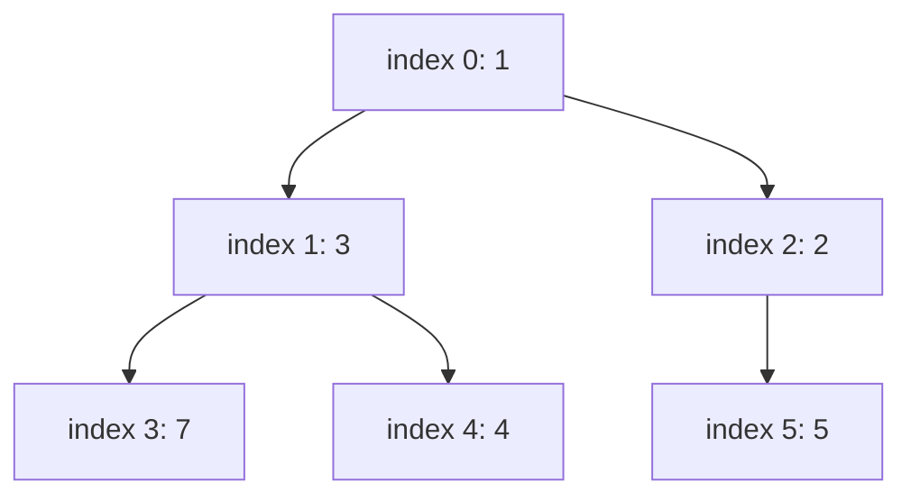

## Hook

Itachi's repair board is a long list of broken bikes. Each report has an urgency number. A 1 means "no brakes, fix now". A 5 means "squeaky bell". When a new report arrives, the tool re-sorts the whole list. That costs O(n log n) every time.

But the crew never reads the whole list. They only ask one question: "Which bike is most urgent right now?" You do not need a fully sorted list to answer that. You only need the smallest number on top. A **heap** keeps exactly that promise, and it keeps it cheaply.

## Concept

### The heap rule

A **binary heap** is a binary tree with two rules.

1. **Shape:** every level is full, except maybe the last one, which fills from left to right. This is called a **complete** tree.
2. **Order:** in a **min-heap**, every parent is smaller than or equal to its children.

So the smallest value always sits at the root. Unlike a BST, left and right are in no particular order. A heap is only "sorted" along each path from the root down.

```callout jargon
Gojo says: a max-heap flips the order rule, so the largest value sits on top. Everything else in this lesson works the same way.
```

### Storing a tree in an array

A complete tree has no gaps. So you can read it level by level, left to right, and write each value into the next array slot. No `Node` objects and no links are needed.



The same heap as an array: `[1, 3, 2, 7, 4, 5]`.

### Syntax: index arithmetic

For a value at index `i`:

```java nocompile
int parent = (i - 1) / 2;
int left = 2 * i + 1;
int right = 2 * i + 2;
```

Check it with the picture. Index 4 holds 4. Its parent is `(4 - 1) / 2 = 1`, which holds 3. Index 1 has children at 3 and 4. Integer division drops the remainder, so index 3 and index 4 share parent 1.

A child index only exists when it is less than `size`. Index 2 has a left child at 5, but its right child would be 6, which is past the end.

### Syntax: add with sift up

To add a value, put it in the first free slot at the end. That keeps the shape rule. It may break the order rule, so you **sift up**: while the new value is smaller than its parent, swap them.

```java nocompile
items[size] = value;
size++;
int i = size - 1;
while (i > 0 && items[i] < items[(i - 1) / 2]) {
    int parent = (i - 1) / 2;
    int temp = items[i];
    items[i] = items[parent];
    items[parent] = temp;
    i = parent;
}
```

Add 0 to `[1, 3, 2, 7, 4, 5]`. It lands at index 6, under 2. 0 is smaller than 2, so swap. Now it is at index 2, under 1. Swap again. It reaches the root: `[0, 3, 1, 7, 4, 5, 2]`.

### Syntax: poll with sift down

To **poll** means to remove and return the top value. Take `items[0]`. Move the last value into slot 0 and shrink `size`. The shape is fine, but the new top is probably too big. So you **sift down**: swap it with its smaller child until no child is smaller.

```java nocompile
int top = items[0];
size--;
items[0] = items[size];
int i = 0;
while (true) {
    int left = 2 * i + 1;
    int right = 2 * i + 2;
    int smallest = i;
    if (left < size && items[left] < items[smallest]) {
        smallest = left;
    }
    if (right < size && items[right] < items[smallest]) {
        smallest = right;
    }
    if (smallest == i) {
        break;
    }
    int temp = items[i];
    items[i] = items[smallest];
    items[smallest] = temp;
    i = smallest;
}
```

Always swap with the **smaller** child. If you swap with the larger one, the smaller child ends up under a bigger parent.

**Peek** returns `items[0]` and changes nothing.

### Growing the array

An array has a fixed length. When `size` reaches `items.length`, make a new array twice as long and copy the values across. Doubling means copies are rare, so `add` stays cheap on average.

### How fast is it?

A complete tree of n values has about log n levels. Sift up and sift down each walk at most one path.

| Operation | Cost | In plain words |
|---|---|---|
| peek | O(1) | read slot 0, no matter how many bikes |
| add | O(log n) | double the bikes, add one swap at most |
| poll | O(log n) | double the bikes, add one swap at most |
| re-sort the list on every report | O(n log n) | what Itachi's tool does now |

```callout analogy
Gojo says: a heap is like a hospital waiting room. Nobody lines everyone up in exact order. The nurse just makes sure the most urgent patient is always next.
```

### Building a heap in O(n)

Say you already have all n repair reports in an array. Adding them one by one costs O(n log n). There is a faster way, called **heapify**.

```callout jargon
To **heapify** an array is to turn it into a heap in place. Sift down every parent, starting from the last parent and moving back to the root.
```

```java nocompile
for (int i = items.length / 2 - 1; i >= 0; i--) {
    siftDown(items, items.length, i);
}
```

The last parent sits at index `n / 2 - 1`. Everything after it is a leaf, and a leaf is already a tiny heap. For `[5, 3, 4, 1, 2, 0]`, heapify gives `[0, 1, 4, 3, 2, 5]`.

Why is it only O(n)? Half the nodes are leaves and do no work. A quarter sift down at most one level, an eighth at most two, and so on. All together, that is at most about n swaps. `new PriorityQueue<>(collection)` uses this trick.

**Heapsort** builds on it: heapify into a max-heap, then poll n times, putting each value into the slot freed at the end. It sorts in place in O(n log n), but it is not stable.

### Syntax: PriorityQueue

Java's `PriorityQueue` is a min-heap stored in an array, just like yours. `offer` or `add` puts a value in. `poll` removes the smallest. `peek` looks at it. `poll` and `peek` return `null` when the queue is empty.

```java nocompile
PriorityQueue<Integer> queue = new PriorityQueue<>();
queue.add(3);
queue.add(1);
System.out.println(queue.poll());
```

For your own objects, pass a `Comparator` to the constructor. The queue uses it to decide which object counts as "smallest".

```java nocompile
Comparator<Repair> byUrgency = Comparator.comparingInt(Repair::urgency)
        .thenComparing(Repair::bikeId);
PriorityQueue<Repair> queue = new PriorityQueue<>(byUrgency);
```

You need `import java.util.PriorityQueue;` and `import java.util.Comparator;`.

### Syntax: a max-heap

```java nocompile
PriorityQueue<Integer> longestFirst = new PriorityQueue<>(Comparator.reverseOrder());
```

`PriorityQueue` is always a min-heap of whatever its comparator calls "smallest". `Comparator.reverseOrder()` flips the order, so the largest value comes out first. For your own objects, add `.reversed()` to a comparator, as in `Comparator.comparingInt(Repair::urgency).reversed()`.

```java run
import java.util.Comparator;
import java.util.PriorityQueue;

public class Main {
    public static void main(String[] args) {
        PriorityQueue<Integer> longestFirst = new PriorityQueue<>(Comparator.reverseOrder());
        longestFirst.add(12);
        longestFirst.add(45);
        longestFirst.add(7);
        System.out.println(longestFirst.poll());
        System.out.println(longestFirst.poll());
    }
}
```

It prints `45` and then `12`.

### Top-k with a size-k heap

Jiraiya wants the 3 longest rides out of a million. Sorting all of them costs O(n log n). You only need 3, so keep only 3.

Use a **min-heap of size k**. Add each ride. When the heap holds more than k, poll the smallest. The heap always holds the k longest rides seen so far, and its top is the weakest of them, the first to be kicked out.

```java run
import java.util.ArrayList;
import java.util.List;
import java.util.PriorityQueue;

public class Main {
    public static void main(String[] args) {
        int[] minutes = {12, 45, 7, 33, 58, 21, 40, 9};
        int k = 3;
        PriorityQueue<Integer> top = new PriorityQueue<>();
        for (int m : minutes) {
            top.add(m);
            if (top.size() > k) {
                top.poll();
            }
        }
        List<Integer> longest = new ArrayList<>();
        while (!top.isEmpty()) {
            longest.add(top.poll());
        }
        System.out.println(longest);
    }
}
```

It prints `[40, 45, 58]`. The heap never holds more than k + 1 values, so each step is O(log k). The whole job is **O(n log k)**, and it uses only O(k) memory. For the k *smallest*, flip it: keep a max-heap of size k.

```animate
title: Keeping the 3 longest rides
kind: scene
nodes:
  - { id: ride, label: Next ride, emoji: "🚲", value: none }
  - { id: heap, label: Min-heap of 3, emoji: "⛰️", value: empty }
  - { id: out, label: Kicked out, emoji: "🗑️", value: none }
steps:
  - say: Rides of 12, 45 and 7 minutes arrive. The heap has room for 3, so all stay. The smallest, 7, sits on top.
    set: { ride: "12, 45, 7", heap: "7 | 12, 45" }
  - say: 33 arrives. Now there are 4, one too many, so poll the top. 7 is out.
    set: { ride: "33", heap: "12 | 33, 45", out: "7" }
    send: { from: heap, to: out, label: "7" }
  - say: 58 arrives. Poll again. 12 is out.
    set: { ride: "58", heap: "33 | 45, 58", out: "7, 12" }
    send: { from: heap, to: out, label: "12" }
  - say: 21 arrives. It is now the smallest, so it is polled right back out.
    set: { ride: "21", out: "7, 12, 21" }
    send: { from: heap, to: out, label: "21" }
  - say: 40 pushes out 33, and 9 is polled straight away. The heap holds the 3 longest rides.
    set: { ride: "40, 9", heap: "40 | 45, 58", out: "7, 12, 21, 33, 9" }
    focus: [heap]
```

### Merging k sorted lists

Each of 3 stations sends its dock times, already sorted. You want one sorted list. Put the **first** time from each list into a min-heap. Poll the smallest, add it to the result, then push the **next** time from the same list.

```java run
import java.util.ArrayList;
import java.util.List;
import java.util.PriorityQueue;

public class Main {
    public static void main(String[] args) {
        List<List<Integer>> stations = List.of(
                List.of(905, 930, 1010),
                List.of(900, 1000),
                List.of(915, 920, 1005));
        // Each heap entry: {time, which list, index in that list}
        PriorityQueue<int[]> heap = new PriorityQueue<>((a, b) -> Integer.compare(a[0], b[0]));
        for (int s = 0; s < stations.size(); s++) {
            heap.add(new int[] {stations.get(s).get(0), s, 0});
        }
        List<Integer> merged = new ArrayList<>();
        while (!heap.isEmpty()) {
            int[] top = heap.poll();
            merged.add(top[0]);
            int s = top[1];
            int next = top[2] + 1;
            if (next < stations.get(s).size()) {
                heap.add(new int[] {stations.get(s).get(next), s, next});
            }
        }
        System.out.println(merged);
    }
}
```

It prints `[900, 905, 915, 920, 930, 1000, 1005, 1010]`. The heap never holds more than k entries, one per list. With n times in total, the merge is O(n log k).

### Two heaps for a running median

Riders keep finishing rides, and the dashboard wants the median ride length after each one.

```callout jargon
The **median** is the middle value once the values are sorted. For an even count, it is the average of the two middle values.
```

Keep two heaps. A max-heap holds the smaller half, and a min-heap holds the larger half. A new value goes into the max-heap if it is no bigger than that heap's top, and into the min-heap otherwise. Then, if one heap has two more values than the other, move its top across. The median is the top of the bigger heap, or the average of both tops when they are the same size.

Each new ride costs O(log n), and reading the median costs O(1). Re-sorting after every ride would cost O(n log n) each time.

## Worked example

This program builds a tiny min-heap on an array and polls everything out.

```java run
public class Main {
    static int[] items = new int[8];
    static int size = 0;

    static void add(int value) {
        items[size] = value;
        size++;
        int i = size - 1;
        while (i > 0 && items[i] < items[(i - 1) / 2]) {
            int parent = (i - 1) / 2;
            int temp = items[i];
            items[i] = items[parent];
            items[parent] = temp;
            i = parent;
        }
    }

    static int poll() {
        int top = items[0];
        size--;
        items[0] = items[size];
        int i = 0;
        while (true) {
            int left = 2 * i + 1;
            int right = 2 * i + 2;
            int smallest = i;
            if (left < size && items[left] < items[smallest]) {
                smallest = left;
            }
            if (right < size && items[right] < items[smallest]) {
                smallest = right;
            }
            if (smallest == i) {
                break;
            }
            int temp = items[i];
            items[i] = items[smallest];
            items[smallest] = temp;
            i = smallest;
        }
        return top;
    }

    public static void main(String[] args) {
        int[] urgencies = {4, 1, 5, 2, 3};
        for (int u : urgencies) {
            add(u);
        }
        System.out.println("Top: " + items[0]);
        while (size > 0) {
            System.out.print(poll() + " ");
        }
        System.out.println();
    }
}
```

Line by line:

- `add(4)` puts 4 at index 0. It is the root, so no sift.
- `add(1)` puts 1 at index 1. Its parent holds 4, so they swap. 1 is now on top.
- The other adds sift up the same way. After all five, `items[0]` is 1.
- Each `poll` takes the top, moves the last value up, and sifts it down.
- The output is `Top: 1` and then `1 2 3 4 5`. The heap hands back values in sorted order, one cheap step at a time.

## Try it

Here is Itachi's repair list with the library heap. Run it. Then add `new Repair("B-1099", 0)` to the list and run again.

```java run
import java.util.Comparator;
import java.util.List;
import java.util.PriorityQueue;

public class Main {
    public static void main(String[] args) {
        Comparator<Repair> mostUrgentFirst = Comparator.comparingInt(Repair::urgency)
                .thenComparing(Repair::bikeId);
        PriorityQueue<Repair> queue = new PriorityQueue<>(mostUrgentFirst);
        queue.addAll(List.of(
                new Repair("B-1042", 3),
                new Repair("B-1017", 1),
                new Repair("B-1088", 2),
                new Repair("B-1003", 1)));
        System.out.println("Next up: " + queue.peek().bikeId());
        while (!queue.isEmpty()) {
            System.out.println(queue.poll());
        }
    }
}

record Repair(String bikeId, int urgency) {
}
```

B-1003 and B-1017 both have urgency 1. The `thenComparing` part breaks the tie by bike id.

```callout warning
Gojo says: printing a PriorityQueue with System.out.println(queue) shows the raw array, which is not sorted. Only poll gives you values in order.
```

## Recap

- A min-heap is a complete binary tree where every parent is smaller than or equal to its children. The smallest value is always at the root.
- A heap lives in an array. For index i, the parent is (i - 1) / 2 and the children are 2i + 1 and 2i + 2.
- Add puts the value at the end and sifts up. Poll moves the last value to the top and sifts down.
- Peek is O(1). Add and poll are O(log n).
- `PriorityQueue` is the library min-heap. Pass a `Comparator` to order your own objects, or `Comparator.reverseOrder()` for a max-heap. A size-k heap finds the top k in O(n log k).

## Common mistakes

**1. Comparing with the left child only in sift down.**

```java nocompile
int left = 2 * i + 1;
if (left < size && items[left] < items[i]) {
    int temp = items[i];
    items[i] = items[left];
    items[left] = temp;
    i = left;
}
```

Add 1, 3, 2, 4 and poll them all. You get `1 3 2 4` instead of `1 2 3 4`. After the first poll, 2 sits in the right child and never moves up. Fix: find the smaller of both children, then swap with that one.

**2. Checking a child without checking that it exists.**

```java nocompile
if (items[right] < items[smallest]) {
    smallest = right;
}
```

Near the bottom of the heap, `right` points past the last real value. In an 8-slot array the program crashes with `java.lang.ArrayIndexOutOfBoundsException: Index 14 out of bounds for length 8`. Fix: write `if (right < size && items[right] < items[smallest])`.

**3. Printing a PriorityQueue and expecting sorted output.**

```java
import java.util.PriorityQueue;

public class Main {
    public static void main(String[] args) {
        PriorityQueue<Integer> queue = new PriorityQueue<>();
        int[] urgencies = {5, 1, 3, 2, 4, 0};
        for (int u : urgencies) {
            queue.add(u);
        }
        System.out.println(queue);
    }
}
```

This prints `[0, 2, 1, 5, 4, 3]`. That is the heap's array order, which only promises the smallest value first. Fix: call `poll()` in a loop to get `0 1 2 3 4 5`.

**4. Writing a comparator as a - b.**

```java
import java.util.Comparator;

public class Main {
    public static void main(String[] args) {
        Comparator<Integer> broken = (a, b) -> a - b;
        System.out.println(broken.compare(-2_000_000_000, 1_000_000_000));
        System.out.println(Integer.compare(-2_000_000_000, 1_000_000_000));
    }
}
```

This prints `1294967296` and then `-1`. The first value is smaller, so the answer should be negative. But `-2_000_000_000 - 1_000_000_000` is too big for an `int`, so it overflows and wraps around to a positive number. A heap built on it puts values in the wrong order. Fix: use `Integer.compare(a, b)`, `Comparator.naturalOrder()` or `Comparator.comparingInt(...)`.

**5. Comparing Integer objects with ==.**

```java
public class Main {
    public static void main(String[] args) {
        Integer a = 127;
        Integer b = 127;
        Integer c = 128;
        Integer d = 128;
        System.out.println(a == b);
        System.out.println(c == d);
        System.out.println(c.equals(d));
    }
}
```

This prints `true`, `false`, `true`. Java reuses one `Integer` object for each small value from -128 to 127, so `==` happens to work there. From 128 up, each boxed value is a new object, and `==` compares objects, not numbers. A comparator or tie check that uses `==` on `Integer` breaks as soon as the numbers grow. Fix: use `equals`, or compare `int` values.
