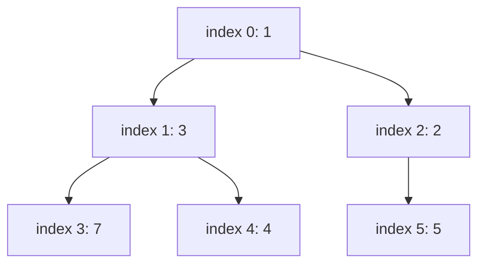

## Hook

Iruka's repair board is a long list of broken bikes. Each report has an urgency number. A 1 means "no brakes, fix now". A 5 means "squeaky bell". When a new report arrives, the tool re-sorts the whole list. That costs O(n log n) every time.

But the crew never reads the whole list. They only ask one question: "Which bike is most urgent right now?" You do not need a fully sorted list to answer that. You only need the smallest number on top. A **heap** keeps exactly that promise, and it keeps it cheaply.

## Concept

### The heap rule

A **binary heap** is a binary tree with two rules.

1. **Shape:** every level is full, except maybe the last one, which fills from left to right. This is called a **complete** tree.
2. **Order:** in a **min-heap**, every parent is smaller than or equal to its children.

So the smallest value always sits at the root. Unlike a BST, left and right are in no particular order. A heap is only "sorted" along each path from the root down.

```callout jargon
Byte says: a max-heap flips the order rule, so the largest value sits on top. Everything else in this lesson works the same way.
```

### Storing a tree in an array

A complete tree has no gaps. So you can read it level by level, left to right, and write each value into the next array slot. No `Node` objects and no links are needed.



The same heap as an array: `[1, 3, 2, 7, 4, 5]`.

### Syntax: index arithmetic

For a value at index `i`:

```java nocompile
int parent = (i - 1) / 2;
int left = 2 * i + 1;
int right = 2 * i + 2;
```

Check it with the picture. Index 4 holds 4. Its parent is `(4 - 1) / 2 = 1`, which holds 3. Index 1 has children at 3 and 4. Integer division drops the remainder, so index 3 and index 4 share parent 1.

A child index only exists when it is less than `size`. Index 2 has a left child at 5, but its right child would be 6, which is past the end.

### Syntax: add with sift up

To add a value, put it in the first free slot at the end. That keeps the shape rule. It may break the order rule, so you **sift up**: while the new value is smaller than its parent, swap them.

```java nocompile
items[size] = value;
size++;
int i = size - 1;
while (i > 0 && items[i] < items[(i - 1) / 2]) {
    int parent = (i - 1) / 2;
    int temp = items[i];
    items[i] = items[parent];
    items[parent] = temp;
    i = parent;
}
```

Add 0 to `[1, 3, 2, 7, 4, 5]`. It lands at index 6, under 2. 0 is smaller than 2, so swap. Now it is at index 2, under 1. Swap again. It reaches the root: `[0, 3, 1, 7, 4, 5, 2]`.

### Syntax: poll with sift down

To **poll** means to remove and return the top value. Take `items[0]`. Move the last value into slot 0 and shrink `size`. The shape is fine, but the new top is probably too big. So you **sift down**: swap it with its smaller child until no child is smaller.

```java nocompile
int top = items[0];
size--;
items[0] = items[size];
int i = 0;
while (true) {
    int left = 2 * i + 1;
    int right = 2 * i + 2;
    int smallest = i;
    if (left < size && items[left] < items[smallest]) {
        smallest = left;
    }
    if (right < size && items[right] < items[smallest]) {
        smallest = right;
    }
    if (smallest == i) {
        break;
    }
    int temp = items[i];
    items[i] = items[smallest];
    items[smallest] = temp;
    i = smallest;
}
```

Always swap with the **smaller** child. If you swap with the larger one, the smaller child ends up under a bigger parent.

**Peek** returns `items[0]` and changes nothing.

### Growing the array

An array has a fixed length. When `size` reaches `items.length`, make a new array twice as long and copy the values across. Doubling means copies are rare, so `add` stays cheap on average.

### How fast is it?

A complete tree of n values has about log n levels. Sift up and sift down each walk at most one path.

| Operation | Cost | In plain words |
|---|---|---|
| peek | O(1) | read slot 0, no matter how many bikes |
| add | O(log n) | double the bikes, add one swap at most |
| poll | O(log n) | double the bikes, add one swap at most |
| re-sort the list on every report | O(n log n) | what Iruka's tool does now |

```callout analogy
Byte says: a heap is like a hospital waiting room. Nobody lines everyone up in exact order. The nurse just makes sure the most urgent patient is always next.
```

### Syntax: PriorityQueue

Java's `PriorityQueue` is a min-heap stored in an array, just like yours. `offer` or `add` puts a value in. `poll` removes the smallest. `peek` looks at it. `poll` and `peek` return `null` when the queue is empty.

```java nocompile
PriorityQueue<Integer> queue = new PriorityQueue<>();
queue.add(3);
queue.add(1);
System.out.println(queue.poll());
```

For your own objects, pass a `Comparator` to the constructor. The queue uses it to decide which object counts as "smallest".

```java nocompile
Comparator<Repair> byUrgency = Comparator.comparingInt(Repair::urgency)
        .thenComparing(Repair::bikeId);
PriorityQueue<Repair> queue = new PriorityQueue<>(byUrgency);
```

You need `import java.util.PriorityQueue;` and `import java.util.Comparator;`.

## Worked example

This program builds a tiny min-heap on an array and polls everything out.

```java run
public class Main {
    static int[] items = new int[8];
    static int size = 0;

    static void add(int value) {
        items[size] = value;
        size++;
        int i = size - 1;
        while (i > 0 && items[i] < items[(i - 1) / 2]) {
            int parent = (i - 1) / 2;
            int temp = items[i];
            items[i] = items[parent];
            items[parent] = temp;
            i = parent;
        }
    }

    static int poll() {
        int top = items[0];
        size--;
        items[0] = items[size];
        int i = 0;
        while (true) {
            int left = 2 * i + 1;
            int right = 2 * i + 2;
            int smallest = i;
            if (left < size && items[left] < items[smallest]) {
                smallest = left;
            }
            if (right < size && items[right] < items[smallest]) {
                smallest = right;
            }
            if (smallest == i) {
                break;
            }
            int temp = items[i];
            items[i] = items[smallest];
            items[smallest] = temp;
            i = smallest;
        }
        return top;
    }

    public static void main(String[] args) {
        int[] urgencies = {4, 1, 5, 2, 3};
        for (int u : urgencies) {
            add(u);
        }
        System.out.println("Top: " + items[0]);
        while (size > 0) {
            System.out.print(poll() + " ");
        }
        System.out.println();
    }
}
```

Line by line:

- `add(4)` puts 4 at index 0. It is the root, so no sift.
- `add(1)` puts 1 at index 1. Its parent holds 4, so they swap. 1 is now on top.
- The other adds sift up the same way. After all five, `items[0]` is 1.
- Each `poll` takes the top, moves the last value up, and sifts it down.
- The output is `Top: 1` and then `1 2 3 4 5`. The heap hands back values in sorted order, one cheap step at a time.

## Try it

Here is Iruka's repair list with the library heap. Run it. Then add `new Repair("B-1099", 0)` to the list and run again.

```java run
import java.util.Comparator;
import java.util.List;
import java.util.PriorityQueue;

public class Main {
    public static void main(String[] args) {
        Comparator<Repair> mostUrgentFirst = Comparator.comparingInt(Repair::urgency)
                .thenComparing(Repair::bikeId);
        PriorityQueue<Repair> queue = new PriorityQueue<>(mostUrgentFirst);
        queue.addAll(List.of(
                new Repair("B-1042", 3),
                new Repair("B-1017", 1),
                new Repair("B-1088", 2),
                new Repair("B-1003", 1)));
        System.out.println("Next up: " + queue.peek().bikeId());
        while (!queue.isEmpty()) {
            System.out.println(queue.poll());
        }
    }
}

record Repair(String bikeId, int urgency) {
}
```

B-1003 and B-1017 both have urgency 1. The `thenComparing` part breaks the tie by bike id.

```callout warning
Byte says: printing a PriorityQueue with System.out.println(queue) shows the raw array, which is not sorted. Only poll gives you values in order.
```

## Recap

- A min-heap is a complete binary tree where every parent is smaller than or equal to its children. The smallest value is always at the root.
- A heap lives in an array. For index i, the parent is (i - 1) / 2 and the children are 2i + 1 and 2i + 2.
- Add puts the value at the end and sifts up. Poll moves the last value to the top and sifts down.
- Peek is O(1). Add and poll are O(log n).
- `PriorityQueue` is the library min-heap. Pass a `Comparator` to order your own objects.

## Common mistakes

**1. Comparing with the left child only in sift down.**

```java nocompile
int left = 2 * i + 1;
if (left < size && items[left] < items[i]) {
    int temp = items[i];
    items[i] = items[left];
    items[left] = temp;
    i = left;
}
```

Add 1, 3, 2, 4 and poll them all. You get `1 3 2 4` instead of `1 2 3 4`. After the first poll, 2 sits in the right child and never moves up. Fix: find the smaller of both children, then swap with that one.

**2. Checking a child without checking that it exists.**

```java nocompile
if (items[right] < items[smallest]) {
    smallest = right;
}
```

Near the bottom of the heap, `right` points past the last real value. In an 8-slot array the program crashes with `java.lang.ArrayIndexOutOfBoundsException: Index 14 out of bounds for length 8`. Fix: write `if (right < size && items[right] < items[smallest])`.

**3. Printing a PriorityQueue and expecting sorted output.**

```java
import java.util.PriorityQueue;

public class Main {
    public static void main(String[] args) {
        PriorityQueue<Integer> queue = new PriorityQueue<>();
        int[] urgencies = {5, 1, 3, 2, 4, 0};
        for (int u : urgencies) {
            queue.add(u);
        }
        System.out.println(queue);
    }
}
```

This prints `[0, 2, 1, 5, 4, 3]`. That is the heap's array order, which only promises the smallest value first. Fix: call `poll()` in a loop to get `0 1 2 3 4 5`.
