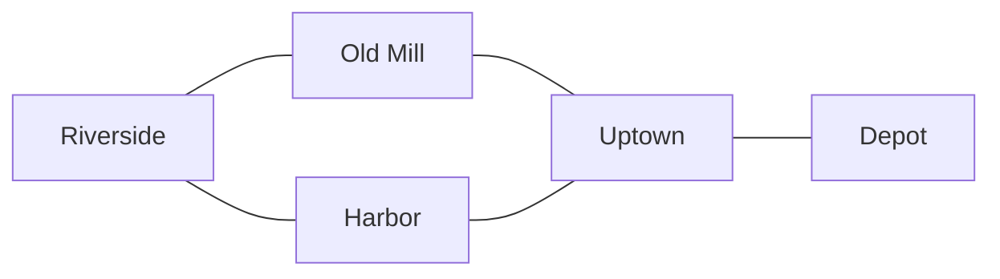

## Hook

Look at a paper map of Riverton. The stations are dots. The bike lanes are lines between the dots. A rider at Riverside wants to reach Depot with the fewest stops.

Your eyes find the answer fast on a map this small. A program has no eyes. It needs a way to store the dots and lines, and a plan to walk through them. That plan is the topic of this page.

## Concept

### Nodes, edges and neighbours

```callout jargon
A **graph** is a set of **nodes** (the dots) joined by **edges** (the lines). Here every station is a node and every bike lane is an edge.
```

- Two nodes joined by one edge are **neighbours**.
- An edge in an **undirected** graph works both ways. A lane from Riverside to Harbor also runs from Harbor to Riverside.
- A **path** (or route) is a list of nodes where each one is a neighbour of the next.

Two other kinds of graph come later. In a **directed** graph an edge works one way only, like a one-way street. In a **weighted** graph each edge carries a number, such as minutes of riding. SPK-0415 covers directed graphs and SPK-0416 weighted ones. This ticket uses undirected lanes that all count the same.

Here are the five stations and their lanes:



Riverside has two neighbours: Old Mill and Harbor. Uptown has three: Old Mill, Harbor and Depot.

A tree from earlier topics is a special graph. A graph is more general. It can have loops, like Riverside, Old Mill, Uptown, Harbor and back to Riverside. It can also fall into separate pieces with no lane between them.

### Syntax: an adjacency list

```java nocompile
Map<String, List<String>> lanes = new LinkedHashMap<>();
```

An **adjacency list** stores, for each node, the list of its neighbours. A `Map` from station name to a `List` of station names does the job.

```java nocompile
lanes.computeIfAbsent("Riverside", k -> new ArrayList<>()).add("Harbor");
lanes.computeIfAbsent("Harbor", k -> new ArrayList<>()).add("Riverside");
```

`computeIfAbsent` gets the list for a key. If the key has no list yet, it makes one with the lambda first. An undirected lane needs two `add` calls, one for each end.

`LinkedHashMap` and `ArrayList` keep things in the order you added them. That makes every search give the same answer each time you run it.

```java run
import java.util.ArrayList;
import java.util.LinkedHashMap;
import java.util.List;
import java.util.Map;

public class Main {
    static Map<String, List<String>> lanes = new LinkedHashMap<>();

    static void addLane(String a, String b) {
        lanes.computeIfAbsent(a, k -> new ArrayList<>()).add(b);
        lanes.computeIfAbsent(b, k -> new ArrayList<>()).add(a);
    }

    public static void main(String[] args) {
        addLane("Riverside", "Old Mill");
        addLane("Riverside", "Harbor");
        addLane("Old Mill", "Uptown");
        addLane("Harbor", "Uptown");
        addLane("Uptown", "Depot");
        for (String station : lanes.keySet()) {
            System.out.println(station + " -> " + lanes.get(station));
        }
    }
}
```

### Breadth-first search (BFS)

**Breadth-first search** visits the start, then every node one lane away, then every node two lanes away, and so on. It spreads out like a ripple in a pond.

```callout analogy
Drop a stone at Riverside. The first ripple reaches Old Mill and Harbor. The second ripple reaches Uptown. The third reaches Depot.
```

BFS needs two helpers:

- A **queue** holds the stations waiting to be explored. The first one in is the first one out, so near stations come before far ones.
- A **visited set** remembers stations already seen. Without it, the search walks around a loop forever.

### Syntax: the BFS loop

```java nocompile
Set<String> visited = new HashSet<>();
Queue<String> queue = new ArrayDeque<>();
visited.add(start);
queue.offer(start);
while (!queue.isEmpty()) {
    String current = queue.poll();
    for (String next : lanes.get(current)) {
        if (!visited.contains(next)) {
            visited.add(next);
            queue.offer(next);
        }
    }
}
```

Mark a station as visited when it joins the queue. Then it can never join twice.

### Program to the interface

Look at one line of the BFS loop: `Queue<String> queue = new ArrayDeque<>();`. The left side names an interface, `Queue`. It says what the variable can do. The right side picks the class that does the work, `ArrayDeque`.

```callout jargon
**Programming to an interface** means you declare a variable with the interface type, not the class. You met interfaces in [SPK-0208](/t/module-02-oop/topic-08-interfaces).
```

The rest of the code can only call `Queue` methods, such as `offer` and `poll`. So you could swap in another queue class later, and no other line would change. `Map<String, List<String>> lanes = new LinkedHashMap<>()` and `Set<String> visited = new HashSet<>()` follow the same habit.

```java run
import java.util.ArrayDeque;
import java.util.HashSet;
import java.util.List;
import java.util.Map;
import java.util.Queue;
import java.util.Set;

public class Main {
    public static void main(String[] args) {
        Map<String, List<String>> lanes = Map.of(
                "Riverside", List.of("Old Mill", "Harbor"),
                "Old Mill", List.of("Riverside", "Uptown"),
                "Harbor", List.of("Riverside", "Uptown"),
                "Uptown", List.of("Old Mill", "Harbor", "Depot"),
                "Depot", List.of("Uptown"));

        Set<String> visited = new HashSet<>();
        Queue<String> queue = new ArrayDeque<>();
        visited.add("Riverside");
        queue.offer("Riverside");
        while (!queue.isEmpty()) {
            String current = queue.poll();
            System.out.println("Visit " + current);
            for (String next : lanes.get(current)) {
                if (!visited.contains(next)) {
                    visited.add(next);
                    queue.offer(next);
                }
            }
        }
    }
}
```

### Shortest path by number of stops

BFS reaches every station along a route with the fewest lanes. So it can find the route with the fewest stops. You only need to remember how you got to each station.

The **parent** of a station is the station you came from when you first reached it. Store it in a `Map<String, String>`. When BFS reaches the goal, follow the parents back to the start. That gives the route backwards, so reverse it at the end.

### Syntax: remembering parents

```java nocompile
Map<String, String> parent = new HashMap<>();
// inside the loop, when next is new:
parent.put(next, current);
```

When two routes have the same number of stops, BFS keeps the one it found first. It finds first the neighbour that sits earlier in the list.

### Depth-first search (DFS)

**Depth-first search** goes as far as it can down one lane before it backs up and tries the next. Recursion, from topic 2, writes it in a few lines. The call stack does the backing up for you.

### Syntax: recursive DFS

```java nocompile
static void dfs(String station, Set<String> visited) {
    if (visited.contains(station)) {
        return;
    }
    visited.add(station);
    for (String next : lanes.get(station)) {
        dfs(next, visited);
    }
}
```

DFS answers the question "which stations can I reach at all?" just as well as BFS. It does not find the fewest stops.

### DFS without recursion

Recursive DFS keeps one note per station on the call stack. On a map grid of 1000 by 1000 squares, a path can run a million squares deep. That overflows the call stack, as SPK-0402 showed. For big inputs, keep your own `Deque` as the stack.

```java run
import java.util.ArrayDeque;
import java.util.Deque;
import java.util.HashSet;
import java.util.List;
import java.util.Map;
import java.util.Set;

public class Main {
    public static void main(String[] args) {
        Map<String, List<String>> lanes = Map.of(
                "Riverside", List.of("Old Mill", "Harbor"),
                "Old Mill", List.of("Riverside", "Uptown"),
                "Harbor", List.of("Riverside", "Uptown"),
                "Uptown", List.of("Old Mill", "Harbor", "Depot"),
                "Depot", List.of("Uptown"));

        Set<String> visited = new HashSet<>();
        Deque<String> stack = new ArrayDeque<>();
        stack.push("Riverside");
        while (!stack.isEmpty()) {
            String station = stack.pop();
            if (!visited.add(station)) {
                continue;                     // seen it already
            }
            System.out.println("Visit " + station);
            for (String next : lanes.get(station)) {
                if (!visited.contains(next)) {
                    stack.push(next);
                }
            }
        }
    }
}
```

`visited.add` returns `false` when the station was already in the set, so the loop skips it. The visit order differs from the recursive version, because the last neighbour pushed comes off first. It still reaches the same stations. SPK-0415 shows how a map grid becomes a graph, with islands and flood fill.

```callout tip
Need the fewest stops? Use BFS. Only need to know what is reachable? DFS or BFS both work.
```

### How fast are they?

**V** is the number of nodes (vertices). **E** is the number of edges. BFS and DFS visit each node once and look along each edge a fixed number of times.

| Algorithm | Big-O | In plain words |
|---|---|---|
| BFS | O(V + E) | Double the stations and lanes, double the time |
| DFS | O(V + E) | Double the stations and lanes, double the time |
| Look up a station's neighbours | O(1) | Same tiny cost at any size |

### Adjacency matrix or list?

An **adjacency matrix** is the other common way to store a graph. It is a V by V grid of `boolean`s, where `matrix[a][b]` is `true` when a lane joins `a` and `b`.

| | Adjacency list | Adjacency matrix |
|---|---|---|
| Memory | O(V + E) | O(V^2) |
| Is there a lane from a to b? | O(neighbours of a) | O(1) |
| List a node's neighbours | O(neighbours) | O(V) |

City maps are **sparse**: each station has only a few lanes. A list wastes nothing there, so it is the usual choice. A matrix suits small, crowded graphs where almost everything is joined.

## Worked example

This program finds the route with the fewest stops from Riverside to Depot.

```java run
import java.util.ArrayDeque;
import java.util.ArrayList;
import java.util.Collections;
import java.util.HashMap;
import java.util.HashSet;
import java.util.List;
import java.util.Map;
import java.util.Queue;
import java.util.Set;

public class Main {
    public static void main(String[] args) {
        Map<String, List<String>> lanes = Map.of(
                "Riverside", List.of("Old Mill", "Harbor"),
                "Old Mill", List.of("Riverside", "Uptown"),
                "Harbor", List.of("Riverside", "Uptown"),
                "Uptown", List.of("Old Mill", "Harbor", "Depot"),
                "Depot", List.of("Uptown"));
        String from = "Riverside";
        String to = "Depot";

        Map<String, String> parent = new HashMap<>();
        Set<String> visited = new HashSet<>();
        Queue<String> queue = new ArrayDeque<>();
        visited.add(from);
        queue.offer(from);
        while (!queue.isEmpty()) {
            String current = queue.poll();
            for (String next : lanes.get(current)) {
                if (!visited.contains(next)) {
                    visited.add(next);
                    parent.put(next, current);
                    queue.offer(next);
                }
            }
        }

        List<String> route = new ArrayList<>();
        String step = to;
        while (step != null) {
            route.add(step);
            step = parent.get(step);
        }
        Collections.reverse(route);
        System.out.println(route);
    }
}
```

Line by line:

1. `lanes` is the adjacency list for the five stations.
2. `parent`, `visited` and `queue` are the three BFS helpers. The start goes into `visited` and `queue`.
3. Each turn, `poll` takes the oldest waiting station.
4. Each new neighbour gets marked, gets its parent, and joins the queue.
5. After the loop, `step` starts at Depot and follows parents: Depot, Uptown, Old Mill, Riverside. Riverside has no parent, so `get` returns `null` and the loop stops.
6. `Collections.reverse` flips the list, and the program prints `[Riverside, Old Mill, Uptown, Depot]`.

Why Old Mill and not Harbor? Both give 3 lanes. Old Mill comes first in Riverside's list, so BFS reached Uptown from Old Mill first.

## Try it

Run this DFS. Then swap the order in Riverside's list to `List.of("Harbor", "Old Mill")` and run it again. Watch the visit order change.

```java run
import java.util.HashSet;
import java.util.List;
import java.util.Map;
import java.util.Set;

public class Main {
    static Map<String, List<String>> lanes = Map.of(
            "Riverside", List.of("Old Mill", "Harbor"),
            "Old Mill", List.of("Riverside", "Uptown"),
            "Harbor", List.of("Riverside", "Uptown"),
            "Uptown", List.of("Old Mill", "Harbor", "Depot"),
            "Depot", List.of("Uptown"));

    static void dfs(String station, Set<String> visited) {
        if (visited.contains(station)) {
            return;
        }
        visited.add(station);
        System.out.println("Visit " + station);
        for (String next : lanes.get(station)) {
            dfs(next, visited);
        }
    }

    public static void main(String[] args) {
        dfs("Riverside", new HashSet<>());
    }
}
```

## Recap

- A graph is nodes joined by edges. In an undirected graph, every edge works both ways.
- An adjacency list maps each node to the list of its neighbours: `Map<String, List<String>>`.
- BFS uses a queue and a visited set. It finds the fewest stops when you also store each node's parent.
- DFS goes deep first and fits neatly into a recursive method with a visited set.
- Both searches run in O(V + E).

## Common mistakes

### Forgetting the visited set

```java nocompile
static Map<String, List<String>> lanes = Map.of(
        "Riverside", List.of("Harbor"),
        "Harbor", List.of("Riverside"));

static void dfs(String station) {
    System.out.println(station);
    for (String next : lanes.get(station)) {
        dfs(next);
    }
}
```

Riverside calls Harbor, Harbor calls Riverside, and so on forever. The program prints the two names thousands of times and then crashes:

```
Exception in thread "main" java.lang.StackOverflowError
```

Fix: pass a `Set<String> visited`. Return straight away when the station is already in it.

### Adding a lane in one direction only

```java nocompile
static Map<String, List<String>> lanes = new HashMap<>();

static void addLane(String a, String b) {
    lanes.computeIfAbsent(a, k -> new ArrayList<>()).add(b);
}
```

After `addLane("Riverside", "Harbor")`, Harbor has no list at all. In the practice task, `fewestStops("Harbor", "Riverside")` then returns `[]`, even though the lane exists.

Fix: add the second line, `lanes.computeIfAbsent(b, k -> new ArrayList<>()).add(a);`.

### Looking up a station that has no lanes

```java nocompile
for (String next : lanes.get("Airport")) {
    System.out.println(next);
}
```

`get` returns `null` for a missing key, and the loop crashes:

```
Exception in thread "main" java.lang.NullPointerException: Cannot invoke "java.util.List.iterator()" because the return value of "java.util.Map.get(Object)" is null
```

Fix: use `lanes.getOrDefault("Airport", new ArrayList<>())`. An unknown station then has an empty list of neighbours.
