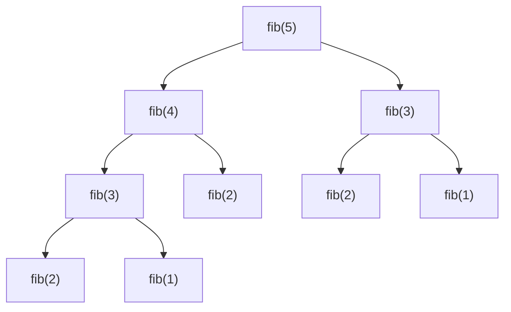

## Hook

Tsunade's pass pricing tool tries every mix of passes for a rider's month. For a 30-day month it freezes. The reason is silly: it solves the same small question again and again, millions of times.

Picture a friend who asks you "what is 7 times 8?" every minute. The first time, you work it out. After that, you just remember 56. This topic teaches a program to remember.

## Concept

### Overlapping subproblems

```callout jargon
A **subproblem** is a smaller copy of the problem you are solving. Subproblems **overlap** when the same small copy comes up many times.
```

**Dynamic programming** (DP) means: solve each subproblem once, save the answer, and reuse it. It works on any problem that splits into overlapping subproblems.

The Fibonacci numbers show the idea. Each number is the sum of the two before it: 0, 1, 1, 2, 3, 5, 8, 13, and so on. So `fib(0)` is 0, `fib(1)` is 1, and `fib(n)` is `fib(n - 1) + fib(n - 2)`.

### Syntax: naive recursion

```java
static long fib(int n) {
    if (n < 2) {
        return n;
    }
    return fib(n - 1) + fib(n - 2);
}
```

This is correct and very slow. `fib(5)` calls `fib(4)` and `fib(3)`. But `fib(4)` also calls `fib(3)`. The same work repeats all the way down.



`fib(3)` appears twice and `fib(2)` three times, and this is only `fib(5)`. Count the calls:

```java run
public class Main {
    static long calls = 0;

    static long fib(int n) {
        calls++;
        if (n < 2) {
            return n;
        }
        return fib(n - 1) + fib(n - 2);
    }

    public static void main(String[] args) {
        System.out.println("fib(20) = " + fib(20));
        System.out.println("calls: " + calls);
    }
}
```

Over twenty thousand calls for one small answer. `fib(80)` would need more calls than your computer can make in a lifetime.

### Memoization: top-down

**Memoization** keeps a memo, a notebook of answers you already found. Before you do any work, look in the memo. After you work out an answer, write it in the memo. This style is **top-down**: you start from the big question and recurse down.

### Syntax: a memo with a Map

```java nocompile
static Map<Integer, Long> memo = new HashMap<>();

static long fib(int n) {
    if (n < 2) {
        return n;
    }
    if (memo.containsKey(n)) {
        return memo.get(n);
    }
    long answer = fib(n - 1) + fib(n - 2);
    memo.put(n, answer);
    return answer;
}
```

```java run
import java.util.HashMap;
import java.util.Map;

public class Main {
    static long calls = 0;
    static Map<Integer, Long> memo = new HashMap<>();

    static long fib(int n) {
        calls++;
        if (n < 2) {
            return n;
        }
        if (memo.containsKey(n)) {
            return memo.get(n);
        }
        long answer = fib(n - 1) + fib(n - 2);
        memo.put(n, answer);
        return answer;
    }

    public static void main(String[] args) {
        System.out.println("fib(20) = " + fib(20));
        System.out.println("calls: " + calls);
        System.out.println("fib(80) = " + fib(80));
    }
}
```

Same answer, 39 calls instead of over twenty thousand. And `fib(80)` comes back at once.

### Tabulation: bottom-up

**Tabulation** fills a table from the smallest answer upward. This style is **bottom-up**. It needs no recursion, so it can never overflow the call stack.

### Syntax: a table with an array

```java
static long fib(int n) {
    if (n < 2) {
        return n;
    }
    long[] table = new long[n + 1];
    table[1] = 1;
    for (int i = 2; i <= n; i++) {
        table[i] = table[i - 1] + table[i - 2];
    }
    return table[n];
}
```

`table[i]` holds `fib(i)`. Each cell uses the two cells before it, and those are already filled.

```callout tip
Write the rule first, like "`fib(i)` is `fib(i - 1) + fib(i - 2)`". Then the memo version and the table version both follow from that one line.
```

### Counting ways to dock

Here is a counting puzzle from the practice task. A row of slots holds bikes, and each slot takes either 1 or 2 bikes. In how many ways can you dock `n` bikes? For 3 bikes there are three ways: 1+1+1, 1+2 and 2+1.

Look only at the last slot. It holds either 1 bike or 2 bikes.

- If it holds 1, the other `n - 1` bikes can be docked in `ways(n - 1)` ways.
- If it holds 2, the other `n - 2` bikes can be docked in `ways(n - 2)` ways.

The two groups never overlap, so add them: `ways(n) = ways(n - 1) + ways(n - 2)`. The start is `ways(0) = 1`, because zero bikes have exactly one way to dock: do nothing. And `ways(1) = 1`.

```animate
title: Filling the ways table
kind: code
code: |
  int bikes = 4;
  int[] ways = new int[bikes + 1];
  ways[0] = 1;
  ways[1] = 1;
  for (int b = 2; b <= bikes; b++) {
      ways[b] = ways[b - 1] + ways[b - 2];
  }
  System.out.println(ways[bikes]);
steps:
  - line: 1
    vars: { bikes: 4 }
    say: Four bikes wait to dock.
  - line: 2
    objects: { w: { type: "int[]", fields: { 0: 0, 1: 0, 2: 0, 3: 0, 4: 0 } } }
    vars: { ways: "@w" }
    say: One cell for each bike count from 0 to 4. Java fills them with 0.
  - line: 3
    objects: { w: { type: "int[]", fields: { 0: 1, 1: 0, 2: 0, 3: 0, 4: 0 } } }
    say: Zero bikes can be docked one way, by doing nothing.
  - line: 4
    objects: { w: { type: "int[]", fields: { 0: 1, 1: 1, 2: 0, 3: 0, 4: 0 } } }
    say: One bike fits one way, alone in a slot.
  - line: 6
    vars: { b: 2 }
    objects: { w: { type: "int[]", fields: { 0: 1, 1: 1, 2: 2, 3: 0, 4: 0 } } }
    say: Two bikes. The last slot holds 1 bike, ways[1], or 2 bikes, ways[0]. 1 + 1 = 2.
  - line: 6
    vars: { b: 3 }
    objects: { w: { type: "int[]", fields: { 0: 1, 1: 1, 2: 2, 3: 3, 4: 0 } } }
    say: Three bikes. ways[2] + ways[1] is 2 + 1 = 3. Both cells were already filled.
  - line: 6
    vars: { b: 4 }
    objects: { w: { type: "int[]", fields: { 0: 1, 1: 1, 2: 2, 3: 3, 4: 5 } } }
    say: Four bikes. ways[3] + ways[2] is 3 + 2 = 5.
  - line: 8
    vars: { b: ~ }
    out: "5"
    say: Five ways to dock four bikes. It is the Fibonacci rule again, with different starting cells.
```

### How fast is it?

| Version | Big-O | In plain words |
|---|---|---|
| Naive recursive fib | about 1.6^n, loosely O(2^n) | Add one to n, and the time grows by about 1.6 times |
| Memoized fib | O(n) | Double n, double the time |
| Tabulated fib | O(n) | Double n, double the time |
| Cheapest pass cover (below) | O(D) | D is the last ride day; double D, double the time |

## Worked example

A rider rides on some days of the year. Passes cost:

- a 1-day pass: $3
- a 7-day pass: $10, covering 7 days in a row
- a 30-day pass: $25, covering 30 days in a row

What is the cheapest way to cover every ride day? Let `cost[d]` be the cheapest cover for all ride days up to day `d`.

- On a day with no ride, nothing new is needed: `cost[d] = cost[d - 1]`.
- On a ride day, the last pass you bought covers day `d`. It is one of three:
  - a day pass: `cost[d - 1] + 3`
  - a week pass that started 6 days ago: `cost[d - 7] + 10`
  - a month pass that started 29 days ago: `cost[d - 30] + 25`
- Take the smallest. When `d - 7` or `d - 30` is below 0, use day 0, which costs 0.

Why `cost[d - 7]`? A week pass that ends on day `d` covers days `d - 6` to `d`. Every ride day up to `d - 7` still needs paying for. The cheapest way to pay for those is already in `cost[d - 7]`. The month pass works the same way: it covers `d - 29` to `d`, so `cost[d - 30]` pays for the rest.

Why let the pass end exactly on day `d`? Sliding it to end on `d` covers the most earlier days for the same price. Ending later never helps the days up to `d`.

```java run
public class Main {
    static int cheapestCover(int[] rideDays, int dayPrice, int weekPrice, int monthPrice) {
        if (rideDays.length == 0) {
            return 0;
        }
        int lastDay = rideDays[rideDays.length - 1];
        boolean[] rides = new boolean[lastDay + 1];
        for (int day : rideDays) {
            rides[day] = true;
        }
        int[] cost = new int[lastDay + 1];
        for (int d = 1; d <= lastDay; d++) {
            if (!rides[d]) {
                cost[d] = cost[d - 1];
                continue;
            }
            int withDay = cost[d - 1] + dayPrice;
            int withWeek = cost[Math.max(0, d - 7)] + weekPrice;
            int withMonth = cost[Math.max(0, d - 30)] + monthPrice;
            cost[d] = Math.min(withDay, Math.min(withWeek, withMonth));
        }
        return cost[lastDay];
    }

    public static void main(String[] args) {
        System.out.println(cheapestCover(new int[] {1, 2, 3, 4, 5}, 3, 10, 25));
        System.out.println(cheapestCover(new int[] {1, 4, 6, 7, 8, 20}, 3, 10, 25));
        System.out.println(cheapestCover(new int[] {2, 9}, 3, 10, 25));
    }
}
```

Line by line:

1. An empty month costs 0.
2. `rides` marks which days have a ride, so each check is quick.
3. `cost[0]` is 0, because Java fills a new `int[]` with zeros.
4. The loop fills `cost` from day 1 to the last ride day, using only cells already filled.
5. `Math.max(0, d - 7)` stops the index from going below 0.
6. The answers are 10 (one week pass), 16 (a week pass plus two day passes) and 6 (two day passes).

## Try it

Run the worked example. Then change the week pass price from 10 to 20 and run it again. The first answer drops back to day passes: 5 days at $3 is $15.

Then add a fourth line that covers days 1 to 20 in a row. Build the array with a loop. A month pass should win, at $25.

The practice task also asks for `waysToDock`, which follows the rule from "Counting ways to dock": `ways(n) = ways(n - 1) + ways(n - 2)`.

## Recap

- Overlapping subproblems are small questions that come up again and again.
- Dynamic programming solves each subproblem once and saves the answer.
- Memoization is top-down: recurse, but check the memo first and fill it after.
- Tabulation is bottom-up: fill a table from the smallest case upward with a loop.
- Memoized and tabulated Fibonacci run in O(n). Naive recursion grows about 1.6 times per step, loosely written O(2^n).

## Common mistakes

### Using int for big Fibonacci numbers

```java
static int fib(int n) {
    int[] table = new int[n + 1];
    table[1] = 1;
    for (int i = 2; i <= n; i++) {
        table[i] = table[i - 1] + table[i - 2];
    }
    return table[n];
}
```

`fib(50)` prints `-298632863`. The real answer, 12586269025, is too big for an `int`, so the number wraps around.

Fix: use `long` and a `long[]` table. A `long` holds `fib(80)` with room to spare.

### Reading the memo but never writing to it

```java nocompile
static long fib(int n) {
    if (n < 2) {
        return n;
    }
    if (memo.containsKey(n)) {
        return memo.get(n);
    }
    return fib(n - 1) + fib(n - 2);
}
```

The answers are right, but the call count for `fib(20)` stays at 21891. The memo is always empty, so this is still naive recursion.

Fix: save the answer in a variable, call `memo.put(n, answer)`, then return it.

### Making the table one cell too small

```java
static long fib(int n) {
    long[] table = new long[n];
    table[1] = 1;
    for (int i = 2; i <= n; i++) {
        table[i] = table[i - 1] + table[i - 2];
    }
    return table[n];
}
```

`fib(10)` crashes:

```
Exception in thread "main" java.lang.ArrayIndexOutOfBoundsException: Index 10 out of bounds for length 10
```

Fix: the table needs a cell for every value from 0 to n, so create it with `new long[n + 1]`.
