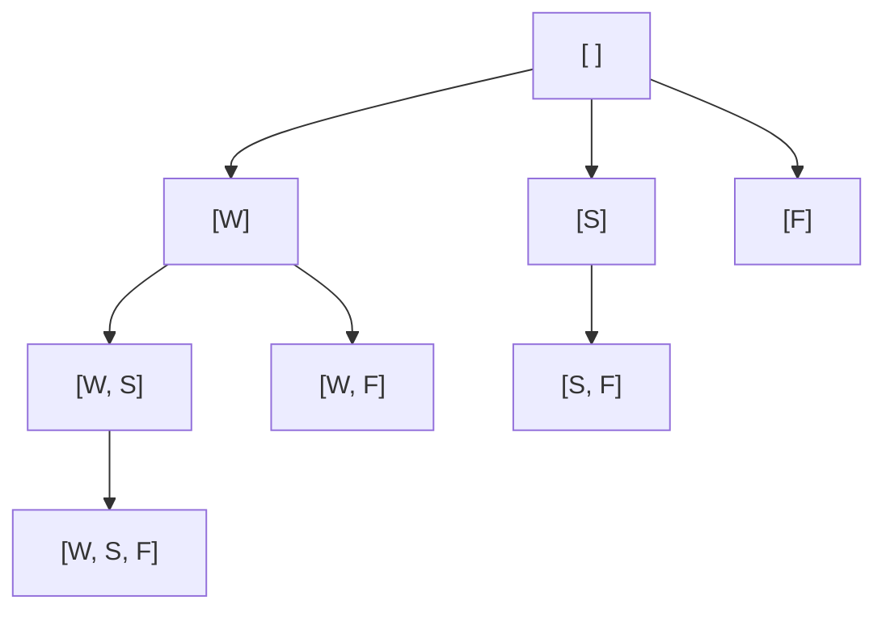

## Hook

A truck driver reaches a fork in the road. She takes the left road. It ends at a locked gate. So she drives back to the fork and tries the right road. That is the whole idea of this page: try a choice, see where it leads, and if you are done or stuck, go back and try the next one.

Itachi's riders want every option listed: every set of promos they could switch on, every order to visit stations. Our tools list only a few. This page shows you how to list them all, with no repeats and nothing missed.

## Concept

### What backtracking is

```callout jargon
**Backtracking** builds an answer one choice at a time. After each choice it explores further. When it is done or stuck, it undoes the last choice and tries the next one.
```

The answer you are building is called the **path**. In Java it is usually a `List` called `current`. Every answer is recorded the moment the path is complete.

Backtracking is recursion from [Recursion](/t/module-04-dsa/topic-02-recursion), with one extra step: undoing. Each recursive call is one more choice. Returning from a call is walking back to the fork.

### The decision tree

```callout jargon
A **decision tree** draws every choice as a branch. Each node is a path so far. Its children are the paths you get by making one more choice.
```

Here is the tree for promo sets built from WEEKEND (W), STUDENT (S) and FIRSTRIDE (F). Each node may only add a promo that comes after the last one it picked, so no set shows up twice.



Backtracking walks this tree depth first: down one branch as far as it goes, then back up to try the next. It never builds the whole tree in memory. It only keeps the one path it is standing on.

### Syntax: choose, explore, un-choose

Every backtracking method has the same shape.

```java nocompile
static void explore(int start, List<String> current, List<List<String>> result) {
    result.add(new ArrayList<>(current));        // record a COPY of the path
    for (int i = start; i < items.size(); i++) {
        current.add(items.get(i));               // 1. choose
        explore(i + 1, current, result);         // 2. explore
        current.remove(current.size() - 1);      // 3. un-choose
    }
}
```

- **Choose**: add one item to the path.
- **Explore**: call yourself to make the remaining choices.
- **Un-choose**: remove that item, so the path is back to what it was before. Now the loop can try the next item.

Where you record, and what you pass as the next `start`, change from problem to problem. The three steps never do.

### Subsets: every set of promos

```callout jargon
A **subset** is any selection of items from a list, from none of them to all of them. A list of n items has 2^n subsets, because each item is either in or out.
```

Here the method records the path at every node, not only at the leaves. Every node in the tree is a valid set.

```animate
title: Backtracking lists every set of two promos
kind: code
code: |
  import java.util.ArrayList;
  import java.util.List;

  public class Main {
      static void explore(String[] promos, int start, List<String> current) {
          System.out.println(current);
          for (int i = start; i < promos.length; i++) {
              current.add(promos[i]);
              explore(promos, i + 1, current);
              current.remove(current.size() - 1);
          }
      }

      public static void main(String[] args) {
          explore(new String[] {"WEEKEND", "STUDENT"}, 0, new ArrayList<>());
      }
  }
steps:
  - line: 15
    vars: { current: "[]", start: 0 }
    say: main starts the search with an empty path and start 0.
  - line: 6
    out: "[]"
    say: Every node is a valid set, so the empty set is recorded first.
  - line: 8
    vars: { i: 0, current: "[WEEKEND]" }
    say: Choose. WEEKEND joins the path.
  - line: 9
    vars: { start: 1 }
    say: Explore. A new call may only add promos after WEEKEND, so its start is 1.
  - line: 6
    out: "[WEEKEND]"
    say: The new call records the set it was handed.
  - line: 8
    vars: { i: 1, current: "[WEEKEND, STUDENT]" }
    say: Choose again. STUDENT joins the path.
  - line: 6
    vars: { start: 2 }
    out: "[WEEKEND, STUDENT]"
    say: One level deeper, the set is recorded. Start is 2, past the last promo, so this call has nothing left to try.
  - line: 10
    vars: { current: "[WEEKEND]" }
    say: Un-choose. Back one level, STUDENT is removed. The path is what it was before.
  - line: 10
    vars: { i: 0, start: 0, current: "[]" }
    say: That call is finished too. Back at the top, WEEKEND is removed. The path is empty again.
  - line: 8
    vars: { i: 1, current: "[STUDENT]" }
    say: The top loop tries its next choice. STUDENT joins an empty path.
  - line: 6
    vars: { start: 2 }
    out: "[STUDENT]"
    say: The set STUDENT on its own is recorded.
  - line: 10
    vars: { start: 0, current: "[]" }
    say: Un-choose. Every branch has been tried, so the search ends. Four sets from two promos, which is 2^2.
```

Here is the full version, which collects the sets in a list.

```java run
import java.util.ArrayList;
import java.util.List;

public class Main {
    static List<List<String>> result = new ArrayList<>();

    static void explore(List<String> promos, int start, List<String> current) {
        result.add(new ArrayList<>(current));
        for (int i = start; i < promos.size(); i++) {
            current.add(promos.get(i));
            explore(promos, i + 1, current);
            current.remove(current.size() - 1);
        }
    }

    public static void main(String[] args) {
        explore(List.of("WEEKEND", "STUDENT", "FIRSTRIDE"), 0, new ArrayList<>());
        for (List<String> set : result) {
            System.out.println(set);
        }
        System.out.println(result.size() + " sets");
    }
}
```

It prints the 8 sets in depth-first order, walking the tree above, then `8 sets`.

### Record a copy, never the path itself

`current` is one list object that the search keeps changing. `result.add(current)` stores an arrow to that one object, not a snapshot of it. Every arrow points at the same list. When the search ends, that list is empty, so every "answer" looks empty.

```callout warning
Always record `new ArrayList<>(current)`. That copies the path as it is right now. Later changes to `current` cannot touch the copy.
```

### Permutations: every order to visit stations

```callout jargon
A **permutation** is one ordering of all the items. n items have n! permutations ("n factorial", n × (n - 1) × ... × 1). Three stations have 3 × 2 × 1 = 6.
```

Order matters now, so each position may use any station not used yet. A `boolean[] used` remembers which ones are on the path. The loop always starts at 0, and you record only when the path holds every station.

```java run
import java.util.ArrayList;
import java.util.List;

public class Main {
    static int count = 0;

    static void explore(List<String> stations, boolean[] used, List<String> current) {
        if (current.size() == stations.size()) {
            count++;
            System.out.println(current);
            return;
        }
        for (int i = 0; i < stations.size(); i++) {
            if (used[i]) {
                continue;
            }
            used[i] = true;
            current.add(stations.get(i));
            explore(stations, used, current);
            current.remove(current.size() - 1);
            used[i] = false;
        }
    }

    public static void main(String[] args) {
        List<String> stations = List.of("Harbor", "Uptown", "Depot");
        explore(stations, new boolean[stations.size()], new ArrayList<>());
        System.out.println(count + " orders");
    }
}
```

It prints six orders, from `[Harbor, Uptown, Depot]` to `[Depot, Uptown, Harbor]`. Notice that un-choose undoes two things: the list and the `used` mark.

### Combinations: choose k of n

```callout jargon
A **combination** is a selection of exactly k items where order does not matter. Picking Riverside and Harbor is the same as picking Harbor and Riverside.
```

Spoke wants 2 of 4 stations for a weekend pop-up. Use the subset template, but record only when the path holds k items, and stop going deeper there.

```java run
import java.util.ArrayList;
import java.util.List;

public class Main {
    static void explore(List<String> stations, int k, int start, List<String> current) {
        if (current.size() == k) {
            System.out.println(current);
            return;
        }
        for (int i = start; i < stations.size(); i++) {
            current.add(stations.get(i));
            explore(stations, k, i + 1, current);
            current.remove(current.size() - 1);
        }
    }

    public static void main(String[] args) {
        explore(List.of("Riverside", "Old Mill", "Harbor", "Uptown"), 2, 0, new ArrayList<>());
    }
}
```

It prints 6 pairs. Passing `i + 1` as the next start is what stops `[Harbor, Riverside]` from appearing after `[Riverside, Harbor]`.

### Combination sum: reuse or no reuse

A **combination sum** asks for every selection that adds up to a target. The next start decides whether an item may be picked again:

| Rule | Next call | Example |
|---|---|---|
| Each item at most once | `explore(i + 1, ...)` | Bikes on a truck: each bike is one real bike |
| An item may be reused | `explore(i, ...)` | Crate sizes: you can order as many 3-bike crates as you like |

Passing `i` lets the next level pick the same item again, but never an earlier one. So you still never get the same answer in two orders.

The path keeps a `remaining` count instead of a total. Each choice subtracts from it. When `remaining` hits 0, the path is an answer.

### Skipping duplicates after sorting

Two bikes can take the same space. With slots `{2, 2, 3}` and a target of 5, picking the first 2 and the second 2 each gives `[2, 3]`. That is the same load twice.

The fix has two parts:

1. **Sort first**, so equal values sit next to each other.
2. In the loop, **skip a value equal to the one just before it**, but only when `i > start`.

```java nocompile
if (i > start && sorted[i] == sorted[i - 1]) {
    continue;
}
```

`i > start` means "this is not the first choice at this level". The first 2 at a level is still allowed, so `[2, 2, 3]` can be built. Only a second 2 in the same loop, which would repeat a branch, is skipped.

```callout warning
This rule fits subsets and combinations, where `start` moves forward. Permutations always loop from 0, so they need a different rule after sorting: skip `i` when `i > 0 && a[i] == a[i - 1] && !used[i - 1]`. That means "use equal values only in their sorted order", so each order of repeats is built once.
```

### Pruning: stop early

```callout jargon
**Pruning** means cutting off a branch of the decision tree as soon as you know it cannot lead to an answer. The search never visits anything below that cut.
```

After sorting, if `sorted[i]` is bigger than `remaining`, every later value is bigger too. So you can `break` out of the whole loop, not just skip one value.

```java nocompile
if (sorted[i] > remaining) {
    break;
}
```

Pruning does not change the answers. It only stops wasted work. On 30 bikes it can turn a billion paths into fewer than a thousand checks.

### How much does it cost?

Backtracking is slow by nature, because the number of answers is huge.

| Problem | Answers | Time | n = 10 | n = 20 |
|---|---|---|---|---|
| Subsets | 2^n | O(n × 2^n) | 1,024 | 1,048,576 |
| Permutations | n! | O(n × n!) | 3,628,800 | about 2.4 × 10^18 |

The extra n in the time is the cost of copying each answer, which has up to n items. No method can beat the size of its output: if you must list 2^n sets, you need at least 2^n steps.

Space: for subsets, permutations and combinations, the recursion goes at most n calls deep, and the path holds at most n items. So the working space is O(n). With reuse, as in combination sum, the depth can reach the target divided by the smallest value instead. The output list itself takes O(n × 2^n) or O(n × n!).

```callout tip
If you only need how many answers there are, or the single best one, a table from [Dynamic programming basics](/t/module-04-dsa/topic-12-dynamic-programming) is often far faster. Backtracking is the tool when you must list every answer, or check a rule that depends on the whole path.
```

### In an interview

Listen for **all**, **every**, **list all possible**, **generate**, or **find every way**. Small limits, such as n up to 10 or 20, are another clue: the problem setter expects an exponential answer.

Classic problems that use backtracking:

- Every subset of a list, with and without duplicate values.
- Every permutation of a list, and of a list with repeated values, which needs the `!used[i - 1]` skip rule.
- Every combination that adds up to a target, with or without reuse.
- **Word search in a grid**: try each neighbouring cell, mark the cell as used, explore, then unmark it.
- **N-Queens**: place one queen per row, prune any column or diagonal already attacked, and un-place her on the way back.

Say the template out loud: "choose, explore, un-choose". Then name your pruning and the cost, for example "O(n × 2^n), because there are 2^n subsets and each copy costs n".

## Worked example

The truck at Depot has 7 free slots. Waiting bikes take `{3, 2, 5, 2}` slots. Which loads fill the truck exactly, each bike used at most once? This version prints every move it makes.

```java run
import java.util.ArrayList;
import java.util.Arrays;
import java.util.List;

public class Main {
    static void explore(int[] sorted, int start, int remaining, List<Integer> current) {
        String indent = "  ".repeat(current.size());
        if (remaining == 0) {
            System.out.println(indent + "found " + current);
            return;
        }
        for (int i = start; i < sorted.length; i++) {
            if (i > start && sorted[i] == sorted[i - 1]) {
                System.out.println(indent + "skip the second " + sorted[i]);
                continue;
            }
            if (sorted[i] > remaining) {
                System.out.println(indent + "prune: " + sorted[i] + " > " + remaining);
                break;
            }
            current.add(sorted[i]);
            System.out.println(indent + "choose " + sorted[i] + " -> " + current);
            explore(sorted, i + 1, remaining - sorted[i], current);
            current.remove(current.size() - 1);
        }
    }

    public static void main(String[] args) {
        int[] slots = {3, 2, 5, 2};
        int[] sorted = slots.clone();
        Arrays.sort(sorted);
        System.out.println("sorted: " + Arrays.toString(sorted));
        explore(sorted, 0, 7, new ArrayList<>());
    }
}
```

The output:

```text
sorted: [2, 2, 3, 5]
choose 2 -> [2]
  choose 2 -> [2, 2]
    choose 3 -> [2, 2, 3]
      found [2, 2, 3]
    prune: 5 > 3
  choose 3 -> [2, 3]
    prune: 5 > 2
  choose 5 -> [2, 5]
    found [2, 5]
skip the second 2
choose 3 -> [3]
  prune: 5 > 4
choose 5 -> [5]
```

Line by line:

1. `slots.clone()` is sorted, so the caller's array keeps its order and equal values sit together.
2. The first 2 is chosen. One level down, the second 2 is allowed, because it is the first choice at that level (`i == start`).
3. `[2, 2, 3]` leaves 0 slots, so it is recorded. Back at `[2, 2]`, the 5 is too big for the 3 slots left. The loop breaks.
4. `[2, 5]` fills the truck too.
5. Back at the top, the second 2 is skipped. It would rebuild every load the first 2 already found.
6. `[3]` and `[5]` cannot be completed. Pruning stops both after a single check.

## Try it

Add `"Uptown"` to the list, then `"Depot"`. Watch the number of orders jump from 6 to 24 to 120.

```java run
import java.util.ArrayList;
import java.util.List;

public class Main {
    static int count = 0;

    static void explore(List<String> stations, boolean[] used, List<String> current) {
        if (current.size() == stations.size()) {
            count++;
            if (count <= 3) {
                System.out.println(current);
            }
            return;
        }
        for (int i = 0; i < stations.size(); i++) {
            if (!used[i]) {
                used[i] = true;
                current.add(stations.get(i));
                explore(stations, used, current);
                current.remove(current.size() - 1);
                used[i] = false;
            }
        }
    }

    public static void main(String[] args) {
        List<String> stations = List.of("Riverside", "Old Mill", "Harbor");
        explore(stations, new boolean[stations.size()], new ArrayList<>());
        System.out.println(stations.size() + " stations: " + count + " orders");
    }
}
```

## Recap

- Backtracking builds an answer one choice at a time: choose, explore, un-choose.
- Subsets record at every node and pass `i + 1`. Permutations use a `used` array and record only full paths. Combination sums pass `i + 1` for no reuse and `i` for reuse.
- Always record a copy, `new ArrayList<>(current)`, never `current` itself.
- Sort first, then skip a repeated value when `i > start`, so the same answer never appears twice. Prune with `break` when a value is bigger than what is left.
- The cost follows the output: O(n × 2^n) for subsets and O(n × n!) for permutations, with O(n) working space.

## Common mistakes

**1. Recording the path instead of a copy.** Every answer is the same list object.

```java
import java.util.ArrayList;
import java.util.List;

public class Main {
    static List<List<String>> result = new ArrayList<>();

    static void explore(List<String> promos, int start, List<String> current) {
        result.add(current);
        for (int i = start; i < promos.size(); i++) {
            current.add(promos.get(i));
            explore(promos, i + 1, current);
            current.remove(current.size() - 1);
        }
    }

    public static void main(String[] args) {
        explore(List.of("WEEKEND", "STUDENT"), 0, new ArrayList<>());
        System.out.println(result);
    }
}
```

It prints `[[], [], [], []]`. All four entries point at `current`, which is empty when the search ends. Fix: `result.add(new ArrayList<>(current));`.

**2. Forgetting to un-choose.** Items from old branches stay on the path.

```java
import java.util.ArrayList;
import java.util.List;

public class Main {
    static List<List<String>> result = new ArrayList<>();

    static void explore(List<String> promos, int start, List<String> current) {
        result.add(new ArrayList<>(current));
        for (int i = start; i < promos.size(); i++) {
            current.add(promos.get(i));
            explore(promos, i + 1, current);
        }
    }

    public static void main(String[] args) {
        explore(List.of("WEEKEND", "STUDENT"), 0, new ArrayList<>());
        System.out.println(result);
    }
}
```

It prints `[[], [WEEKEND], [WEEKEND, STUDENT], [WEEKEND, STUDENT, STUDENT]]`. The set `[STUDENT]` is missing, and STUDENT appears twice in one set. Fix: add `current.remove(current.size() - 1);` right after the recursive call.

**3. Skipping duplicates with `i > 0`.** That also blocks a repeated value as the first choice of a deeper level.

```java
import java.util.ArrayList;
import java.util.List;

public class Main {
    static List<List<Integer>> result = new ArrayList<>();

    static void explore(int[] sorted, int start, int remaining, List<Integer> current) {
        if (remaining == 0) {
            result.add(new ArrayList<>(current));
            return;
        }
        for (int i = start; i < sorted.length; i++) {
            if (i > 0 && sorted[i] == sorted[i - 1]) {
                continue;
            }
            if (sorted[i] > remaining) {
                break;
            }
            current.add(sorted[i]);
            explore(sorted, i + 1, remaining - sorted[i], current);
            current.remove(current.size() - 1);
        }
    }

    public static void main(String[] args) {
        explore(new int[] {2, 2, 3, 5}, 0, 7, new ArrayList<>());
        System.out.println(result);
    }
}
```

It prints `[[2, 5]]`. The load `[2, 2, 3]` is lost, because the second 2 was skipped even as the first choice one level down. Fix: write `i > start`.

**4. Passing `i + 1` when items may be reused.** Each crate size can then be used only once.

```java
import java.util.ArrayList;
import java.util.List;

public class Main {
    static List<List<Integer>> result = new ArrayList<>();

    static void explore(int[] crates, int start, int remaining, List<Integer> current) {
        if (remaining == 0) {
            result.add(new ArrayList<>(current));
            return;
        }
        for (int i = start; i < crates.length; i++) {
            if (crates[i] > remaining) {
                break;
            }
            current.add(crates[i]);
            explore(crates, i + 1, remaining - crates[i], current);
            current.remove(current.size() - 1);
        }
    }

    public static void main(String[] args) {
        explore(new int[] {2, 3, 5}, 0, 8, new ArrayList<>());
        System.out.println(result);
    }
}
```

It prints `[[3, 5]]`, missing `[2, 2, 2, 2]` and `[2, 3, 3]`. Fix: when reuse is allowed, explore with `i`, so the next level may pick the same size again.
