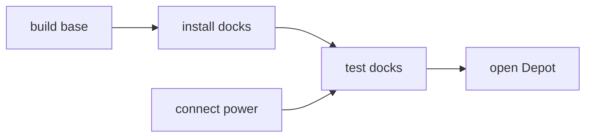

## Hook

Depot is about to open as Spoke's fifth station. The crew has a to-do list: build the base, connect the power, install the docks, test them, open the doors. Some jobs must wait for others. You cannot test docks that are not installed yet.

The bike lane map from the last ticket had lanes that work both ways. A "must happen before" rule only points one way. That one-way arrow changes what a graph can answer. It can tell you a safe order for jobs, and it can warn you when the rules are impossible.

Then there is a second puzzle. The city planners send the lane map as a grid of blocks, not as a list of stations. A grid is a graph too, once you know how to look at it.

## Concept

### Edges with a direction

```callout jargon
A **directed graph** is a graph where every edge is an arrow. It goes from one node to another, and only that way. An edge that works both ways is **undirected**.
```

Here is the Depot list as a directed graph. An arrow from A to B means "A must happen before B".



```callout jargon
The **in-degree** of a node is the number of arrows pointing into it. The **out-degree** is the number of arrows leaving it.
```

"test docks" has in-degree 2: it waits for two jobs. "build base" and "connect power" have in-degree 0. Nothing has to happen before them.

### Syntax: a directed adjacency list

```java nocompile
after.computeIfAbsent(first, k -> new ArrayList<>()).add(then);
after.computeIfAbsent(then, k -> new ArrayList<>());
```

The first line stores the arrow in `first`'s list, and only there. In the last ticket, a lane needed two `add` calls. An arrow needs one. The second line just makes sure `then` has a list of its own, even an empty one.

```java nocompile
inDegree.merge(next, 1, Integer::sum);
```

`merge` puts 1 in the map if `next` has no count yet. Otherwise it adds 1 to the old count. It is a short way to count things.

```java run
import java.util.ArrayList;
import java.util.List;
import java.util.Map;
import java.util.TreeMap;

public class Main {
    static Map<String, List<String>> after = new TreeMap<>();

    static void rule(String first, String then) {
        after.computeIfAbsent(first, k -> new ArrayList<>()).add(then);
        after.computeIfAbsent(then, k -> new ArrayList<>());
    }

    public static void main(String[] args) {
        rule("build base", "install docks");
        rule("install docks", "test docks");
        rule("connect power", "test docks");
        rule("test docks", "open Depot");

        Map<String, Integer> inDegree = new TreeMap<>();
        for (String job : after.keySet()) {
            inDegree.putIfAbsent(job, 0);
            for (String next : after.get(job)) {
                inDegree.merge(next, 1, Integer::sum);
            }
        }
        System.out.println(after);
        System.out.println(inDegree);
    }
}
```

### Topological order

```callout jargon
A **topological order** lists every node so that each arrow points forward. If there is an arrow from A to B, A comes before B in the list.
```

For Depot, one topological order is: build base, connect power, install docks, test docks, open Depot. Another is: connect power, build base, install docks, test docks, open Depot. Both keep every rule. A graph often has many valid orders.

Real systems use this all the time. A build tool compiles a library before the code that uses it. A spreadsheet works out a cell before the cells that read it. A course plan puts "Algebra 1" before "Algebra 2".

### When no order exists

```callout jargon
A **cycle** is a path of arrows that leads back to where it started. A **DAG** (directed acyclic graph) is a directed graph with no cycles. "Acyclic" just means "with no cycle".
```

Suppose someone adds the rule "open Depot before build base". Now build base waits for open Depot, which waits for test docks, which waits for install docks, which waits for build base. Every job in that loop waits for another one in it. None can ever start.

So a topological order exists **exactly when the graph is a DAG**. Finding an order and checking for a cycle are the same job.

### Kahn's algorithm

**Kahn's algorithm** builds the order one job at a time.

1. Count the in-degree of every job.
2. Put every job with in-degree 0 in a "ready" queue. Nothing blocks them.
3. Take a job from the queue and add it to the order.
4. Each arrow leaving that job is now done, so lower the in-degree of the job it points to.
5. A job whose in-degree drops to 0 is ready. Put it in the queue.
6. Repeat until the queue is empty.

```callout analogy
Think of sticky notes on a board. A job is ready when no note above it is still waiting. Each time you finish a job, you peel its note off, and maybe a new job becomes free.
```

```animate
title: Kahn's algorithm orders the Depot jobs
kind: scene
nodes:
  - { id: base, label: build base, emoji: "🧱", value: "in 0", row: 0, col: 0 }
  - { id: docks, label: install docks, emoji: "🔩", value: "in 1", row: 0, col: 1 }
  - { id: test, label: test docks, emoji: "🧪", value: "in 2", row: 0, col: 2 }
  - { id: open, label: open Depot, emoji: "🎉", value: "in 1", row: 0, col: 3 }
  - { id: power, label: connect power, emoji: "🔌", value: "in 0", row: 1, col: 1 }
  - { id: order, label: Order so far, emoji: "📋", value: "empty", row: 2, col: 1 }
links:
  - { from: base, to: docks }
  - { from: docks, to: test }
  - { from: power, to: test }
  - { from: test, to: open }
steps:
  - say: Count the arrows coming into each job. build base and connect power have in-degree 0, so both go into the ready queue.
    focus: [base, power]
  - say: The ready queue gives build base first. It joins the order. Its arrow is done, so install docks drops to 0 and becomes ready.
    send: { from: base, to: order, label: "build base" }
    set: { base: done, docks: "in 0", order: "build base" }
  - say: Next out is connect power. Its arrow is done, so test docks drops from 2 to 1. It still waits for one job.
    send: { from: power, to: order, label: "connect power" }
    set: { power: done, test: "in 1", order: "base, power" }
  - say: install docks goes next. test docks drops to 0 and joins the queue.
    send: { from: docks, to: order, label: "install docks" }
    set: { docks: done, test: "in 0", order: "base, power, docks" }
  - say: test docks goes next, which frees open Depot.
    send: { from: test, to: order, label: "test docks" }
    set: { test: done, open: "in 0", order: "base, power, docks, test" }
  - say: open Depot goes last. All 5 jobs made it into the order, so there is no cycle.
    send: { from: open, to: order, label: "open Depot" }
    set: { open: done, order: "all 5 jobs" }
    focus: [order]
```

### Spotting a cycle with Kahn

Jobs in a cycle never reach in-degree 0. Each one waits on another job in the loop. So Kahn's algorithm stops early, and those jobs never join the order.

That gives a simple test at the end: **if the order is shorter than the number of jobs, there is a cycle.** You do not need a separate search.

```callout warning
Gojo says: if you forget this check, a cycle does not crash anything. You just quietly get a short list, and the missing jobs never happen.
```

### Syntax: a fixed order for ties

When two jobs are ready at once, which goes first? A plain `ArrayDeque` takes them in the order they arrived. That order can change when someone adds the rules in a different order.

```java nocompile
PriorityQueue<String> ready = new PriorityQueue<>();
```

A `PriorityQueue<String>` from the heaps ticket always gives back the smallest string. Java compares strings by character code, so capital letters come before lowercase ones. With all-lowercase job names, that is plain A to Z. Now the same rules always give the same order. Tests, logs and crew sheets stay the same on every run.

### Cycle check with DFS and three colours

DFS from the graphs ticket can also find cycles. Give every node one of three colours:

- **White:** not visited yet.
- **Grey:** visiting now. DFS has entered it but not finished it.
- **Black:** finished. Everything after it has been checked.

```java nocompile
static boolean hasCycle(String job) {
    colour.put(job, GREY);
    for (String next : after.get(job)) {
        if (colour.get(next) == GREY) {
            return true;
        }
        if (colour.get(next) == WHITE && hasCycle(next)) {
            return true;
        }
    }
    colour.put(job, BLACK);
    return false;
}
```

Reaching a grey node means you walked back into a job you are still inside. That is a cycle. Reaching a black node is fine: it was finished by another path. A plain visited set cannot tell grey from black, so it reports false cycles.

Bonus: the order in which nodes turn black, reversed, is also a topological order.

### How fast is Kahn?

**V** is the number of jobs and **E** is the number of rules. Each job joins and leaves the queue once. Each arrow is looked at once when its job leaves.

| Version | Time | Space |
|---|---|---|
| Kahn with a plain queue | O(V + E) | O(V + E) for the lists, the counts and the queue |
| Kahn with a PriorityQueue | O(V log V + E) | O(V + E) |
| DFS three colours | O(V + E) | O(V) for the colours and the call stack |

The PriorityQueue costs an extra log V per job, because each `offer` and `poll` is O(log V). That is the price of a fixed tie order.

### A grid is a graph too

```callout jargon
A **grid** is a table of cells in rows and columns, like a chessboard. A cell's position is (row, column). Row 0 is the top. Column 0 is the left.
```

The planners send the city as text. `#` is a block with a bike lane, `D` is a dock, and `.` is a block with no lane.

```
##..#
#...#
..#..
..##.
```

Every cell is a node. Each cell has up to **4 neighbours**: up, down, left and right. You never write these edges down. You work them out when you need them, by adding a step to the row and column.

### Syntax: neighbours and bounds checks

```java nocompile
int[] rowStep = {-1, 1, 0, 0};
int[] colStep = {0, 0, -1, 1};
for (int d = 0; d < 4; d++) {
    int nr = r + rowStep[d];
    int nc = c + colStep[d];
    if (nr >= 0 && nr < rows && nc >= 0 && nc < cols && grid[nr][nc] == '#') {
        // (nr, nc) is a lane neighbour
    }
}
```

The two arrays list the four steps. The **bounds check** comes first: a cell on the edge has fewer than four neighbours. Java's `&&` stops at the first false part, so `grid[nr][nc]` is never read outside the grid.

Diagonals do not count. A rider cannot cut across the corner of a building.

### Counting zones: connected components

```callout jargon
A **connected component** is a group of nodes where you can reach any one from any other, and nothing outside the group. On a grid map, people often call them **islands**.
```

To count lane zones:

1. Make a `boolean[][] visited` the same size as the grid.
2. Scan every cell, row by row.
3. When you find a lane cell that is not visited, you found a new zone. Add 1 to the count.
4. Run BFS from that cell, marking every lane cell it reaches. That whole zone is now visited, so the scan never counts it again.

The map above has 3 zones: three cells top left, two on the right edge, and three in the bottom middle.

**Cost:** every cell is visited once and checks 4 neighbours. Time is O(rows × cols). The visited array and the queue take O(rows × cols) space too.

### Multi-source BFS

Riders want to know how far each lane block is from the nearest dock. You could run one BFS from each dock and keep the smallest answer. With many docks, that repeats a lot of work.

```callout jargon
**Multi-source BFS** starts from many places at once. Every start goes into the queue at distance 0 before the loop begins.
```

The waves now spread out from all the docks together. The first wave to reach a cell came from the nearest dock, so that cell's distance is final. One BFS does the whole job in O(rows × cols).

```animate
title: Two docks send out waves together
kind: scene
nodes:
  - { id: c00, label: "dock", emoji: "🅿️", value: "?", row: 0, col: 0 }
  - { id: c01, label: "lane", emoji: "🛣️", value: "?", row: 0, col: 1 }
  - { id: c02, label: "lane", emoji: "🛣️", value: "?", row: 0, col: 2 }
  - { id: c03, label: "lane", emoji: "🛣️", value: "?", row: 0, col: 3 }
  - { id: c10, label: "lane", emoji: "🛣️", value: "?", row: 1, col: 0 }
  - { id: c11, label: "no lane", emoji: "🏢", value: "?", row: 1, col: 1 }
  - { id: c12, label: "lane", emoji: "🛣️", value: "?", row: 1, col: 2 }
  - { id: c13, label: "dock", emoji: "🅿️", value: "?", row: 1, col: 3 }
links:
  - { from: c00, to: c01 }
  - { from: c01, to: c02 }
  - { from: c02, to: c03 }
  - { from: c00, to: c10 }
  - { from: c02, to: c12 }
  - { from: c03, to: c13 }
  - { from: c12, to: c13 }
steps:
  - say: Both docks go into the queue at distance 0, before the loop starts.
    set: { c00: "0", c13: "0" }
    focus: [c00, c13]
  - say: Wave 1. Every lane next to a dock gets distance 1. The left dock reaches two cells, and so does the right dock.
    set: { c01: "1", c10: "1", c03: "1", c12: "1" }
    focus: [c01, c10, c03, c12]
  - say: Wave 2. Only the top middle lane is left. Three of its neighbours have distance 1, so it gets 2.
    set: { c02: "2" }
    focus: [c02]
  - say: The block with no lane is never reached, so it stays at -1. Every lane cell now knows its nearest dock.
    set: { c11: "-1" }
    focus: [c11]
```

### Big grids and the call stack

A flood fill is easy to write with recursion: mark the cell, then call yourself on each neighbour. On a small grid that works fine.

Remember the call stack from the recursion ticket. Each call waiting for another call takes a little stack memory. On a 3000 x 3000 grid full of lanes, the chain of calls can be millions deep. The stack runs out long before that, and the program crashes with a `StackOverflowError`.

The fix is to keep your own to-do list on the heap, where memory is plentiful:

- An `ArrayDeque` used as a **queue** (`offer`, `poll`) gives BFS.
- An `ArrayDeque` used as a **stack** (`push`, `pop`) gives an iterative DFS.

Both visit the same cells and count the same zones. Neither one grows the call stack.

### In an interview

Listen for these words in a problem:

- "prerequisites", "depends on", "must happen before", "build order": **topological sort**. "Is it possible?" means "is there a cycle?"
- "islands", "regions", "connected areas" on a grid: **flood fill** with BFS or DFS and a visited array.
- "nearest", "minimum steps from any of" several starts: **multi-source BFS**.

Classic problems: can you finish every course given the prerequisites, and in what order; work out the letter order of an alien alphabet from a sorted word list; count the islands in a grid; find the time for rot to spread from every rotten orange; fill each room with its distance to the nearest gate.

Say the cost out loud: O(V + E) for the graph, O(rows × cols) for the grid. Mention that you avoid recursion on big grids.

## Worked example

This program runs Kahn's algorithm on the Depot jobs, with a `PriorityQueue` for ties.

```java run
import java.util.ArrayList;
import java.util.List;
import java.util.Map;
import java.util.PriorityQueue;
import java.util.TreeMap;

public class Main {
    static Map<String, List<String>> after = new TreeMap<>();

    static void rule(String first, String then) {
        after.computeIfAbsent(first, k -> new ArrayList<>()).add(then);
        after.computeIfAbsent(then, k -> new ArrayList<>());
    }

    public static void main(String[] args) {
        rule("build base", "install docks");
        rule("install docks", "test docks");
        rule("connect power", "test docks");
        rule("test docks", "open Depot");

        Map<String, Integer> inDegree = new TreeMap<>();
        for (String job : after.keySet()) {
            inDegree.putIfAbsent(job, 0);
            for (String next : after.get(job)) {
                inDegree.merge(next, 1, Integer::sum);
            }
        }

        PriorityQueue<String> ready = new PriorityQueue<>();
        for (String job : inDegree.keySet()) {
            if (inDegree.get(job) == 0) {
                ready.offer(job);
            }
        }

        List<String> order = new ArrayList<>();
        while (!ready.isEmpty()) {
            String job = ready.poll();
            order.add(job);
            for (String next : after.get(job)) {
                inDegree.merge(next, -1, Integer::sum);
                if (inDegree.get(next) == 0) {
                    ready.offer(next);
                }
            }
        }

        if (order.size() < after.size()) {
            System.out.println("Cycle! Only " + order.size() + " of " + after.size() + " jobs can be ordered.");
        } else {
            System.out.println(order);
        }
    }
}
```

Step by step:

1. `rule` stores each arrow once, in the first job's list. Every job gets a list, even `open Depot`, which points nowhere.
2. The first loop counts in-degrees. Every job starts at 0, and each arrow adds 1 to the job it points at.
3. `build base` and `connect power` have in-degree 0, so they start in `ready`.
4. Each turn, `poll` takes the A-to-Z first ready job and adds it to `order`.
5. `merge(next, -1, Integer::sum)` lowers a count by 1. At 0, the job joins `ready`.
6. The last check compares lengths. All 5 jobs made it, so the program prints `[build base, connect power, install docks, test docks, open Depot]`.

## Try it

Run the worked example again with one extra rule. Add this line after the other four rules:

```java nocompile
rule("open Depot", "build base");
```

It prints `Cycle! Only 1 of 5 jobs can be ordered.` Only `connect power` was free. Then remove it and run this lane-zone counter. Change a `.` to `#` to join two zones, and watch the count drop.

```java run
import java.util.ArrayDeque;
import java.util.Queue;

public class Main {
    static String[] city = {
            "##..#",
            "#...#",
            "..#..",
            "..##."};
    static int[] rowStep = {-1, 1, 0, 0};
    static int[] colStep = {0, 0, -1, 1};

    static boolean isLane(int r, int c) {
        return r >= 0 && r < city.length && c >= 0 && c < city[0].length()
                && city[r].charAt(c) == '#';
    }

    public static void main(String[] args) {
        boolean[][] visited = new boolean[city.length][city[0].length()];
        int zones = 0;
        for (int r = 0; r < city.length; r++) {
            for (int c = 0; c < city[0].length(); c++) {
                if (isLane(r, c) && !visited[r][c]) {
                    zones++;
                    Queue<int[]> queue = new ArrayDeque<>();
                    visited[r][c] = true;
                    queue.offer(new int[] {r, c});
                    while (!queue.isEmpty()) {
                        int[] cell = queue.poll();
                        for (int d = 0; d < 4; d++) {
                            int nr = cell[0] + rowStep[d];
                            int nc = cell[1] + colStep[d];
                            if (isLane(nr, nc) && !visited[nr][nc]) {
                                visited[nr][nc] = true;
                                queue.offer(new int[] {nr, nc});
                            }
                        }
                    }
                }
            }
        }
        System.out.println("Lane zones: " + zones);
    }
}
```

It prints `Lane zones: 3`. Each `int[]` in the queue holds one cell's row and column.

## Recap

- A directed graph has one-way arrows. A node's in-degree counts the arrows pointing into it.
- A topological order puts every arrow forward. It exists exactly when the graph has no cycle (a DAG).
- Kahn's algorithm takes in-degree 0 jobs from a queue in O(V + E). A short result means a cycle. A PriorityQueue gives a fixed tie order.
- A grid is a graph with up to 4 neighbours per cell. Check the bounds before you read a cell.
- Count zones with BFS or DFS and a visited array, and find the nearest dock with multi-source BFS, both in O(rows × cols). Use an ArrayDeque, not recursion, on big grids.

## Common mistakes

**1. Returning a short order when there is a cycle.**

```java nocompile
while (!ready.isEmpty()) {
    String job = ready.poll();
    order.add(job);
    // lower the in-degrees ...
}
return order;
```

With the extra rule "open Depot before build base", this returns `[connect power]` and no error. Four jobs silently vanish from the crew's sheet. Fix: after the loop, compare `order.size()` with the number of jobs. If it is smaller, throw `new IllegalStateException("cycle")`.

**2. Reading a neighbour before the bounds check.**

```java nocompile
int nr = r + rowStep[d];
int nc = c + colStep[d];
if (city[nr][nc] == '#') {
    System.out.println("lane at " + nr + ", " + nc);
}
```

Store this page's 4-row map as a `char[][]` and check the corner cell (0, 0). Its "up" step gives row -1, and the program crashes with `java.lang.ArrayIndexOutOfBoundsException: Index -1 out of bounds for length 4`. Fix: check `nr >= 0 && nr < rows && nc >= 0 && nc < cols` first, in the same `if`, before `city[nr][nc]`.

**3. A recursive flood fill on a big grid.**

```java nocompile
static void fill(int r, int c) {
    if (r < 0 || r >= 3000 || c < 0 || c >= 3000 || visited[r][c]) {
        return;
    }
    visited[r][c] = true;
    fill(r + 1, c);
    fill(r - 1, c);
    fill(r, c + 1);
    fill(r, c - 1);
}
```

On a 3000 x 3000 grid this crashes with `Exception in thread "main" java.lang.StackOverflowError`. Every waiting call holds stack memory, and the chain gets far too deep. Fix: use an `ArrayDeque` as a queue (BFS) or as a stack with `push` and `pop` (iterative DFS).

**4. Counting diagonal cells as neighbours.**

```java nocompile
int[] rowStep = {-1, -1, -1, 0, 0, 1, 1, 1};
int[] colStep = {-1, 0, 1, -1, 1, -1, 0, 1};
```

Two lane blocks that only touch at a corner now look joined. The map `#.` over `.#` counts 1 zone instead of 2, and riders get sent across a building. Fix: use only the 4 steps up, down, left and right, unless a problem says diagonals count.
