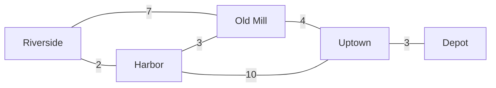

## Hook

A rider at Riverside asks the app for the way to Depot. The app proudly shows the route with the fewest stops. The rider follows it and gets stuck on a long, hilly lane by the harbour. A route with one more stop would have been two minutes faster.

Fewest stops is not the same as fastest. Real lanes take different times: some are flat and short, some climb a hill. To find the fastest route, the graph needs to know the minutes on every lane. Then it needs a smarter search than BFS.

## Concept

### Weighted edges

```callout jargon
A **weight** is a number stored on an edge, such as its length, cost or time. A graph with weights is a **weighted graph**. Here every lane's weight is its riding time in minutes.
```

Here is Riverton with riding minutes on each lane:



The **length** of a route is now the sum of its weights, not the number of lanes. Riverside, Harbor, Old Mill takes 2 + 3 = 5 minutes. The direct lane from Riverside to Old Mill takes 7. Two lanes beat one.

### Syntax: a weighted adjacency list

Each station's list now holds a small record per lane: where it goes, and how long it takes.

```java nocompile
record Lane(String to, int minutes) { }

Map<String, List<Lane>> lanes = new HashMap<>();
lanes.computeIfAbsent(a, k -> new ArrayList<>()).add(new Lane(b, minutes));
lanes.computeIfAbsent(b, k -> new ArrayList<>()).add(new Lane(a, minutes));
```

A lane works both ways, so it goes in twice, with the same minutes each way.

```java run
import java.util.ArrayList;
import java.util.LinkedHashMap;
import java.util.List;
import java.util.Map;

public class Main {
    record Lane(String to, int minutes) {
    }

    static Map<String, List<Lane>> lanes = new LinkedHashMap<>();

    static void addLane(String a, String b, int minutes) {
        lanes.computeIfAbsent(a, k -> new ArrayList<>()).add(new Lane(b, minutes));
        lanes.computeIfAbsent(b, k -> new ArrayList<>()).add(new Lane(a, minutes));
    }

    public static void main(String[] args) {
        addLane("Riverside", "Harbor", 2);
        addLane("Riverside", "Old Mill", 7);
        addLane("Harbor", "Old Mill", 3);
        for (String station : lanes.keySet()) {
            System.out.println(station + " -> " + lanes.get(station));
        }
    }
}
```

### Why BFS is not enough

BFS spreads out one lane at a time. It finds the route with the fewest lanes, because every lane counts as 1.

From Riverside to Depot, BFS finds one of the 3-lane routes, such as Riverside, Old Mill, Uptown, Depot. That one takes 7 + 4 + 3 = 14 minutes. The other, through Harbor, takes 2 + 10 + 3 = 15. The 4-lane route Riverside, Harbor, Old Mill, Uptown, Depot takes 2 + 3 + 4 + 3 = 12 minutes.

BFS also locks in a station the first time it sees it. With weights, a station first seen through a slow lane may later be reached faster through a longer chain of quick lanes. BFS never goes back to fix it.

```callout tip
Gojo says: if every lane takes the same time, BFS is still the right tool, and it is faster. Dijkstra is for when the weights differ.
```

### Dijkstra's idea

**Dijkstra's algorithm** (say "DIKE-stra") grows out from the start like BFS. The difference is the order. It always picks the station with the **smallest total time so far** next.

```callout jargon
A station is **settled** when its fastest time is final. To **relax** a lane means: check whether going through this lane gives its far end a faster time than the best one known, and if so, write the new time down.
```

1. The start gets 0 minutes. Every other station has no time yet.
2. Pick the unsettled station with the smallest time. It is now settled.
3. Relax every lane out of it.
4. Repeat until no stations are left to pick.

Why is the smallest one safe to settle? Every other route to it must leave the settled stations through some station whose time is at least as big. Weights are never negative, so that route can only get longer. Nothing can beat it any more.

This "take the best-looking choice now" style is called **greedy**. Here, being greedy is provably right.

### Syntax: records in a PriorityQueue

To find the smallest time fast, put the candidates in a `PriorityQueue` from the heaps ticket.

```java nocompile
record Visit(String station, int minutes) { }

PriorityQueue<Visit> queue = new PriorityQueue<>(
        Comparator.comparingInt(Visit::minutes).thenComparing(Visit::station));
```

A `Visit` says "I can reach this station in this many minutes". The `Comparator` orders visits by minutes. When two visits tie on minutes, `thenComparing` orders them by station name A to Z. So the same map always gives the same answer.

Without a `Comparator`, the queue does not know how to order a `Visit`. It crashes on the very first `offer`.

### Syntax: the Dijkstra loop

```java nocompile
Map<String, Integer> best = new HashMap<>();
Map<String, String> parent = new HashMap<>();
best.put(start, 0);
queue.offer(new Visit(start, 0));
while (!queue.isEmpty()) {
    Visit visit = queue.poll();
    if (visit.minutes() > best.get(visit.station())) {
        continue;                          // stale entry: skip it
    }
    for (Lane lane : lanes.get(visit.station())) {
        int minutes = visit.minutes() + lane.minutes();
        Integer known = best.get(lane.to());
        if (known == null || minutes < known) {
            best.put(lane.to(), minutes);
            parent.put(lane.to(), visit.station());
            queue.offer(new Visit(lane.to(), minutes));
        }
    }
}
```

`best` holds the fastest time found so far for each station. A station missing from `best` has not been reached yet. `known` is an `Integer`, not an `int`, so it can be `null`.

### Stale entries and lazy deletion

When a station gets a faster time, the ideal move is to change its old entry in the queue. That move is called **decrease-key**. Java's `PriorityQueue` has no decrease-key. Its `remove(object)` has to search the whole array, which is O(n).

```callout jargon
**Lazy deletion** means you leave the old entry in the queue and add a new one. When an old entry comes out later, you notice it is out of date and skip it. An out-of-date entry is called **stale**.
```

The test is one line: if the visit's minutes are more than the station's `best`, a faster visit already came out. Skip it. The queue holds a few extra entries, but each `offer` and `poll` stays O(log n).

```animate
title: Dijkstra settles Riverton from Riverside
kind: scene
nodes:
  - { id: r, label: Riverside, emoji: "🚲", value: "0", row: 0, col: 0 }
  - { id: h, label: Harbor, emoji: "⚓", value: "?", row: 1, col: 1 }
  - { id: o, label: Old Mill, emoji: "🏭", value: "?", row: 0, col: 2 }
  - { id: u, label: Uptown, emoji: "🏙️", value: "?", row: 1, col: 3 }
  - { id: d, label: Depot, emoji: "🚚", value: "?", row: 0, col: 4 }
  - { id: q, label: Queue, emoji: "📥", value: "Riverside 0", row: 2, col: 2 }
links:
  - { from: r, to: o, label: "7" }
  - { from: r, to: h, label: "2" }
  - { from: h, to: o, label: "3" }
  - { from: o, to: u, label: "4" }
  - { from: h, to: u, label: "10" }
  - { from: u, to: d, label: "3" }
steps:
  - say: Riverside starts at 0 minutes and goes in the queue. Every other station is unknown.
    focus: [r, q]
  - say: Poll Riverside 0. It is settled. Relax its lanes. Harbor gets 2 and Old Mill gets 7.
    set: { r: "0 final", h: "2", o: "7", q: "Harbor 2, Old Mill 7" }
    focus: [h, o]
  - say: Poll Harbor 2, the smallest. Through Harbor, Old Mill takes 2 + 3 = 5, which beats 7. Uptown gets 12.
    set: { h: "2 final", o: "5", u: "12", q: "Old Mill 5, Old Mill 7, Uptown 12" }
    focus: [o, u]
  - say: Poll Old Mill 5. Through Old Mill, Uptown takes 5 + 4 = 9, which beats 12.
    set: { o: "5 final", u: "9", q: "Old Mill 7, Uptown 9, Uptown 12" }
    focus: [u]
  - say: Poll Old Mill 7. But Old Mill's best is already 5. This entry is stale, so skip it.
    set: { q: "Uptown 9, Uptown 12" }
    focus: [q]
  - say: Poll Uptown 9. It is settled. Depot gets 9 + 3 = 12.
    set: { u: "9 final", d: "12", q: "Depot 12, Uptown 12" }
    focus: [d]
  - say: Two entries tie at 12. Depot comes first A to Z, so it is polled and settled.
    set: { d: "12 final", q: "Uptown 12" }
    focus: [d]
  - say: The last entry, Uptown 12, is stale and skipped. The queue is empty. Depot is 12 minutes from Riverside.
    set: { q: "empty" }
```

### Rebuilding the route

The `parent` map works like the one in the BFS ticket. Each time a station gets a faster time, you also write down the station you came from. A later, faster time overwrites the parent too.

When the search ends, start at the goal and follow parents back to the start. Then reverse the list.

```java nocompile
List<String> route = new ArrayList<>();
for (String step = goal; step != null; step = parent.get(step)) {
    route.add(step);
}
Collections.reverse(route);
```

The start has no parent, so `parent.get` returns `null` and the loop stops.

### Unreachable stations and ties

A station with no lane path from the start never gets into `best`. So `best.get` returns `null` for it. Decide what that means and say it clearly. The practice task returns -1 minutes and an empty route.

A station with no lanes at all has no list in `lanes`. Use `lanes.getOrDefault(station, List.of())`, or the loop crashes on `null`.

Ties need a rule too, so the same map always gives the same route. Two parts make it fixed:

- The queue orders equal minutes by station name, A to Z.
- You update a station only when the new time is **strictly** smaller (`<`), never when it is equal.

So the first route to reach a time keeps it.

### Negative minutes break it

Dijkstra settles a station and never looks at it again. That is only safe if no lane can make a route shorter.

Imagine a tiny map with one-way lanes. Riverside to Harbor takes 2 minutes. Riverside to Old Mill takes 3. Old Mill to Harbor somehow takes -4.

1. Dijkstra polls Harbor first, at 2, and settles it.
2. Then it polls Old Mill, at 3. Through Old Mill, Harbor would take 3 - 4 = -1.
3. But Harbor was already settled at 2, and its lanes were relaxed using 2. Classic Dijkstra never goes back, so Harbor and everything after it get wrong times.

A version that keeps a set of settled stations and never touches them again really does print 2 for Harbor. That answer is wrong.

The lazy version on this page has no such set. On this tiny map it pushes Harbor again and prints the right -1. But now a station can settle many times, and on bad maps the work grows very fast. With a two-way lane of negative minutes, riding back and forth keeps "saving" time, and the search never stops. Either way, Dijkstra's promise is broken.

A different algorithm, **Bellman-Ford**, handles negative weights by relaxing every edge again and again. It is slower, O(V × E). Riding times are never negative, so Dijkstra is the right choice for Spoke. The practice code refuses negative minutes with an `IllegalArgumentException`.

### How fast is it?

**V** is the number of stations and **E** the number of lanes. Each lane can add at most one entry to the queue, so the queue holds at most about E entries. Each `offer` and `poll` costs O(log E), which is the same as O(log V) in Big-O terms.

| Part | Cost | Why |
|---|---|---|
| Time | O((V + E) log V) | every station is settled once, every lane is relaxed once, and each queue step is O(log V) |
| Space | O(V + E) | the lane lists, `best`, `parent`, and up to E queue entries |
| Without a heap | O(V²) | scanning every station to find the smallest time, V times |

On a city with 30,000 docks, V² is 900 million steps. The heap version needs about a million.

The O(V²) array version is not always worse. In a **dense** graph, where almost every station has a lane to almost every other, E is close to V². Then the heap version costs about V² log V, and the simple scan wins. Road and lane maps are sparse, so the heap is the right choice for Spoke.

### In an interview

Listen for "shortest", "fastest", "cheapest" or "minimum total" together with **different costs** on the edges. That is Dijkstra. If every edge costs the same, use BFS. If some costs are negative, say Bellman-Ford.

Classic problems: how long a signal takes to reach every computer in a network; the cheapest flight between two cities; the path through a height map that needs the least climbing effort; the earliest time you can swim across a rising pool; the fastest route for a delivery van.

Say both costs out loud: O((V + E) log V) time and O(V + E) space. Mention the stale-entry check, because interviewers often ask how you handle "decrease-key" in Java.

## Worked example

This program finds the fastest route from Riverside to Depot.

```java run
import java.util.ArrayList;
import java.util.Collections;
import java.util.Comparator;
import java.util.HashMap;
import java.util.List;
import java.util.Map;
import java.util.PriorityQueue;

public class Main {
    record Lane(String to, int minutes) {
    }

    record Visit(String station, int minutes) {
    }

    static Map<String, List<Lane>> lanes = new HashMap<>();

    static void addLane(String a, String b, int minutes) {
        lanes.computeIfAbsent(a, k -> new ArrayList<>()).add(new Lane(b, minutes));
        lanes.computeIfAbsent(b, k -> new ArrayList<>()).add(new Lane(a, minutes));
    }

    public static void main(String[] args) {
        addLane("Riverside", "Old Mill", 7);
        addLane("Riverside", "Harbor", 2);
        addLane("Harbor", "Old Mill", 3);
        addLane("Old Mill", "Uptown", 4);
        addLane("Harbor", "Uptown", 10);
        addLane("Uptown", "Depot", 3);

        Map<String, Integer> best = new HashMap<>();
        Map<String, String> parent = new HashMap<>();
        PriorityQueue<Visit> queue = new PriorityQueue<>(
                Comparator.comparingInt(Visit::minutes).thenComparing(Visit::station));
        best.put("Riverside", 0);
        queue.offer(new Visit("Riverside", 0));

        while (!queue.isEmpty()) {
            Visit visit = queue.poll();
            if (visit.minutes() > best.get(visit.station())) {
                continue;
            }
            for (Lane lane : lanes.get(visit.station())) {
                int minutes = visit.minutes() + lane.minutes();
                Integer known = best.get(lane.to());
                if (known == null || minutes < known) {
                    best.put(lane.to(), minutes);
                    parent.put(lane.to(), visit.station());
                    queue.offer(new Visit(lane.to(), minutes));
                }
            }
        }

        List<String> route = new ArrayList<>();
        for (String step = "Depot"; step != null; step = parent.get(step)) {
            route.add(step);
        }
        Collections.reverse(route);
        System.out.println(best.get("Depot") + " minutes: " + route);
    }
}
```

Step by step:

1. `addLane` stores each lane in both stations' lists as a `Lane` record.
2. Riverside starts in `best` at 0 and goes in the queue.
3. Each `poll` gives the visit with the fewest minutes. A stale visit is skipped.
4. For each lane, `minutes` is the time through this station. If it beats `known`, the far station gets a new best, a new parent and a new queue entry.
5. When the queue is empty, every reachable station has its final time.
6. The route walks back from Depot: Uptown, Old Mill, Harbor, Riverside. Reversed, it prints `12 minutes: [Riverside, Harbor, Old Mill, Uptown, Depot]`.

## Try it

This version puts the search in a method and prints the fastest time to every station. Run it. Then change the Harbor to Old Mill lane from 3 to 6 minutes and run again. Old Mill's time from Riverside rises from 5 to 7, because the direct lane wins now.

```java run
import java.util.ArrayList;
import java.util.Comparator;
import java.util.HashMap;
import java.util.List;
import java.util.Map;
import java.util.PriorityQueue;
import java.util.TreeMap;

public class Main {
    record Lane(String to, int minutes) {
    }

    record Visit(String station, int minutes) {
    }

    static Map<String, List<Lane>> lanes = new HashMap<>();

    static void addLane(String a, String b, int minutes) {
        lanes.computeIfAbsent(a, k -> new ArrayList<>()).add(new Lane(b, minutes));
        lanes.computeIfAbsent(b, k -> new ArrayList<>()).add(new Lane(a, minutes));
    }

    static Map<String, Integer> fastestFrom(String start) {
        Map<String, Integer> best = new TreeMap<>();
        PriorityQueue<Visit> queue = new PriorityQueue<>(
                Comparator.comparingInt(Visit::minutes).thenComparing(Visit::station));
        best.put(start, 0);
        queue.offer(new Visit(start, 0));
        while (!queue.isEmpty()) {
            Visit visit = queue.poll();
            if (visit.minutes() > best.get(visit.station())) {
                continue;
            }
            for (Lane lane : lanes.get(visit.station())) {
                int minutes = visit.minutes() + lane.minutes();
                Integer known = best.get(lane.to());
                if (known == null || minutes < known) {
                    best.put(lane.to(), minutes);
                    queue.offer(new Visit(lane.to(), minutes));
                }
            }
        }
        return best;
    }

    public static void main(String[] args) {
        addLane("Riverside", "Old Mill", 7);
        addLane("Riverside", "Harbor", 2);
        addLane("Harbor", "Old Mill", 3);
        addLane("Old Mill", "Uptown", 4);
        addLane("Harbor", "Uptown", 10);
        addLane("Uptown", "Depot", 3);
        System.out.println("From Riverside: " + fastestFrom("Riverside"));
        System.out.println("From Depot: " + fastestFrom("Depot"));
    }
}
```

The first line prints `From Riverside: {Depot=12, Harbor=2, Old Mill=5, Riverside=0, Uptown=9}`. A `TreeMap` keeps the stations A to Z.

## Recap

- A weighted graph stores a number on each edge. Here it is the riding minutes, kept in a `Lane` record.
- BFS finds the fewest lanes, not the fewest minutes. Dijkstra always settles the station with the smallest total time next.
- A `PriorityQueue` of `Visit` records, ordered by minutes then name, picks that station. Skip stale entries, because Java has no decrease-key.
- A parent map rebuilds the route. Unreachable stations never enter `best`, and a strict `<` keeps ties fixed.
- Dijkstra runs in O((V + E) log V) time and O(V + E) space, and only works when no weight is negative.

## Common mistakes

**1. A PriorityQueue of records with no Comparator.**

```java nocompile
PriorityQueue<Visit> queue = new PriorityQueue<>();
queue.offer(new Visit("Riverside", 0));
```

The first `offer` crashes with `java.lang.ClassCastException: class Main$Visit cannot be cast to class java.lang.Comparable`. The queue has no idea how to order a `Visit`. Fix: pass `Comparator.comparingInt(Visit::minutes).thenComparing(Visit::station)` to the constructor.

**2. Locking in a station the first time you see it.**

```java nocompile
if (!best.containsKey(lane.to())) {
    best.put(lane.to(), minutes);
    parent.put(lane.to(), visit.station());
    queue.offer(new Visit(lane.to(), minutes));
}
```

This is the BFS habit. Old Mill keeps its first time, 7, and never learns about the 5-minute route through Harbor. The worked example then prints `15 minutes: [Riverside, Harbor, Uptown, Depot]` instead of 12. Fix: update whenever the new time is smaller. A station is final only when it is polled.

**3. Using <= instead of < when relaxing.**

```java nocompile
if (known == null || minutes <= known) {
```

With a 0-minute lane between Harbor and Old Mill, each station keeps "improving" the other to the same time. They push new entries forever, and the program dies with `java.lang.OutOfMemoryError: Java heap space`. Fix: use a strict `<`. An equal time is not an improvement.

**4. Reading the time for a station that was never reached.**

```java nocompile
Map<String, Integer> best = new HashMap<>();
best.put("Riverside", 0);
int minutes = best.get("Airport");
```

`get` returns `null`, and Java cannot turn `null` into an `int`. It crashes with `java.lang.NullPointerException: Cannot invoke "java.lang.Integer.intValue()" because the return value of "java.util.Map.get(Object)" is null`. Fix: use `best.getOrDefault(to, -1)`, or check `containsKey` first.
