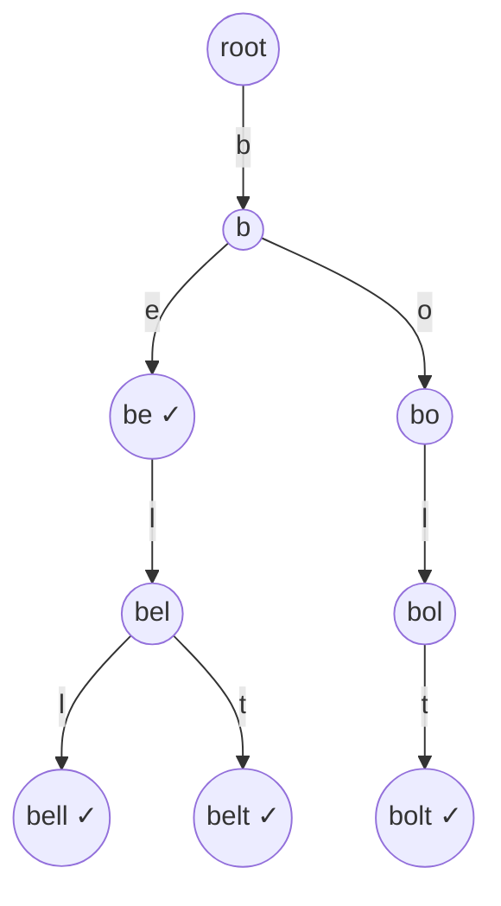

## Hook

A rider opens the Spoke app and types "Riv" into the station search box. The app checks every station name, one by one, to see which ones start with "Riv". With five stations, nobody notices. Spoke now plans thousands of stops, and the search box lags on every key press.

The same rider then asks: "Can I ride from Harbor to Depot on bike lanes only?" The city adds new lanes every week. Running a full graph search after each new lane is wasteful.

This ticket gives you two small, clever structures. A **trie** answers "which names start with this?" in a few steps. **Union-find** answers "are these two stations joined?" in almost no time, even while lanes keep arriving.

## Concept

### Two puzzles, two tools

Both puzzles have the same shape. Lots of small questions arrive, and each one must be answered fast.

- The search box asks about **prefixes**: the first few letters of a name.
- The lane map asks about **groups**: which stations can reach each other.

```callout jargon
A **prefix** is the start of a word. "Riv", "River" and "Riverside" are all prefixes of "Riverside". An empty prefix, "", is a prefix of every word.
```

A `HashSet` answers "is this exact name here?" quickly. It cannot answer "which names start with Riv?" without checking every name. A trie can.

### A trie: a tree of letters

```callout jargon
A **trie** (say "try", from re*trie*val) is a tree where each link is one letter. A word is the path of letters from the root down. It is also called a **prefix tree**.
```

Words that share a start share a path. Here is a trie for the bike parts `be`, `bell`, `belt` and `bolt`. A tick marks a node where a whole word ends.



The node for `bel` has no tick. `bel` is a path, but nobody stored it as a word. That tick is called the **end-of-word flag**, and forgetting it is the classic trie bug.

### Syntax: a trie node with an array of 26

When words use only the letters `a` to `z`, each node keeps an array of 26 child links. Slot 0 is `a`, slot 1 is `b`, and so on.

```java
class Node {
    Node[] children = new Node[26];
    boolean endsWord;
}
```

To find the slot for a letter, subtract `'a'`. A `char` is a number underneath, so `'c' - 'a'` is `2`.

```java nocompile
int i = c - 'a';
Node next = node.children[i];
```

### Syntax: a trie node with a Map

Station names have capitals and spaces, such as "Old Mill". An array of 26 has no slot for those. Use a `Map` from each character to its child instead.

```java nocompile
class Node {
    Map<Character, Node> children = new TreeMap<>();
    boolean endsWord;
}

node = node.children.computeIfAbsent(c, key -> new Node());
```

`computeIfAbsent(key, maker)` returns the child stored under `key`. If there is none, it calls `maker`, stores the new child, and returns it. A `TreeMap` keeps its keys sorted, which you will use for A to Z suggestions.

```callout tip
Gojo says: an array is faster and simpler when the alphabet is small and fixed. A Map handles any character and wastes no slots. Pick the one that fits the data.
```

### Insert, contains and startsWith

All three walk down from the root, one letter at a time.

```java nocompile
static void insert(String word) {
    Node node = root;
    for (char c : word.toCharArray()) {
        int i = c - 'a';
        if (node.children[i] == null) {
            node.children[i] = new Node();
        }
        node = node.children[i];
    }
    node.endsWord = true;
}
```

- **insert** makes any missing child as it goes. At the last letter it sets `endsWord = true`.
- **contains** follows the letters. A missing child means `false`. At the end, the answer is the node's `endsWord`.
- **startsWith** follows the letters the same way. Reaching the end usually means `true`, because nodes exist only on the paths of stored words. The one exception is the root: in an empty trie, the empty prefix reaches the root, but no word starts there. So check that the node ends a word or has children.

The difference between the last two is just the flag. With `bell` stored, `contains("bel")` is `false` but `startsWith("bel")` is `true`.

### Autocomplete: walk, then collect

Autocomplete has two steps. First, walk to the node for the prefix. Then visit everything below it and gather each word whose node has the flag set.

```animate
title: The search box suggests stations
kind: scene
nodes:
  - { id: root, label: root, emoji: "🌱", row: 0, col: 1 }
  - { id: h, label: h, emoji: "🔤", row: 1, col: 0 }
  - { id: u, label: u, emoji: "🔤", row: 1, col: 2 }
  - { id: a, label: ha, emoji: "🔤", row: 2, col: 0 }
  - { id: r, label: har, emoji: "🔤", row: 3, col: 0 }
  - { id: rest, label: "b-o-r ...", emoji: "📦", row: 3, col: 1, value: "below har" }
links:
  - { from: root, to: h }
  - { from: root, to: u }
  - { from: h, to: a }
  - { from: a, to: r }
  - { from: r, to: rest }
steps:
  - say: The trie holds Harbor, Harbor East and Uptown. The rider types "har". We start at the root.
    focus: [root]
  - say: The first letter is h, so we follow the h link. One step.
    focus: [h]
  - say: Next is a. We move to the child for a. Two steps.
    focus: [a]
  - say: Then r. Three letters took three steps, however many stations the trie holds.
    focus: [r]
  - say: Now we collect every word below this node. Harbor ends first, then Harbor East.
    focus: [rest]
    set: { rest: "Harbor, Harbor East" }
  - say: The u branch for Uptown was never touched. The trie skipped it without even looking.
    focus: [u]
```

### Syntax: collecting the words below a node

```java nocompile
static void collect(Node node, String soFar, List<String> out) {
    if (node.endsWord) {
        out.add(soFar);
    }
    for (int i = 0; i < 26; i++) {
        if (node.children[i] != null) {
            collect(node.children[i], soFar + (char) ('a' + i), out);
        }
    }
}
```

This is a depth-first walk, like the tree traversals you know. The word comes out sorted for two reasons. The node's own word is added before its children, so `be` comes before `bell`. The children are visited in letter order, slot 0 to 25. A `TreeMap` gives the same order with `children.values()`.

### How fast is a trie?

Say a word has `L` letters, and `n` words are stored.

| Operation | Time | Why |
|---|---|---|
| insert, contains, startsWith | O(L) | One step per letter. The number of words `n` does not matter |
| complete(prefix) | O(P + S) | `P` steps to reach the prefix, then `S` = the number of nodes below it. This holds when each end node keeps its whole word, as in this ticket's fix |
| prefix search in a `HashSet` | O(n × P) | It must check the start of every name |

The `collect` above builds `soFar + letter` at every node. Each of those makes a new String of up to `L` letters, so it costs up to O(S × L). Storing the word at its end node avoids that.

Space is the price. In the worst case a trie makes one node per letter of every word: O(total letters). An array node keeps 26 links even when it uses one. A `HashSet` stores each word once, with far less overhead per letter.

So use a trie when you ask many prefix questions, or when many words share starts. For a few exact lookups, a `HashSet` is smaller and simpler.

```callout tip
Gojo says: Java has no Trie class. For small lists, a sorted TreeSet can answer prefix questions too: names.subSet("Riv", "Riv" + Character.MAX_VALUE) gives every name starting with Riv, in O(log n) plus the matches.
```

### Union-find: groups that only merge

Now the lane map. Each station starts on its own. Each new lane joins two stations, and so joins their whole groups. Groups merge, but they never split.

```callout jargon
**Union-find**, also called a **disjoint set union** (DSU), keeps items in groups that do not overlap. It has two operations. **find** names an item's group. **union** merges two groups. In this ticket, union is called `connect`.
```

The trick is a `parent` array. Each station points at another station in its group. Follow the pointers up, and you reach the **root**: the one station that points at itself. The root is the group's name tag.

```java
public class Main {
    public static void main(String[] args) {
        int[] parent = {0, 0, 2, 2, 4};
        System.out.println(parent[1] + " " + parent[3]);
    }
}
```

Here Old Mill (1) points at Riverside (0), and Uptown (3) points at Harbor (2). So there are three groups: {0, 1}, {2, 3} and {4}. Two stations are connected exactly when they have the same root.

### Syntax: find with path compression

```java nocompile
static int find(int station) {
    int root = station;
    while (parent[root] != root) {
        root = parent[root];
    }
    while (parent[station] != root) {
        int next = parent[station];
        parent[station] = root;
        station = next;
    }
    return root;
}
```

The first loop climbs to the root. The second loop walks the same path again and points every station on it straight at the root.

```callout jargon
**Path compression** means pointing every item you passed straight at the root during `find`. The next `find` on any of them takes one step.
```

### Syntax: connect with union by size

```java nocompile
static boolean connect(int a, int b) {
    int rootA = find(a);
    int rootB = find(b);
    if (rootA == rootB) {
        return false;
    }
    if (size[rootA] < size[rootB]) {
        int swap = rootA;
        rootA = rootB;
        rootB = swap;
    }
    parent[rootB] = rootA;
    size[rootA] += size[rootB];
    groups--;
    return true;
}
```

`connect` always links two **roots**, never the two stations themselves. It hangs the smaller group under the larger one, so the trees stay short. It returns `false` when both were already in one group.

```callout jargon
**Union by size** means hanging the root of the smaller group under the root of the larger group. A close cousin, **union by rank**, compares rough tree heights instead. Both keep trees flat.
```

### Watch the groups merge

```animate
title: Lanes join stations into groups
kind: scene
nodes:
  - { id: riverside, label: Riverside, emoji: "🚲", value: "root, size 1" }
  - { id: oldmill, label: Old Mill, emoji: "🚲", value: "root, size 1" }
  - { id: harbor, label: Harbor, emoji: "🚲", value: "root, size 1" }
  - { id: uptown, label: Uptown, emoji: "🚲", value: "root, size 1" }
  - { id: depot, label: Depot, emoji: "🚲", value: "root, size 1" }
steps:
  - say: Every station starts as its own root, in a group of size 1. There are 5 groups.
    focus: [riverside, oldmill, harbor, uptown, depot]
  - say: A lane joins Riverside and Old Mill. Old Mill's parent becomes Riverside. 4 groups.
    send: { from: oldmill, to: riverside, label: parent }
    set: { oldmill: "parent Riverside", riverside: "root, size 2" }
  - say: A lane joins Harbor and Uptown. Uptown's parent becomes Harbor. 3 groups.
    send: { from: uptown, to: harbor, label: parent }
    set: { uptown: "parent Harbor", harbor: "root, size 2" }
  - say: A lane joins Old Mill and Uptown. Their roots are Riverside and Harbor, so we link the roots. 2 groups.
    send: { from: harbor, to: riverside, label: parent }
    set: { harbor: "parent Riverside", riverside: "root, size 4" }
  - say: find(Uptown) climbs Uptown, Harbor, Riverside. Path compression then points Uptown straight at Riverside.
    send: { from: uptown, to: riverside, label: "shortcut" }
    set: { uptown: "parent Riverside" }
  - say: A lane joins Riverside and Harbor. Both already have root Riverside, so connect returns false. That lane closes a loop.
    focus: [riverside, harbor]
  - say: Depot is still its own root. Harbor to Depot on lanes only? No, their roots differ.
    focus: [depot]
```

### How fast is union-find?

| Version | find and connect | Why |
|---|---|---|
| No tricks | O(n) | Bad luck builds one long chain, and `find` climbs all of it |
| Union by size only | O(log n) | A station only moves one level deeper when its group at least doubles in size |
| Both tricks | about O(1) amortised | Trees stay almost flat |

```callout jargon
**Amortised** cost is the average cost per operation over a long run. A single call may cost more, but the total stays low.
```

With both tricks, the exact bound is O(α(n)). Here α is the **inverse Ackermann function**. It grows so slowly that it stays at 4 or less for any number of items a computer could hold. Space is O(n): two `int` arrays.

```callout warning
Union-find cannot split a group. If lanes can close, union-find alone is the wrong tool. Rebuild it, or use a graph search such as BFS.
```

### Spotting a redundant lane

When `connect` returns `false`, the two stations could already reach each other. So the new lane closes a **loop** (also called a **cycle**). The city did not need it to join anything.

```java nocompile
for (int i = 0; i < lanes.length; i++) {
    if (!connect(lanes[i][0], lanes[i][1])) {
        return i;
    }
}
return -1;
```

This finds the first redundant lane in O(m) time for `m` lanes, ignoring the tiny α factor. Space is O(n) for the stations. A lane from a station to itself is always redundant, because a station already reaches itself.

### Kruskal: the cheapest lane network

The city wants every station joined, at the lowest total cost. A set of lanes that joins every station with no loop is a **spanning tree**. The cheapest one is the **minimum spanning tree** (MST).

```callout jargon
**Kruskal's algorithm** builds a minimum spanning tree. Sort the lanes by cost, cheapest first. Take each lane only if it joins two different groups. Skip it if it would close a loop.
```

```java nocompile
Arrays.sort(lanes, Comparator.comparingInt(lane -> lane[2]));
long total = 0;
for (int[] lane : lanes) {
    if (connect(lane[0], lane[1])) {
        total += lane[2];
    }
}
```

Kruskal is a **greedy** algorithm, like the ones from the last ticket: it always grabs the cheapest safe lane. Why is that safe? Say a cheapest network skipped that lane. Adding it would make a loop. Another lane on that loop also crosses between the same two groups, and it costs at least as much. Swap the two, and the cost does not go up. If more than one group is left at the end, no network can join every station. Time is O(m log m), because sorting the `m` lanes costs the most. Space is O(n + m).

### In an interview

Listen for these words in the problem:

- **Trie:** "prefix", "starts with", "autocomplete", "suggestions as you type", "a big dictionary of words".
- **Union-find:** "groups", "connected", "friend circles", "edges arrive one at a time", "does this edge make a cycle" in an undirected graph.

Classic problems that use them:

1. Build a trie with insert, search and startsWith.
2. Search suggestions: the first three words that start with what the user typed.
3. Word search on a letter grid, for many words at once. A trie of the words prunes dead paths.
4. Count the separate groups (provinces, islands that grow over time) as links arrive.
5. Find the redundant connection, and minimum cost to connect all points (Kruskal).

```callout tip
Gojo says: if the graph is fixed, BFS or DFS also counts groups. Union-find shines when edges keep arriving and you must answer after each one.
```

## Worked example

The repair crew keeps a parts list. This trie stores parts with only lowercase letters, so an array of 26 works.

```java run
import java.util.ArrayList;
import java.util.List;

public class Main {
    static class Node {
        Node[] children = new Node[26];
        boolean endsWord;
    }

    static Node root = new Node();

    static void insert(String word) {
        Node node = root;
        for (char c : word.toCharArray()) {
            int i = c - 'a';
            if (node.children[i] == null) {
                node.children[i] = new Node();
            }
            node = node.children[i];
        }
        node.endsWord = true;
    }

    static Node walk(String text) {
        Node node = root;
        for (char c : text.toCharArray()) {
            node = node.children[c - 'a'];
            if (node == null) {
                return null;
            }
        }
        return node;
    }

    static void collect(Node node, String soFar, List<String> out) {
        if (node.endsWord) {
            out.add(soFar);
        }
        for (int i = 0; i < 26; i++) {
            if (node.children[i] != null) {
                collect(node.children[i], soFar + (char) ('a' + i), out);
            }
        }
    }

    public static void main(String[] args) {
        for (String part : new String[] {"brake", "bell", "basket", "belt", "bolt", "be"}) {
            insert(part);
        }
        Node be = walk("be");
        List<String> out = new ArrayList<>();
        collect(be, "be", out);
        System.out.println("be -> " + out);
        System.out.println("contains bel? " + (walk("bel") != null && walk("bel").endsWord));
        System.out.println("starts with bel? " + (walk("bel") != null));
        System.out.println("starts with cha? " + (walk("cha") != null));
    }
}
```

It prints:

```text
be -> [be, bell, belt]
contains bel? false
starts with bel? true
starts with cha? false
```

Line by line:

- `insert` walks one letter at a time. `c - 'a'` turns the letter into a slot from 0 to 25. A missing child is made on the spot.
- After the last letter, `endsWord = true` marks a real word. `be` is stored, so its node gets the flag too.
- `walk` follows a prefix and returns its node, or `null` the moment a child is missing.
- `collect` adds the node's own word first, then visits children from `a` to `z`. That is why `be` comes before `bell`, and `bell` before `belt`.
- `bel` is a path but not a word, so `contains` says `false` and `startsWith` says `true`.
- No part starts with `c`, so `walk("cha")` returns `null` at the very first letter.

## Try it

Lanes arrive one by one. Run it, then add the lane `{3, 4}` at the end of `lanes` and see Harbor reach Depot.

```java run
public class Main {
    static String[] names = {"Riverside", "Old Mill", "Harbor", "Uptown", "Depot"};
    static int[] parent = {0, 1, 2, 3, 4};
    static int[] size = {1, 1, 1, 1, 1};
    static int groups = 5;

    static int find(int s) {
        int root = s;
        while (parent[root] != root) {
            root = parent[root];
        }
        while (parent[s] != root) {
            int next = parent[s];
            parent[s] = root;
            s = next;
        }
        return root;
    }

    static boolean connect(int a, int b) {
        int ra = find(a);
        int rb = find(b);
        if (ra == rb) {
            return false;
        }
        if (size[ra] < size[rb]) {
            int t = ra;
            ra = rb;
            rb = t;
        }
        parent[rb] = ra;
        size[ra] += size[rb];
        groups--;
        return true;
    }

    public static void main(String[] args) {
        int[][] lanes = {{0, 1}, {2, 3}, {1, 3}, {0, 2}};
        for (int[] lane : lanes) {
            String label = names[lane[0]] + " - " + names[lane[1]];
            if (connect(lane[0], lane[1])) {
                System.out.println(label + ": joined, " + groups + " groups left");
            } else {
                System.out.println(label + ": redundant, already connected");
            }
        }
        System.out.println("Harbor reaches Depot? " + (find(2) == find(4)));
    }
}
```

The first run prints that Riverside to Harbor is redundant, with 2 groups left. With the extra lane, the last line turns `true` and only 1 group is left.

## Recap

- A trie stores words as paths of letters from the root. Words with the same start share a path.
- An end-of-word flag marks where a stored word ends. Without it, every prefix looks like a word.
- Trie insert, contains and startsWith take O(L) for a word of `L` letters. Autocomplete walks to the prefix, then collects the words below it in sorted order.
- Union-find keeps groups in a parent array. `find` climbs to the root, and `connect` links two roots.
- Path compression plus union by size make each operation almost O(1). `connect` returning `false` reveals a loop, which also powers Kruskal's minimum spanning tree.

## Common mistakes

**1. Using an array of 26 for names with capitals or spaces.**

```java nocompile
for (char c : "Old Mill".toCharArray()) {
    int i = c - 'a';
    if (node.children[i] == null) {
        node.children[i] = new Node();
    }
    node = node.children[i];
}
```

The program crashes with `java.lang.ArrayIndexOutOfBoundsException: Index -18 out of bounds for length 26`. `'O' - 'a'` is `-18`, because capitals come before small letters. A space would give `-65`. Fix: use a `Map<Character, Node>` for real names, or lowercase each letter and allow only `a` to `z`.

**2. Treating any path as a stored word.**

```java nocompile
static boolean contains(String word) {
    return walk(word) != null;
}
```

With `bell` stored, `contains("bel")` returns `true`. The path exists, but `bel` was never stored. Fix: `Node node = walk(word); return node != null && node.endsWord;`. Only `startsWith` may ignore the flag.

**3. Linking the two stations instead of their roots.**

```java nocompile
static void connect(int a, int b) {
    parent[a] = b;
}
```

After `connect(0, 1)` and `connect(0, 2)`, it prints `Old Mill reaches Harbor? false`. The second call overwrote Riverside's link to Old Mill, so Old Mill fell out of the group. Fix: find both roots first, then set `parent[rootB] = rootA`.

**4. A recursive find on a long chain.**

```java nocompile
static int find(int s) {
    if (parent[s] == s) {
        return s;
    }
    parent[s] = find(parent[s]);
    return parent[s];
}
```

This short version does path compression. But without union by size, lanes can build a chain of 100,000 stations. The first `find` then recurses 100,000 deep and crashes with `java.lang.StackOverflowError`. Fix: always union by size. It keeps every station within 17 links of its root, even with 100,000 stations. Or use the two-loop `find`, which needs no recursion.
