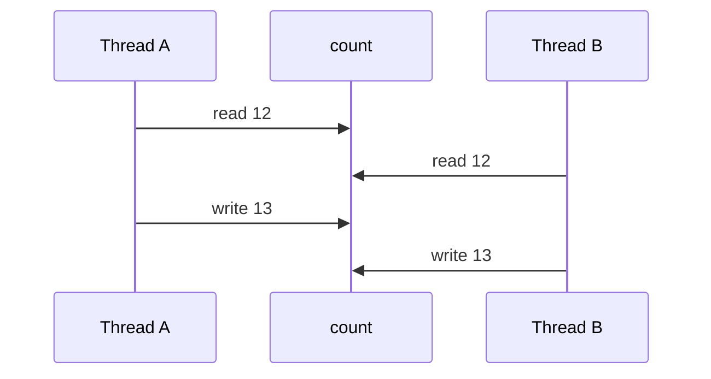

## Hook

Two friends share one notebook that holds a running total. Both read "12" at the same moment. Both add 1 in their heads. Both write "13". Two people added one each, yet the total only went up by one.

That is Itachi's ticket. Two riders tap the Harbor kiosk at the same moment. Both threads read "1 bike left". Both say yes. And the unlock counter loses taps the same way the notebook did.

## Concept

### A race condition

In the last topic you learned that threads share memory. Sharing is fast, but it has a cost. Two threads can change the same field at the same time and get in each other's way.

```callout jargon
A **race condition** is a bug where the result depends on which thread happens to run first. The threads "race", and the winner changes from run to run.
```

### Why count++ is not safe

`count++` looks like one step. It is really three:

1. Read `count` from memory.
2. Add 1.
3. Write the new value back.

Another thread can slip in between any two steps. If two threads both read 12, both write 13. One update is lost. This is called a **lost update**.



Run this program. Two threads each add 10,000.

```java run
public class Main {
    static int count = 0;

    public static void main(String[] args) throws InterruptedException {
        Runnable job = () -> {
            for (int i = 0; i < 10_000; i++) {
                count++;
            }
        };
        Thread a = new Thread(job);
        Thread b = new Thread(job);
        a.start();
        b.start();
        a.join();
        b.join();
        System.out.println("count = " + count);
    }
}
```

You expect 20000. You might see 15,328 or another number below 20,000. Run it again and the number changes. On some runs you may even get 20000 by luck. That luck is what makes races hard to find.

### Syntax: synchronized method

```java
class UnlockCounter {
    private int count = 0;

    synchronized void increment() {
        count++;
    }

    synchronized int get() {
        return count;
    }
}
```

`synchronized` means only one thread at a time may run a synchronized method on this object. A second thread that arrives must wait at the door until the first one leaves.

```callout jargon
Every Java object has a built-in **lock**, also called its **intrinsic lock**. A synchronized method takes the lock of `this` when it starts and gives it back when it ends. Only one thread can hold a lock at a time.
```

```callout analogy
The lock is like the key to a single bathroom at a café. You take the key, use the room, and hang the key back. Anyone else waits until the key is back on the hook.
```

Here is the race again with the fix:

```java run
public class Main {
    public static void main(String[] args) throws InterruptedException {
        UnlockCounter counter = new UnlockCounter();
        Runnable job = () -> {
            for (int i = 0; i < 10_000; i++) {
                counter.increment();
            }
        };
        Thread a = new Thread(job);
        Thread b = new Thread(job);
        a.start();
        b.start();
        a.join();
        b.join();
        System.out.println("count = " + counter.get());
    }
}

class UnlockCounter {
    private int count = 0;

    synchronized void increment() {
        count++;
    }

    synchronized int get() {
        return count;
    }
}
```

This prints `count = 20000` every time.

### Syntax: synchronized block

```java nocompile
synchronized (this) {
    count++;
}
```

A synchronized block locks only the lines inside the braces. The object in the brackets is the lock to take. Use a block when only a few lines of a longer method need protecting.

### Syntax: a private lock object

```java nocompile
private final Object lock = new Object();

void increment() {
    synchronized (lock) {
        count++;
    }
}
```

In real code, lock a private field instead of `this`. Any code that can see your object can also write `synchronized (dock)`. A stranger could then hold your lock and stall your methods. Nobody outside the class can reach a private lock object.

### Syntax: ReentrantLock

`java.util.concurrent.locks.ReentrantLock` is a lock you hold in a field and control by hand.

```java nocompile
private final ReentrantLock lock = new ReentrantLock();

void increment() {
    lock.lock();
    try {
        count++;
    } finally {
        lock.unlock();
    }
}
```

- `lock()` waits until the lock is free, then takes it.
- `unlock()` gives it back.
- Put `unlock()` in `finally`. Then the lock is given back even if the code inside throws an exception.

"Reentrant" means a thread that already holds the lock may take it again without blocking itself. Synchronized methods work the same way.

### Check-then-act

Itachi's double unlock is a second kind of race. The code checks a condition, then acts on it:

```java nocompile
if (bikes > 0) {     // check
    bikes--;         // act
}
```

Two threads can both pass the check when `bikes` is 1. Then both act, and `bikes` becomes -1. This is a **check-then-act** race. The fix is to put the check and the act inside the same lock, so no thread can slip in between.

### Deadlock

```callout warning
A **deadlock** happens when two threads each hold one lock and wait forever for the other's lock. Thread A holds lock 1 and wants lock 2. Thread B holds lock 2 and wants lock 1. Neither can move, and the program freezes.
```

The usual cause is two threads taking the same locks in opposite order. The fix is a fixed lock order: every thread takes the locks in the same order. For example, when moving credit between two rider wallets, always lock the wallet with the smaller id first.

### The four conditions for deadlock

A deadlock needs all four of these at once. Break any one and it cannot happen.

1. **Mutual exclusion**: a lock can be held by only one thread.
2. **Hold and wait**: a thread keeps one lock while it waits for another.
3. **No preemption**: nobody can take a lock away from the thread holding it.
4. **Circular wait**: thread A waits for B, and B waits for A, in a circle.

Locks need the first three to work at all. So in practice you break the fourth one. Give every lock a rank, and always take locks in rank order. Then no circle can form.

```java nocompile
void transfer(Wallet a, Wallet b, long cents) {
    Wallet low = a.id() < b.id() ? a : b;      // rank: the smaller id goes first
    Wallet high = (low == a) ? b : a;
    synchronized (low) {
        synchronized (high) {
            a.take(cents);
            b.add(cents);
        }
    }
}
```

Say rider 17 sends credit to rider 42 while rider 42 sends credit to rider 17. Both transfers lock wallet 17 first. One waits for the other, and nobody waits in a circle.

```animate
title: Two transfers, two wallets
kind: scene
nodes:
  - { id: t1, label: transfer-1, emoji: "💸", value: idle, row: 0, col: 0 }
  - { id: w17, label: wallet-17 lock, emoji: "🔒", value: free, row: 0, col: 2 }
  - { id: w42, label: wallet-42 lock, emoji: "🔒", value: free, row: 1, col: 2 }
  - { id: t2, label: transfer-2, emoji: "💸", value: idle, row: 1, col: 0 }
steps:
  - say: transfer-1 sends credit from wallet 17 to wallet 42. transfer-2 sends credit the other way.
    focus: [t1, t2]
  - say: transfer-1 takes the wallet-17 lock. At the same moment, transfer-2 takes the wallet-42 lock.
    send: [{ from: t1, to: w17, label: lock }, { from: t2, to: w42, label: lock }]
    set: { w17: transfer-1, w42: transfer-2 }
  - say: transfer-1 now asks for wallet 42. transfer-2 holds it, so transfer-1 waits.
    send: { from: t1, to: w42, label: lock? }
    set: { t1: BLOCKED }
  - say: transfer-2 asks for wallet 17. transfer-1 holds it, so transfer-2 waits too.
    send: { from: t2, to: w17, label: lock? }
    set: { t2: BLOCKED }
  - say: Each waits for the other, in a circle. Neither ever lets go. That is a deadlock.
    focus: [t1, t2]
  - say: The fix is lock order. If both transfers lock the smaller id first, the circle can never form.
    focus: [w17]
```

### Thread states

Every thread is in one state at a time. You see these names in thread dumps, so learn them now. `Thread.getState()` returns them as an enum.

| State | What the thread is doing |
|---|---|
| `NEW` | Created, but `start()` not called yet |
| `RUNNABLE` | Running, or ready to run when a core is free |
| `BLOCKED` | Waiting to enter a `synchronized` block that another thread holds |
| `WAITING` | Waiting with no time limit, for example in `join()` or `lock()` |
| `TIMED_WAITING` | Waiting with a time limit, for example in `Thread.sleep(100)` |
| `TERMINATED` | Finished |

Two threads stuck in `BLOCKED` forever, each holding what the other wants, is a deadlock. Threads stuck on a `ReentrantLock` show as `WAITING` instead.

### Finding a deadlock

A deadlocked program does not crash. It just stops doing anything. To see why, take a **thread dump**.

```callout jargon
A **thread dump** is a snapshot of every thread in a running JVM: its name, its state, the line it is on and the locks it holds.
```

Here is a real deadlock. Two transfers lock wallets 17 and 42 in opposite order. It never finishes, so do not run it in the app.

```java nocompile
public class WalletDeadlock {
    static final Wallet wallet17 = new Wallet(17);
    static final Wallet wallet42 = new Wallet(42);

    static void pause() {
        try { Thread.sleep(100); } catch (InterruptedException e) { Thread.currentThread().interrupt(); }
    }

    public static void main(String[] args) {
        new Thread(() -> {
            synchronized (wallet17) { pause(); synchronized (wallet42) { System.out.println("paid"); } }
        }, "transfer-1").start();
        new Thread(() -> {
            synchronized (wallet42) { pause(); synchronized (wallet17) { System.out.println("paid"); } }
        }, "transfer-2").start();
    }
}

record Wallet(long id) { }
```

While it hangs, open a second terminal. `jcmd` with no arguments lists the running Java programs and their process ids (pid). Then ask for a dump:

```bash
jcmd                       # find the pid, for example 53938 WalletDeadlock
jcmd 53938 Thread.print    # print every thread
jstack 53938               # an older tool that prints the same dump
```

At the end of the dump, the JVM has already found the circle for you:

```text
Found one Java-level deadlock:
=============================
"transfer-1":
  waiting to lock monitor 0x00000008f8cc49a0 (object 0x0000000312415f18, a Wallet),
  which is held by "transfer-2"

"transfer-2":
  waiting to lock monitor 0x00000008f8cc4a80 (object 0x0000000312415f00, a Wallet),
  which is held by "transfer-1"
```

Read it like a story: transfer-1 waits for a lock held by transfer-2, and transfer-2 waits for a lock held by transfer-1. Further down, each thread shows `BLOCKED (on object monitor)` and the exact source line. Named threads make this readable, which is one more reason to name them.

```callout tip
In production, take two or three dumps a few seconds apart. A thread that sits on the same line in every dump is stuck.
```

### Syntax: tryLock with a timeout

```java nocompile
if (lock.tryLock(200, TimeUnit.MILLISECONDS)) {
    try { /* work */ } finally { lock.unlock(); }
} else {
    // could not get the lock in time: give up or retry later
}
```

`synchronized` waits forever. A `ReentrantLock` can wait for a limited time instead. `tryLock` returns `true` if it got the lock, or `false` when time runs out. A thread that gives up can let go of the locks it already holds, so it never waits forever while holding them.

```java run
import java.util.concurrent.TimeUnit;
import java.util.concurrent.locks.ReentrantLock;

public class Main {
    public static void main(String[] args) throws InterruptedException {
        ReentrantLock wallet42 = new ReentrantLock();
        wallet42.lock();   // main holds the wallet-42 lock for the whole demo

        Thread transfer = new Thread(() -> {
            try {
                if (wallet42.tryLock(200, TimeUnit.MILLISECONDS)) {
                    try {
                        System.out.println("transfer-1 paid");
                    } finally {
                        wallet42.unlock();
                    }
                } else {
                    System.out.println("transfer-1: wallet 42 is busy, will retry later");
                }
            } catch (InterruptedException e) {
                Thread.currentThread().interrupt();
            }
        }, "transfer-1");

        transfer.start();
        transfer.join();
        wallet42.unlock();
    }
}
```

The transfer waits 200 milliseconds, then gives up instead of hanging forever. Lock order is still the first fix. `tryLock` is the safety net.

### Livelock, starvation and fair locks

Two more ways threads can get stuck without crashing:

```callout jargon
**Livelock**: threads keep reacting to each other, so none makes progress. Two transfers both give up, wait the same time and retry, again and again. Fix: wait a small random time before retrying.
```

```callout jargon
**Starvation**: one thread almost never gets the lock, because others keep grabbing it first. It is alive, but its work never happens.
```

By default, `synchronized` and `ReentrantLock` are unfair. A thread that just arrived may jump ahead of one that has waited a long time. That is faster overall. `new ReentrantLock(true)` makes a **fair** lock: the longest-waiting thread goes next. Fair locks are slower, so use them only when starvation is a real problem.

## Worked example

Here is a safe Harbor dock with one bike left and three riders tapping at once.

```java run
public class Main {
    public static void main(String[] args) throws InterruptedException {
        Dock harbor = new Dock("Harbor", 1);
        Thread[] riders = new Thread[3];
        for (int i = 0; i < riders.length; i++) {
            String rider = "rider-" + (i + 1);
            riders[i] = new Thread(() -> {
                if (harbor.tryUnlock()) {
                    System.out.println(rider + " got the bike");
                }
            });
            riders[i].start();
        }
        for (Thread t : riders) {
            t.join();
        }
        System.out.println("Bikes left: " + harbor.bikesLeft());
    }
}

class Dock {
    private final String station;
    private int bikes;

    Dock(String station, int bikes) {
        this.station = station;
        this.bikes = bikes;
    }

    synchronized boolean tryUnlock() {
        if (bikes > 0) {
            bikes--;
            return true;
        }
        return false;
    }

    synchronized int bikesLeft() {
        return bikes;
    }
}
```

Line by line:

1. `tryUnlock` is synchronized, so the check `bikes > 0` and the change `bikes--` happen while one thread holds the lock.
2. The first rider to get the lock takes the bike. The others find `bikes` at 0 and get `false`.
3. `bikesLeft` is synchronized too, so it always reads the latest value. Without the lock, a thread could see an old value. The [Java Memory Model ticket](/t/module-05-advanced-java/topic-14-memory-model), later in this module, explains why.
4. `main` joins every rider before printing the count.

Exactly one rider gets the bike. Which rider wins can change between runs. `Bikes left: 0` is always the last line.

## Try it

In the worked example, change the dock to hold 2 bikes and start 10 riders. Count the "got the bike" lines. Then remove `synchronized` from `tryUnlock` and run it many times. Most runs still look right, which is why races slip into production.

## Recap

- A race condition is a bug whose result depends on thread timing. `count++` is read, add, write, so two threads can lose updates.
- `synchronized` lets one thread at a time hold an object's intrinsic lock.
- `ReentrantLock` does the same by hand: call `lock()`, and `unlock()` in `finally`.
- Keep a check and its act under one lock, and lock a private object rather than `this`.
- Deadlock needs a circle of waiting threads. Take locks in a fixed order, find a hang with `jcmd <pid> Thread.print`, and use `tryLock` with a timeout as a safety net.

## Common mistakes

### Leaving one method unsynchronized

```java
class UnlockCounter {
    private int count = 0;

    void increment() {
        count++;
    }

    synchronized int get() {
        return count;
    }
}
```

With 8 threads each calling `increment()` 10,000 times, `get()` returns a number below 80,000 on most runs. A lock only helps if every method that touches the field takes it. Fix: add `synchronized` to `increment()` too.

### Unlocking outside finally

```java
import java.util.concurrent.locks.ReentrantLock;

class Counter {
    private final ReentrantLock lock = new ReentrantLock();
    private int count = 0;

    void add(int amount) {
        lock.lock();
        if (amount < 0) {
            throw new IllegalArgumentException("negative");
        }
        count += amount;
        lock.unlock();
    }
}
```

After one exception the lock is never given back. The next thread that calls `add` waits forever and the program freezes. Fix: wrap the work in `try { ... } finally { lock.unlock(); }`.

### Locking the check and the act separately

```java
class Dock {
    private int bikes = 1;

    synchronized boolean hasBike() {
        return bikes > 0;
    }

    synchronized void take() {
        bikes--;
    }

    boolean tryUnlock() {
        if (hasBike()) {
            take();
            return true;
        }
        return false;
    }
}
```

Each method is safe on its own. Between `hasBike()` and `take()`, another thread can take the last bike, so `bikes` can drop to -1 and two riders get `true`. Fix: make `tryUnlock` itself synchronized, so the check and the act share one lock.
