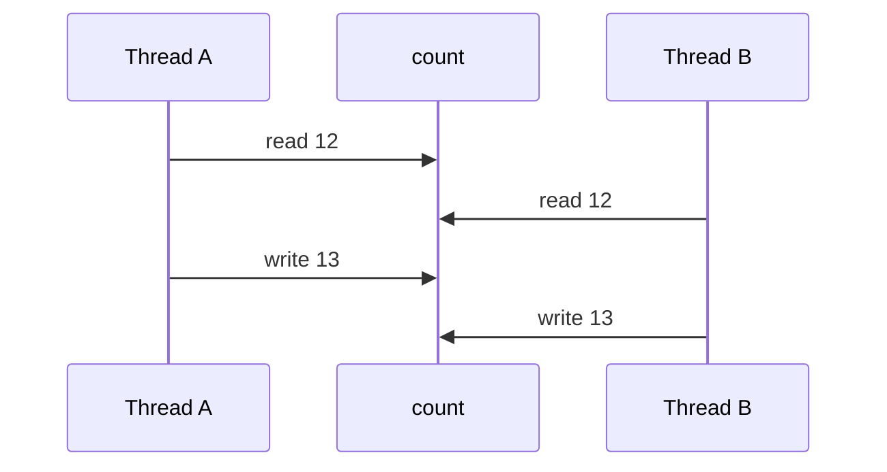

## Hook

Two friends share one notebook that holds a running total. Both read "12" at the same moment. Both add 1 in their heads. Both write "13". Two people added one each, yet the total only went up by one.

That is Itachi's ticket. Two riders tap the Harbor kiosk at the same moment. Both threads read "1 bike left". Both say yes. And the unlock counter loses taps the same way the notebook did.

## Concept

### A race condition

In the last topic you learned that threads share memory. Sharing is fast, but it has a cost. Two threads can change the same field at the same time and get in each other's way.

```callout jargon
A **race condition** is a bug where the result depends on which thread happens to run first. The threads "race", and the winner changes from run to run.
```

### Why count++ is not safe

`count++` looks like one step. It is really three:

1. Read `count` from memory.
2. Add 1.
3. Write the new value back.

Another thread can slip in between any two steps. If two threads both read 12, both write 13. One update is lost. This is called a **lost update**.



Run this program. Two threads each add 10,000.

```java run
public class Main {
    static int count = 0;

    public static void main(String[] args) throws InterruptedException {
        Runnable job = () -> {
            for (int i = 0; i < 10_000; i++) {
                count++;
            }
        };
        Thread a = new Thread(job);
        Thread b = new Thread(job);
        a.start();
        b.start();
        a.join();
        b.join();
        System.out.println("count = " + count);
    }
}
```

You expect 20000. You might see 15,328 or another number below 20,000. Run it again and the number changes. On some runs you may even get 20000 by luck. That luck is what makes races hard to find.

### Syntax: synchronized method

```java
class UnlockCounter {
    private int count = 0;

    synchronized void increment() {
        count++;
    }

    synchronized int get() {
        return count;
    }
}
```

`synchronized` means only one thread at a time may run a synchronized method on this object. A second thread that arrives must wait at the door until the first one leaves.

```callout jargon
Every Java object has a built-in **lock**, also called its **intrinsic lock**. A synchronized method takes the lock of `this` when it starts and gives it back when it ends. Only one thread can hold a lock at a time.
```

```callout analogy
The lock is like the key to a single bathroom at a café. You take the key, use the room, and hang the key back. Anyone else waits until the key is back on the hook.
```

Here is the race again with the fix:

```java run
public class Main {
    public static void main(String[] args) throws InterruptedException {
        UnlockCounter counter = new UnlockCounter();
        Runnable job = () -> {
            for (int i = 0; i < 10_000; i++) {
                counter.increment();
            }
        };
        Thread a = new Thread(job);
        Thread b = new Thread(job);
        a.start();
        b.start();
        a.join();
        b.join();
        System.out.println("count = " + counter.get());
    }
}

class UnlockCounter {
    private int count = 0;

    synchronized void increment() {
        count++;
    }

    synchronized int get() {
        return count;
    }
}
```

This prints `count = 20000` every time.

### Syntax: synchronized block

```java nocompile
synchronized (this) {
    count++;
}
```

A synchronized block locks only the lines inside the braces. The object in the brackets is the lock to take. Use a block when only a few lines of a longer method need protecting.

### Syntax: ReentrantLock

`java.util.concurrent.locks.ReentrantLock` is a lock you hold in a field and control by hand.

```java nocompile
private final ReentrantLock lock = new ReentrantLock();

void increment() {
    lock.lock();
    try {
        count++;
    } finally {
        lock.unlock();
    }
}
```

- `lock()` waits until the lock is free, then takes it.
- `unlock()` gives it back.
- Put `unlock()` in `finally`. Then the lock is given back even if the code inside throws an exception.

"Reentrant" means a thread that already holds the lock may take it again without blocking itself. Synchronized methods work the same way.

### Check-then-act

Itachi's double unlock is a second kind of race. The code checks a condition, then acts on it:

```java nocompile
if (bikes > 0) {     // check
    bikes--;         // act
}
```

Two threads can both pass the check when `bikes` is 1. Then both act, and `bikes` becomes -1. This is a **check-then-act** race. The fix is to put the check and the act inside the same lock, so no thread can slip in between.

### Deadlock

```callout warning
A **deadlock** happens when two threads each hold one lock and wait forever for the other's lock. Thread A holds lock 1 and wants lock 2. Thread B holds lock 2 and wants lock 1. Neither can move, and the program freezes.
```

The usual cause is two threads taking the same locks in opposite order. The fix is a fixed lock order: every thread takes the locks in the same order. For example, when moving a bike between Harbor and Uptown, always lock the dock whose name comes first in the alphabet.

## Worked example

Here is a safe Harbor dock with one bike left and three riders tapping at once.

```java run
public class Main {
    public static void main(String[] args) throws InterruptedException {
        Dock harbor = new Dock("Harbor", 1);
        Thread[] riders = new Thread[3];
        for (int i = 0; i < riders.length; i++) {
            String rider = "rider-" + (i + 1);
            riders[i] = new Thread(() -> {
                if (harbor.tryUnlock()) {
                    System.out.println(rider + " got the bike");
                }
            });
            riders[i].start();
        }
        for (Thread t : riders) {
            t.join();
        }
        System.out.println("Bikes left: " + harbor.bikesLeft());
    }
}

class Dock {
    private final String station;
    private int bikes;

    Dock(String station, int bikes) {
        this.station = station;
        this.bikes = bikes;
    }

    synchronized boolean tryUnlock() {
        if (bikes > 0) {
            bikes--;
            return true;
        }
        return false;
    }

    synchronized int bikesLeft() {
        return bikes;
    }
}
```

Line by line:

1. `tryUnlock` is synchronized, so the check `bikes > 0` and the change `bikes--` happen while one thread holds the lock.
2. The first rider to get the lock takes the bike. The others find `bikes` at 0 and get `false`.
3. `bikesLeft` is synchronized too, so it always reads the latest value.
4. `main` joins every rider before printing the count.

Exactly one rider gets the bike. Which rider wins can change between runs. `Bikes left: 0` is always the last line.

## Try it

In the worked example, change the dock to hold 2 bikes and start 10 riders. Count the "got the bike" lines. Then remove `synchronized` from `tryUnlock` and run it many times. Most runs still look right, which is why races slip into production.

## Recap

- A race condition is a bug whose result depends on thread timing.
- `count++` is read, add, write. Two threads can lose updates.
- `synchronized` lets one thread at a time hold an object's intrinsic lock.
- `ReentrantLock` does the same by hand: call `lock()`, and `unlock()` in `finally`.
- Keep a check and its act under one lock. Take several locks in a fixed order to avoid deadlock.

## Common mistakes

### Leaving one method unsynchronized

```java
class UnlockCounter {
    private int count = 0;

    void increment() {
        count++;
    }

    synchronized int get() {
        return count;
    }
}
```

With 8 threads each calling `increment()` 10,000 times, `get()` returns a number below 80,000 on most runs. A lock only helps if every method that touches the field takes it. Fix: add `synchronized` to `increment()` too.

### Unlocking outside finally

```java
import java.util.concurrent.locks.ReentrantLock;

class Counter {
    private final ReentrantLock lock = new ReentrantLock();
    private int count = 0;

    void add(int amount) {
        lock.lock();
        if (amount < 0) {
            throw new IllegalArgumentException("negative");
        }
        count += amount;
        lock.unlock();
    }
}
```

After one exception the lock is never given back. The next thread that calls `add` waits forever and the program freezes. Fix: wrap the work in `try { ... } finally { lock.unlock(); }`.

### Locking the check and the act separately

```java
class Dock {
    private int bikes = 1;

    synchronized boolean hasBike() {
        return bikes > 0;
    }

    synchronized void take() {
        bikes--;
    }

    boolean tryUnlock() {
        if (hasBike()) {
            take();
            return true;
        }
        return false;
    }
}
```

Each method is safe on its own. Between `hasBike()` and `take()`, another thread can take the last bike, so `bikes` can drop to -1 and two riders get `true`. Fix: make `tryUnlock` itself synchronized, so the check and the act share one lock.
