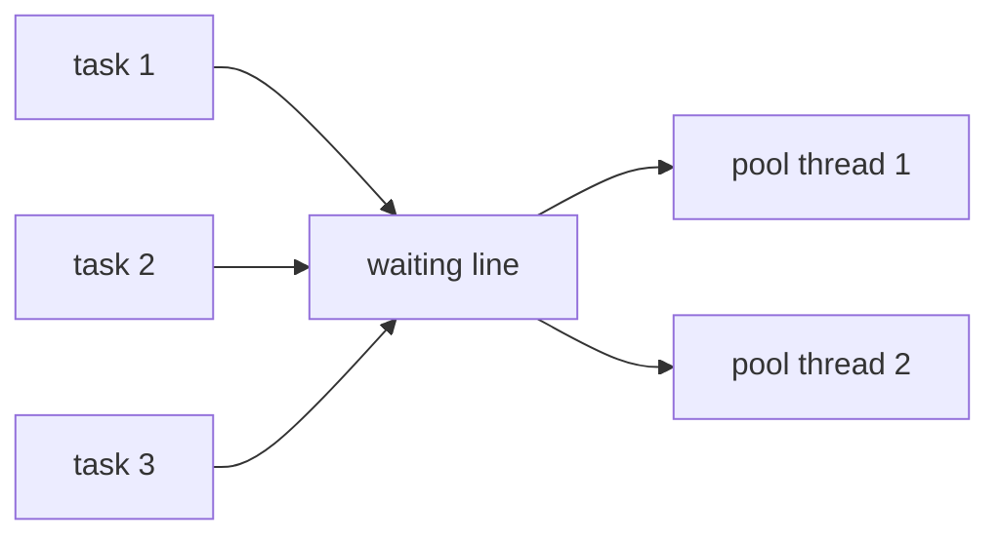

## Hook

Picture a pizza shop that hires a new cook for every single order. Each cook needs an apron, a locker and a quick training. Then the cook makes one pizza and goes home. On a busy Friday the shop fills with cooks and runs out of lockers.

A smart shop keeps four cooks. Orders wait on a rail, and each free cook grabs the next one. That is exactly what Jiraiya's ticket needs. Your sensor check starts a new thread for every dock. With 60 docks, every few seconds, the kiosk slows to a crawl.

## Concept

### Why one thread per task is costly

A thread is not free. Each one gets its own **stack**, a block of memory that holds the method calls it is running. Starting a thread also asks the operating system for work. Ending it throws all of that away.

For 12 docks this cost hardly matters. For 60 docks, every few seconds, at rush hour, it adds up fast.

```callout jargon
A **thread pool** is a fixed group of threads that stay alive and run task after task. A **task** is one piece of work, such as "read the sensor on dock Harbor-3".
```

### ExecutorService

Java gives you thread pools through the interface `ExecutorService` in the package `java.util.concurrent`. You hand it tasks. It decides which pool thread runs each one.



Tasks wait in a line, called a **queue**. Each free pool thread takes the next task from the front.

### Syntax: Executors.newFixedThreadPool

```java nocompile
ExecutorService pool = Executors.newFixedThreadPool(4);
```

- `Executors` is a helper class with ready-made pools.
- `newFixedThreadPool(4)` makes a pool with exactly 4 threads.
- 60 tasks still work. They just wait their turn.

### Syntax: submit with a Runnable

```java nocompile
pool.submit(() -> System.out.println("checking Harbor-1"));
```

A `Runnable` from the threads topic takes nothing and gives nothing back. `submit` puts it in the queue and returns straight away.

### Syntax: shutdown and awaitTermination

```java nocompile
pool.shutdown();
pool.awaitTermination(5, TimeUnit.SECONDS);
```

- `shutdown()` says "take no new tasks". Tasks already in the queue still run.
- `awaitTermination(5, TimeUnit.SECONDS)` waits until every task has finished, or until 5 seconds pass.

Pool threads stay alive and wait for more work. If you never shut the pool down, your program never ends.

### Syntax: try-with-resources on ExecutorService

```java nocompile
try (ExecutorService pool = Executors.newFixedThreadPool(4)) {
    pool.submit(() -> System.out.println("checking Harbor-1"));
}
```

You met try-with-resources with files in module 3. Since Java 19, so in your Java 21, an `ExecutorService` works the same way. At the closing brace Java calls `close()`. That method shuts the pool down and **waits** for every task to finish.

```java run
import java.util.concurrent.ExecutorService;
import java.util.concurrent.Executors;

public class Main {
    public static void main(String[] args) {
        try (ExecutorService pool = Executors.newFixedThreadPool(2)) {
            for (int dock = 1; dock <= 6; dock++) {
                String id = "Harbor-" + dock;
                pool.submit(() -> System.out.println(id + " on " + Thread.currentThread().getName()));
            }
        }
        System.out.println("all docks checked");
    }
}
```

Six tasks run on only two threads, named like `pool-1-thread-1` and `pool-1-thread-2`. The order of the lines changes between runs. The last line always comes last, because `close()` waited.

### Syntax: Callable and Future

```java nocompile
Callable<String> task = () -> "Harbor-1: ok";
Future<String> future = pool.submit(task);
String result = future.get();
```

- A `Callable<String>` is like a `Runnable` that **returns** a value, here a `String`. Unlike `run()`, `call()` may throw a checked exception.
- `submit` gives back a `Future<String>`. A **future** is a receipt for a result that may not exist yet.
- `get()` waits until the task is done, then hands you the result.

```callout analogy
A `Future` is the buzzer a café gives you. You can sit down and do other things. When you call `get()`, you walk to the counter and wait there until your coffee is ready.
```

`get()` can throw two **checked exceptions**: `InterruptedException` and `ExecutionException`. So the method that calls it must catch them or declare them with `throws`.

### Syntax: invokeAll

```java nocompile
List<Callable<String>> tasks = List.of(() -> "Old Mill-1: ok", () -> "Old Mill-2: ok");
List<Future<String>> futures = pool.invokeAll(tasks);
```

`invokeAll` submits a whole list of callables and waits until all are done. The futures come back in the same order as the tasks.

### Syntax: an exception inside a task

```java nocompile
try {
    String line = future.get();
} catch (ExecutionException e) {
    Throwable real = e.getCause();
}
```

When a task throws, the pool thread does not crash. The pool stores the exception inside the future. Later, `get()` throws an `ExecutionException` that wraps it. `getCause()` gives you the original exception back.

```java run
import java.util.concurrent.ExecutionException;
import java.util.concurrent.ExecutorService;
import java.util.concurrent.Executors;
import java.util.concurrent.Future;

public class Main {
    public static void main(String[] args) throws InterruptedException {
        try (ExecutorService pool = Executors.newFixedThreadPool(2)) {
            Future<String> broken = pool.submit(() -> {
                if (true) {
                    throw new IllegalStateException("sensor offline");
                }
                return "Harbor-X: ok";
            });
            try {
                System.out.println(broken.get());
            } catch (ExecutionException e) {
                System.out.println("wrapper: " + e.getClass().getSimpleName());
                System.out.println("cause: " + e.getCause().getMessage());
            }
        }
    }
}
```

### submit hides exceptions nobody reads

The future keeps the exception until someone calls `get()`. So if nobody ever calls `get()`, nobody ever sees the error. No message, no stack trace, nothing in the logs.

```java run
import java.util.concurrent.ExecutorService;
import java.util.concurrent.Executors;

public class Main {
    public static void main(String[] args) {
        Runnable broken = () -> {
            throw new IllegalStateException("sensor offline");
        };
        try (ExecutorService pool = Executors.newFixedThreadPool(2)) {
            pool.submit(broken);
        }
        System.out.println("done, and no error anywhere");
    }
}
```

This is a classic production bug. A nightly job "runs" for weeks, but every task fails in silence. `execute(job)` is the other way to hand a `Runnable` to a pool. It returns nothing, so the exception is not stored. It escapes the pool thread, and Java prints it. Swap `pool.submit(broken)` for `pool.execute(broken)` and you get a real run's output like this:

```text
Exception in thread "pool-1-thread-1" java.lang.IllegalStateException: sensor offline
	at Main.lambda$main$0(Main.java:7)
	at java.base/java.util.concurrent.ThreadPoolExecutor.runWorker(ThreadPoolExecutor.java:1144)
```

The rule: if you `submit`, always call `get()` on the future, or catch and log inside the task. For fire-and-forget jobs, `execute` at least shows the error.

### Syntax: get with a timeout

```java nocompile
String line = future.get(200, TimeUnit.MILLISECONDS);
```

Plain `get()` waits forever. If a sensor never answers, the kiosk hangs with it. `get(time, unit)` waits at most that long, then throws `TimeoutException`. Every call to something slow, like a network, deserves a time limit.

```java run
import java.util.concurrent.ExecutionException;
import java.util.concurrent.ExecutorService;
import java.util.concurrent.Executors;
import java.util.concurrent.Future;
import java.util.concurrent.TimeUnit;
import java.util.concurrent.TimeoutException;

public class Main {
    public static void main(String[] args) throws InterruptedException, ExecutionException {
        try (ExecutorService pool = Executors.newFixedThreadPool(2)) {
            Future<String> check = pool.submit(() -> {
                Thread.sleep(5_000);   // the Depot-7 sensor never answers in time
                return "Depot-7: ok";
            });
            try {
                System.out.println(check.get(200, TimeUnit.MILLISECONDS));
            } catch (TimeoutException e) {
                System.out.println("Depot-7: no answer in 200 ms");
                check.cancel(true);    // true: interrupt the thread running it
            }
            System.out.println("cancelled: " + check.isCancelled());
        }
    }
}
```

A timeout only stops *you* waiting. The task keeps running on its pool thread. `cancel(true)` interrupts that thread, and `Thread.sleep` wakes up with `InterruptedException`. Without the cancel, the pool's `close()` would wait the full 5 seconds.

### Shutting down and timeouts

Try-with-resources waits forever for tasks to finish. A server that is shutting down cannot wait forever. Here is the standard three-step shutdown:

```java run
import java.util.concurrent.ExecutorService;
import java.util.concurrent.Executors;
import java.util.concurrent.TimeUnit;

public class Main {
    public static void main(String[] args) throws InterruptedException {
        ExecutorService pool = Executors.newFixedThreadPool(1);
        pool.submit(() -> {
            try {
                Thread.sleep(5_000);   // a sensor that hangs
                System.out.println("slow check finished");
            } catch (InterruptedException e) {
                System.out.println("slow check interrupted");
                Thread.currentThread().interrupt();
            }
        });
        pool.submit(() -> System.out.println("Harbor-2 checked"));

        pool.shutdown();                                            // 1. take no new tasks
        if (!pool.awaitTermination(200, TimeUnit.MILLISECONDS)) {   // 2. wait a little
            int neverStarted = pool.shutdownNow().size();           // 3. interrupt the rest
            pool.awaitTermination(1, TimeUnit.SECONDS);
            System.out.println("tasks that never started: " + neverStarted);
        }
        System.out.println("pool stopped: " + pool.isTerminated());
    }
}
```

1. `shutdown()` refuses new tasks but lets queued ones run.
2. `awaitTermination` returns a `boolean`. `false` means time ran out. Always check it. Giving up waiting stops nothing: the slow task is still running.
3. `shutdownNow()` interrupts every running task and hands back the tasks that never started. Here `Harbor-2` never got a turn.

```callout warning
`shutdownNow()` can only ask. A task that ignores interrupts, such as one with an empty `catch (InterruptedException e) {}`, keeps running anyway.
```

### Production thread pools

`Executors.newFixedThreadPool(4)` hides a trap. Its waiting line is **unbounded**: it has no size limit. If tasks arrive faster than 4 threads can finish them, the queue just grows. At rush hour it can hold millions of tasks, and the JVM runs out of memory.

Real servers build the pool by hand with `ThreadPoolExecutor`, so every limit is visible:

```java nocompile
new ThreadPoolExecutor(
    4, 8,                               // core threads, max threads
    30, TimeUnit.SECONDS,               // idle time before extra threads stop
    new ArrayBlockingQueue<>(100),      // a bounded queue: at most 100 tasks wait
    threadFactory,                      // makes (and names) the threads
    new ThreadPoolExecutor.CallerRunsPolicy());   // what to do when everything is full
```

The pool keeps 4 **core** threads. New tasks wait in the queue. Only when the queue is full does it add threads, up to 8. When the queue and all 8 threads are full, the **rejection policy** decides:

- `AbortPolicy` (the default) throws `RejectedExecutionException`.
- `CallerRunsPolicy` runs the task on the thread that submitted it. That slows the sender down, which is often what you want.
- `DiscardPolicy` drops the task without a word. Avoid it unless losing work is fine.

```java run
import java.util.concurrent.ArrayBlockingQueue;
import java.util.concurrent.RejectedExecutionException;
import java.util.concurrent.ThreadPoolExecutor;
import java.util.concurrent.TimeUnit;

public class Main {
    public static void main(String[] args) throws InterruptedException {
        ThreadPoolExecutor pool = new ThreadPoolExecutor(
                2, 2, 30, TimeUnit.SECONDS,
                new ArrayBlockingQueue<>(2),
                new ThreadPoolExecutor.AbortPolicy());
        Runnable slowCheck = () -> {
            try {
                Thread.sleep(300);
            } catch (InterruptedException e) {
                Thread.currentThread().interrupt();
            }
        };
        for (int dock = 1; dock <= 5; dock++) {
            try {
                pool.execute(slowCheck);
                System.out.println("Harbor-" + dock + " accepted");
            } catch (RejectedExecutionException e) {
                System.out.println("Harbor-" + dock + " rejected: pool and queue are full");
            }
        }
        pool.shutdown();
        pool.awaitTermination(5, TimeUnit.SECONDS);
    }
}
```

Two threads take docks 1 and 2. Docks 3 and 4 wait in the queue. Dock 5 has nowhere to go. A clear "no" is better than a server that slowly fills its memory.

### How many threads?

The right pool size depends on what the tasks do.

- **CPU work** (maths, sorting): about one thread per core. More threads only add context switches.
- **Waiting work** (network, database): threads spend most of their time idle, so you can run more.

A handy rule of thumb:

```text
threads ≈ cores × (1 + wait time / compute time)
```

Say a sensor check computes for 10 ms and waits 90 ms for the network, on 8 cores. That gives 8 × (1 + 90 / 10) = 80 threads. Treat the answer as a starting point, then measure under real load. `Runtime.getRuntime().availableProcessors()` tells your program how many cores it has.

### Syntax: naming pool threads

```java nocompile
ThreadFactory names = Thread.ofPlatform().name("sensor-", 1).factory();
ExecutorService pool = Executors.newFixedThreadPool(4, names);
```

```callout jargon
A **ThreadFactory** is an object the pool asks whenever it needs a new thread. You use it to give the threads clear names.
```

`name("sensor-", 1)` names the threads `sensor-1`, `sensor-2` and so on. In a thread dump or a log line, `sensor-3` tells you at once which pool is stuck. `pool-7-thread-3` tells you nothing.

## Worked example

Here is a small version of the sensor check. It uses a pool of 3 threads for 5 Uptown docks and keeps the results in order.

```java run
import java.util.ArrayList;
import java.util.List;
import java.util.concurrent.ExecutionException;
import java.util.concurrent.ExecutorService;
import java.util.concurrent.Executors;
import java.util.concurrent.Future;

public class Main {
    static String readSensor(String dockId) {
        return dockId + ": ok";
    }

    public static void main(String[] args) throws InterruptedException, ExecutionException {
        List<String> docks = List.of("Uptown-1", "Uptown-2", "Uptown-3", "Uptown-4", "Uptown-5");
        List<Future<String>> futures = new ArrayList<>();
        try (ExecutorService pool = Executors.newFixedThreadPool(3)) {
            for (String id : docks) {
                futures.add(pool.submit(() -> readSensor(id)));
            }
            for (Future<String> f : futures) {
                System.out.println(f.get());
            }
        }
    }
}
```

Line by line:

1. `readSensor` stands in for the slow network call.
2. The `try` line makes a pool of 3 threads and promises to close it.
3. The first loop submits one callable per dock. Each `submit` returns at once, so all 5 tasks are queued quickly.
4. The `Future` for each dock goes into `futures`, in the same order as `docks`.
5. The second loop calls `get()` on each future in that order. The tasks may finish in any order, but you read them in list order.
6. At the closing brace, `close()` waits for the pool and shuts it down.

The output is always `Uptown-1: ok` to `Uptown-5: ok`, top to bottom.

## Try it

Run the worked example. Then change the pool size from 3 to 1 and run it again. The output stays the same, because one thread can still do all 5 tasks one by one. Next, add `Thread.currentThread().getName()` to the text `readSensor` returns and look at the thread names.

```callout tip
For CPU work, use about one thread per core. Slow network work can use more, and topic 05 shows a better tool.
```

## Recap

- A pool reuses a few threads. `Executors.newFixedThreadPool(n)` makes one, but its queue has no limit. Production pools use `ThreadPoolExecutor` with a bounded queue, a rejection policy and named threads.
- `submit` takes a `Runnable` or a `Callable` and returns a `Future`. `get()` waits for the result. `invokeAll` runs a list of callables and returns their futures in order.
- Always shut a pool down: `shutdown`, `awaitTermination` (check the boolean), then `shutdownNow`. Give every `get()` a timeout.
- An exception inside a task comes out of `get()` as an `ExecutionException`. If nobody calls `get()`, the error vanishes.

## Common mistakes

**Forgetting to shut the pool down.**

```java
import java.util.concurrent.ExecutorService;
import java.util.concurrent.Executors;

public class Main {
    public static void main(String[] args) {
        ExecutorService pool = Executors.newFixedThreadPool(2);
        pool.submit(() -> System.out.println("Riverside-1: ok"));
    }
}
```

The program prints `Riverside-1: ok` and then never ends. The pool threads keep waiting for more work. Fix it with `try (ExecutorService pool = ...) { ... }`, or call `pool.shutdown()` when you are done.

**Calling get() without handling its exceptions.**

```java nocompile
public static void main(String[] args) {
    try (ExecutorService pool = Executors.newFixedThreadPool(2)) {
        Future<String> f = pool.submit(() -> "Riverside-1: ok");
        System.out.println(f.get());
    }
}
```

Java says: `unreported exception InterruptedException; must be caught or declared to be thrown`. Add `throws InterruptedException, ExecutionException` to the method, or wrap the call in `try` and `catch`.

**Catching the task's own exception around get().**

```java nocompile
try {
    System.out.println(broken.get());
} catch (IllegalStateException e) {
    System.out.println("failed");
}
```

The catch never runs. The program crashes with `Exception in thread "main" java.util.concurrent.ExecutionException: java.lang.IllegalStateException: sensor offline`. `get()` throws the wrapper. Catch `ExecutionException` and read `e.getCause()`.
