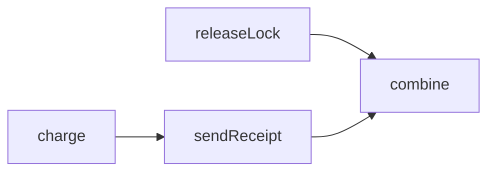

## Hook

Imagine ordering lunch at a food court. You pay at one counter, then walk to the drinks stand, then wait for your receipt. Each step waits for the one before. A smarter plan: a friend gets the drinks while you pay. You both finish sooner.

Tsunade's ticket is the same problem. Unlocking a bike calls payment, then the lock, then the receipt service, one after another. Payment is slow at rush hour, so the lock sits idle. You want payment and the lock to run at the same time.

## Concept

### What CompletableFuture adds

In the executors topic, a `Future` gave you a result later. The only way to use it was `get()`, which blocks. **Blocks** means the thread stops and waits.

A `CompletableFuture` is a future you can attach the next steps to. You say "when payment is done, send the receipt". No thread has to sit and wait in between.

```callout jargon
**Asynchronous** (async) means "started now, finished later, on another thread". The code that started the work keeps going instead of waiting.
```

### Syntax: supplyAsync

```java nocompile
CompletableFuture<String> payment = CompletableFuture.supplyAsync(() -> charge("r1"));
```

- `supplyAsync` takes a `Supplier`, the functional interface with `get()` from module 3.
- It runs the supplier on another thread and returns at once.
- The result type matches what the supplier returns, here a `String`.

### Syntax: join and get

```java nocompile
String id = payment.join();
```

`join()` waits for the result and returns it. `get()` does the same, but it throws the checked exceptions `InterruptedException` and `ExecutionException`. `join()` throws an unchecked `CompletionException` instead, so you need no `try` block.

```java run
import java.util.concurrent.CompletableFuture;

public class Main {
    public static void main(String[] args) {
        CompletableFuture<String> payment = CompletableFuture.supplyAsync(() -> "P-r1");
        System.out.println("asked for payment");
        System.out.println("payment id: " + payment.join());
    }
}
```

### Syntax: thenApply

```java nocompile
CompletableFuture<Integer> length = payment.thenApply(id -> id.length());
```

`thenApply` changes the result once it arrives. It is like `map` on a stream. The lambda gets the plain value and returns a plain value.

### Syntax: thenCompose

```java nocompile
CompletableFuture<String> receipt =
        payment.thenCompose(id -> CompletableFuture.supplyAsync(() -> sendReceipt(id)));
```

Use `thenCompose` when the next step is itself async and returns a `CompletableFuture`. It flattens the result into one future. With `thenApply` you would get a future inside a future.

### Syntax: thenCombine

```java nocompile
CompletableFuture<String> both = payment.thenCombine(lock, (id, lockMsg) -> lockMsg + " | " + id);
```

`thenCombine` waits for **two** futures that run side by side. Then it calls your two-input lambda with both results.

```java run
import java.util.concurrent.CompletableFuture;

public class Main {
    public static void main(String[] args) {
        CompletableFuture<String> payment = CompletableFuture.supplyAsync(() -> "P-r1");
        CompletableFuture<String> lock = CompletableFuture.supplyAsync(() -> "released B-1042");
        CompletableFuture<String> receipt =
                payment.thenCompose(id -> CompletableFuture.supplyAsync(() -> "receipt for " + id));
        String line = lock.thenCombine(receipt, (l, r) -> l + " | " + r).join();
        System.out.println(line);
    }
}
```



Payment and the lock start together. The receipt waits only for payment. The combine step waits for both branches.

### Syntax: allOf

```java nocompile
CompletableFuture<Void> all = CompletableFuture.allOf(first, second, third);
all.join();
```

`allOf` makes one future that finishes when every future you pass in has finished. Its type is `CompletableFuture<Void>`, so it carries no result. After it finishes, call `join()` on each original future to read its value. That `join()` returns at once.

### Syntax: exceptionally

```java nocompile
CompletableFuture<String> safe = payment.exceptionally(ex -> "payment failed");
```

If any step throws, the future **completes exceptionally**. That means it holds an exception instead of a value. `exceptionally` runs only in that case and gives a fallback value.

```callout warning
The exception that reaches a later step is often wrapped in a `CompletionException`. Its `getMessage()` then looks like `java.lang.IllegalStateException: card declined`. Read `ex.getCause()` to reach the original exception.
```

### Syntax: handle

```java nocompile
CompletableFuture<String> line = payment.handle((id, ex) -> {
    if (ex != null) {
        return "no payment";
    }
    return "paid " + id;
});
```

`handle` always runs. It gets the value and the exception, and one of them is `null`. Use it when you want one place for both outcomes.

```java run
import java.util.concurrent.CompletableFuture;
import java.util.concurrent.CompletionException;

public class Main {
    static String charge(String riderId) {
        if (riderId.equals("BLOCKED")) {
            throw new IllegalStateException("card declined");
        }
        return "P-" + riderId;
    }

    public static void main(String[] args) {
        String line = CompletableFuture.supplyAsync(() -> charge("BLOCKED"))
                .thenApply(id -> "paid with " + id)
                .exceptionally(ex -> {
                    Throwable real = ex;
                    if (ex instanceof CompletionException && ex.getCause() != null) {
                        real = ex.getCause();
                    }
                    return "unlock failed: " + real.getMessage();
                })
                .join();
        System.out.println(line);
    }
}
```

`thenApply` is skipped, because there was no value to change. `exceptionally` catches the failure and turns it into a normal line.

### Syntax: your own executor

```java nocompile
CompletableFuture.supplyAsync(() -> charge("r1"), pool);
```

By default, `supplyAsync` uses a shared pool called the **common pool**. It is sized for number crunching. Slow network calls can fill it up. Pass your own `ExecutorService` as a second argument to keep that work separate.

## Worked example

Three riders unlock at Old Mill at once. Each payment runs on a small pool of your own.

```java run
import java.util.ArrayList;
import java.util.List;
import java.util.concurrent.CompletableFuture;
import java.util.concurrent.ExecutorService;
import java.util.concurrent.Executors;

public class Main {
    public static void main(String[] args) {
        List<String> riders = List.of("r1", "r2", "r3");
        try (ExecutorService pool = Executors.newFixedThreadPool(3)) {
            List<CompletableFuture<String>> futures = new ArrayList<>();
            for (String rider : riders) {
                futures.add(CompletableFuture.supplyAsync(() -> "P-" + rider, pool));
            }
            CompletableFuture.allOf(futures.toArray(new CompletableFuture[0])).join();
            for (CompletableFuture<String> f : futures) {
                System.out.println(f.join());
            }
        }
    }
}
```

Line by line:

1. The `try` line makes a pool of 3 threads that closes itself at the end.
2. The first loop starts one async payment per rider on that pool. Nothing waits yet.
3. `allOf` needs an array, so `toArray(new CompletableFuture[0])` turns the list into one.
4. `.join()` on the `allOf` future waits until all three payments are done.
5. The second loop reads each result in list order. The output is always `P-r1`, `P-r2`, `P-r3`.

## Try it

Run the worked example. Then add a fourth rider, `"BLOCKED"`, and make the supplier throw `new IllegalStateException("card declined")` for that id. Run it and read the crash. Next, add `.exceptionally(ex -> "failed")` after `supplyAsync(...)` so the list prints a fallback line for that rider.

```callout tip
Start every independent call first, and join at the very end. If you call `join()` right after each `supplyAsync`, the calls run one at a time again.
```

## Recap

- `supplyAsync` starts work on another thread and returns a `CompletableFuture` at once.
- `thenApply` changes a result. `thenCompose` chains another async step. `thenCombine` joins two futures that run side by side.
- `allOf` waits for many futures. Then `join()` on each one gives its value.
- `join()` throws unchecked exceptions. `get()` throws checked ones.
- `exceptionally` gives a fallback value. `handle` sees both the value and the exception.
- Pass your own executor to `supplyAsync` for slow network calls.

## Common mistakes

**Using thenApply when the step is async.**

```java nocompile
CompletableFuture<String> receipt =
        payment.thenApply(id -> CompletableFuture.supplyAsync(() -> "receipt for " + id));
```

Java says: `incompatible types: inference variable U#1 has incompatible bounds`. The lambda returns a future, so `thenApply` builds a future inside a future. Use `thenCompose` instead.

**Printing the wrapped message.**

```java nocompile
.exceptionally(ex -> "unlock failed: " + ex.getMessage())
```

You see `unlock failed: java.lang.IllegalStateException: card declined`. The exception is wrapped in a `CompletionException`. Check `ex instanceof CompletionException` and use `ex.getCause().getMessage()` to print `unlock failed: card declined`.

**Calling get() without handling its exceptions.**

```java nocompile
public static void main(String[] args) {
    String id = CompletableFuture.supplyAsync(() -> "P-r1").get();
}
```

Java says: `unreported exception InterruptedException; must be caught or declared to be thrown`. Use `join()`, which throws only unchecked exceptions.
