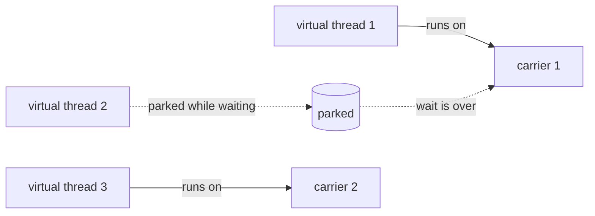

## Hook

Picture a restaurant with 8 waiters. Each waiter takes an order, walks to the kitchen and stands there until the food is ready. With 8 waiters, only 8 tables get served at a time. Everyone else waits at the door.

A smarter waiter drops the order at the kitchen and serves another table while the food cooks. The same 8 waiters can now look after hundreds of tables.

Kakashi's ticket has the first problem. On marathon day, 10,000 riders pay at once. Each payment waits on the slow payment service. The fixed pool from SPK-0503 has a few threads, and each one stands still while it waits. Virtual threads are the smarter waiters.

## Concept

### Platform threads

Every thread you made so far is a **platform thread**. Java asks the operating system for one real thread for each `Thread` object.

```callout jargon
The **operating system** (OS) is the program that runs your computer, such as macOS, Windows or Linux. An **OS thread** is a thread the OS creates and schedules. A **platform thread** is a Java thread that holds one OS thread for its whole life.
```

OS threads are expensive. Each one reserves memory for its stack, often about a megabyte. So one machine can run thousands of them, not millions.

That is why the executors topic used a fixed pool. A small pool shares a few platform threads among many tasks. The catch is waiting. When a pooled thread calls the payment service, it sits idle until the answer comes back. The other riders queue behind it.

### Virtual threads

A **virtual thread** is a cheap thread that the JVM manages itself. It is still a `Thread` object, with `start`, `join` and a name. Under the hood it works differently.

- The JVM keeps a few platform threads, about one per CPU core. These are called **carrier threads**.
- A virtual thread runs by riding on a carrier thread.
- When the virtual thread waits, for example in `Thread.sleep` or a network call, the JVM **parks** it. Parking means it gets lifted off its carrier and set aside.
- The carrier is now free to run another virtual thread.
- When the wait ends, the JVM puts the virtual thread back on any free carrier.

```callout analogy
Carrier threads are the few waiters. Virtual threads are the table orders. An order that waits for the kitchen does not keep a waiter standing still.
```

A virtual thread uses a small amount of memory that grows only when needed. You can start far more virtual threads than platform threads.



### Syntax: Thread.ofVirtual().start

```java nocompile
Thread t = Thread.ofVirtual().start(() -> System.out.println("hi"));
t.join();
```

- `Thread.ofVirtual()` gives you a **builder**, an object that sets up a thread step by step.
- `.start(task)` creates the virtual thread and starts it right away.
- `join()` waits for it, exactly as with a platform thread.

You can name it on the builder too:

```java nocompile
Thread t = Thread.ofVirtual().name("payer-7").start(() -> pay(7));
```

### Syntax: Thread.startVirtualThread

```java nocompile
Thread t = Thread.startVirtualThread(() -> System.out.println("hi"));
```

This is a shortcut for `Thread.ofVirtual().start(...)`. Use it when you need no name.

### Syntax: isVirtual

```java nocompile
boolean v = Thread.currentThread().isVirtual();
```

`isVirtual()` returns `true` on a virtual thread and `false` on a platform thread. The `main` thread is a platform thread.

```java run
public class Main {
    public static void main(String[] args) throws InterruptedException {
        System.out.println("main is virtual: " + Thread.currentThread().isVirtual());

        Thread t = Thread.ofVirtual().name("payer-1").start(() -> {
            Thread me = Thread.currentThread();
            System.out.println(me.getName() + " is virtual: " + me.isVirtual());
        });
        t.join();

        Thread quick = Thread.startVirtualThread(() -> System.out.println("shortcut works"));
        quick.join();
    }
}
```

### Syntax: newVirtualThreadPerTaskExecutor

Most of the time you do not create threads by hand. You use an executor, as in the executors topic.

```java nocompile
try (ExecutorService pool = Executors.newVirtualThreadPerTaskExecutor()) {
    pool.submit(() -> pay(1));
    pool.submit(() -> pay(2));
}
```

- This executor starts a brand new virtual thread for every task you submit.
- It has no fixed size, so tasks never queue for a free thread.
- The `try (...)` is **try-with-resources** from the exceptions topic. When the block ends, Java calls `close()` on the executor.
- `close()` waits until every submitted task has finished, then shuts the executor down.

```callout tip
Do not pool virtual threads. They are cheap, so you make a fresh one per task and throw it away after. A pool exists to save expensive threads.
```

`submit` still returns a `Future`, so `get()` works the same as before:

```java nocompile
Future<String> receipt = pool.submit(() -> "paid r1");
String line = receipt.get();   // "paid r1"
```

### Counting from many threads

When 10,000 tasks each add 1 to a plain `int`, updates get lost. You saw that race in the synchronization topic. An `AtomicInteger` from `java.util.concurrent.atomic` is a counter whose `incrementAndGet()` is safe from many threads at once. The next topic covers it fully.

### Syntax: AtomicInteger

```java nocompile
AtomicInteger done = new AtomicInteger();   // starts at 0
done.incrementAndGet();                     // adds 1 safely, returns the new value
int total = done.get();                     // reads the current value
```

`incrementAndGet()` adds 1 in one safe step, and `get()` reads the value.

```java run
import java.util.concurrent.ExecutorService;
import java.util.concurrent.Executors;
import java.util.concurrent.atomic.AtomicInteger;

public class Main {
    public static void main(String[] args) {
        AtomicInteger done = new AtomicInteger();
        try (ExecutorService pool = Executors.newVirtualThreadPerTaskExecutor()) {
            for (int i = 0; i < 10_000; i++) {
                pool.submit(() -> {
                    try {
                        Thread.sleep(10);
                    } catch (InterruptedException e) {
                        return;
                    }
                    done.incrementAndGet();
                });
            }
        }
        System.out.println("Completed tasks: " + done.get());
    }
}
```

Ten thousand threads each sleep 10 milliseconds. Because sleeping virtual threads are parked, they all wait at the same time. The program prints `Completed tasks: 10000` and ends quickly.

### When virtual threads help

Virtual threads help when tasks spend most of their time **waiting**. Waiting is called **blocking** or **I/O** (input and output): network calls, database queries, `Thread.sleep`.

They do not help with **CPU-heavy work**, such as counting primes or sorting a huge list. That work keeps a carrier busy the whole time. You still have only one carrier per core, so it runs no faster than a fixed pool.

| Task | Virtual threads help? |
|---|---|
| Waiting on the payment service | Yes |
| Reading telemetry from 5,000 dock sensors over the network | Yes |
| Reading many files from the local disk | A little |
| Computing a fare report with heavy maths | No |

Why only "a little" for files? On most systems, a file read keeps its carrier busy until it ends. The JVM makes up for it by adding spare carriers for a while. That works, but it is not the cheap parking that network waits get.

### Pinning, in one line

```callout warning
A virtual thread that waits inside a `synchronized` block can get **pinned** on Java 21. Pinned means it stays stuck to its carrier and blocks it. Keep slow waits outside `synchronized` code.
```

On Java 21, use a `ReentrantLock` instead of `synchronized` around slow work. A virtual thread waiting on a `ReentrantLock` parks normally. Java 24 fixed this (JEP 491), so there `synchronized` almost never pins. Rare cases, such as waiting inside a native call, still do.

```java nocompile
private final ReentrantLock lock = new ReentrantLock();

void payAndRecord(String rider) throws InterruptedException {
    lock.lock();
    try {
        callPaymentService(rider);   // slow: the virtual thread can park here on Java 21
    } finally {
        lock.unlock();
    }
}
```

### Limiting concurrency with a Semaphore

Virtual threads remove one limit: the number of threads. The other limits are still there. If 10,000 virtual threads call the payment service at once, the service gets flooded. If each one opens a database connection, the pool of, say, 20 connections runs dry.

```callout jargon
A **semaphore** is a counter of permits. `acquire()` takes a permit, and waits if none is left. `release()` gives one back.
```

So you cap how many tasks do the risky part at once. The two key lines are `acquire()` before the call and `release()` in `finally`:

```java run
import java.util.concurrent.ExecutorService;
import java.util.concurrent.Executors;
import java.util.concurrent.Semaphore;
import java.util.concurrent.atomic.AtomicInteger;

public class Main {
    static final Semaphore paymentSlots = new Semaphore(10);   // at most 10 calls at once
    static final AtomicInteger inFlight = new AtomicInteger();
    static final AtomicInteger most = new AtomicInteger();

    static void pay(int rider) throws InterruptedException {
        paymentSlots.acquire();          // wait for a free slot
        try {
            int now = inFlight.incrementAndGet();
            most.accumulateAndGet(now, Math::max);
            Thread.sleep(5);             // the slow payment service
            inFlight.decrementAndGet();
        } finally {
            paymentSlots.release();      // hand the slot back
        }
    }

    public static void main(String[] args) {
        try (ExecutorService pool = Executors.newVirtualThreadPerTaskExecutor()) {
            for (int i = 0; i < 2_000; i++) {
                int rider = i;
                pool.submit(() -> { pay(rider); return null; });
            }
        }
        System.out.println("Most payments at once: " + most.get());
    }
}
```

All 2,000 riders get a virtual thread, but only 10 talk to the payment service at any moment. The rest park cheaply while they wait for a permit. The [coordination ticket](/t/module-05-advanced-java/topic-15-coordinating-threads), later in this module, covers semaphores in full.

### ThreadLocal and the road ahead

A `ThreadLocal` gives each thread its own copy of a value. The JVM memory ticket explains it. With a million virtual threads, that is a million copies, so use it sparingly here. Java 21 also previews `ScopedValue` and structured concurrency, which are designed for virtual threads. They are not final in Java 21, so this course does not use them.

## Worked example

Here is a small version of the ticket. Each rider pays through a slow service, and every rider gets their own virtual thread.

```java run
import java.util.ArrayList;
import java.util.List;
import java.util.concurrent.ExecutionException;
import java.util.concurrent.ExecutorService;
import java.util.concurrent.Executors;
import java.util.concurrent.Future;

public class Main {
    static String pay(String rider) throws InterruptedException {
        Thread.sleep(5);
        return "paid " + rider;
    }

    public static void main(String[] args) throws InterruptedException, ExecutionException {
        List<String> riders = List.of("r1", "r2", "r3");
        List<Future<String>> receipts = new ArrayList<>();

        try (ExecutorService pool = Executors.newVirtualThreadPerTaskExecutor()) {
            for (String rider : riders) {
                receipts.add(pool.submit(() -> pay(rider)));
            }
        }

        for (Future<String> receipt : receipts) {
            System.out.println(receipt.get());
        }
    }
}
```

Line by line:

1. `pay` stands in for the slow payment service. It sleeps 5 ms, then returns a receipt line.
2. `receipts` will hold one `Future` per rider, in the same order as `riders`.
3. The `try (...)` opens a virtual-thread executor.
4. The loop submits one task per rider. Each task runs on its own new virtual thread.
5. The lambda throws `InterruptedException`, so Java treats it as a `Callable`. That is fine, because `submit` accepts a `Callable`.
6. When the `try` block ends, `close()` waits for all three tasks.
7. The second loop reads the futures in list order. The output is always `paid r1`, `paid r2`, `paid r3`, whichever thread finished first.

## Try it

Run the program below. It pays 10,000 riders, each waiting 10 ms, and ends in well under a second. Then:

1. Change `riders` to `100_000` and run it again. It still ends in about a second.
2. Set `riders` back to `10_000`.
3. Set `riders` to `2_000`, because the app stops a run after 10 seconds.
4. Swap `newVirtualThreadPerTaskExecutor()` for `newFixedThreadPool(8)` and run it. Even 2,000 riders take about 2.5 seconds, because only 8 riders can wait at once. With 10,000 riders it would take about 12 seconds.

```java run
import java.util.concurrent.ExecutorService;
import java.util.concurrent.Executors;
import java.util.concurrent.atomic.AtomicInteger;

public class Main {
    public static void main(String[] args) {
        int riders = 10_000;
        AtomicInteger paid = new AtomicInteger();
        try (ExecutorService pool = Executors.newVirtualThreadPerTaskExecutor()) {
            for (int i = 0; i < riders; i++) {
                pool.submit(() -> {
                    try {
                        Thread.sleep(10);
                        paid.incrementAndGet();
                    } catch (InterruptedException e) {
                        Thread.currentThread().interrupt();
                    }
                });
            }
        }
        System.out.println("Riders paid: " + paid.get());
    }
}
```

## Recap

- A platform thread holds one expensive OS thread. A virtual thread is a cheap thread that the JVM parks while it waits.
- Start one with `Thread.ofVirtual().start(task)` or `Thread.startVirtualThread(task)`. Check with `isVirtual()`.
- `Executors.newVirtualThreadPerTaskExecutor()` gives each task a new virtual thread. Use it in try-with-resources so `close()` waits for all tasks.
- Virtual threads help with waiting (I/O). They do not speed up CPU-heavy work.
- On Java 21, keep slow waits out of `synchronized` blocks (use `ReentrantLock`) to avoid pinning. Cap calls to a shared service with a `Semaphore`.

## Common mistakes

### 1. Forgetting to wait for the tasks

```java
import java.util.concurrent.ExecutorService;
import java.util.concurrent.Executors;
import java.util.concurrent.atomic.AtomicInteger;

public class Main {
    public static void main(String[] args) {
        AtomicInteger paid = new AtomicInteger();
        ExecutorService pool = Executors.newVirtualThreadPerTaskExecutor();
        for (int i = 0; i < 1000; i++) {
            pool.submit(() -> {
                try { Thread.sleep(5); } catch (InterruptedException e) { return; }
                paid.incrementAndGet();
            });
        }
        System.out.println("Paid: " + paid.get());
    }
}
```

You see something like `Paid: 0`, because `main` prints before the tasks finish. Virtual threads are also **daemon threads**, which means the JVM does not wait for them before it exits. Fix it by opening the executor in `try (ExecutorService pool = ...) { ... }` and printing after the block.

### 2. Expecting virtual threads to speed up maths

```java nocompile
try (ExecutorService pool = Executors.newVirtualThreadPerTaskExecutor()) {
    for (int i = 0; i < 10_000; i++) {
        pool.submit(() -> countPrimesBelow(5_000_000));
    }
}
```

This runs no faster than a fixed pool of one thread per core. The tasks never wait, so nothing gets parked. Use `Executors.newFixedThreadPool(Runtime.getRuntime().availableProcessors())` for CPU-heavy work.

### 3. Calling isVirtual on the wrong thread

```java
public class Main {
    public static void main(String[] args) throws InterruptedException {
        Thread t = Thread.startVirtualThread(() -> System.out.println("working"));
        t.join();
        System.out.println(Thread.currentThread().isVirtual());
    }
}
```

This prints `working` then `false`. `Thread.currentThread()` means the thread running that line, and that line runs on `main`. Call `isVirtual()` inside the lambda, or call `t.isVirtual()` on the thread object, which prints `true`.
