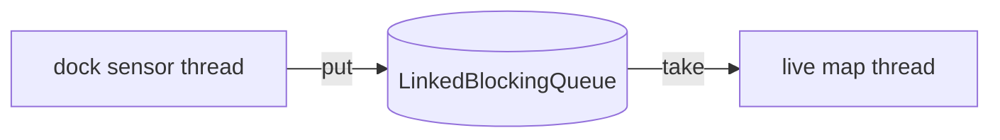

## Hook

Picture a whiteboard in a busy office that shows how many free docks each station has. Five people walk up at once to change the Harbor number. Two of them read "4", both rub it out, and both write "5". One change vanished.

Sam's ticket is that whiteboard. Dock sensors at every station update one `HashMap` from many threads. Sometimes a change goes missing. Sometimes the map breaks in the middle of an update and throws an exception. This page shows the collections Java built for many threads.

## Concept

### Why HashMap and ArrayList break

`HashMap` and `ArrayList` are **not thread-safe**. Thread-safe means the object stays correct when many threads use it at the same time.

```callout jargon
A **race condition** is a bug where the result depends on which thread happens to run first. You met it in the synchronization topic, where two threads did `count++` and lost updates.
```

Three things go wrong with a plain collection:

- **Lost updates.** `map.put(s, map.get(s) + 1)` is a read and then a write. Another thread can slip in between them.
- **Broken insides.** `ArrayList.add` grows an inner array. Two threads growing it at once can lose items or throw `ArrayIndexOutOfBoundsException`.
- **ConcurrentModificationException.** A loop over a collection throws this when another thread changes the collection during the loop.

```java run
import java.util.ArrayList;
import java.util.List;

public class Main {
    public static void main(String[] args) throws InterruptedException {
        List<Integer> events = new ArrayList<>();
        Thread[] sensors = new Thread[4];
        for (int s = 0; s < 4; s++) {
            sensors[s] = new Thread(() -> {
                for (int i = 0; i < 10_000; i++) {
                    try {
                        events.add(i);
                    } catch (RuntimeException e) {
                        // ArrayList can break under a race; skip that event
                    }
                }
            });
            sensors[s].start();
        }
        for (Thread t : sensors) {
            t.join();
        }
        System.out.println("Events stored: " + events.size());
    }
}
```

Four sensors add 10,000 events each, so 40,000 is correct. You might see 31,672 or another number below 40,000. Run it a few times and the number changes.

You could wrap every use in `synchronized`. The `java.util.concurrent` package gives you ready-made collections that do it better.

### Syntax: ConcurrentHashMap

```java nocompile
Map<String, Integer> docks = new ConcurrentHashMap<>();
docks.put("Harbor", 12);
int free = docks.get("Harbor");
```

`ConcurrentHashMap` is a `Map` that many threads can read and change at once. It locks only small parts of itself, so threads working on different keys rarely wait for each other.

Plain `get` and `put` are safe alone. A read followed by a write is still two steps, so it can still race:

```java nocompile
docks.put("Harbor", docks.get("Harbor") + 1);   // two steps: still a race
```

For a change that depends on the old value, use one of the **atomic** update methods. Atomic means the whole update happens as one step that no other thread can cut into.

### Syntax: merge

```java nocompile
docks.merge("Harbor", 1, Integer::sum);
```

- If `"Harbor"` is missing, `merge` stores `1`.
- If it is there, `merge` calls `Integer.sum(old, 1)` and stores the result.
- `Integer::sum` is a method reference from the lambdas topic. It means `(a, b) -> a + b`.

### Syntax: compute

```java nocompile
docks.compute("Harbor", (station, old) -> {
    if (old == null) {
        return 1;
    }
    return old + 1;
});
```

`compute` hands you the key and the old value (or `null`), and stores whatever you return. Use it when the rule is more than a sum.

### Syntax: getOrDefault

```java nocompile
int free = docks.getOrDefault("Depot", 0);
```

`getOrDefault` returns the stored value, or your default when the key is missing. It avoids a `NullPointerException` when you unbox a missing value into an `int`.

```java run
import java.util.Map;
import java.util.concurrent.ConcurrentHashMap;

public class Main {
    public static void main(String[] args) throws InterruptedException {
        Map<String, Integer> docks = new ConcurrentHashMap<>();
        Thread[] sensors = new Thread[4];
        for (int s = 0; s < 4; s++) {
            sensors[s] = new Thread(() -> {
                for (int i = 0; i < 10_000; i++) {
                    docks.merge("Harbor", 1, Integer::sum);
                }
            });
            sensors[s].start();
        }
        for (Thread t : sensors) {
            t.join();
        }
        System.out.println("Harbor events: " + docks.get("Harbor"));
        System.out.println("Depot events: " + docks.getOrDefault("Depot", 0));
    }
}
```

This prints `Harbor events: 40000` every time.

### Syntax: AtomicInteger and AtomicLong

```java nocompile
AtomicInteger rides = new AtomicInteger();
rides.incrementAndGet();      // adds 1, returns the new value
rides.addAndGet(5);           // adds 5, returns the new value
int now = rides.get();        // reads the value
```

An `AtomicInteger` is a single `int` that many threads can update safely without `synchronized`. `AtomicLong` is the same for a `long`. Both live in `java.util.concurrent.atomic`.

### Syntax: compareAndSet

```java nocompile
boolean changed = rides.compareAndSet(10, 11);
```

`compareAndSet(expected, newValue)` says: "if the value is still `expected`, set it to `newValue`". It returns `true` when the swap happened. It returns `false` when another thread changed the value first. This is how atomics work inside.

```java run
import java.util.concurrent.atomic.AtomicInteger;

public class Main {
    public static void main(String[] args) {
        AtomicInteger freeDocks = new AtomicInteger(12);
        System.out.println(freeDocks.decrementAndGet());
        System.out.println(freeDocks.compareAndSet(11, 10));
        System.out.println(freeDocks.compareAndSet(11, 9));
        System.out.println(freeDocks.get());
    }
}
```

This prints `11`, `true`, `false`, `10`. The second swap fails, because the value was already 10.

### LongAdder, briefly

`LongAdder` (also in `java.util.concurrent.atomic`) is a counter built for many threads adding at once. Call `add(1)` or `increment()` to count and `sum()` to read. It is faster than `AtomicLong` under heavy traffic, and it has no `compareAndSet`.

### Syntax: CopyOnWriteArrayList

```java nocompile
List<String> listeners = new CopyOnWriteArrayList<>();
listeners.add("map-screen");
for (String l : listeners) {
    System.out.println(l);
}
```

Every `add` or `remove` copies the whole inner array. A loop reads its own old copy, so it never throws `ConcurrentModificationException`. Copying is slow, so use it for lists you read often and change rarely, like a list of screens to notify.

### Syntax: BlockingQueue

```java nocompile
BlockingQueue<String> telemetry = new LinkedBlockingQueue<>();
telemetry.put("Harbor:dock-3:free");   // add; waits if the queue is full
String msg = telemetry.take();          // remove; waits if the queue is empty
```

A `BlockingQueue` is a queue from the stacks and queues topic that threads can share. `put` adds at the back and `take` removes from the front. `take` waits until an item is there, so it never returns empty-handed.

This fits the **producer-consumer** pattern. One thread (the producer) makes items. Another thread (the consumer) uses them. The queue sits between them.



Both `put` and `take` throw `InterruptedException`, so the calling method must catch it or declare it.

### The old way: Collections.synchronizedList

```java nocompile
List<String> log = Collections.synchronizedList(new ArrayList<>());
```

This wraps a list so each single method call is `synchronized`. It is older and slower under load. A loop over it still needs `synchronized (log) { ... }` around it. Prefer the concurrent collections in new code.

```callout tip
Pick by job: `ConcurrentHashMap` for shared maps, `AtomicInteger` for one counter, `CopyOnWriteArrayList` for a list read far more than it changes, `BlockingQueue` to pass work between threads.
```

## Worked example

A dock sensor thread sends telemetry while the main thread reads it.

```java run
import java.util.concurrent.BlockingQueue;
import java.util.concurrent.LinkedBlockingQueue;

public class Main {
    public static void main(String[] args) throws InterruptedException {
        BlockingQueue<String> telemetry = new LinkedBlockingQueue<>();

        Thread sensor = new Thread(() -> {
            try {
                for (int dock = 1; dock <= 3; dock++) {
                    telemetry.put("Harbor:dock-" + dock);
                }
            } catch (InterruptedException e) {
                Thread.currentThread().interrupt();
            }
        });
        sensor.start();

        for (int i = 0; i < 3; i++) {
            System.out.println("got " + telemetry.take());
        }
        sensor.join();
    }
}
```

Line by line:

1. `telemetry` is the shared queue between the two threads.
2. The `sensor` thread is the producer. It puts three messages in order.
3. `put` throws `InterruptedException`, and a `Runnable` lambda cannot throw it, so the lambda catches it.
4. The main thread is the consumer. It calls `take` three times.
5. If `main` reaches `take` before the sensor has put anything, `take` simply waits.
6. A queue keeps first-in, first-out order, so the output is always `got Harbor:dock-1`, `got Harbor:dock-2`, `got Harbor:dock-3`.

## Try it

Change the map below to a plain `HashMap` and run it a few times. The total drifts away from 0, and it can differ on each run. Sometimes a thread even crashes with `ConcurrentModificationException`. Switch back to `ConcurrentHashMap` and it is always 0.

```java run
import java.util.Map;
import java.util.concurrent.ConcurrentHashMap;

public class Main {
    public static void main(String[] args) throws InterruptedException {
        Map<String, Integer> docks = new ConcurrentHashMap<>();
        Thread unlocks = new Thread(() -> {
            for (int i = 0; i < 20_000; i++) {
                docks.merge("Harbor", -1, Integer::sum);
            }
        });
        Thread returns = new Thread(() -> {
            for (int i = 0; i < 20_000; i++) {
                docks.merge("Harbor", 1, Integer::sum);
            }
        });
        unlocks.start();
        returns.start();
        unlocks.join();
        returns.join();
        System.out.println("Harbor change: " + docks.getOrDefault("Harbor", 0));
    }
}
```

## Recap

- `HashMap` and `ArrayList` are not thread-safe. Shared use loses updates or throws `ConcurrentModificationException`.
- `ConcurrentHashMap` is safe for many threads. Use `merge` or `compute` for updates that depend on the old value, and `getOrDefault` for missing keys.
- `AtomicInteger` and `AtomicLong` give safe counters with `incrementAndGet` and `compareAndSet`. `LongAdder` suits very busy counters.
- `CopyOnWriteArrayList` suits many reads and few writes. `LinkedBlockingQueue` passes items between threads with `put` and `take`.
- `Collections.synchronizedList` is the older, slower way.

## Common mistakes

### 1. A get then a put on ConcurrentHashMap

```java nocompile
docks.put(station, docks.get(station) + change);
```

The map is thread-safe, but this line is two separate steps. Under load, the total comes out wrong, and the number changes from run to run. Use one atomic step: `docks.merge(station, change, Integer::sum);`.

### 2. Unboxing a missing key

```java run crash
import java.util.Map;
import java.util.concurrent.ConcurrentHashMap;

public class Main {
    public static void main(String[] args) {
        Map<String, Integer> docks = new ConcurrentHashMap<>();
        int free = docks.get("Depot");
        System.out.println(free);
    }
}
```

You see `Exception in thread "main" java.lang.NullPointerException: Cannot invoke "java.lang.Integer.intValue()" because the return value of "java.util.Map.get(Object)" is null`. The key is missing, so `get` returns `null`. Use `docks.getOrDefault("Depot", 0)`.

### 3. Calling take without handling InterruptedException

```java nocompile
BlockingQueue<String> telemetry = new LinkedBlockingQueue<>();
String msg = telemetry.take();
```

Inside a method without `throws`, javac says `error: unreported exception InterruptedException; must be caught or declared to be thrown`. Add `throws InterruptedException` to the method, or wrap the call in `try { ... } catch (InterruptedException e) { ... }`.
