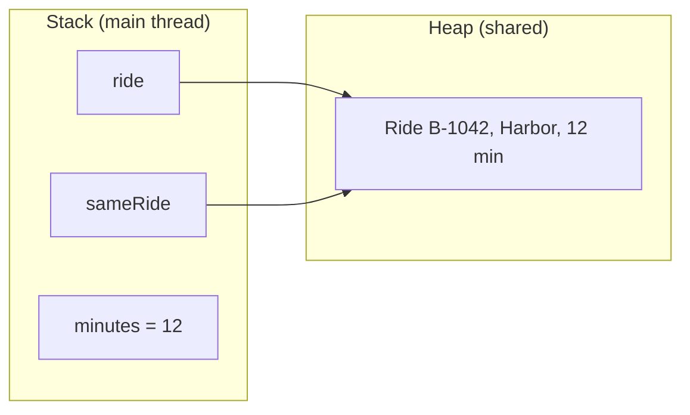

## Hook

Picture a busy café kitchen. Each cook has a small notepad for the order in front of them. The kitchen also has one big shared fridge.

A notepad page gets torn off when an order is done. The fridge only empties when someone throws food out. If nobody ever throws anything out, the fridge fills up, however big it is.

Priya's ticket is about a full fridge. The Harbor kiosk crashed with `OutOfMemoryError: Java heap space`. Before Spoke buys bigger kiosks, you need to know which part of memory ran out, and why.

## Concept

### Three areas of JVM memory

The JVM (Java Virtual Machine, the program that runs your bytecode) splits its memory into areas. Three of them matter here:

- The **stack**: one per thread. It holds the work of the method calls in progress.
- The **heap**: one per JVM, shared by every thread. It holds every object you create with `new`.
- **Metaspace**: holds class data. That is the description of each class: its name, fields, methods and bytecode.

```callout analogy
The stack is each cook's notepad. The heap is the shared fridge. Metaspace is the recipe book on the shelf.
```

### The stack and its frames

Each time you call a method, the JVM pushes a **frame** onto the current thread's stack. A frame is a small block of memory for one method call. It holds that call's parameters and local variables.

When the method returns, the JVM pops its frame. Its local variables are gone at once. You met this last-in, first-out shape in the stacks topic of module 4.

```java
int fare(int minutes) {
    int cents = 100 + minutes * 15;
    return cents;
}
```

- The call `fare(10)` gets a frame holding `minutes` and `cents`.
- When `fare` returns, that frame disappears.

Each thread has its own stack. Two threads calling `fare` at the same moment have separate frames, so their `cents` variables never mix.

### StackOverflowError

A stack has a fixed size. Recursion without a base case keeps pushing frames until there is no room left. The JVM then throws `StackOverflowError`.

```java run crash
public class Main {
    static int depth = 0;

    static void countDocks() {
        depth++;
        countDocks();
    }

    public static void main(String[] args) {
        try {
            countDocks();
        } catch (StackOverflowError e) {
            System.out.println("Stack full after about " + depth + " calls");
            throw e;
        }
    }
}
```

The number of calls depends on your machine and settings. You might see a few thousand calls or tens of thousands. What stays the same is the error name.

### The heap and its objects

Every `new` creates an object on the heap. The heap is shared, so any thread holding a reference can reach the object.

```java
record Ride(String bikeId, String station, String type, int minutes) { }
```

```java nocompile
Ride ride = new Ride("B-1042", "Harbor", "classic", 12);
```

This one line touches two areas:

- The `Ride` object, with its four fields, lives on the heap.
- The variable `ride` lives in the current frame on the stack. It holds a **reference**: the address of the object, like a note saying "the ride is on shelf 7".

### References and objects

A variable of a class type never holds the object itself. It holds a reference to it. Two variables can hold references to one object.



The `int` called `minutes` sits right inside the frame. Primitive values like `int`, `double` and `boolean` live where the variable lives. Objects always live on the heap.

```java run
import java.util.ArrayList;
import java.util.List;

public class Main {
    public static void main(String[] args) {
        List<String> docks = new ArrayList<>();
        List<String> sameDocks = docks;
        sameDocks.add("Dock 1");
        System.out.println(docks);
        System.out.println(docks == sameDocks);
    }
}
```

There is one list on the heap. Both variables point at it, so the change through `sameDocks` shows through `docks`.

### OutOfMemoryError: Java heap space

The heap also has a maximum size. When your program asks for a new object and the heap is full of objects still in use, the JVM throws `OutOfMemoryError: Java heap space`.

"Still in use" is the key part. The JVM frees objects nobody can reach any more. You learn how in the next topic. An object that some live variable can still reach is never freed.

### A leak in Spoke terms

Here is a realistic cause for Priya's crash. Someone added a history list for a dashboard:

```java nocompile
class RideLog {
    static final List<Ride> ALL_RIDES = new ArrayList<>();

    static void record(Ride ride) {
        ALL_RIDES.add(ride);
    }
}
```

A `static` field belongs to the class and lives as long as its class is loaded, which for most apps is the whole run. Every ride ever taken stays in `ALL_RIDES`. Each night the list holds more rides. The heap fills up a bit more every day until it is full.

```callout warning
This is a **memory leak**: objects your program no longer needs but still holds references to. A bigger kiosk only delays the crash. The fix is to stop holding the rides, for example by saving them to a file and keeping only the last 100 in memory.
```

### Memory flags: -Xmx and -Xss

You can set the sizes when you start the JVM. These are **flags**: options you type after `java`.

### Syntax: setting heap and stack sizes

```text
java -Xmx512m -Xss1m Main.java
```

- `-Xmx512m` sets the **maximum heap size** to 512 megabytes. `m` means megabytes and `g` means gigabytes.
- `-Xss1m` sets the **stack size of each thread** to 1 megabyte.

A bigger `-Xmx` lets more objects fit. A bigger `-Xss` lets recursion go deeper. Neither fixes a leak or a missing base case.

## Worked example

Java lets your program ask about its own heap through `Runtime.getRuntime()`.

### Syntax: reading heap sizes

```java nocompile
Runtime rt = Runtime.getRuntime();
long max = rt.maxMemory();
long total = rt.totalMemory();
long free = rt.freeMemory();
```

- `maxMemory()` is the most heap the JVM will ever try to use. `-Xmx` sets it.
- `totalMemory()` is how much heap the JVM has reserved right now. It can grow up to the maximum.
- `freeMemory()` is the unused part of `totalMemory()`.
- All three return bytes as a `long`.

```java run
public class Main {
    public static void main(String[] args) {
        Runtime rt = Runtime.getRuntime();
        long mb = 1024 * 1024;
        long used = rt.totalMemory() - rt.freeMemory();
        System.out.println("Max heap:   " + rt.maxMemory() / mb + " MB");
        System.out.println("Total heap: " + rt.totalMemory() / mb + " MB");
        System.out.println("Free heap:  " + rt.freeMemory() / mb + " MB");
        System.out.println("Used heap:  " + used / mb + " MB");
    }
}
```

Line by line:

1. `Runtime.getRuntime()` returns the one `Runtime` object for this JVM.
2. `mb` is the number of bytes in a megabyte, so dividing by it converts bytes to MB.
3. `used` is the reserved heap minus the free part.
4. Each line prints one size in megabytes.

Your numbers will differ from a classmate's. They depend on your computer's memory, your JDK and your flags. By default the JVM picks a maximum of about a quarter of the machine's memory.

## Try it

Run the program below. Then press Run again after changing `1000` to `100000`. Watch the used heap grow while the list holds the rides.

```java run
import java.util.ArrayList;
import java.util.List;

public class Main {
    public static void main(String[] args) {
        Runtime rt = Runtime.getRuntime();
        long mb = 1024 * 1024;
        List<Ride> history = new ArrayList<>();
        for (int i = 0; i < 1000; i++) {
            history.add(new Ride("B-" + i, "Harbor", "classic", 12));
        }
        long used = rt.totalMemory() - rt.freeMemory();
        System.out.println("Rides kept: " + history.size());
        System.out.println("Used heap:  " + used / mb + " MB");
    }
}

record Ride(String bikeId, String station, String type, int minutes) { }
```

The exact megabytes change from run to run and machine to machine. The trend is what matters: more rides held means more heap used.

## Recap

- Each thread has its own stack of frames. A frame holds one call's parameters and local variables.
- Every object lives on the heap, which all threads share. Variables hold references to objects.
- Metaspace holds class data such as fields, methods and bytecode.
- Deep recursion fills the stack: `StackOverflowError`. Objects you never let go fill the heap: `OutOfMemoryError: Java heap space`.
- `-Xmx` sets the maximum heap and `-Xss` sets each thread's stack size. Neither fixes a leak.

## Common mistakes

**Fixing a leak with a bigger heap.**

```java
import java.util.ArrayList;
import java.util.List;

class RideLog {
    static final List<String> ALL_RIDES = new ArrayList<>();

    static void record(String bikeId) {
        ALL_RIDES.add(bikeId);
    }
}
```

With `-Xmx512m` the kiosk crashes after some days with `java.lang.OutOfMemoryError: Java heap space`. With `-Xmx2g` it crashes later with the same error. Fix the cause: keep only what you need, for example the last 100 rides, and remove older ones.

**Thinking a copy of a variable copies the object.**

```java
import java.util.ArrayList;
import java.util.List;

public class Main {
    public static void main(String[] args) {
        List<String> today = new ArrayList<>();
        List<String> backup = today;
        today.clear();
        System.out.println(backup.size());
    }
}
```

You expect `backup` to keep its data, but `backup` points at the same list. Make a real copy with `List<String> backup = new ArrayList<>(today);`.

**Recursion without a base case.**

```java
class Counter {
    static int countDown(int n) {
        return countDown(n - 1);
    }
}
```

Calling `countDown(5)` ends with `Exception in thread "main" java.lang.StackOverflowError`. A bigger `-Xss` only makes it fail later. Add a base case: `if (n == 0) { return 0; }`.
