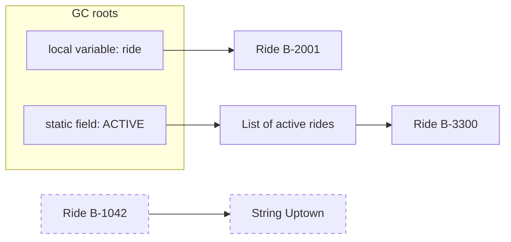

## Hook

Think of a library with a cleaner. Every evening the cleaner walks the shelves. Any book that is on a borrowing list stays. Any book that nobody's list mentions goes in the recycling.

The cleaner is careful. While they check the shelves, nobody may move a book. For a moment, the whole library stands still.

Theo's ticket describes that moment. Once an hour the Uptown kiosk freezes, and the log says "GC pause". GC means **garbage collection**. In this topic you learn what the collector does and why it sometimes stops your program.

## Concept

### What garbage is

In the last topic you saw that every object lives on the heap. You never write code to delete an object in Java. The **garbage collector** (GC) does it for you. It is a part of the JVM that finds unused objects and frees their memory.

An object is **garbage** when your program can no longer reach it. Reach means "follow references to it, starting from somewhere the program is using right now".

```java nocompile
Ride ride = new Ride("B-1042", "Uptown", "classic", 12);
ride = new Ride("B-2001", "Uptown", "ebike", 8);
```

- After line 1, `ride` refers to the B-1042 ride.
- After line 2, `ride` refers to the B-2001 ride.
- Nothing refers to B-1042 any more. It is garbage. The GC may free it at its next run.

### GC roots and reachability

The GC starts from **GC roots**. A GC root is a reference the JVM knows is in use. The main roots are:

- local variables and parameters in the frames of every live thread's stack
- `static` fields of loaded classes

From the roots, the GC follows every reference to every object, then every reference inside those objects, and so on. Each object it reaches is **reachable** and stays. Everything else is garbage.



B-1042 still points at a `String`, but no root leads to either of them. Both are garbage. A reference from garbage does not keep anything alive.

```callout jargon
**Reachable** means the GC can get to the object by following references from a GC root. **Unreachable** objects are garbage and their memory can be reused.
```

### Generations: young and old

Most objects die young. Think of a fare calculation: it creates a few temporary strings and numbers, uses them for a millisecond, then drops them. Only a few objects, like the list of stations, live for the whole day.

The JVM uses that fact. It splits the heap into two **generations**:

- The **young generation** is where new objects start.
- The **old generation** holds objects that survived several collections in the young generation.

A **minor collection** cleans only the young generation. It is small and fast, because most of what it finds is already garbage. A **major collection** also cleans the old generation. G1 does most of that work in small steps while your program runs. If the old generation fills up too fast, G1 falls back to a **full collection**, which stops everything and takes much longer.

### Stop-the-world pauses

To check references safely, the collector sometimes has to stop every thread of your program. This is a **stop-the-world pause**. During it, nothing runs: no unlock button, no fare, no dock sensor reading.

Minor collections usually pause for a short time. A full collection of a big, crowded heap can pause much longer. That matches Theo's freeze: a big collection, once an hour, while the kiosk waits.

```callout analogy
A stop-the-world pause is the library cleaner saying "Nobody move!" while they check the shelves. The fuller the shelves, the longer everyone waits.
```

### Collectors: G1 and ZGC

The JVM ships several collectors. You pick one with a flag when you start `java`.

**G1** (Garbage First) is the default collector in Java 21 on most machines; very small machines get the Serial collector. It cuts the heap into many small regions. It collects the regions with the most garbage first, which is where the name comes from. It aims for short pauses, a goal you can tune, and suits most programs.

**ZGC** is built for very low pauses. It does almost all of its work while your threads keep running, so its pauses stay tiny even on a large heap. It costs a bit more CPU (processor) time. You turn it on with `-XX:+UseZGC`. For a kiosk where a rider is waiting at the screen, ZGC is worth a try.

### Watching the GC: -Xlog:gc

### Syntax: logging collections

```text
java -Xlog:gc Main.java
```

The JVM prints one line per collection. Each line names the kind of pause, the heap size before and after, and how long the pause took. Theo's "GC pause" line comes from logging like this.

```java run
import java.util.ArrayList;
import java.util.List;

public class Main {
    public static void main(String[] args) {
        long total = 0;
        for (int i = 0; i < 2_000_000; i++) {
            List<String> temp = new ArrayList<>();
            temp.add("B-" + i);
            total += temp.size();
        }
        System.out.println("Temporary lists made: " + total);
    }
}
```

Each loop turn makes a list that becomes garbage at the end of the turn. Run this with `-Xlog:gc` on your own machine and you may see several young collections. How many and how long depends on your machine, your JDK and your heap size.

### System.gc() is only a request

### Syntax: asking for a collection

```java nocompile
System.gc();
```

`System.gc()` asks the JVM to collect. The JVM may do it, do it later or ignore it. Never build program logic on it. Calling it often can even cause extra full pauses.

## Worked example

### Leaks in a language with a GC

The GC frees unreachable objects. It cannot free objects you still refer to but forgot about. That is a **memory leak** in Java. Three common shapes:

- **Static collections.** A `static` list or map is a GC root. Anything in it lives until you remove it.
- **Listeners.** You register an object to be told about events, then never unregister it. The event source keeps a reference forever.
- **Caches.** A map that remembers results "to be fast" but never removes old entries.

Here is a listener leak in kiosk terms:

```java nocompile
class DockSensor {
    private final List<Runnable> listeners = new ArrayList<>();

    void onBikeReturned(Runnable listener) {
        listeners.add(listener);
    }
}
```

Each time a rider opens a ride screen, the screen calls `sensor.onBikeReturned(...)`. When the screen closes, it never removes itself. The sensor lives all day, so every old screen stays reachable through `listeners`.

Line by line, the fix:

1. Add a `removeListener(Runnable listener)` method that calls `listeners.remove(listener)`.
2. Call it when the ride screen closes.
3. Now old screens become unreachable, and the GC frees them.

Leaks also make Theo's pauses worse. Leaked objects survive and move to the old generation. A fuller old generation means more work and a higher risk of a full collection.

### Weak references

Sometimes you want to refer to an object without keeping it alive. A **weak reference** does that. The GC ignores weak references when it decides what is reachable.

### Syntax: WeakReference

```java nocompile
WeakReference<Ride> weak = new WeakReference<>(ride);
Ride maybe = weak.get();
```

- `new WeakReference<>(ride)` wraps a weak reference to `ride`.
- `get()` returns the object, or `null` once the GC has freed it.

`WeakHashMap` is a map whose keys are held weakly. When nothing else refers to a key, the GC may remove that entry. It suits a cache that should shrink by itself.

```java run
import java.lang.ref.WeakReference;

public class Main {
    public static void main(String[] args) {
        String bike = new String("B-1042");
        WeakReference<String> weak = new WeakReference<>(bike);
        System.out.println("Before: " + weak.get());
        bike = null;
        System.gc();
        System.out.println("After:  " + weak.get());
    }
}
```

Usually the second line prints `After:  null`. Since `System.gc()` is only a request, you might also see `B-1042` on some JVMs.

## Try it

Run the program below. It keeps a strong list and checks used memory before and after dropping it. Then change `history = null;` into a comment and run it again.

```java run
import java.util.ArrayList;
import java.util.List;

public class Main {
    public static void main(String[] args) {
        Runtime rt = Runtime.getRuntime();
        long mb = 1024 * 1024;
        List<String> history = new ArrayList<>();
        for (int i = 0; i < 500_000; i++) {
            history.add("Ride B-" + i + " at Uptown");
        }
        System.out.println("Used with list: " + (rt.totalMemory() - rt.freeMemory()) / mb + " MB");
        history = null;
        System.gc();
        System.out.println("Used after:     " + (rt.totalMemory() - rt.freeMemory()) / mb + " MB");
    }
}
```

Your numbers will be different from anyone else's. With `history = null;` the second number is usually much smaller. Without it, the list is still reachable from a local variable, so the GC must keep it.

## Recap

- Garbage is every object that the GC cannot reach from a GC root, such as live local variables and static fields.
- The heap has a young and an old generation. Most objects die young, so minor collections are cheap.
- Stop-the-world pauses halt every thread. Full collections of a crowded heap pause the longest.
- G1 is the default collector. ZGC keeps pauses very low. `-Xlog:gc` shows each collection.
- Leaks are references you forgot to drop: static collections, listeners and caches. `System.gc()` is only a request.

## Common mistakes

**Calling System.gc() to fix pauses.**

```java
class Kiosk {
    void afterEachRide() {
        System.gc();
    }
}
```

There is no error message. The kiosk gets slower, and `-Xlog:gc` shows a `Pause Full (System.gc())` line after every ride. Remove the call and let the JVM decide when to collect.

**Forgetting to unregister a listener.**

```java
import java.util.ArrayList;
import java.util.List;

class DockSensor {
    final List<Runnable> listeners = new ArrayList<>();

    void onBikeReturned(Runnable listener) {
        listeners.add(listener);
    }
}
```

After a day, `listeners.size()` is in the thousands and the heap keeps growing. In the end you see `java.lang.OutOfMemoryError: Java heap space`. Add a method that calls `listeners.remove(listener)` and call it when a screen closes.

**A cache that never forgets.**

```java
import java.util.HashMap;
import java.util.Map;

class FareCache {
    static final Map<String, Double> FARES = new HashMap<>();

    static void remember(String rideId, double fare) {
        FARES.put(rideId, fare);
    }
}
```

Every ride id adds an entry, and none leave. The heap grows each day until `OutOfMemoryError: Java heap space`. Remove entries you no longer need, cap the size, or use a `WeakHashMap` when the keys are objects that other code holds.
