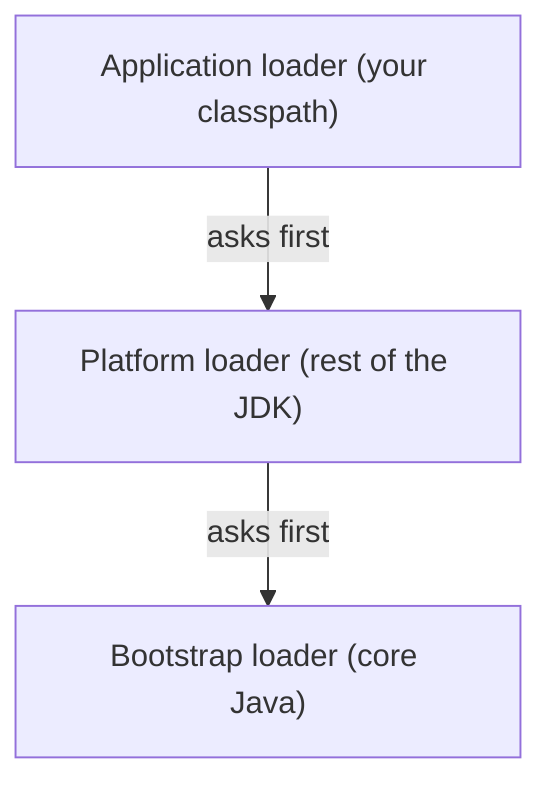

## Hook

Picture a theatre. The script lists every actor who appears. On opening night an actor is called on stage, and nobody comes out. The script was fine. The actor simply did not turn up at the theatre.

Tsunade's ticket is that story. The kiosk code compiled without a complaint. Then the Old Mill kiosk started and died with `NoClassDefFoundError`. To fix it, you need to know how the JVM finds and loads classes while your program runs.

## Concept

### Compile time and run time are separate

`javac` turns your `.java` files into `.class` files. Each `.class` file holds the bytecode of one class. At run time the JVM must find those `.class` files again, plus the ones from every library you use.

Finding a class at compile time proves nothing about run time. The two steps can look in different places.

### The life of a class

A class goes through three steps before your code can use it:

1. **Load.** A class loader finds the `.class` file's bytes and reads them into metaspace, the class data area from the JVM memory topic.
2. **Link.** The JVM checks the bytecode is valid and safe, and makes room for the `static` fields with default values such as `0` and `null`.
3. **Initialize.** The JVM runs the class's static initializers: the `static` field assignments and any `static { }` blocks, top to bottom.


```callout jargon
A **class loader** is a Java object whose job is to find a class's bytes and turn them into a class the JVM can use.
```

### Lazy loading

The JVM does not load every class at start-up. It loads and initializes a class the first time your code really needs it. This is **lazy loading**.

A class is initialized on first use, such as:

- creating an object with `new`
- calling a `static` method
- reading or writing a `static` field (other than a constant)

### Syntax: a static initializer block

```java
class FareTable {
    static double classicPerMinute;

    static {
        classicPerMinute = 0.15;
        System.out.println("FareTable ready");
    }
}
```

- `static { ... }` is a **static initializer block**. It runs once, when the class is initialized.
- It never runs again, however many times you use the class.

```java run
public class Main {
    public static void main(String[] args) {
        System.out.println("Kiosk starting");
        System.out.println("Classic rate: " + FareTable.classicPerMinute());
        System.out.println("E-bike rate: " + FareTable.ebikePerMinute());
    }
}

class FareTable {
    static {
        System.out.println("FareTable loaded");
    }

    static double classicPerMinute() {
        return 0.15;
    }

    static double ebikePerMinute() {
        return 0.30;
    }
}
```

The output is always this, in this order:

```text
Kiosk starting
FareTable loaded
Classic rate: 0.15
E-bike rate: 0.3
```

`FareTable loaded` appears after `Kiosk starting`, because the class waits until its first use. It appears only once, before the first rate.

```callout tip
Java first builds the whole text `"Classic rate: " + ...` before `println` runs. The method call inside triggers initialization, so `FareTable loaded` prints before that line.
```

### The class loader hierarchy

Java uses three built-in class loaders, stacked like a family tree:

- The **bootstrap** loader loads the core of Java, such as `String` and `ArrayList`. It is built into the JVM, so Java code sees it as `null`.
- The **platform** loader loads the other parts of the JDK, such as `java.sql`.
- The **application** loader (also called the system loader) loads your classes and your libraries from the classpath.

### Syntax: asking for a class loader

```java nocompile
ClassLoader loader = FareTable.class.getClassLoader();
```

`FareTable.class` is the `Class` object that describes `FareTable`. Its `getClassLoader()` returns the loader that loaded it.

```java run
public class Main {
    public static void main(String[] args) {
        System.out.println(String.class.getClassLoader());
        System.out.println(java.sql.Date.class.getClassLoader().getName());
        System.out.println(ClassLoader.getSystemClassLoader().getName());
        System.out.println(ClassLoader.getSystemClassLoader().getParent().getName());
    }
}
```

This prints:

```text
null
platform
app
platform
```

`String` came from the bootstrap loader, so you see `null`. The application loader is named `app`, and its parent is the platform loader.

### Parent delegation

When a loader is asked for a class, it first asks its parent. Only when the parent cannot find the class does the loader search itself. This is **parent delegation**.



Parent delegation keeps Java safe. If you write your own class called `java.lang.String`, the bootstrap loader finds the real one first. Your copy never replaces it.

### The classpath

The **classpath** is the list of folders and `.jar` files where the application loader looks for classes. A `.jar` file is a zip file full of `.class` files. You set the classpath with `-cp`.

### Syntax: running with a classpath

```text
java -cp build/classes:libs/fares.jar jq.kiosk.Kiosk
```

- The parts are separated by `:` on macOS and Linux, and by `;` on Windows.
- The last word is the main class, with its full package name.

If `fares.jar` is missing from that list, the classes inside it are missing at run time, even though `javac` saw them.

## Worked example

### ClassNotFoundException and NoClassDefFoundError

Both errors mean "a class could not be found", but they come from different places.

- `ClassNotFoundException` is a checked exception. You get it when you ask for a class **by name** at run time, for example with `Class.forName`, and no loader finds it.
- `NoClassDefFoundError` is an error. The JVM throws it when compiled code refers to a class directly, and that class is missing at run time or failed to initialize earlier.

### Syntax: loading a class by name

```java nocompile
Class<?> type = Class.forName("jq.kiosk.FareTable");
```

`Class.forName` loads and initializes the named class. The name must include the package. It throws `ClassNotFoundException` when no loader can find it.

```java run
public class Main {
    public static void main(String[] args) {
        try {
            Class<?> type = Class.forName("java.util.ArrayList");
            System.out.println("Found " + type.getSimpleName());
            Class.forName("jq.kiosk.FareTable");
        } catch (ClassNotFoundException e) {
            System.out.println("Missing: " + e.getMessage());
        }
    }
}
```

Line by line:

1. `Class.forName("java.util.ArrayList")` finds the class through parent delegation. It prints `Found ArrayList`.
2. `Class.forName("jq.kiosk.FareTable")` finds nothing, so it throws.
3. The `catch` prints `Missing: jq.kiosk.FareTable`.

For Tsunade's ticket, the likely story is this. The build compiled against `fares.jar`. The kiosk's start script runs `java -cp` with a list that leaves that jar out. When `Kiosk` first touches `FareTable`, the JVM cannot find it and throws `NoClassDefFoundError: jq/kiosk/FareTable`. The fix is to add the jar to the run-time classpath.

## Try it

`NoClassDefFoundError` also appears when a class fails during its static initializer. Run this, then change the `throw` line so the block only prints, and run it again.

```java run
public class Main {
    public static void main(String[] args) {
        for (int i = 1; i <= 2; i++) {
            try {
                System.out.println("Rate: " + Rates.cargo());
            } catch (Throwable t) {
                System.out.println("Try " + i + ": " + t.getClass().getSimpleName());
            }
        }
    }
}

class Rates {
    static {
        if (true) {
            throw new IllegalStateException("rates file missing");
        }
    }

    static double cargo() {
        return 0.25;
    }
}
```

The first use throws `ExceptionInInitializerError`. The JVM marks the class as broken. Every later use throws `NoClassDefFoundError`. So when you see `NoClassDefFoundError`, scroll up the log for an earlier `ExceptionInInitializerError` too.

## Recap

- A class is loaded, linked and initialized. Static initializers run once, on first use.
- Three built-in loaders form a hierarchy: bootstrap (shown as `null`), platform and application.
- Parent delegation means a loader asks its parent before searching itself.
- The application loader searches the classpath that you set with `-cp`.
- `ClassNotFoundException` comes from loading by name. `NoClassDefFoundError` means a class your compiled code uses is missing or broken at run time.

## Common mistakes

**Calling a method on the bootstrap loader.**

```java
public class Main {
    public static void main(String[] args) {
        System.out.println(String.class.getClassLoader().getName());
    }
}
```

Java says: `Exception in thread "main" java.lang.NullPointerException: Cannot invoke "java.lang.ClassLoader.getName()" because the return value of "java.lang.Class.getClassLoader()" is null`. Core classes come from the bootstrap loader, which shows up as `null`. Check for `null` before you call a method on it.

**Forgetting the package in Class.forName.**

```java
public class Main {
    public static void main(String[] args) throws Exception {
        Class.forName("ArrayList");
    }
}
```

Java says: `Exception in thread "main" java.lang.ClassNotFoundException: ArrayList`. Class names given as text need the full package: `Class.forName("java.util.ArrayList")`.

**Expecting a static block to run at start-up.**

```java
public class Main {
    public static void main(String[] args) {
        System.out.println("Kiosk ready");
    }
}

class Docks {
    static {
        System.out.println("12 docks checked");
    }
}
```

The output is only `Kiosk ready`. Nothing uses `Docks`, so the JVM never initializes it. Touch the class first, for example by calling a static method, when you need its setup to run.
