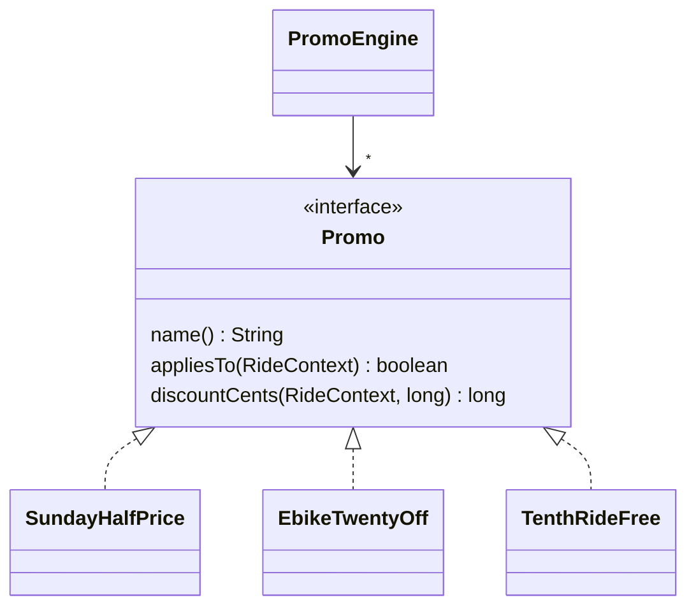

## The design

Every promo is a small class behind one interface:

```java nocompile
public interface Promo {
    String name();
    boolean appliesTo(RideContext ride);
    long discountCents(RideContext ride, long fareCents);
}
```

`RideContext` holds what a promo may look at: rider, bike type, minutes and day of the week. It also holds how many rides the rider has already taken this month.

`PromoEngine` gets its promos through its constructor. For each ride it picks the single best promo. Promos never stack.



```callout tip
This is the open/closed principle from topic 02. The engine is closed for changes, and open for new promos.
```

## What you build

All of these are in package `jq.m06.feature`. Money is in whole cents, as `long`. Every percentage discount rounds down.

1. `SundayHalfPrice`, named `sunday-half-price`: on a Sunday, half the fare off.
2. `EbikeTwentyOff`, named `ebike-20`: on an ebike, 20 percent off.
3. `TenthRideFree`, named `tenth-ride-free`: when the rider already has 9 rides this month (or 19, 29 and so on), the whole fare is off.
4. `PromoEngine.best(ride, fareCents)` returns a `Quote(fareCents, discountCents, payCents, promoName)`:
   - It picks the applicable promo with the largest discount. A tie goes to the name that comes first alphabetically.
   - A promo that applies but saves 0 cents still counts as used, and it is logged.
   - The discount is never more than the fare.
   - With no applicable promo, the quote has discount 0 and promo name `none`.
   - For a used promo it logs at INFO: `promo sunday-half-price saved 225 cents for r1`. With no promo it logs nothing.

### Syntax: one logger per class

```java nocompile
private static final Logger LOG = LoggerFactory.getLogger(PromoEngine.class);
LOG.info("promo {} saved {} cents for {}", name, discount, rider);
```

## Recap

- One interface, many small classes: each promo can be tested on its own.
- The engine depends on the interface, so new promos need no engine change.
- Parameterized log messages are cheap, and finance can search them.

## Common mistakes

**Stacking promos.** Two discounts on one ride can make it free by accident. Pick the single best one.

**Rounding up.** 20 percent of 233 cents is 46.6. The rule says round down, so the discount is 46.
