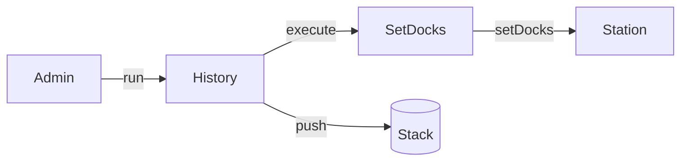

## Hook

Think about a TV remote. The TV does not care which button you press. Each button is a small object that knows one job, such as "volume up". Some remotes even have a "back" button that undoes your last step.

Jiraiya's ticket has three problems that look different but share one idea. Prices must switch when it rains. Three systems must hear when a ride ends. Admins need an undo. In each case, you put a piece of behaviour into its own object. Then the rest of the code can swap it, list it, or store it.

## Concept

```callout jargon
A **design pattern** is a named, reusable shape for code that solves a common problem. **Behavioral patterns** are the patterns about how objects share work and talk to each other.
```

This topic covers three of them in depth: strategy, observer and command. Then you meet three more in one card each, because design interviews often ask about them.

### Strategy: swap the rule, keep the caller

Today the fare code is a long `if` chain: "if rain do this, else if marathon do that". Every new event means editing that chain.

```callout jargon
The **strategy pattern** puts each version of a rule (an algorithm) in its own class behind one interface. The caller only knows the interface, so you can swap the rule at run time.
```

### Syntax: a strategy interface

```java
interface PricingStrategy {
    long priceCents(int minutes);
}
```

Each rule is one class that implements it. Money is in whole cents, stored in a `long`, so there are no rounding surprises from `double`.

```java
interface PricingStrategy {
    long priceCents(int minutes);
}

class StandardPricing implements PricingStrategy {
    public long priceCents(int minutes) {
        return 100 + 15 * minutes;
    }
}
```

The caller holds the interface type. It never asks which class it has.

```java nocompile
PricingStrategy pricing = new StandardPricing();
long fare = pricing.priceCents(10);   // 250
```

### Syntax: a strategy that wraps another strategy

A rain discount is "whatever the normal price is, halved". So the discount class takes another strategy in its constructor and asks it first.

```java nocompile
class RainDiscount implements PricingStrategy {
    private final PricingStrategy inner;

    RainDiscount(PricingStrategy inner) {
        this.inner = inner;
    }

    public long priceCents(int minutes) {
        return inner.priceCents(minutes) / 2;
    }
}
```

Dividing a `long` by 2 drops any half cent, so 115 cents becomes 57. Because the discount only talks to the interface, it can wrap any strategy at all.

### Syntax: a strategy as a lambda

`PricingStrategy` has one abstract method, so it is a functional interface. A lambda can be a strategy.

```java nocompile
PricingStrategy free = minutes -> 0;
PricingStrategy flatFive = minutes -> 500;
PricingStrategy perMinuteOnly = minutes -> 15L * minutes;
```

Use a class when the rule has a name, fields or tests of its own. Use a lambda for a tiny one-off rule.

```java run
public class Main {
    public static void main(String[] args) {
        PricingStrategy standard = new StandardPricing();
        PricingStrategy rain = new RainDiscount(standard);
        PricingStrategy marathon = minutes -> standard.priceCents(minutes) * 2;

        System.out.println("Standard: " + standard.priceCents(10));
        System.out.println("Rain: " + rain.priceCents(10));
        System.out.println("Marathon: " + marathon.priceCents(10));
    }
}

interface PricingStrategy {
    long priceCents(int minutes);
}

class StandardPricing implements PricingStrategy {
    public long priceCents(int minutes) {
        return 100 + 15 * minutes;
    }
}

class RainDiscount implements PricingStrategy {
    private final PricingStrategy inner;

    RainDiscount(PricingStrategy inner) {
        this.inner = inner;
    }

    public long priceCents(int minutes) {
        return inner.priceCents(minutes) / 2;
    }
}
```

Try it: add a `minutes -> 300` strategy and print its price for 10 minutes.

### Observer: tell everyone who asked

When a ride ends, the app, the email service and the dashboard all care. The ride code should not call each one by name. Then a fourth system would mean editing the ride code again.

```callout jargon
The **observer pattern** lets objects **subscribe** (sign up) to an event. The object that owns the event is the **subject**. When the event happens, the subject calls every **subscriber**, also called a **listener**.
```

### Syntax: subscribe and notify

```java nocompile
private final List<Consumer<String>> subscribers = new ArrayList<>();

public void subscribe(Consumer<String> subscriber) {
    subscribers.add(subscriber);
}

public void rideEnded(String bikeId) {
    for (Consumer<String> subscriber : subscribers) {
        subscriber.accept(bikeId);
    }
}
```

- A subscriber is a `Consumer<String>`: it takes the bike id and returns nothing.
- `rideEnded` walks the list in order and calls `accept` on each one.

### Syntax: unsubscribing with a Runnable

A subscriber also needs a way to stop listening. A neat trick is to return a `Runnable` from `subscribe`. Running it removes that subscriber.

```java nocompile
public Runnable subscribe(Consumer<String> subscriber) {
    subscribers.add(subscriber);
    return () -> subscribers.remove(subscriber);
}
```

```java nocompile
Runnable stop = events.subscribe(bikeId -> System.out.println("Email for " + bikeId));
stop.run();   // no more emails
```

```callout warning
A subject keeps a reference to every subscriber in its list. The [garbage collector](/t/module-05-advanced-java/topic-08-garbage-collection) can only free objects that nothing points to. So a screen that subscribes and never unsubscribes stays in memory as long as the subject lives. This is called a **listener leak**. Always unsubscribe when the subscriber is done.
```

```java run
import java.util.ArrayList;
import java.util.List;
import java.util.function.Consumer;

public class Main {
    public static void main(String[] args) {
        RideEvents events = new RideEvents();
        events.subscribe(bikeId -> System.out.println("App: ride ended on " + bikeId));
        Runnable stopEmail = events.subscribe(bikeId -> System.out.println("Email: receipt for " + bikeId));

        events.rideEnded("B-1042");
        stopEmail.run();
        events.rideEnded("B-2001");
    }
}

class RideEvents {
    private final List<Consumer<String>> subscribers = new ArrayList<>();

    Runnable subscribe(Consumer<String> subscriber) {
        subscribers.add(subscriber);
        return () -> subscribers.remove(subscriber);
    }

    void rideEnded(String bikeId) {
        for (Consumer<String> subscriber : new ArrayList<>(subscribers)) {
            subscriber.accept(bikeId);
        }
    }
}
```

Notice `new ArrayList<>(subscribers)` in the loop. It walks a copy of the list. A subscriber can then unsubscribe during the loop without breaking it.

### Command: an action you can keep

An admin sets Harbor to 2 docks by mistake. To undo it, you must know what the value was before. A plain method call forgets that.

```callout jargon
The **command pattern** turns an action into an object. The object has `execute()` to do the action and `undo()` to reverse it. Because it is an object, you can store it, list it and undo it later.
```

### Syntax: a command interface

```java
interface AdminCommand {
    void execute();
    void undo();
}
```

### Syntax: a command that remembers the old value

```java nocompile
class SetDocks implements AdminCommand {
    private final Station station;
    private final int newDocks;
    private int oldDocks;

    SetDocks(Station station, int newDocks) {
        this.station = station;
        this.newDocks = newDocks;
    }

    public void execute() {
        oldDocks = station.docks();
        station.setDocks(newDocks);
    }

    public void undo() {
        station.setDocks(oldDocks);
    }
}
```

`execute` saves the old value first. That saved value is what makes `undo` possible.

### Syntax: a history stack

Undo always reverses the newest action first. That is last in, first out, so a stack fits. You met `ArrayDeque` as a stack in the DSA module.

```java nocompile
private final Deque<AdminCommand> done = new ArrayDeque<>();

public void run(AdminCommand command) {
    command.execute();
    done.push(command);
}

public boolean undo() {
    if (done.isEmpty()) {
        return false;
    }
    done.pop().undo();
    return true;
}
```



### State: let each state decide what happens next

A bike moves through a lifecycle: AVAILABLE, then RENTED, then back, or off to IN_REPAIR. Not every move is allowed. You cannot rent a bike that is in repair.

```callout jargon
The **state pattern** gives each state its own object. The object decides which actions are allowed and which state comes next. This replaces a big `if` on a status field in every method.
```

In Java, an enum with a body per constant is a neat way to write it.

```java run
public class Main {
    public static void main(String[] args) {
        BikeState b1042 = BikeState.AVAILABLE;
        b1042 = b1042.rent();
        System.out.println("B-1042 is " + b1042);
        b1042 = b1042.giveBack();
        b1042 = b1042.reportBroken();
        System.out.println("B-1042 is " + b1042);
        try {
            b1042.rent();
        } catch (IllegalStateException e) {
            System.out.println("Refused: " + e.getMessage());
        }
    }
}

enum BikeState {
    AVAILABLE {
        BikeState rent() { return RENTED; }
        BikeState reportBroken() { return IN_REPAIR; }
    },
    RENTED {
        BikeState giveBack() { return AVAILABLE; }
    },
    IN_REPAIR {
        BikeState fixed() { return AVAILABLE; }
    };

    BikeState rent() { throw refuse("rent"); }
    BikeState giveBack() { throw refuse("give back"); }
    BikeState reportBroken() { throw refuse("report broken"); }
    BikeState fixed() { throw refuse("mark fixed"); }

    IllegalStateException refuse(String action) {
        return new IllegalStateException("cannot " + action + " a bike that is " + this);
    }
}
```

By default every action refuses. Each state overrides only the moves it allows. A vending machine, a traffic light and an order (placed, paid, shipped) fit the same shape.

### Template Method: a fixed recipe with blanks

```callout jargon
The **template method pattern** puts the fixed steps of a job in a `final` method of a parent class. The parent leaves some steps blank (abstract), and each subclass fills them in.
```

Every Spoke report has the same header and footer. Only the middle changes.

```java run
public class Main {
    public static void main(String[] args) {
        System.out.println(new RiderReceipt().build(250));
        System.out.println(new StationReport().build(250));
    }
}

abstract class Report {
    final String build(long cents) {
        return "== Spoke ==\n" + body(cents) + "\n== end ==";
    }

    abstract String body(long cents);
}

class RiderReceipt extends Report {
    String body(long cents) { return "You paid " + cents + " cents"; }
}

class StationReport extends Report {
    String body(long cents) { return "Harbor took " + cents + " cents"; }
}
```

`build` is `final`, so no subclass can skip the header. The catch is inheritance: each subclass is glued to `Report` forever. When the blank is just one small rule, a strategy passed in through the constructor is often simpler.

### Chain of Responsibility: pass it along until someone says no

Before a bike unlocks, three checks run: does the rider have an account, at least 100 cents, and a real bike id?

```callout jargon
The **chain of responsibility pattern** lines up handlers. Each handler either deals with the request (here: refuses it) or passes it to the next one.
```

```java run
public class Main {
    public static void main(String[] args) {
        UnlockCheck chain = new AccountCheck(new BalanceCheck(new BikeCheck(null)));
        System.out.println(chain.check(new Unlock("ana", 500, "B-1042")));
        System.out.println(chain.check(new Unlock("ana", 50, "B-1042")));
        System.out.println(chain.check(new Unlock("", 500, "B-1042")));
    }
}

record Unlock(String riderId, long balanceCents, String bikeId) {}

abstract class UnlockCheck {
    private final UnlockCheck next;

    UnlockCheck(UnlockCheck next) { this.next = next; }

    String check(Unlock request) {
        String problem = problemWith(request);
        if (problem != null) {
            return "refused: " + problem;
        }
        return next == null ? "unlocked " + request.bikeId() : next.check(request);
    }

    abstract String problemWith(Unlock request);
}

class AccountCheck extends UnlockCheck {
    AccountCheck(UnlockCheck next) { super(next); }
    String problemWith(Unlock r) { return r.riderId().isEmpty() ? "no account" : null; }
}

class BalanceCheck extends UnlockCheck {
    BalanceCheck(UnlockCheck next) { super(next); }
    String problemWith(Unlock r) { return r.balanceCents() < 100 ? "balance under 100 cents" : null; }
}

class BikeCheck extends UnlockCheck {
    BikeCheck(UnlockCheck next) { super(next); }
    String problemWith(Unlock r) { return r.bikeId().startsWith("B-") ? null : "unknown bike"; }
}
```

The first check that finds a problem stops the chain. Adding a fourth check means one new class and one change where the chain is built. Web servers work this way: a request passes through a chain of filters, and Spring Security's filter chain in module 8 is one.

### When not to use a pattern

Patterns cost something: more classes, more files, and more jumps for the reader. Use one when it removes real pain you have today.

```callout jargon
**YAGNI** stands for "You Aren't Gonna Need It": do not build for a future that may never come. **Speculative generality** is the code smell of hooks, interfaces and options that nobody uses yet.
```

Signs a pattern costs more than it saves:

- A strategy interface with exactly one class, and no second one on the way.
- An observer with one subscriber that will never change. A plain method call is clearer.
- A chain of one handler, or a state machine with two states. An `if` reads faster.

A good habit: write the simple version first. When the second or third case arrives and the `if` chain starts to hurt, refactor to the pattern. Topic 6 shows how to do that safely.

## Worked example

Back to the command pattern. Here is the full undo flow for Harbor. Read the comments as you go.

```java run
import java.util.ArrayDeque;
import java.util.Deque;

public class Main {
    public static void main(String[] args) {
        Station harbor = new Station("Harbor", 12);
        CommandHistory history = new CommandHistory();

        history.run(new SetDocks(harbor, 10));
        history.run(new SetDocks(harbor, 2));
        System.out.println("After mistake: " + harbor.docks());

        history.undo();
        System.out.println("After undo: " + harbor.docks());
        history.undo();
        System.out.println("After second undo: " + harbor.docks());
        System.out.println("Third undo worked? " + history.undo());
    }
}

class Station {
    private final String name;
    private int docks;

    Station(String name, int docks) {
        this.name = name;
        this.docks = docks;
    }

    int docks() { return docks; }
    void setDocks(int docks) { this.docks = docks; }
}

interface AdminCommand {
    void execute();
    void undo();
}

class SetDocks implements AdminCommand {
    private final Station station;
    private final int newDocks;
    private int oldDocks;

    SetDocks(Station station, int newDocks) {
        this.station = station;
        this.newDocks = newDocks;
    }

    public void execute() {
        oldDocks = station.docks();   // remember 12, later 10
        station.setDocks(newDocks);
    }

    public void undo() {
        station.setDocks(oldDocks);
    }
}

class CommandHistory {
    private final Deque<AdminCommand> done = new ArrayDeque<>();

    void run(AdminCommand command) {
        command.execute();
        done.push(command);           // newest goes on top
    }

    boolean undo() {
        if (done.isEmpty()) {
            return false;             // nothing left, so do nothing
        }
        done.pop().undo();            // take the newest and reverse it
        return true;
    }
}
```

- The first `run` changes Harbor from 12 to 10. Its command saved 12.
- The second `run` changes 10 to 2. Its command saved 10.
- The first `undo` pops the newest command, so Harbor goes back to 10.
- The second `undo` pops the older one, so Harbor goes back to 12.
- The third `undo` finds an empty stack and returns `false`.

## Try it

Open the strategy run block above. Add a `Surge` class that takes a strategy and a `double` multiplier. Its price is the wrapped price times the multiplier, cast to `long`. Print `new Surge(new RainDiscount(standard), 2.0).priceCents(10)`. You should see 250, because strategies stack.

```callout tip
Each pattern answers one question. Strategy: "which rule right now?" Observer: "who needs to know?" Command: "what did I do, and how do I take it back?"
```

## Recap

- Strategy puts each version of a rule behind one interface, so the caller can swap it. A lambda can be a small strategy.
- A strategy can wrap another strategy, so discounts and surges stack.
- Observer keeps a list of subscribers and calls each one, in order, when the event happens.
- Always give subscribers a way to unsubscribe. A forgotten subscriber is a memory leak.
- Command turns an action into an object with `execute` and `undo`. A stack of commands gives you undo, newest first.

## Common mistakes

### 1. Undo that forgets to save the old value first

```java nocompile
public void execute() {
    station.setDocks(newDocks);
    oldDocks = station.docks();
}
```

This compiles, but it saves the value after the change. For Harbor at 12, set to 2, `undo()` leaves it at 2:

```
After undo: 2
```

Fix: read the old value before you change it.

```java nocompile
public void execute() {
    oldDocks = station.docks();
    station.setDocks(newDocks);
}
```

### 2. A subscriber that unsubscribes during the loop

```java nocompile
public void rideEnded(String bikeId) {
    for (Consumer<String> subscriber : subscribers) {
        subscriber.accept(bikeId);
    }
}
```

If a subscriber runs its own unsubscribe `Runnable` inside `accept`, the list changes while the loop walks it. Java stops with:

```
Exception in thread "main" java.util.ConcurrentModificationException
```

Fix: loop over a copy of the list.

```java nocompile
for (Consumer<String> subscriber : new ArrayList<>(subscribers)) {
    subscriber.accept(bikeId);
}
```

### 3. Undo on an empty history

```java nocompile
public boolean undo() {
    done.pop().undo();
    return true;
}
```

`pop()` on an empty `ArrayDeque` throws. An admin who presses undo twice too many sees a crash:

```
Exception in thread "main" java.util.NoSuchElementException
```

Fix: check first, and return `false` when there is nothing to undo.

```java nocompile
if (done.isEmpty()) {
    return false;
}
done.pop().undo();
return true;
```
