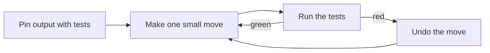

## Hook

Picture a messy bedroom. You want to tidy it, but your little brother keeps his game saves on a sticky note somewhere in the mess. If you throw away the wrong paper, his saves are gone.

So you work carefully. First you photograph where everything is. Then you move one thing at a time and check the photo. Tsunade's invoice code is that bedroom. Riders' bills must not change by a single character while you tidy it.

## Concept

### What refactoring is

```callout jargon
**Refactoring** means changing the structure of code (its names, methods and classes) without changing what it does. The inputs and outputs stay exactly the same. Only the inside gets easier to read and change.
```

Adding a feature changes behaviour. Fixing a bug changes behaviour. Refactoring never does. Keep these jobs separate. Do one, check it, then do the other.

### Step one: pin the current behaviour

You cannot prove "nothing changed" without a record of how it was before.

```callout jargon
A **characterization test** records what the code does today, right or wrong. A **golden master** is one kind: it saves the whole output for some inputs and compares every later run against it, character by character.
```

The trick is simple. Run the old code. Copy its exact output into the test as the expected value. The test passes at once, because it describes the code as it is.

```java run
import java.util.List;

public class Main {
    public static void main(String[] args) {
        String expected = "B-1042: $2.80\nB-2001: $14.50\n";
        String actual = receipt(List.of("B-1042", "B-2001"), List.of(280L, 1450L));
        System.out.println("Same as before? " + expected.equals(actual));
    }

    static String receipt(List<String> bikes, List<Long> cents) {
        String out = "";
        for (int i = 0; i < bikes.size(); i++) {
            long c = cents.get(i);
            String d = String.valueOf(c % 100);
            if (d.length() == 1) {
                d = "0" + d;
            }
            out = out + bikes.get(i) + ": $" + (c / 100) + "." + d + "\n";
        }
        return out;
    }
}
```

Try it: change `"0" + d` to `d` and run again. One missing zero makes the check print `false`. That is the B-1042 bug from Tsunade's ticket.

```callout tip
Pick inputs that reach every branch: each membership, each bike type, an empty list and an error. A branch the golden master never runs is a branch it cannot protect.
```

### Step two: tiny steps, test after each

Make one small move. Run the tests. If they pass, keep going. If they fail, undo that one move and try again smaller. Never stack ten changes and then test, because you will not know which one broke it.



### Code smells

```callout jargon
A **code smell** is a sign in the code that something could be shaped better. It is not a bug. It points you to the refactoring move that helps.
```

| Smell | What you see | Move that helps |
|---|---|---|
| Unclear name | `t`, `c`, `d`, `r` | Rename |
| Long method | One method does five jobs | Extract method |
| Hard expression | A long calculation on one line | Extract variable |
| Magic number | `30` or `100` with no name | Replace magic number with constant |
| Needless middle step | A variable or method that only passes a value on | Inline |
| Type switch | The same `if` on a type in many places | Replace conditional with polymorphism |
| Long parameter list | Four values that always travel together | Introduce parameter object |

### More smells you will meet

These five come up in almost every code review. Each has a usual fix.

| Smell | What you see | Usual fix |
|---|---|---|
| Duplicated code | The same lines pasted in two or more places | Extract method, then call it from each place |
| Feature envy | A method that mostly reads another class's fields | Move method into the class it envies |
| God class | One huge class that knows and does everything | Extract class: split it by responsibility |
| Shotgun surgery | One small change forces edits in many classes | Move the scattered pieces into one class |
| Primitive obsession | Ids as bare `String`s everywhere, money as a bare number | Introduce a small type, such as `record BikeId(String value)` |

```callout tip
A small type like `BikeId` lets the compiler stop you from passing a rider id where a bike id belongs. A bare `String` cannot. Spoke keeps fares as plain `long` cents to keep lessons short; big codebases often wrap them in a `Money` type.
```

### Syntax: rename

Give a thing a name that says what it holds.

```java nocompile
long t = 0;          // before
long totalCents = 0; // after
```

### Syntax: extract variable

Give part of an expression a name.

```java nocompile
// before
long c = 100 + Integer.parseInt(r[2]) * 15;
// after
int minutes = Integer.parseInt(r[2]);
long c = 100 + minutes * 15;
```

### Syntax: extract method

Move a block into its own method with a clear name. The old spot calls the new method.

```java nocompile
// before
String d = String.valueOf(c % 100);
if (d.length() == 1) {
    d = "0" + d;
}
out = out + "$" + (c / 100) + "." + d;

// after
out = out + money(c);

static String money(long cents) {
    String pennies = String.valueOf(cents % 100);
    if (pennies.length() == 1) {
        pennies = "0" + pennies;
    }
    return "$" + (cents / 100) + "." + pennies;
}
```

Now the same money code can serve the ride lines and the total. Copy-paste is gone.

### Syntax: inline

Inline is the reverse of extract. If a variable or method adds nothing, put its value back where it was used.

```java nocompile
// before
long result = UNLOCK_FEE_CENTS + minutes * rate;
return result;
// after
return UNLOCK_FEE_CENTS + minutes * rate;
```

### Syntax: replace magic number with constant

```callout jargon
A **magic number** is a number in code with no name. A reader has to guess what `100` means.
```

```java
public class Main {
    private static final long UNLOCK_FEE_CENTS = 100;
    private static final int PLUS_FREE_MINUTES = 30;
}
```

`UNLOCK_FEE_CENTS` says what `100` was. If the fee changes, you edit one line.

### Syntax: replace conditional with polymorphism

The same `if` on the bike type appears three times in the invoice code. Polymorphism (one method, a different body per type) can replace it. An enum with a field is the smallest version.

```java
enum BikeType {
    CLASSIC(15), EBIKE(30), CARGO(25);

    private final long centsPerMinute;

    BikeType(long centsPerMinute) {
        this.centsPerMinute = centsPerMinute;
    }

    long centsPerMinute() {
        return centsPerMinute;
    }
}
```

Each type now carries its own rate. `type.centsPerMinute()` replaces the whole `if` chain.

### Syntax: introduce parameter object

When the same values always travel together, bundle them in a record.

```java nocompile
// before
static String format(String bikeId, String type, int minutes, long cents) { ... }
// after
record InvoiceLine(String bikeId, String type, int minutes, long cents) { }
static String format(InvoiceLine line) { ... }
```

### Let the IDE do it

VS Code, with the Extension Pack for Java, can do these moves for you. It also updates every caller, so it does not miss one. Select the code, then press **Ctrl+Shift+R** (the same keys on Mac and Windows) to open the **Refactor** menu. You can also right-click and choose **Refactor…**.

| Move | In VS Code |
|---|---|
| Rename | Click the name and press F2 |
| Extract method | Refactor menu, **Extract to method** |
| Extract variable | Refactor menu, **Extract to local variable** |
| Extract constant | Refactor menu, **Extract to constant** |
| Inline | Refactor menu, **Inline** |
| Introduce parameter | Refactor menu, **Introduce Parameter** |

IntelliJ IDEA has the same moves under its own **Refactor** menu.

```callout warning
An automated refactoring is safer than typing, but still run the tests after it. A rename inside a text string, or a method found by reflection, can slip past the IDE.
```

### Legacy code: seams and sprout methods

```callout jargon
**Legacy code** is code you must change but cannot easily test. A **seam** is a place where you can swap behaviour without editing the code around it, such as a constructor parameter or an interface.
```

Sometimes a giant old method has no tests, and writing them all first would take weeks. You still need to add a feature today.

Use a **sprout method**: write the new logic as a fresh, small method with its own tests. Then add one line in the old method that calls it.

```java nocompile
// inside the old 300-line invoice method, one new line:
total = total - loyaltyDiscountCents(total, membership);

// the sprout: new, small, fully tested
static long loyaltyDiscountCents(long totalCents, String membership) {
    return membership.equals("PRO") ? totalCents / 10 : 0;
}
```

The old code stays untouched apart from one line. The new code is tested from day one. Over time, each change leaves the method a little better.

## Worked example

Here is a small piece of messy e-bike fare code (30 cents a minute), then the same code after four moves. The check at the end proves the output did not change.

```java run
public class Main {
    private static final long UNLOCK_FEE_CENTS = 100;
    private static final int PLUS_FREE_MINUTES = 30;

    public static void main(String[] args) {
        String[] members = {"BASIC", "PLUS"};
        int[] minutes = {12, 45};
        for (String m : members) {
            for (int min : minutes) {
                long before = messy(min, m);
                long after = rideCents(min, m);
                System.out.println(m + " " + min + " min: " + before + " " + after + " " + (before == after));
            }
        }
    }

    static long messy(int m, String s) {
        long c;
        if (s.equals("BASIC")) {
            c = 100 + m * 30;
        } else {
            int p = m - 30;
            if (p < 0) {
                p = 0;
            }
            c = p * 30;
        }
        return c;
    }

    static long rideCents(int minutes, String membership) {
        long rate = 30;
        if (membership.equals("BASIC")) {
            return UNLOCK_FEE_CENTS + minutes * rate;
        }
        return paidMinutes(minutes) * rate;
    }

    static int paidMinutes(int minutes) {
        return Math.max(0, minutes - PLUS_FREE_MINUTES);
    }
}
```

- **Rename:** `m`, `s`, `p` became `minutes`, `membership`, `paidMinutes`.
- **Replace magic number:** `100` and the first `30` became named constants.
- **Extract method:** the "never below zero" logic moved into `paidMinutes`.
- **Inline:** the variable `c` is gone; each branch returns directly.
- The last column prints `true` for every input, so behaviour stayed the same.

## Try it

Open the run block above. Add `"PRO"` to the members and give PRO 60 free minutes in both methods. Change `rideCents` first and run. The check shows `false`, because you changed behaviour inside a refactor. Now change `messy` too, and both agree again. Feature work and refactoring are separate steps.

## Recap

- Refactoring changes structure and keeps behaviour exactly the same.
- Pin the current output with characterization tests first. A golden master passes on the old code, and that is the point.
- Make one small move, then run the tests. Undo a move that turns them red.
- Smells point to moves: rename, extract variable, extract method, inline, named constants, polymorphism and parameter objects.
- Let the IDE do the move, then still run the tests.

## Common mistakes

### 1. Fixing a bug in the middle of a refactor

```java nocompile
static String money(long cents) {
    return "$" + (cents / 100) + "." + (cents % 100);
}
```

This "tidier" helper drops the zero padding. The PLUS golden master fails, because `$0.00` turns into `$0.0`. The format test shows the same slip:

```
expected: <B-3003 | cargo | 5 min | $0.05> but was: <B-3003 | cargo | 5 min | $0.5>
```

Fix: keep the padding exactly as the old code had it. If the old output is truly wrong, fix it in a separate step with its own test.

### 2. Writing the expected text from memory

```java nocompile
String expected = "Total: $19.55";
```

The real output ends with a newline, `"Total: $19.55\n"`. The test fails on the old code before you change anything:

```
expected: <Total: $19.55> but was: <Total: $19.55
>
```

Fix: run the old code and copy its exact output into the test, newlines and spaces included.

### 3. Making a parameter object that is not a record yet

```java nocompile
public class InvoiceLine {
    public InvoiceLine(String bikeId, String type, int minutes, long cents) {
    }
}
```

This compiles, but the constructor throws the values away. Any accessor you add has nothing to return. The practice test checks the shape with `InvoiceLine.class.isRecord()` and prints:

```
InvoiceLine should be a record: public record InvoiceLine(String bikeId, String type, int minutes, long cents) ==> expected: <true> but was: <false>
```

Fix: declare it as a record, so Java stores the fields and writes the accessors for you.

```java
record InvoiceLine(String bikeId, String type, int minutes, long cents) { }
```
